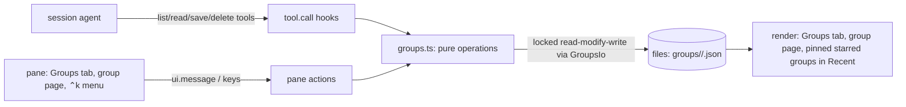
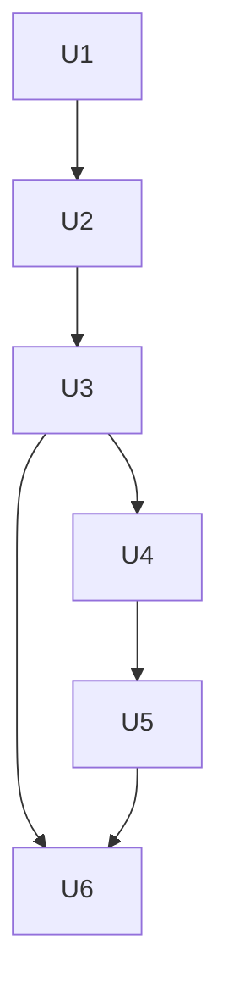

# Peek Groups - Plan

**Target repo:** shrimpshack. All paths are relative to the repo root. The live development copy at `~/.claude/mods/peek` mirrors `plugins/peek` and is synced after each unit.

---

## Goal Capsule

- **Objective:** a person working with Claude Code can open, in the peek pane, the bundles of files and links the session agent put together for them — a titled, described set with sections — come back to them in later sessions of the same project, star the ones that matter, and add what they are looking at.
- **Means:** one JSON file per group in a peek data directory, written under a cross-session lock; four agent tools beside `star`; a Groups tab and a group page in the pane (KTD1, KTD2, KTD3).
- **Authority:** this plan's Requirements set behavior; KTDs set mechanism. The engine types at `plugins/peek/.claude-plugin/types/claude-code/index.d.ts` are the authority on what a mod can do; where this plan and the types disagree, stop and report.
- **Stop conditions:**
  - Never let an agent write replace a group's whole item list (R7).
  - Never write a group file without holding its lock and re-reading it under that lock (KTD3).
  - Never keep group data inside `~/.claude/mods/peek` or a cache directory; both are deleted by routine syncs and cleanups.
  - Peek never writes to GitHub or Linear as part of any group action.
- **Execution profile:** TypeScript mod. Pure group logic in `plugins/peek/hooks/groups.ts` with `plugins/peek/tests/groups.test.ts`; file io, tools and pane behavior in `plugins/peek/tests/groups-pane.test.ts`, run with `claude plugin test`.
- **Who finishes:** `ce-work` implements and verifies; the manual pane check in the Verification Contract is done by a person.

---

## Product Contract

### Summary

Peek gains groups: named, starrable collections of files and links with a title, a description and optional sections. The session agent creates, updates and deletes them through new peek tools. The person sees them in a Groups tab and on a group page, stars them, and adds or removes items. Groups persist per project.

### Problem Frame

The agent often produces or finds several related things for one piece of work — a plan, two diagrams, the PR, its Linear issue, a docs page. Today peek can show each one and star each one, but nothing ties them together or says why they belong. They scatter across Recent among everything else the session touched, and they are gone from view in the next session unless each was starred one by one. The agent has no way to hand the person a curated, explained set to come back to.

### Requirements

**Groups and their content**

- R1. A group has a title, a description, an ordered list of sections, and items; an item sits in at most one section of a group or in the group's unsectioned top block.
- R2. An item is any file or link peek can open (local file or folder, GitHub item, Linear item, web page); the same item appears at most once in a group, with a PR URL and its issue URL counting as one.
- R3. Groups belong to the project they were made in and persist across sessions; a session in another project does not see them.
- R4. An item whose file is gone, or whose link is confirmed gone, stays in the group marked as missing rather than vanishing; a link that cannot be reached right now is marked unavailable, not missing.

**What the agent can do**

- R5. The agent can list the project's groups and read one group in full, including which items the person added.
- R6. The agent can create a group, change its title, description and sections, add, move and remove items, and delete a group.
- R7. An agent update never removes an item the person added unless the call names that exact item and passes force, and an item the person removed is not silently put back.
- R8. Deleting a starred group, or one holding items the person added, needs force; without it the agent is told what would be lost.

**What the person can do**

- R9. The person can open a Groups tab listing the project's groups and open a group as a page showing its description, sections and items.
- R10. The person can open any item from a group page, and come back to the group with back.
- R11. The person can star and unstar a group; starred groups are pinned at the top of Recent, above favourite files, up to four at a time with the rest in the Groups tab.
- R12. The person can add the item they are viewing to a group and remove an item from a group; they cannot create, rename or delete groups.
- R13. Every group action is reachable from the ⌃k menu and by keyboard, matching the footer that shows only status and ⌃k.

### Key Decisions

- **Groups persist per project.** (session-settled: user-approved — chosen over session-only groups: bundles are worth coming back to.) Governs R3.
- **A Groups tab, plus starred groups pinned in Recent.** (session-settled: user-approved — chosen over groups living only inside Recent.) Governs R9, R11.
- **The agent owns a group's shape; the person curates membership.** (session-settled: user-approved — chosen over person-created groups: groups are primarily the agent's way of presenting work.) Governs R6, R12.
- **The agent reads before it writes.** (session-settled: user-approved — chosen over a write-only agent surface: it keeps the person's additions.) Governs R5, R7.

### Scope Boundaries

- Sharing groups between people or machines.
- Groups inside groups.
- The person creating, renaming or deleting groups (agent-owned by design, R12).
- Reordering items within a section from the pane.
- Per-item notes; the group description and section headers carry the why.

#### Deferred to Follow-Up Work

- The agent starring a group or opening a group in the pane for the person.
- Telling the agent when the person changes a group; today it learns on its next read.
- Undo for a deleted group.
- Fixing stars' existing two-session overwrite (stars are written to `$.store` from an in-memory copy loaded at session start); groups avoid the defect by not using `$.store` (KTD1, KTD3), but stars keep it.
- Cleaning up group directories of projects that no longer exist.

---

## Planning Contract

### Key Technical Decisions

- KTD1. **One JSON file per group, at `~/.local/share/claude-peek/groups/<project hash>/<group id>.json`; not `$.store`.** `$.store` is one 4 MiB file shared with `stars`, `titles` and `linear`, and its types say nothing on whether a write merges one key or rewrites the file from an in-process copy, or whether `get` sees another session's write. Per-project caps cannot bound a shared file, and a full store would silently stop stars saving. Files remove all three unknowns: reads always come from disk, each project's groups sit in their own directory, and peek already writes files with an atomic replace (`plugins/peek/hooks/live.ts`). The directory is durable and outside the plugin folder, which `rsync --delete` wipes on every sync. Each file also records the raw project key, so a hash collision is detectable. Governs R3.
- KTD1b. **The project key is the output of `git rev-parse --path-format=absolute --git-common-dir`, run once in the session root and used unchanged.** Plain `--git-common-dir` prints a relative `.git` from a main checkout, which would give every main checkout the same key; resolving it by hand breaks on macOS, where git reports `/private/tmp/...` for a session root of `/tmp/...`. Outside git the key is the session root. Worktrees of one repo share groups. Governs R3.
- KTD2. **Four tools beside `star`: `list_groups`, `read_group`, `save_group`, `delete_group`.** Read tools are separate so a read never risks a write; `save_group` creates when no id is given and otherwise applies patch operations, because a create is a patch on an empty group. They stay deferred behind ToolSearch like `star`, with descriptions that carry the words an agent searches for (`peek group collection files links bundle`); `star`'s description gains one clause pointing to groups for several related things. Governs R5, R6. Source: `docs/solutions/architecture-patterns/a-skill-calling-mcp-tools-must-load-them-with-toolsearch-first.md`.
- KTD3. **Every group write takes a lock, re-reads, applies, and replaces the file atomically.** Sequence: `mkdir <group>.lock` (succeeds for exactly one caller across all sessions), read the file, apply the operation, write a staged file, `mv -f` it over the group file (readers see the old or the new file, never a partial one), `rmdir` the lock. A lock older than 10 s is broken; a lock still held after 2 s of retries refuses the write with "busy, try again". Within one process, writes also queue per group so a pane action and a tool call never race each other for the lock. This closes the same-group race: two writers can no longer both read the old group and the later one erase the earlier one's change. Governs R3, R7.
- KTD4. **Agent writes are operations, never a whole-list replace.** `save_group` takes title/description changes, section operations (add, rename, remove, reorder) and item operations (add, move, remove); there is no "set items". With KTD3's lock, every operation applies to the latest saved group. Governs R7.
- KTD5. **Item identity is the canonical href, deduped by `itemKey`; a file inside the repo is stored relative to the repo root.** The agent's target runs through the same normalisation `star` uses (`toHref`, then `remoteRef(..).address`), and equality is `itemKey`, so `owner/repo#12`, the PR URL and the issue URL are one item. A local file inside the session's repo is stored as a repo-relative path and resolved against the current session's worktree when rendered or opened, so a group made in one worktree opens that worktree's sibling's copy and survives the first worktree's removal; files outside the repo keep absolute hrefs. Each item records `addedBy` (`agent` or `person`) and an optional label. Governs R2, R5.
- KTD6. **A person's removal leaves a tombstone, and the person's items need `force` to remove.** Removing an item through the pane records its key on the group; a later agent add of that key is skipped and reported unless the call passes `force`. An agent `remove` of a person-added item is refused the same way, since the agent may be working from an older read. Governs R7.
- KTD7. **Group and section ids are opaque short ids, never slugs of titles.** Renames change titles only, so stars and agent references survive and an old slug cannot mislead the agent. A create, or a rename, whose title matches another group in the project (case-insensitive) is refused and returns that group's id, which makes create retries safe. Governs R1, R6.
- KTD7a. **An item has one place per group; person-added items go to the unsectioned block.** Identity inside a group is the item key alone, so remove and tombstones never need a section. An agent add of an item already in another section reports where it is and moves it only through an explicit move. The same item may sit in many groups. Governs R1, R2.
- KTD8. **A group's star is a field on the group, not an entry in the `stars` list.** Stars hold file and link hrefs; a pseudo-href would leak into every place that reads stars as hrefs, and across projects. Deleting a group removes its star with it. Governs R11.
- KTD9. **Hard caps enforced in code, and group write failures are reported, never swallowed.** Caps: 50 groups per project, 200 items and 20 sections per group, 100 tombstones per group (oldest dropped), 500 characters for a description and 200 for a label. A group file stays far under the 4 MiB `fs.read` limit at these caps. A failed `mkdir`, write or `mv` becomes tool error text for the agent and a toast for the person — never "Added". Governs R6.
- KTD10. **The pane re-reads group files from disk on every render of a group screen and before every write.** There is no change event, so this is how a pane sees another session's changes. A write to a group whose file no longer exists is refused ("That group was deleted") and the pane returns to the Groups tab. Same-session tool writes invalidate the pane so it redraws at once. Governs R3, R9.
- KTD11. **The Groups tab is a new `Mode` on the free key `e`; the open group lives in its own `openGroup` atom.** `g` is Gallery and the list and view keys are taken. The atom holds the group id and the selected item's key — not its position, since another session may add or remove items between renders; if the key is gone, selection falls to the nearest remaining row in reading order. The atom survives `show` and backs a "Back to <group>" step (`b` and ⌃k) after an item was opened from a group page; pressing `e` on a group page returns to the list. Group items render with the existing row list and hover layer, but not through `sessionEntries`, which drops files it cannot stat. Governs R9, R10.
- KTD12. **On a group page `f` stars the selected item, as everywhere else; a group is starred with `f` on its card or through ⌃k.** One meaning per key per screen. Group cards post their own hover-layer payloads (`openGroup`, `starGroup`) so `setStar` and `show` never see a group. Governs R11.
- KTD13. **Remote items of the open group join the background refresh set; an agent label shows until a title is cached.** `tickRemote` already refreshes mentions and stars; only the open group's remote items are added, since group cards elsewhere show no item titles. `read_group` returns `title: null` for an uncached item so the agent never mistakes a key for a title. Governs R4, R9.
- KTD14. **Missing means confirmed gone; anything else is unavailable.** A local file is missing when `stat` says it does not exist. A remote item is missing when its latest refresh returned not-found or gone (404, 410, or the source's equivalent); a timeout, network error, auth failure or rate limit marks it unavailable, with its own marker, and it is not counted as missing. `read_group` returns `state: ok | missing | unavailable` per item. An agent add of a local file that does not exist at call time is rejected; missing covers only files that vanish later. Governs R4.

### High-Level Technical Design

Components and data flow:



Group file (directional, not a schema):

```text
Group    { projectKey, id, title, description, starred, updatedAt,
           sections: [ { id, title } ],
           items:    [ { ref, section?, addedBy: agent|person, addedAt, label? } ],
           removed:  [ itemKey ] }
ref = repo-relative path | absolute file href | canonical remote address
```

One write, from the agent or the pane:

```mermaid
sequenceDiagram
  participant W as writer (tool hook or pane action)
  participant M as groups.ts
  participant D as disk
  W->>W: normalise each target to a canonical ref
  W->>D: mkdir <id>.lock (retry up to 2 s; break if older than 10 s)
  W->>D: read <id>.json
  W->>M: apply operations
  M-->>W: new group + per-target outcomes (added, already there, skipped: removed by person, rejected)
  W->>D: write staged file, mv -f over <id>.json
  W->>D: rmdir <id>.lock
  W-->>W: summary line + compact JSON for the agent, or a toast for the person
```

### Assumptions

- `$.fs.write` and `$.process.run` accept absolute paths outside the session root (the types say so; peek already writes its scratch and cache this way).
- `mkdir` and `mv -f` on one local filesystem are atomic on macOS, which the existing live-view frame writer relies on.
- The person's "current item" for adding to a group is the page open in view mode, or the selected entry in Recent, Gallery, a folder or a group page. The `..` row, error views and the live view cannot be added.
- Flow analysis behind the navigation and data rules: `/tmp/compound-engineering-501/ce-plan-research/b8ad390b/spec-flow.md` (scratch, not durable).

### Sources & Research

- Star tool path, store load/write, and the capture hook's `mcp__(?!peek__)` exclusion: `plugins/peek/hooks/register.tsx` (`session.start`, `tool.call` for `mcp__peek__star`, `setStar`).
- Staged write + atomic replace: `plugins/peek/hooks/live.ts` (`mkdir -p`, `mv -f`).
- Recent/Gallery builders, `sessionEntries`, `navOrder`/`cursorAtom`, hover layer and `ui.message` chain: `plugins/peek/hooks/register.tsx`, `plugins/peek/hooks/hover-layer.tsx`.
- Pure helper patterns (`toggleStar`, `selectEntries`, `nextOf`): `plugins/peek/hooks/lib.ts`, tests in `plugins/peek/tests/lib.test.ts`.
- Tool, file and process test patterns: `plugins/peek/tests/pane.test.ts` (star tool, `fs.write`), `plugins/peek/tests/media-pane.test.ts` (`process.run` argv capture).

---

## Implementation Units



### U1. Group model and operations

**Goal:** a pure module that holds the group data shape and every operation on it.

**Requirements:** R1, R2, R4, R6, R7, R8; KTD4, KTD5, KTD6, KTD7, KTD7a, KTD9.

**Dependencies:** none.

**Execution note:** test-first; break each operation once and confirm a test fails.

**Files:**
- `plugins/peek/hooks/groups.ts` (new)
- `plugins/peek/types/index.d.ts` (group types)
- `plugins/peek/tests/groups.test.ts` (new)

**Approach:**
1. Types for group, section and item, all JSON-serialisable; ids are opaque short ids (KTD7).
2. Operations as pure functions from a group plus input to a new group plus outcomes: create, set title/description, section add/rename/remove/reorder, item add/move/remove, star, delete check. Item refs come in already canonical; equality uses `itemKey`.
3. Removing a section moves its items to the unsectioned block; removing an item as the person records a tombstone; an agent add of a tombstoned key, or an agent remove of a person-added item, is refused unless forced.
4. Caps per KTD9 return a refusal outcome, never throw.

**Patterns to follow:** `toggleStar`, `selectEntries` and `nextOf` in `plugins/peek/hooks/lib.ts` (immutable in, new value out, caps as defaults).

**Test scenarios:**
- Create with two sections and five items returns stable group and section ids; items sit in the right sections.
- Create with a title matching an existing group (case-insensitive) is refused and returns the existing id; so is a rename to another group's title.
- Adding an item already present is a no-op reported as already there; adding one that sits in another section reports that section and leaves it there; an explicit move moves it.
- Adding `…/pull/42` then `…/issues/42` of the same repo leaves one item.
- Renaming a group or section keeps every id.
- Removing a section moves its items to the unsectioned block.
- A person's removal leaves a tombstone; an agent add of that item is skipped and reported; with force it is added and the tombstone cleared.
- An agent remove of a person-added item is refused without force and names the item.
- Deleting a starred group, or one with a person-added item, is refused without force and names the star and the person's items; with force it is allowed.
- At each cap the operation is refused with a clear reason and the group is unchanged; past 100 tombstones the oldest is dropped.

**Verification:** every operation and outcome above is covered by pure tests with no engine.

### U2. Group files, locking and the agent tools

**Goal:** the agent can list, read, create, update and delete the project's groups through four tools, and every write is safe across sessions.

**Requirements:** R3, R4, R5, R6, R7, R8; KTD1, KTD1b, KTD2, KTD3, KTD5, KTD9, KTD10, KTD14.

**Dependencies:** U1.

**Execution note:** test-first.

**Files:**
- `plugins/peek/hooks/groups.ts` (file port `GroupsIo`: list, read, locked write, delete; project key)
- `plugins/peek/hooks/register.tsx` (project key at session start, tool registration, four `tool.call` hooks, `star` description clause)
- `plugins/peek/tests/groups-pane.test.ts` (new)

**Approach:**
1. Resolve the project key once per session (KTD1b) and the project directory from its hash.
2. Implement the locked write of KTD3 through an io port that takes `fs` and `process.run` calls, since the engine handle cannot cross an import; queue writes per group inside the process. Listing reads only the `<id>.json` files in the project directory — never lock directories or staged files — and skips files whose recorded project key differs.
3. Tool inputs are validated by hand like `star`; each target goes through the `star` normalisation, then KTD5's repo-relative rule, before U1 sees it. A local file that does not exist is rejected; other unresolvable targets are rejected per item while the rest apply (KTD14).
4. Results are one plain summary line followed by a compact JSON block with ids, items (ref, title or `null`, label, section, addedBy, state) and per-target outcomes; `list_groups` returns summaries only. A failed lock, write or replace returns error text (KTD9). Same-session writes invalidate the pane (KTD10).
5. The four tool names must not be caught by the generic capture hook.

**Patterns to follow:** the `star` registration and `tool.call` hook in `plugins/peek/hooks/register.tsx`; io ports such as `remoteIoOf`; the staged write in `plugins/peek/hooks/live.ts`.

**Test scenarios:**
- `save_group` with mixed targets (repo file, relative path, PR URL, Linear key, web URL) creates a group; `read_group` returns every item with `addedBy: agent` and the repo file as a repo-relative ref.
- A batch with one nonexistent file adds the others and rejects that one with its reason.
- Each write runs `mkdir` lock, write, `mv -f`, `rmdir` in that order (checked through the captured `process.run` argv).
- Two interleaved writes to one group — a pane add and an agent save, the second started while the first holds the lock — both land in the final file.
- A lock directory older than 10 s is broken and the write proceeds; a fresh lock held past 2 s refuses with "busy".
- A failing `mv` makes `save_group` return an error, and nothing reports the item as added.
- A main checkout and a linked worktree of one repo resolve to the same project key; a group saved under one project key is absent from `list_groups` under another.
- `delete_group` on a starred group without force is refused; with force the file is gone.
- A peek tool call is not recorded by the capture hook.

**Verification:** the tool round-trips are covered by pane tests that call `$.tool.call` and check the written files and argv. These tests prove the logic and the call order; real cross-session behavior is proven by the manual check in the Verification Contract.

### U3. Groups tab

**Goal:** the person sees the project's groups in a Groups tab.

**Requirements:** R9, R13; KTD10, KTD11, KTD12.

**Dependencies:** U2.

**Files:**
- `plugins/peek/hooks/register.tsx` (`Mode`, `MODES`, header tabs, ⌃k entry, list-mode render branch)
- `plugins/peek/hooks/theme.ts` (group icon)
- `plugins/peek/types/index.d.ts` (`Mode`)
- `plugins/peek/tests/groups-pane.test.ts`

**Approach:**
1. Widen the `Mode` union and every place that checks it (types, `MODES`, the tab message check, header chip widths, menu entries, the list-mode branch).
2. Render groups as cards (title, description first line, item count, starred mark), starred first then most recently updated, through the existing card grid and hover layer; group cards post `openGroup` and `starGroup` so a click opens and the hover star stars the group (KTD12). `f` on a selected card stars it.
3. Hotkey `e` and a ⌃k entry (KTD11); an empty state explains that the agent makes groups. Status line: `N groups · M starred`.
4. The fourth header chip must fit: under 60 columns there are no tabs (hotkey and ⌃k only); between 60 and 75 the crumb shortens before chips overflow.

**Patterns to follow:** the Gallery branch and `cardGrid` in `plugins/peek/hooks/register.tsx`.

**Test scenarios:**
- After the agent creates two groups, the Groups tab lists both, starred one first.
- Clicking a group card opens its group page; the hover star stars it.
- With no groups, the tab shows the empty-state line.
- The tab is reachable from the header, the `e` key, and ⌃k.
- At 60, 70 and 100 columns the header draws all tabs without overflow.

**Verification:** pane tests mount the Groups tab and drive it with pointer and keys.

### U4. Group page

**Goal:** a group opens as a page showing its description, sections and items, and each item opens.

**Requirements:** R1, R4, R9, R10; KTD5, KTD7a, KTD10, KTD11, KTD13, KTD14.

**Dependencies:** U3.

**Files:**
- `plugins/peek/hooks/register.tsx` (`openGroup` atom, group page render branch, back step, refresh set)
- `plugins/peek/tests/groups-pane.test.ts`

**Approach:**
1. The open group is held in the `openGroup` atom (id + selected item key); the page re-reads the group file on each render, and a deleted group returns to the Groups tab with a toast (KTD10).
2. Header: title and description. The unsectioned block comes first, then each section header with its items as rows (icon, cached title else the agent's label else the file name or address). Empty sections show their header with "empty"; an empty group says "No items".
3. Items are checked one by one, not through `sessionEntries`. Repo-relative refs resolve against the current worktree (KTD5). A missing item stays as a dimmed, selectable, removable row marked missing; an unavailable remote item gets its own marker (KTD14); opening a missing file says the file is gone.
4. `j`/`k` move through items across sections in reading order; headers are not selectable. Opening an item keeps `openGroup`, and `b` or ⌃k "Back to <title>" returns to the page with the same item selected.
5. The open group's remote items join the background refresh set (KTD13). Status line: `<title> · N items · K missing`.

**Patterns to follow:** `rowList` and the folder listing's rows in `plugins/peek/hooks/register.tsx`; `openFromPage`/`goBack`.

**Test scenarios:**
- A group with two sections shows the description, both headers and items under the right header.
- An item whose file was deleted shows as missing, stays selectable, and can be removed.
- A remote item whose refresh returns 404 shows as missing; one whose refresh times out shows as unavailable and is not counted in the status line's missing count.
- A repo-relative item added in worktree A opens worktree B's copy when the session runs in B.
- Opening an item then pressing back returns to the group page with the same item selected; if another write removed that item meanwhile, the nearest row is selected.
- A remote item with no cached title shows the agent's label, then its title after refresh.
- When the open group's file is gone at the next render, the pane returns to the Groups tab.

**Verification:** pane tests open a group page and an item from it.

### U5. Person actions: star, add, remove

**Goal:** the person can star a group and add or remove items, from the ⌃k menu and keys.

**Requirements:** R7, R11, R12, R13; KTD6, KTD8, KTD9, KTD10, KTD12.

**Dependencies:** U4.

**Files:**
- `plugins/peek/hooks/register.tsx` (⌃k entries, key bindings, `ui.message` handlers)
- `plugins/peek/tests/groups-pane.test.ts`

**Approach:**
1. `f` on a group card and ⌃k "Star this group" (on the card or the group page) star or unstar the group; on the group page `f` stars the selected item (KTD12).
2. For the current item (view mode) or the selection (list modes), ⌃k lists "Add to group: <title>" for groups that lack it and "Remove from group: <title>" for groups that hold it. At most 8 rows, recently updated groups first; the rest are reached by typing in the menu. Added items go to the unsectioned block (KTD7a).
3. On a group page, ⌃k "Remove from this group" removes the selected item and leaves a tombstone (KTD6).
4. All person actions call the same U2 write path as the tools, with `addedBy: person`; each ends in a toast ("Added to <title>", "Already in <title>", or the refusal), since the footer shows no buttons. A write to a deleted group is refused (KTD10).

**Patterns to follow:** the `star` entry and conditional spreads in the ⌃k `commands` array; the `ui.message` chain.

**Test scenarios:**
- Starring a group from its page marks it starred in the Groups tab.
- Adding the current item to a group shows it on the group page; `read_group` reports `addedBy: person`.
- After the person removes an agent item, an agent re-add is skipped and reported.
- An agent update after the person added an item keeps that item.
- "Remove from group" appears only for groups containing the current item.
- On Recent, adding acts on the selected entry; on the `..` folder row no add rows appear.
- With 12 groups, the menu shows 8 add rows and finds the others by typing.

**Verification:** pane tests drive each action through ⌃k and keys and read the result back through the tools.

### U6. Starred groups in Recent, docs and vocabulary

**Goal:** starred groups sit at the top of Recent, and the README and glossary describe groups.

**Requirements:** R11; KTD8, KTD12.

**Dependencies:** U3, U5.

**Files:**
- `plugins/peek/hooks/register.tsx` (Recent: pinned starred groups above Favourites)
- `plugins/peek/README.md`
- `CONCEPTS.md` (Group entry in the Peek section)
- `plugins/peek/tests/groups-pane.test.ts`

**Approach:**
1. Recent shows a STARRED GROUPS block above FAVOURITES for this project only, using the same cards as the Groups tab; the block ignores Recent's scope and role filters and shows at most 4 cards, the rest reachable through the Groups tab.
2. Pinned cards join Recent's keyboard order before Favourites; `o` or a click opens the group page, `f` unstars the group (KTD12).
3. README gains a Groups section: what they are, that the agent makes them, how to star, add and remove, that they are per project, and where the files live.

**Test scenarios:**
- A starred group appears above Favourites in Recent; `f` on it unstars it and it leaves the block.
- With 6 starred groups, Recent shows 4.
- Deleting a starred group with force removes it from Recent.

**Verification:** pane tests for the pinned block; README and CONCEPTS.md updated.

---

## Verification Contract

| Check | Command or step | Applies to |
|---|---|---|
| Manifest and hooks validate | `claude plugin validate plugins/peek` | U1-U6 |
| Type-check | `npx -y -p typescript@5.6 tsc -p plugins/peek` (a clean run prints nothing; read the exit code) | U1-U6 |
| Tests | `claude plugin test plugins/peek` | U1-U6 |
| Manual pane check | in a real session, ask the agent to group a plan, a PR and a web page with two sections; star it; add the current file; check it in Recent | U2-U6 |
| Manual cross-session check | with two sessions of one project open together: create a group in the second, add an item to it from the first's pane, then open a third, new session and confirm the group holds both the agent's and the person's items; open a session in another project and confirm the group is absent | U2, U5 |

---

## Definition of Done

- Every requirement (R1-R13) is met and covered by the unit tests listed.
- Validation, type-check and the full test suite pass.
- A person has done both manual checks.
- No code from abandoned approaches remains in the diff.
- `plugins/peek/README.md` and `CONCEPTS.md` describe groups, and the live copy at `~/.claude/mods/peek` matches `plugins/peek`.
