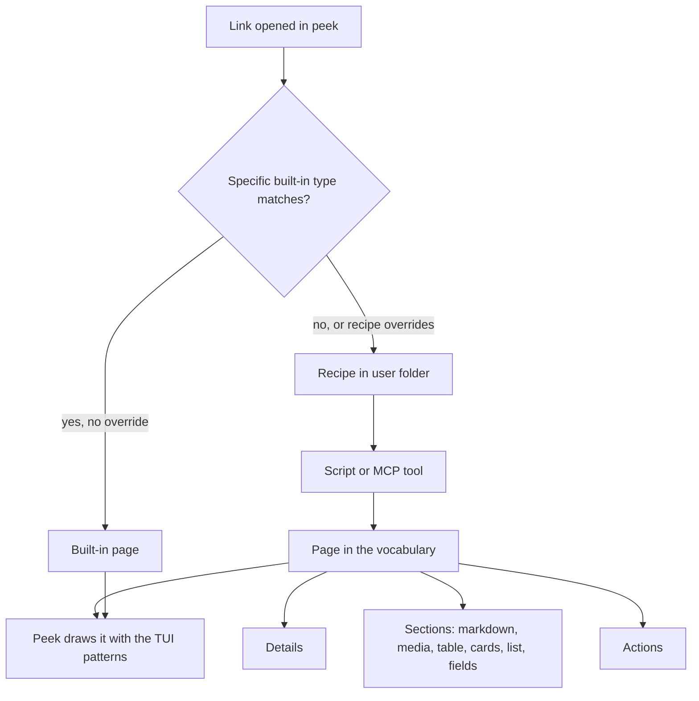
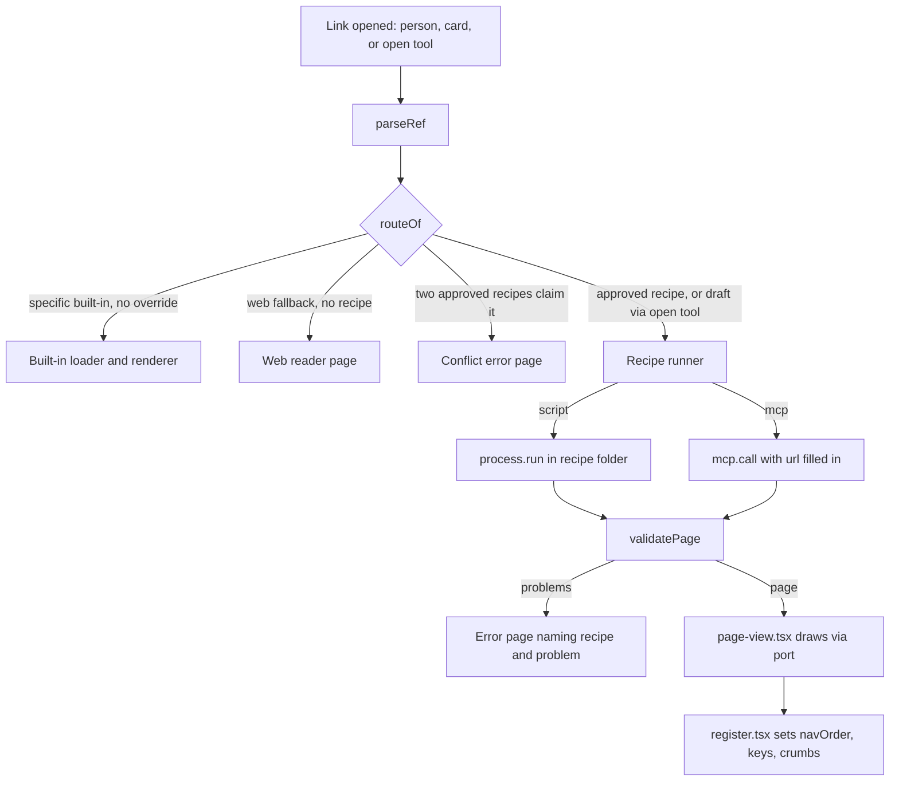
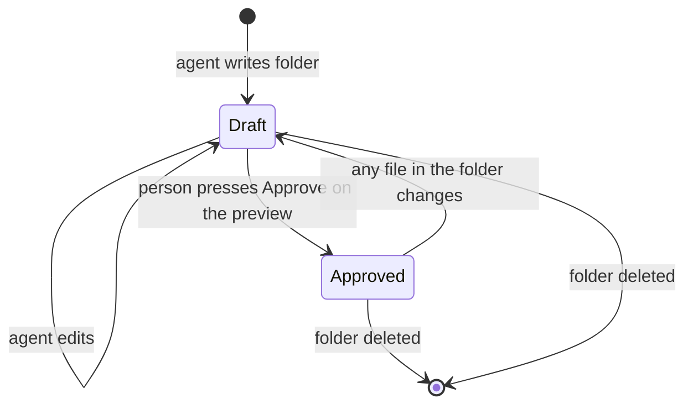
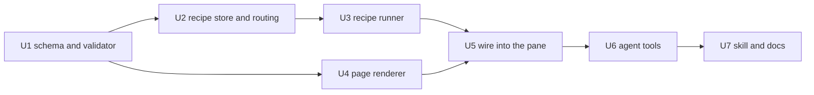

# Peek Page Vocabulary and Recipe Skill - Plan

## Goal Capsule

- **Objective:** An agent can give peek a readable, navigable page for a document type peek has never seen. The page works in every session of that user, and adding the type edits no peek file and needs no peek release.
- **Means:** A closed page vocabulary inside peek, user-level recipes that return pages in it, person-only approval, and a skill shipped with peek that teaches the agent the whole loop (KTD1–KTD9).
- **Product authority:** Shawn. The Product Contract wins on behaviour; Key Technical Decisions win on mechanism. New top-level tabs, sharing recipes, recipes for local files, and moving the built-in pages onto the vocabulary are not active scope.
- **Open blockers:** None. This work lands after PR #102 (Slack threads as pages) merges, rebased onto `main`.
- **Execution profile:** Test-first per unit with observed red, pane tests through `claude-code/testing`, then a live look in a real session after `/reload-plugins`.
- **Stop conditions:** Stop and ask Shawn if a mod plugin cannot ship a skill at runtime and the fallback in KTD9 is not enough, if the approval press cannot be proven to come from the person (KTD7), or if a settled decision proves infeasible.
- **Who finishes:** `ce-work` implements and verifies; Shawn approves the fresh-agent eval page and the PR.

---

## Product Contract

### Summary

Peek gets a named page vocabulary: Page, Section, Card, List, Details and Action, built from a fixed set of block types, with the same keyboard and menu behaviour on every page. A new document type is a recipe in the user's folder. The recipe names the links it handles and a script or MCP tool that returns a Page in the vocabulary. A skill shipped with peek teaches an agent the vocabulary, then the recipe, then how to prove the page works.

### Problem Frame

Peek gains a new page kind about once a session: Linear, GitHub and web pages, the live browser, groups, and Slack threads on a separate branch. Each one re-did the same work by hand in `plugins/peek/hooks/register.tsx`. That work covers a new branch in the render function, card grids, row lists, the hover layer, ⌃k entries, the status line and a test world. The remote-pages plan set the rule "`register.tsx` only dispatches and draws" when the file was about 1,900 lines. It is now 3,965 lines. The building blocks every page reuses (`cardGrid`, `rowList`, `mediaBlock`, `markdownChunks`, `header`, `footer`, `frame`) are closures inside one render function, so nothing outside that function can use them.

Shawn wants to name a document type nobody has thought of yet and have an agent build its page correctly. Today that means a peek code change, a commit and a sync for every type.

### Key Decisions

- **Page types only.** The vocabulary covers things you open in the pane, not new top-level tabs or screens. Governs R1, R6. (session-settled: user-approved — chosen over page types plus tabs, and over anything in the pane: it covers the stated need with the smallest kit.)
- **A closed, named vocabulary, not open drawing.** A recipe composes pages from the vocabulary and cannot draw its own layout. As a result, every page behaves like the rest of peek, and `register.tsx` stops growing per type. Governs R1, R2, R3. (session-settled: user-directed — chosen over a loose list of body blocks: Shawn asked for clear block types, TUI patterns and concepts such as Pages, Cards and Lists.)
- **Shared layout with selectable blocks.** Governs R2. (session-settled: user-approved — chosen over shared layout only, where types that do not suit markdown look flat, and over fully custom pages, which recreate the `register.tsx` problem.)
- **Recipes live outside peek, global to the user.** Governs R6, R7, R11. (session-settled: user-directed — chosen over code inside peek's repo: Shawn wants new types to work across all his sessions without a release, initially for him alone.)
- **Done means a built-in check and the person's approval.** Governs R13, R14. (session-settled: user-directed — chosen over check plus a live capture alone, and over sign-off alone.)
- **Specific built-in page types win link conflicts by default; the generic web page does not.** Governs R8. (session-settled: user-approved — proposed with the risk that a recipe silently replaces the GitHub page.)
- **Actions only open or copy.** Peek stays read-only: no Action changes an outside system. Governs R17. (session-settled: user-approved — chosen over letting an Action re-run the recipe's source with an argument, which would let a menu key close a ticket or post a comment.)
- **Overlapping recipes are refused when built.** Governs R19. (session-settled: user-approved — chosen over newest recipe wins with a warning.)
- **Recipes go live only when the person approves them in the pane.** An edit returns a recipe to draft. Governs R14, R21. (session-settled: user-approved — chosen over approval in chat only, where a later agent edit goes live unseen, and over a read-only-name filter on MCP tools, which catches mistakes but not edits.)
- **Only opening, refreshing or an opted-in timer runs a recipe's source.** Governs R22. (session-settled: user-approved — chosen over letting groups, stars and the link list load recipe pages to show titles, which would run scripts on display.)
- **A failing recipe never falls back.** Governs R10. (session-settled: user-approved — chosen over showing a captured copy or the generic web page, which would hide the error page.)
- **Recipes match web links only in this work.** Governs R7. (session-settled: user-approved — local files are deferred, since peek has no route for them today.)
- **Recipes load on demand.** Governs R9. (session-settled: user-approved — proposed because the 60-second on-screen refresh would run an API- or model-backed script every minute.)

### Requirements

**Page vocabulary**

- R1. Peek defines a closed page vocabulary with six concepts: Page, Section, Card, List, Details and Action.
- R2. A Page has a title, optional Details, an ordered set of Sections, and optional Actions. Each Section holds one block of a supported type: markdown, media, table, cards, list or fields.
- R3. Every page drawn from the vocabulary gets peek's TUI patterns without the recipe asking for them. These are arrow-key movement between items, enter to open, every Action in the ⌃k menu with a key, the hover star on openable items, breadcrumbs, the status line, and the pane's image budget.
- R4. A Card or List item can open a link or a file. A link routes like any link in peek, so it can land on a built-in page or on another recipe's page.
- R16. Arrow keys move through one ordered list of selectable items across all Sections of a Page. Cards, list items and table rows are selectable; markdown, media and fields blocks scroll with the page and do not take focus.
- R17. An Action opens a link, opens a file, or copies text. No Action changes an outside system.
- R5. Media and markdown blocks follow the rules peek already applies to remote pages: picture conversion, the image budget, mermaid diagrams, and badges kept as text.

**Recipes**

- R6. A recipe lives in a user-level folder, loads in every session and project of that user, and survives peek updates and reinstalls.
- R7. A recipe declares which web links (http or https) it handles and one data source: a script peek runs, or an MCP tool peek calls. The source returns one Page in the vocabulary.
- R8. When a link matches both a specific built-in page type (GitHub, Linear, Slack) and a recipe, the built-in type wins unless the recipe declares that it overrides that type. The generic web page is a fallback: any matching recipe wins over it.
- R9. A recipe page loads when opened and reloads when the person refreshes it. It refreshes on a timer only when the recipe opts in.
- R10. When a recipe's source fails, times out, or returns something outside the vocabulary, peek shows an error page that names the recipe and the problem, never a captured copy or the generic web page.
- R18. While a recipe's source runs, peek shows a loading page that names the recipe. During a manual refresh the previous page stays visible with a refreshing marker. A Page or Section with no items shows a one-line empty message.
- R11. A new or edited recipe takes effect on the next open or plugin reload, without reinstalling peek.
- R21. A recipe is a draft until the person approves it from the pane. Normal link routing ignores draft recipes; the agent's open tool can preview a draft, marked unapproved. Any change to a recipe's files returns it to draft. An agent cannot record an approval.
- R22. Only opening a recipe page, refreshing it, or a recipe's opted-in timer runs its source. Groups, stars and the conversation's link list show a cached title or the bare link.

**Skill and verification**

- R12. Peek ships a skill that teaches the vocabulary first (concepts, block types, TUI patterns, each with an example), then how to write a recipe.
- R13. Peek provides a built-in check that runs a recipe against a sample link. The check reports whether the recipe matched the link, whether the source answered, and whether every returned element is in the vocabulary and drawable.
- R19. The built-in check fails a recipe whose links overlap those of an existing recipe, and names the other recipe.
- R20. Peek registers a tool an agent calls to open a link in the pane through normal routing. R14's open step uses this tool.
- R14. The skill's definition of done is three steps: the check passes on a real sample, the agent opens the page in the pane, and the person approves it in the pane (R21). The agent does not report the type as done before the approval.
- R15. The vocabulary's terms are defined in the Peek section of `CONCEPTS.md`, so the skill, the code and the docs use the same words.



### Key Flows

- F1. An agent adds a document type
  - **Trigger:** The person asks for a page for a type peek does not handle, for example "show Figma files in peek".
  - **Steps:** The agent loads the skill, picks blocks from the vocabulary for the type, writes the recipe in the user folder, runs the built-in check on a real link, previews the draft in the pane, and asks the person to approve it there.
  - **Outcome:** Once approved, the type works in every later session. If the person does not approve, the agent revises the recipe, which stays a draft, and repeats the check.
  - **Covered by:** R6, R7, R11, R12, R13, R14, R19, R20, R21

- F2. The person opens a link a recipe handles
  - **Trigger:** A link appears in the conversation or the person opens one from a Card or List.
  - **Steps:** Peek resolves the link (R8). Only when routing picks the recipe does peek show the loading page, run the recipe's source once, and draw the returned Page.
  - **Outcome:** A page that looks and behaves like any other peek page, or the error page from R10.
  - **Covered by:** R3, R8, R9, R10, R18

### Acceptance Examples

- AE1. **Covers R8.** **Given** a recipe that matches `github.com` links and does not declare an override, **when** the person opens a GitHub PR link, **then** peek shows the built-in GitHub page. **Given** the same recipe declares an override for GitHub, **then** peek shows the recipe's page. **Given** a recipe that matches `figma.com` links, **when** the person opens a Figma link, **then** peek shows the recipe's page, not the generic web page.
- AE2. **Covers R9.** **Given** a recipe page has been on screen for five minutes, **when** the recipe has not opted into a timer, **then** its source has run once. **When** the person refreshes, **then** it runs again.
- AE3. **Covers R10.** **Given** a recipe script exits with an error, **when** the person opens a matching link, **then** the pane shows an error page naming the recipe and the error, and the rest of peek keeps working.
- AE4. **Covers R4.** **Given** a recipe returns a cards Section whose Cards link to other files, **when** the person selects a Card and presses enter, **then** that link opens through normal routing, including into another recipe's page.
- AE6. **Covers R21.** **Given** an approved recipe, **when** an agent edits its script, **then** the next time the person opens a matching link it routes as if the recipe were absent, and the agent's preview shows the page marked unapproved.
- AE7. **Covers R22.** **Given** a group holds a link an approved recipe handles, **when** the person opens the group page, **then** the recipe's source does not run; it runs when the person opens the link.
- AE5. **Covers R13, R14.** **Given** a recipe returns a block type outside the vocabulary, **when** the agent runs the built-in check, **then** the check fails and names that element, and the agent does not open the page for approval.

### Success Criteria

- A fresh agent with only the skill builds a page for a document type peek does not handle, without editing peek's source, and Shawn approves it on the first or second attempt.
- Adding that type changes no file in `plugins/peek/`.

### Scope Boundaries

- **Deferred for later:**
  - New top-level tabs or screens built from the vocabulary.
  - Recipes for local files (for example `.fig`).
  - Sharing or publishing recipes to other people.
  - One-off pages an agent pushes mid-session through a peek tool. These could reuse the same vocabulary.
- **Outside this work:**
  - Custom layouts beyond the vocabulary. A type that truly needs one goes through a peek code change, as Slack threads do.
- **Deferred to Follow-Up Work:**
  - Moving the built-in Linear, GitHub, web and Slack pages onto the vocabulary renderer, which would shrink `register.tsx`.
  - Pulling `markdownBlocks`, `mediaBlock` and `rule` out of `register.tsx` into shared modules; this work passes them to the new renderer through a port instead (KTD6).
  - A `list_recipes` tool; files in the recipe folder plus the check's overlap report cover it now.

### Dependencies / Assumptions

- A peek hooks module cannot load code at runtime: a module holding `import()` does not load. This rule is why recipes are data plus an external script or MCP tool, not code. Source: engine types `claude-code/index.d.ts:24`.
- Peek can already run processes, call MCP tools and read files under the user's home folder. See `remoteIoOf` in `plugins/peek/hooks/register.tsx:461` and the groups store under `~/.local/share/claude-peek/` in `plugins/peek/hooks/groups.ts:295`.
- Assumption, partly verified: a mod plugin can ship a skill through its manifest. `claude plugin validate` passes on a copy of peek with a `skills` folder declared, but peek is the only mod plugin in the repo, so no plugin yet shows a mod's skill loading at runtime.
- An MCP-backed recipe works only in projects where that MCP server is connected. Elsewhere it loads but shows its error page (R10).
- PR #102 (Slack threads as pages, `feature/peek-slack-threads`) inserts its link matcher in the same spot of `refs.ts` this work routes from, and changes the remote renderer and `RemoteKind`. This work rebases onto `main` after #102 merges.
- The engine says `$.mcp.call` never prompts, but the Slack branch's README says Slack MCP tools ask until always allowed. U3 tests what an MCP-backed recipe does and treats a denied call as the R10 error page.

### Sources / Research

- `plugins/peek/hooks/register.tsx`: the inline building blocks are `header` (2206), `footer` (2224), `rule` (2244), `menuFor` (2324), `frame` (2404), `groupCards` (2500), `cardGrid` (2957), `rowList` (3134), `mediaBlock` (3369) and `markdownChunks` (3436). The shared remote page renderer starts at 3343, and the local CSV table at 3747.
- Already standalone: `plugins/peek/hooks/{rows,grid,tabs,hover-layer}.tsx`.
- `plugins/peek/hooks/refs.ts`: link recognition for remote kinds.
- `plugins/peek/hooks/refresh.ts:4`: `ON_SCREEN_MS = 60_000`.
- `plugins/peek/tests/groups-pane.test.ts`: the `$.ui.mount` pane test pattern.
- `docs/plans/2026-10-08-2153-feat-peek-remote-pages-plan.md`, decision KTD10 ("`register.tsx` only dispatches and draws").
- `docs/plans/2026-10-12-1002-feat-peek-groups-plan.md`: the list of what adding a mode touched.
- `docs/solutions/architecture-patterns/a-skill-calling-mcp-tools-must-load-them-with-toolsearch-first.md`, `docs/solutions/architecture-patterns/command-and-skill-sharing-a-name.md`, `docs/solutions/security-issues/a-validator-proven-correct-and-proven-unused.md`, `docs/solutions/logic-errors/a-checks-scanner-crash-reads-as-a-clean-result.md`, `docs/solutions/performance-issues/live-frame-streaming-is-capped-by-bytes-per-second-the-sender-cannot-see.md`.

**Product Contract preservation:** changed R7, R10, R14 and added R21, R22, AE6, AE7, after Shawn chose pane approval and confirmed the plan's scoping call-outs on 2026-10-12. The Objective's wording was corrected to match Success Criteria. Planning questions moved into the Key Technical Decisions below.

---

## Planning Contract

### Key Technical Decisions

- KTD1. **Recipes are folders under `~/.local/share/claude-peek/recipes/<id>/`.** Each folder holds a `recipe.json` declaration and any script it runs. The id is the folder name and must match `^[a-z0-9-]{1,40}$` before it becomes a path. The location sits beside the groups store (`plugins/peek/hooks/groups.ts:295`) and outside the plugin, so reinstalls keep it (R6). Peek reads the folder on each link resolution, so edits apply on the next open (R11). Recipes are files the agent writes with its own tools; peek never writes `recipe.json`, so no lease lock is needed.
- KTD2. **Matching is host plus path glob, and overlap is decidable.** A recipe lists `match` entries of a host (`figma.com` or `*.figma.com`) and an optional path glob using only `*`. It may list `overrides` by family name: `github`, `linear` or `slack`. No regular expressions: two recipes overlap when a host pattern intersects and neither path glob excludes the other, which the check can decide exactly (R19). If two approved recipes still overlap at open time (hand edits), peek shows an error page naming both. This choice serves R7, R8 and R19.
- KTD3. **Routing is a pure function, and recipe pages bypass the remote loader.** A `routeOf(link, recipes)` function returns one of four routes: built-in, recipe, web fallback, or conflict. It runs after `parseRef` (`plugins/peek/hooks/refs.ts:62`): a `web` result or an overridden family hands over to the recipe. Recipe loads never enter `remote.ts` `sourceFor`/`loadItem`, whose default branch silently loads GitHub and whose failure path replays session captures, either of which would hide the error page (R10). Recipe pages get their own `View` field rather than a new `RemoteKind`, so `refresh.ts`, `isTimed` and the background tier never see them (R22).
- KTD4. **The source contract is JSON on stdout, under one runner.**
  - A script source is an argv relative to the recipe folder.
  - Peek runs it with the recipe folder as the working directory, the link as the last argument and in `PEEK_URL`, a 20 s default timeout (a recipe may raise it to 60 s), and `$.process.run`'s 4 MiB output cap.
  - An MCP source names a server, a tool and arguments, where the string `{{url}}` is replaced by the link.
  - Every outcome is typed: started-failed, exit-nonzero (with a stderr excerpt), timeout, output-truncated, not-JSON, server-not-connected, denied, invalid-page (with paths).
  - The check tool and the pane call the same runner (agent-native research: check-pass/pane-fail cases otherwise appear that only the person sees). This serves R7, R10 and R13.
- KTD5. **One Page schema and one validator, shared by every caller.** A pure module defines the Page, Section and block types and `validatePage`, which returns a page or a list of problems with JSON paths (`sections[2].block.type`). It also caps sections, items and text lengths, and accepts only `http(s)` and absolute-file hrefs. The pane's load path, the check tool and the skill's example test all call it. A test counts those production callers (`docs/solutions/security-issues/a-validator-proven-correct-and-proven-unused.md`). The same module produces the text outline the tools return. This serves R1, R2, R13 and R17.
- KTD6. **A new renderer module, fed by a port.**
  - `page-view.tsx` draws a Page and returns its tree, its focus order, its Keys and its block jumps.
  - It cannot import `$`, so `register.tsx` passes a port carrying the element table, width, theme, and its existing `markdownBlocks`, `mediaBlock`, `rule`, `fitsPane` and `openFromPage` closures.
  - The renderer writes no state: navigation data goes back to `register.tsx`, which sets `navOrder` outside the draw. This follows the engine rule that state writes are refused during a render hook.
  - Pulling those closures out of `register.tsx` is deferred.
  - This serves R2, R3, R5 and R16.
- KTD7. **Approval is a hash marker that only a person's press can write.**
  - Approving writes `<id>/.approved`, holding a SHA-256 (via `crypto.subtle`) over every file in the folder except the marker, in sorted order. Any edit changes the hash and drops the recipe to draft.
  - The Approve entry appears in ⌃k only on a draft preview.
  - Its handler records approval only when the triggering event carries `origin.kind === 'person'`, the check peek already uses at `plugins/peek/hooks/register.tsx:1807`.
  - If a ⌃k menu run cannot carry the press's origin, approval moves to a dedicated pane Button handled in a hook that sees the origin. The plan stops if neither path can prove the person pressed it.
  - This serves R21.
- KTD8. **Two deferred agent tools: `check_recipe` and `open`.**
  - Both are registered with `isDeferred: true`, so sessions that never build recipes pay no context for them.
  - Both return a first line of plain text, then JSON, matching the `save_group` result shape.
  - `check_recipe {recipe, link}` reports the winning route, the source outcome (KTD4), every problem with its path, and every overlapping recipe.
  - `open {link}` reuses the `/peek` path (`toHref` + `show`) and waits for the load to settle. It then returns the route, whether the pane was placed (`$.ui.open`'s `isPlaced`), the drawn outline or the error page text, and the page the pane showed before.
  - `open` previews a draft recipe; normal routing does not (R21).
  - This serves R13, R19 and R20.
- KTD9. **The skill ships in peek's manifest, with a fallback.**
  - `plugin.json` gains `"skills": "./skills"`, and the skill lives at `skills/peek-recipes/`. No command may share that name (`docs/solutions/architecture-patterns/command-and-skill-sharing-a-name.md`).
  - The skill loads `mcp__peek__check_recipe` and `mcp__peek__open` through ToolSearch before using them and lists them in `allowed-tools`.
  - Both tool descriptions and every failing check name the skill's file path. An agent can then recover if a mod plugin's skill does not load at runtime, which `claude plugin validate` accepts but no plugin has shown yet.
  - This serves R12 and R14.
- KTD10. **Opted-in timers refresh on screen only.** A recipe may set `refreshMinutes` of at least 5. Peek re-runs the source only while that recipe page is the one on screen, driven from the existing 15 s ticker and backing off after a failure (R9). Anything faster, or any background refresh, is refused by the validator.

### High-Level Technical Design

How a link becomes a page:



Recipe lifecycle:



Declaration and page shape, as directional sketches rather than a final spec:

```text
recipe.json
  name: "Figma files"
  match: [{ host: "figma.com", path: "/file/*" }, { host: "figma.com", path: "/design/*" }]
  overrides: []                       # any of github | linear | slack
  source: { run: ["./fetch.sh"], timeoutSeconds: 20 }
       or { mcp: { server: "figma", tool: "get_file", args: { url: "{{url}}" } } }
  refreshMinutes: 0                   # 0 = on demand only

Page (stdout of the source)
  title, details?: [{ label, value }]
  sections: [{ heading?, block }]
    block = markdown { text }
          | media { items: [{ url, alt?, kind: image|video }] }
          | table { columns, rows: [{ cells, href? }] }
          | cards { items: [{ title, meta?, href?, image? }] }
          | list  { items: [{ title, meta?, href? }] }
          | fields { rows: [{ label, value }] }
  actions?: [{ label, open: href } | { label, copy: text }]
```

### Sequencing and Parallelism



U2 and U4 can run in parallel after U1: they touch different new files, and U4's only `register.tsx` change is a port it does not wire until U5. Every other unit is sequential, because U5, U6 and U7 all edit `register.tsx` or depend on its tools.

### Assumptions

- `crypto.subtle` SHA-256 is available to a hooks module, as the engine types list it among the environment's web APIs.
- A recipe script runs with the person's own authority; approval (R21) is the only gate. This is the same authority the agent already has through Bash.

---

## Implementation Units

### U1. Page schema and validator

- **Goal:** Define the page vocabulary as data and one validator every caller uses.
- **Requirements:** R1, R2, R16, R17; KTD5, KTD10.
- **Dependencies:** None.
- **Files:** `plugins/peek/hooks/page.ts` (new), `plugins/peek/types/index.d.ts` (Page types, `View.page`), `plugins/peek/tests/page.test.ts` (new).
- **Approach:**
  1. Types for Page, Section, the six blocks and Actions, plus the recipe declaration.
  2. `validatePage` returns a page or problems with JSON paths; caps sections, items and text lengths; accepts only `http(s)` and absolute-file hrefs and `http(s)` media URLs.
  3. `validateRecipe` checks the declaration: id pattern, match entries, overrides, one source, `refreshMinutes` of 0 or at least 5.
  4. `outlineOf(page)` returns the text outline the tools use: title, each Section's block type and item count, Actions.
- **Execution note:** Test-first; each problem case starts red.
- **Patterns to follow:** pure-module style of `plugins/peek/hooks/groups.ts` (`applyGroupOps`, `GROUP_CAPS`).
- **Test scenarios:**
  - A page with one of each block type validates and round-trips unchanged.
  - Covers AE5. A section with block type `chart` returns a problem at `sections[0].block.type`.
  - A missing title, a non-array `sections`, and `null` output each return a named problem, never a valid page.
  - An href of `javascript:alert(1)` and a media URL of `file:///etc/passwd` are rejected at their paths.
  - Items above the cap are rejected with the count.
  - An Action with both `open` and `copy`, or with neither, is rejected.
  - A recipe id of `../x` or `A_B` fails `validateRecipe`; `figma-files` passes.
  - `refreshMinutes: 2` fails; `0` and `5` pass.
  - `outlineOf` lists sections in order with item counts.
- **Verification:** All scenarios pass, and each was seen red first.

### U2. Recipe store, matcher, overlap and routing

- **Goal:** Read recipes from the user folder, decide approval, and route a link.
- **Requirements:** R6, R7, R8, R11, R19, R21; AE1, AE6; KTD1, KTD2, KTD3, KTD7.
- **Dependencies:** U1.
- **Files:** `plugins/peek/hooks/recipes.ts` (new), `plugins/peek/tests/recipes.test.ts` (new).
- **Approach:**
  1. A `RecipesIo` port (list, read, stat, write, home, digest) built in `register.tsx` from `$`, like `groupsIoOf`.
  2. `loadRecipes` lists folders, validates each with U1, computes the folder hash, and marks approved when `.approved` matches. Invalid recipes are reported, not dropped silently.
  3. `matches(recipe, url)` and `overlaps(a, b)` implement KTD2.
  4. `routeOf(ref, url, recipes, { allowDraft })` returns built-in, recipe, web or conflict (KTD3).
  5. `approve(io, id)` writes the marker; the caller enforces the person-origin check (U5).
- **Patterns to follow:** `groupsIoOf` (`plugins/peek/hooks/register.tsx:1124`) and the `GroupsIo` port in `groups.ts`.
- **Test scenarios:**
  - Covers AE1. A `github.com` recipe without override → built-in for a PR link; with `overrides: ["github"]` → recipe; a `figma.com` recipe → recipe for a Figma link, which `parseRef` calls `web`.
  - A link no recipe matches → web fallback.
  - Covers AE6. An approved recipe whose script content changes → draft, and `routeOf` without `allowDraft` returns web; with `allowDraft` returns the recipe marked draft.
  - Two approved recipes on `figma.com` with `/file/*` and `/*` → `overlaps` true and `routeOf` returns conflict naming both.
  - `figma.com /file/*` against `figma.com /proto/*` → no overlap; `*.figma.com` against `www.figma.com` → overlap.
  - A folder with an invalid `recipe.json` is listed as invalid with its problems and never routes.
  - A missing recipes folder → empty list, no error.
  - The fake fs rejects reads of folders that do not exist, as the real one does.
- **Verification:** Routing matches the acceptance examples above; the conflict and draft cases are pinned.

### U3. Recipe runner

- **Goal:** Run a recipe's source once and return a validated page or a typed failure.
- **Requirements:** R7, R10; AE3; KTD4.
- **Dependencies:** U1, U2.
- **Files:** `plugins/peek/hooks/recipes.ts`, `plugins/peek/tests/recipe-run.test.ts` (new), `plugins/peek/tests/fixtures/recipes/` (new).
- **Approach:**
  1. `runRecipe(io, recipe, url)` with `run` and `mcpCall` on the port.
  2. Script: argv resolved inside the recipe folder (reject `..` escapes), cwd the folder, `PEEK_URL` env, link as last argument, `timeoutMs` from the declaration capped at 60 s.
  3. MCP: substitute `{{url}}` in string arguments, call, read text content, parse JSON. A rejected call is server-not-connected; `isError` is a tool error; a permission refusal is `denied`.
  4. Parse stdout as JSON, then `validatePage`. Truncated output is its own failure.
- **Execution note:** Test-first; a crash, a timeout, empty output and non-JSON output must each fail by name, never pass (`docs/solutions/logic-errors/a-checks-scanner-crash-reads-as-a-clean-result.md`).
- **Patterns to follow:** `runGh` in `plugins/peek/hooks/sources.ts:129` (timeout, `.catch(() => null)`, exit-code branch); the Slack branch's `tests/fixtures/slack/mcp.ts` for MCP stubs.
- **Test scenarios:**
  - A script printing a valid page → page.
  - Covers AE3. Exit code 2 with stderr `boom` → exit-nonzero failure carrying `boom`.
  - `process.run` rejecting (missing script) → started-failed, not an empty page.
  - Timeout → timeout failure naming the limit.
  - `isStdoutTruncated: true` → output-truncated.
  - Empty stdout and `not json` → not-JSON.
  - Valid JSON with an unknown block → invalid-page with the path.
  - Argv `../../bin/sh` → rejected before running.
  - The script receives the link as its last argument and in `PEEK_URL`, with the recipe folder as cwd.
  - MCP source: `{{url}}` substituted; `mcp.call` rejecting → server-not-connected; `isError` → tool error.
- **Verification:** Every failure kind has a test that was red before the branch existed.

### U4. Page renderer and focus order

- **Goal:** Draw a validated Page with peek's patterns and return its focus order and Keys.
- **Requirements:** R2, R3, R4, R5, R16, R17, R18 (empty states); KTD6.
- **Dependencies:** U1.
- **Files:** `plugins/peek/hooks/page-view.tsx` (new), `plugins/peek/tests/page-view-pane.test.ts` (new).
- **Approach:**
  1. `drawPage(port, page, state)` returns `{ tree, nav, keys, jumps }`; it writes no state.
  2. Blocks:
     - markdown and media go through the port's `markdownBlocks` and `mediaBlock`, so pictures, the image budget, mermaid and badge handling match remote pages (R5);
     - table reuses `columnWidths` and `fitCell` from `lib.ts`;
     - cards and list reuse the `grid.tsx` and `rows.tsx` client modules and the hover layer;
     - fields render as label/value rows.
  3. Focus order: one nav line per card row, list item and table row, in section order; markdown, media and fields add none (R16).
  4. Actions become `Key`s with `menu` set and hotkeys `1`–`9` assigned by peek in order; `copy` uses `$.ui.copy` through the port (R17).
  5. Empty page and empty section draw one line each (R18).
- **Patterns to follow:** `cardGrid` and `rowList` in `register.tsx` (nav lines, `item-N` keys), the CSV table branch, `hover-layer.tsx` payloads.
- **Test scenarios:**
  - A page with markdown, cards (3), table (2 rows) and fields → nav order is the 3 cards, then the 2 rows; down from the last card lands on the first row.
  - Covers AE4. Enter on a card whose href is another recipe's link calls the port's `openFromPage` with that href.
  - Actions `Open in Figma` and `Copy link` appear in ⌃k with hints `1` and `2`; pressing `2` copies the text.
  - An empty cards section shows its empty line; a page with no sections shows the page-level empty line.
  - A media block of two images draws two pictures within the image budget; a third over budget draws as a link.
  - Fields and markdown take no focus.
- **Verification:** Pane tests pass through `$.ui.mount`; each was mutated once and seen red.

### U5. Wire recipe pages into the pane

- **Goal:** Route links to recipes, show loading, refreshing, error and draft states, and let the person approve.
- **Requirements:** R8, R9, R10, R18, R21, R22; AE1, AE2, AE3, AE6, AE7; KTD3, KTD7, KTD10.
- **Dependencies:** U2, U3, U4.
- **Files:** `plugins/peek/hooks/register.tsx`, `plugins/peek/hooks/theme.ts` (recipe icon and colour), `plugins/peek/tests/recipe-pane.test.ts` (new).
- **Approach:**
  1. `recipesIoOf($)` beside `groupsIoOf`.
  2. In `show`, after `remoteRef`, call `routeOf`. A recipe route sets a loading view naming the recipe, runs U3, and stores `View.page` with recipe name, draft flag, fetched time and failure.
  3. A new `current.page` render branch calls `drawPage` with a port of the existing closures, then sets `navOrder` and keys after the draw.
  4. Manual refresh keeps the old page with a refreshing marker; a failed refresh keeps it with "refresh failed: reason".
  5. The error page names the recipe and the failure, with keys to retry and to open the link in the browser; it never falls back (R10).
  6. On a draft preview, ⌃k carries "Approve recipe"; its handler checks the person origin (KTD7) before `approve`.
  7. The on-screen ticker re-runs a recipe page only when `refreshMinutes` is set (KTD10).
  8. Crumbs show the recipe name and page title; the status line shows draft or approved and fetched age.
- **Execution note:** Prove the person-origin check first. If ⌃k runs cannot carry origin, switch to the Button path in KTD7 before building the rest.
- **Patterns to follow:** `show`/`loadRemote` (`register.tsx:594-679`), the remote failure view, `refresh()` (`register.tsx:1501`), `tickRemote` (`register.tsx:1546`).
- **Test scenarios:**
  - Covers AE1 (pane level). Opening a Figma link with an approved recipe shows the recipe page; a GitHub PR link with a non-overriding recipe shows the GitHub page.
  - Covers AE2. With the clock advanced five minutes, the script ran once; pressing `u` runs it again.
  - Covers AE3. A failing script shows the error page with the recipe name; `b` goes back and other pages still open.
  - Covers AE6. After the script file changes, opening the link shows the web page.
  - Covers AE7. Opening a group page that holds a recipe link runs no script.
  - A loading page names the recipe until the script answers.
  - An approval press with origin `model` writes no marker; with origin `person` it writes one, and the next normal open shows the recipe page.
  - A recipe with `refreshMinutes: 5` re-runs on screen after five minutes and not while another page is showing.
- **Verification:** Pane tests pass and a live look after `/reload-plugins` shows a fixture recipe page, its error page and approval.

### U6. Agent tools: `check_recipe` and `open`

- **Goal:** Give the agent the check and a way to open and see the pane.
- **Requirements:** R13, R19, R20; AE5; KTD8.
- **Dependencies:** U5.
- **Files:** `plugins/peek/hooks/register.tsx`, `plugins/peek/tests/recipe-tools.test.ts` (new).
- **Approach:**
  1. Register both specs with `isDeferred: true` in `session.start` beside `GROUP_TOOLS`.
  2. Serve them in `tool.call` hooks matched on the full name, following the `star` hook.
  3. `check_recipe` loads all recipes, validates the named one, runs U3 on the sample link with `allowDraft`, and reports the route, outcome, problems and overlaps. It never writes approval.
  4. `open` resolves through `toHref` and `show` with `allowDraft`, awaits the load and `$.ui.open`, and returns the route, `isPlaced`, the outline or error text, and the previous page.
  5. Both descriptions and every failing check name the skill path (KTD9).
- **Patterns to follow:** `star` and `GROUP_TOOLS` registration and hooks (`register.tsx:1368`, `1770`, `2018-2043`); tool tests in `tests/groups-pane.test.ts:181`.
- **Test scenarios:**
  - Covers AE5. Checking a recipe whose page has an unknown block fails and names the path.
  - The check on a GitHub link with a non-overriding recipe reports the route as the built-in GitHub page.
  - Two overlapping recipes → the check fails and names the other recipe's folder.
  - A timed-out script → the check reports timeout, not pass.
  - `open` on a working draft returns the outline with the matching item order of the mounted pane, marked unapproved.
  - `open` on a failing recipe returns the error page text, not "opened".
  - `open` with the pane unplaced reports `isPlaced: false` with the reason.
  - Neither tool can create `.approved`.
- **Verification:** Tool tests pass; the outline order equals the pane's focus order in one shared fixture.

### U7. Skill, manifest and docs

- **Goal:** Ship the skill that teaches the vocabulary and the recipe loop, and document it.
- **Requirements:** R12, R14, R15; Success Criteria; KTD9.
- **Dependencies:** U6.
- **Files:**
  - Skill: `plugins/peek/.claude-plugin/plugin.json`, `plugins/peek/skills/peek-recipes/SKILL.md` (new), `plugins/peek/skills/peek-recipes/references/vocabulary.md` (new), `plugins/peek/skills/peek-recipes/examples/` (new).
  - Tests: `plugins/peek/tests/skill-examples.test.ts` (new).
  - Docs: `plugins/peek/README.md`, `CONCEPTS.md`.
- **Approach:**
  1. First, prove a mod plugin's skill loads at runtime: add the manifest key and a stub skill, sync to `~/.claude/mods/peek`, `/reload-plugins`, and confirm the skill is listed and its body loads. If it does not, stop and apply KTD9's fallback.
  2. SKILL.md order:
     - load the two tools with ToolSearch;
     - teach the concepts, blocks and patterns with one example each;
     - write a recipe folder;
     - run `check_recipe` until it passes;
     - preview with `open`;
     - ask the person to press Approve in the pane;
     - only then report done (R14).
     
     It warns that MCP-backed recipes work only where that server is connected.
  3. Examples: one script recipe and one MCP recipe, each with a sample page.
  4. README gains a Recipes section; `CONCEPTS.md` gains Approval and refines Recipe for drafts (R15).
- **Patterns to follow:** `plugins/spinoff/.claude-plugin/plugin.json` skills key; `docs/solutions/architecture-patterns/a-skill-calling-mcp-tools-must-load-them-with-toolsearch-first.md`.
- **Test scenarios:**
  - Every example page in the skill passes `validatePage`, and every example recipe passes `validateRecipe`.
  - No file in `plugins/peek` registers a command named `peek-recipes`.
  - The validator caller count test (KTD5) finds the load path, the check tool and this example test.
- **Verification:** `claude plugin validate plugins/peek` passes, the skill loads in a live session, and the fresh-agent eval in the Definition of Done passes.

---

## Verification Contract

| Gate | Command or action | Proves |
|---|---|---|
| Plugin shape | `claude plugin validate plugins/peek` | Manifest, hooks and skill declarations are valid |
| Unit and pane tests | `claude plugin test plugins/peek`, read through `~/.claude/tools/honest-run/run.sh` with an expect marker on the pass count | U1–U7 scenarios pass, and every existing test file still passes |
| Mutation proof | Break one pinned line per new test file and watch it go red | The new tests can fail |
| Personal lint | `/lint-router:lint-router` on the changed files | Changed JS/TS passes the personal overlay |
| Live look | Sync to `~/.claude/mods/peek`, `/reload-plugins`, open a fixture recipe link | Loading, page, error, draft preview and approval work in a real pane |
| Skill load | Invoke the skill in a fresh session | A mod plugin's skill loads at runtime (KTD9) |
| Fresh-agent eval | A new session with only the skill builds a recipe for a type peek does not handle | Success Criteria; `git status plugins/peek` stays clean |

---

## Definition of Done

- Every unit's scenarios pass and were seen red once.
- `claude plugin validate` and `claude plugin test` pass on the rebased branch after PR #102.
- The live look shows a recipe page, its error page, a draft preview and a person approval.
- The fresh-agent eval produces an approved page for an unhandled type, Shawn approves it on the first or second attempt, and no file under `plugins/peek/` changes.
- README and `CONCEPTS.md` describe recipes, drafts and approval.
- No experimental or abandoned code from dead-end attempts remains in the diff.
