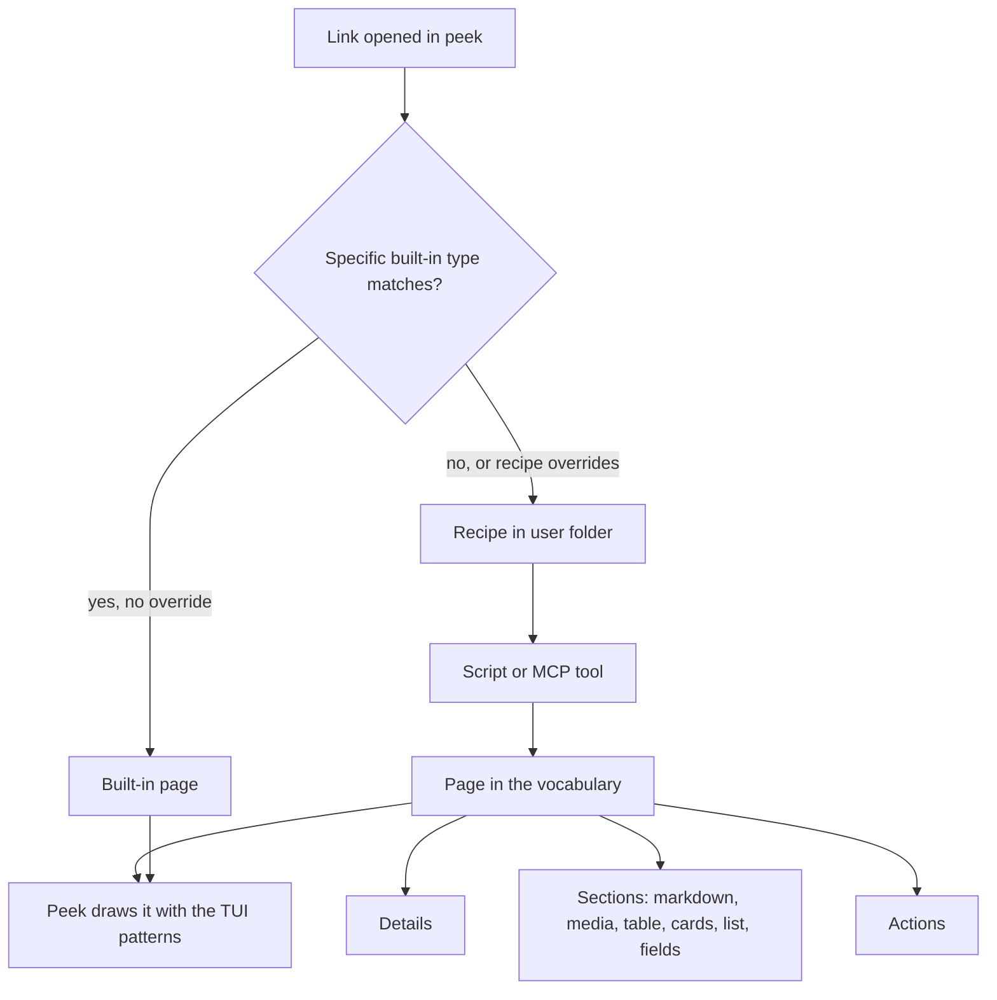

# Peek Page Vocabulary and Recipe Skill - Plan

## Goal Capsule

- **Objective:** An agent can give peek a readable, navigable page for a document type peek has never seen. The page works in every session of that user, and nobody edits or releases peek.
- **Means:** A closed page vocabulary inside peek (concepts, block types, TUI patterns), user-level recipes that return pages in that vocabulary, and a skill shipped with peek that teaches both.
- **Product authority:** Shawn. New top-level tabs, sharing recipes with other people, and agent-pushed one-off pages are not active scope.
- **Open blockers:** None.

---

## Product Contract

### Summary

Peek gets a named page vocabulary: Page, Section, Card, List, Details and Action, built from a fixed set of block types, with the same keyboard and menu behaviour on every page. A new document type is a recipe in the user's folder. The recipe names the links it handles and a script or MCP tool that returns a Page in the vocabulary. A skill shipped with peek teaches an agent the vocabulary, then the recipe, then how to prove the page works.

### Problem Frame

Peek gains a new page kind about once a session: Linear, GitHub and web pages, the live browser, groups, and Slack threads on a separate branch. Each one re-did the same work by hand in `plugins/peek/hooks/register.tsx`. That work covers a new branch in the render function, card grids, row lists, the hover layer, ⌃k entries, the status line and a test world. The remote-pages plan set the rule "`register.tsx` only dispatches and draws" when the file was about 1,900 lines. It is now 3,965 lines. The building blocks every page reuses (`cardGrid`, `rowList`, `mediaBlock`, `markdownChunks`, `header`, `footer`, `frame`) are closures inside one render function, so nothing outside that function can use them.

Shawn wants to name a document type nobody has thought of yet and have an agent build its page correctly. Today that means a peek code change, a commit and a sync for every type.

### Key Decisions

- **Page types only.** The vocabulary covers things you open in the pane, not new top-level tabs or screens. Governs R1, R6. (session-settled: user-approved — chosen over page types plus tabs, and over anything in the pane: it covers the stated need with the smallest kit.)
- **A closed, named vocabulary, not open drawing.** A recipe composes pages from the vocabulary and cannot draw its own layout. As a result, every page behaves like the rest of peek, and `register.tsx` stops growing per type. Governs R1, R2, R3. (session-settled: user-directed — chosen over a loose list of body blocks: Shawn asked for clear block types, TUI patterns and concepts such as Pages, Cards and Lists.)
- **Shared layout with selectable blocks.** Governs R2. (session-settled: user-approved — chosen over shared layout only, where types that do not suit markdown look flat, and over fully custom pages, which recreate the `register.tsx` problem.)
- **Recipes live outside peek, global to the user.** Governs R6, R7, R11. (session-settled: user-directed — chosen over code inside peek's repo: Shawn wants new types to work across all his sessions without a release, initially for him alone.)
- **Done means a built-in check and the user's approval.** Governs R13, R14. (session-settled: user-directed — chosen over check plus a live capture alone, and over sign-off alone.)
- **Specific built-in page types win link conflicts by default; the generic web page does not.** Governs R8. (session-settled: user-approved — proposed with the risk that a recipe silently replaces the GitHub page.)
- **Actions only open or copy.** Peek stays read-only: no Action changes an outside system. Governs R17. (session-settled: user-approved — chosen over letting an Action re-run the recipe's source with an argument, which would let a menu key close a ticket or post a comment.)
- **Overlapping recipes are refused when built.** Governs R19. (session-settled: user-approved — chosen over newest recipe wins with a warning.)
- **Recipes load on demand.** Governs R9. (session-settled: user-approved — proposed because the 60-second on-screen refresh would run an API- or model-backed script every minute.)

### Requirements

**Page vocabulary**

- R1. Peek defines a closed page vocabulary with six concepts: Page, Section, Card, List, Details and Action.
- R2. A Page has a title, optional Details, an ordered set of Sections, and optional Actions. Each Section holds one block of a supported type: markdown, media, table, cards, list or fields.
- R3. Every page drawn from the vocabulary gets peek's TUI patterns without the recipe asking for them. These are arrow-key movement between items, enter to open, every Action in the ⌃k menu with a key, the hover star on openable items, breadcrumbs, the status line, and the pane's image budget.
- R4. A Card or List item can open a link or a file. A link routes like any link in peek, so it can land on a built-in page or on another recipe's page.
- R16. Arrow keys move through one ordered list of selectable items across all Sections of a Page. Cards, list items and table rows are selectable; markdown, media and fields blocks scroll with the page and do not take focus.
- R17. An Action opens a link, opens a file, or copies text. No Action changes an outside system.
- R5. Media and markdown blocks follow the rules peek already applies to remote pages: picture conversion, the image budget, mermaid diagrams, and badges kept as text.

**Recipes**

- R6. A recipe lives in a user-level folder, loads in every session and project of that user, and survives peek updates and reinstalls.
- R7. A recipe declares which links it handles and one data source: a script peek runs, or an MCP tool peek calls. The source returns one Page in the vocabulary.
- R8. When a link matches both a specific built-in page type (GitHub, Linear, Slack) and a recipe, the built-in type wins unless the recipe declares that it overrides that type. The generic web page is a fallback: any matching recipe wins over it.
- R9. A recipe page loads when opened and reloads when the person refreshes it. It refreshes on a timer only when the recipe opts in.
- R10. When a recipe's source fails, times out, or returns something outside the vocabulary, peek shows an error page that names the recipe and the problem.
- R18. While a recipe's source runs, peek shows a loading page that names the recipe. During a manual refresh the previous page stays visible with a refreshing marker. A Page or Section with no items shows a one-line empty message.
- R11. A new or edited recipe takes effect on the next open or plugin reload, without reinstalling peek.

**Skill and verification**

- R12. Peek ships a skill that teaches the vocabulary first (concepts, block types, TUI patterns, each with an example), then how to write a recipe.
- R13. Peek provides a built-in check that runs a recipe against a sample link. The check reports whether the recipe matched the link, whether the source answered, and whether every returned element is in the vocabulary and drawable.
- R19. The built-in check fails a recipe whose links overlap those of an existing recipe, and names the other recipe.
- R20. Peek registers a tool an agent calls to open a link in the pane through normal routing. R14's open step uses this tool.
- R14. The skill's definition of done is three steps: the check passes on a real sample, the agent opens the page in the pane, and the user approves it. The agent does not report the type as done before the approval.
- R15. The vocabulary's terms are defined in the Peek section of `CONCEPTS.md`, so the skill, the code and the docs use the same words.

### Key Flows

- F1. An agent adds a document type
  - **Trigger:** The person asks for a page for a type peek does not handle, for example "show Figma files in peek".
  - **Steps:** The agent loads the skill, picks blocks from the vocabulary for the type, writes the recipe in the user folder, runs the built-in check on a real link, opens the link in the pane, and asks the person to approve.
  - **Outcome:** The type works in every later session. If the person rejects it, the agent revises the recipe and repeats the check.
  - **Covered by:** R6, R7, R11, R12, R13, R14, R19, R20

- F2. The person opens a link a recipe handles
  - **Trigger:** A link appears in the conversation or the person opens one from a Card or List.
  - **Steps:** Peek resolves the link (R8). Only when routing picks the recipe does peek show the loading page, run the recipe's source once, and draw the returned Page.
  - **Outcome:** A page that looks and behaves like any other peek page, or the error page from R10.
  - **Covered by:** R3, R8, R9, R10, R18

### Acceptance Examples

- AE1. **Covers R8.** **Given** a recipe that matches `github.com` links and does not declare an override, **when** the person opens a GitHub PR link, **then** peek shows the built-in GitHub page. **Given** the same recipe declares an override for GitHub, **then** peek shows the recipe's page. **Given** a recipe that matches `figma.com` links, **when** the person opens a Figma link, **then** peek shows the recipe's page, not the generic web page.
- AE2. **Covers R9.** **Given** a recipe page has been on screen for five minutes, **when** the recipe has not opted into a timer, **then** its source has run once. **When** the person refreshes, **then** it runs again.
- AE3. **Covers R10.** **Given** a recipe script exits with an error, **when** the person opens a matching link, **then** the pane shows an error page naming the recipe and the error, and the rest of peek keeps working.
- AE4. **Covers R4.** **Given** a recipe returns a cards Section whose Cards link to other files, **when** the person selects a Card and presses enter, **then** that link opens through normal routing, including into another recipe's page.
- AE5. **Covers R13, R14.** **Given** a recipe returns a block type outside the vocabulary, **when** the agent runs the built-in check, **then** the check fails and names that element, and the agent does not open the page for approval.

### Success Criteria

- A fresh agent with only the skill builds a page for a document type peek does not handle, without editing peek's source, and Shawn approves it on the first or second attempt.
- Adding that type changes no file in `plugins/peek/`.

### Scope Boundaries

- **Deferred for later:**
  - New top-level tabs or screens built from the vocabulary.
  - Sharing or publishing recipes to other people.
  - One-off pages an agent pushes mid-session through a peek tool. These could reuse the same vocabulary.
- **Outside this work:**
  - Custom layouts beyond the vocabulary. A type that truly needs one goes through a peek code change, as Slack threads do.

### Dependencies / Assumptions

- A peek hooks module cannot load code at runtime: a module holding `import()` does not load. This rule is why recipes are data plus an external script or MCP tool, not code. Source: engine types `claude-code/index.d.ts:24`.
- Peek can already run processes, call MCP tools and read files under the user's home folder. See `remoteIoOf` in `plugins/peek/hooks/register.tsx:461` and the groups store under `~/.local/share/claude-peek/` in `plugins/peek/hooks/groups.ts:295`.
- Assumption, partly verified: a mod plugin can ship a skill through its manifest. `claude plugin validate` passes on a copy of peek with a `skills` folder declared, but peek is the only mod plugin in the repo, so no plugin yet shows a mod's skill loading at runtime.
- An MCP-backed recipe works only in projects where that MCP server is connected. Elsewhere it loads but shows its error page (R10).
- `feature/peek-slack-threads` changes about 30 lines in the files this work touches (`register.tsx`, `theme.ts`, `types/index.d.ts`, `README.md`). This work should land after it, or rebase onto it.

### Outstanding Questions

**Deferred to Planning**

- Do the built-in remote pages (Linear, GitHub, web, Slack) move onto the vocabulary in this work, or later? Moving them proves the vocabulary and shrinks `register.tsx`, but widens the change.
- Where do recipes live? One option is beside the groups store under `~/.local/share/claude-peek/`.
- What format do recipes declare link matching in, and what is the page payload's exact shape?
- How does peek run a recipe's script: permissions, timeout, and the size limit on what it returns?
- Where does the built-in check run: a peek MCP tool, a slash command, or both?
- Do links a recipe handles get titles in the conversation's link list before they are opened? Peek's background refresh runs every five minutes, which would run each recipe's source that often (against R9).
- How much of `register.tsx` has to move out so the vocabulary's blocks become shared modules that follow the io-port rule?

### Sources / Research

- `plugins/peek/hooks/register.tsx`: the inline building blocks are `header` (2206), `footer` (2224), `rule` (2244), `menuFor` (2324), `frame` (2404), `groupCards` (2500), `cardGrid` (2957), `rowList` (3134), `mediaBlock` (3369) and `markdownChunks` (3436). The shared remote page renderer starts at 3343, and the local CSV table at 3747.
- Already standalone: `plugins/peek/hooks/{rows,grid,tabs,hover-layer}.tsx`.
- `plugins/peek/hooks/refs.ts`: link recognition for remote kinds.
- `plugins/peek/hooks/refresh.ts:4`: `ON_SCREEN_MS = 60_000`.
- `plugins/peek/tests/groups-pane.test.ts`: the `$.ui.mount` pane test pattern.
- `docs/plans/2026-10-08-2153-feat-peek-remote-pages-plan.md`, decision KTD10 ("`register.tsx` only dispatches and draws").
- `docs/plans/2026-10-12-1002-feat-peek-groups-plan.md`: the list of what adding a mode touched.
