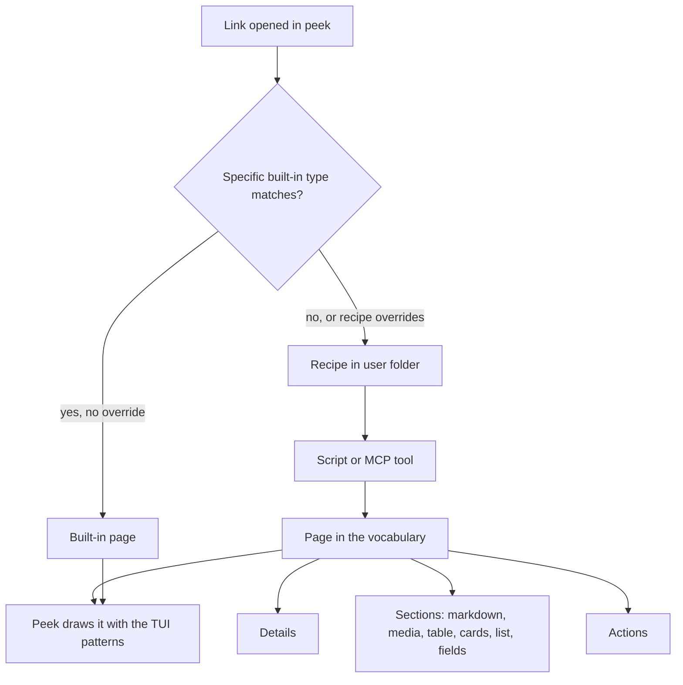
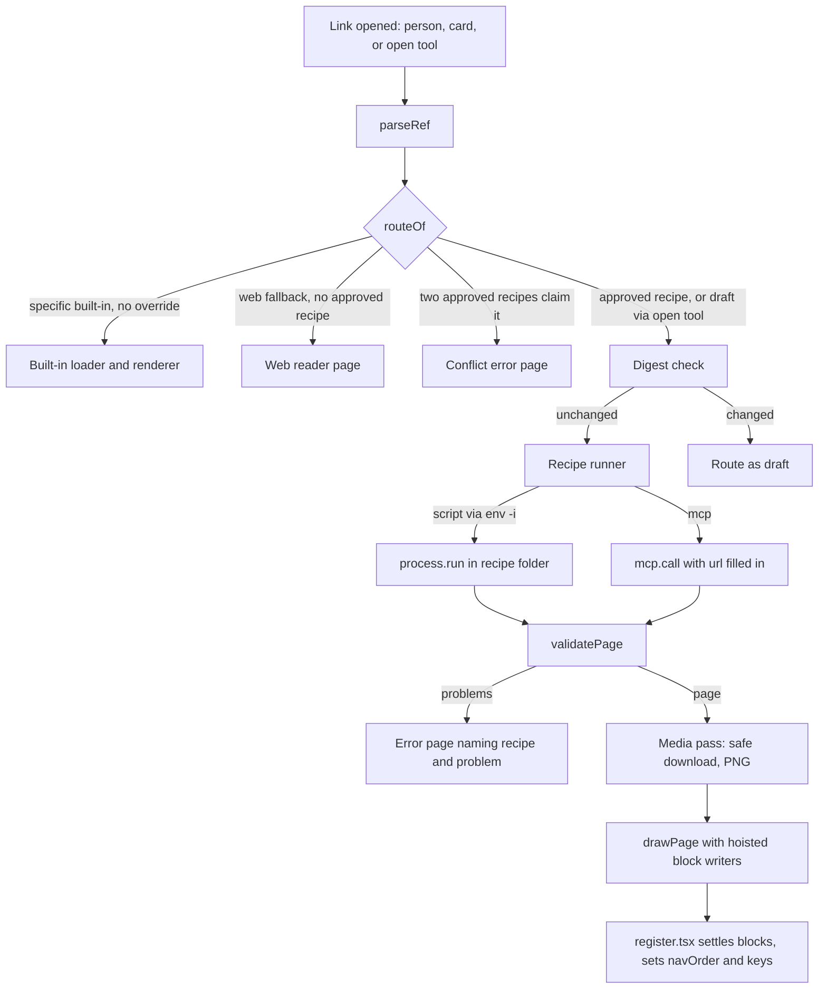
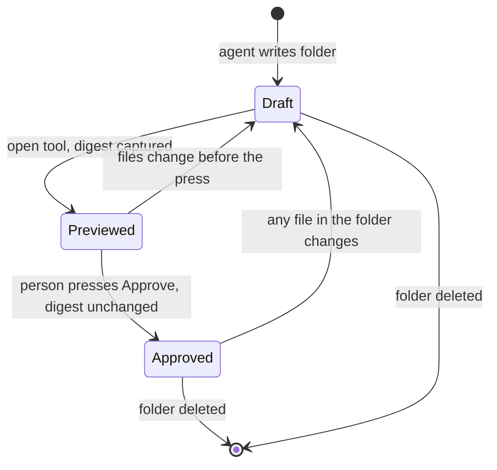
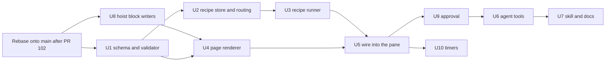

# Peek Page Vocabulary and Recipe Skill - Plan

## Goal Capsule

- **Objective:** An agent can give peek a readable, navigable page for a document type peek has never seen. The page works in every session of that user, and adding the type edits no peek file and needs no peek release.
- **Means:** A closed page vocabulary inside peek, user-level recipes that return pages in it, person-only approval kept in peek's own store, and a skill shipped with peek that teaches the agent the whole loop (KTD1–KTD11).
- **Product authority:** Shawn. The Product Contract wins on behaviour; Key Technical Decisions win on mechanism. New top-level tabs, sharing recipes, recipes for local files, and moving the built-in pages onto the vocabulary are not active scope.
- **Open blockers:** PR #102 (Slack threads as pages) must merge before this work starts; then rebase onto `main` (KTD11).
- **Execution profile:** Test-first per unit with observed red, pane tests through `claude-code/testing`, then a live look in a real session after `/reload-plugins`.
- **Stop conditions:** Stop and ask Shawn if a mod plugin cannot ship a skill at runtime and the fallback in KTD9 is not enough, if the U8 hoist cannot keep the existing pane tests green, or if a settled decision proves infeasible.
- **Who finishes:** `ce-work` implements and verifies; Shawn approves the fresh-agent eval page and the PR.

---

## Product Contract

### Summary

Peek gets a named page vocabulary: Page, Section, Card, List, Details and Action, built from a fixed set of block types, with the same keyboard and menu behaviour on every page. A new document type is a recipe in the user's folder. The recipe names the links it handles and a script or MCP tool that returns a Page in the vocabulary. A skill shipped with peek teaches an agent the vocabulary, then the recipe, then how to prove the page works.

### Problem Frame

Peek gains a new page kind about once a session: Linear, GitHub and web pages, the live browser, groups, and Slack threads on a separate branch. Each one re-did the same work by hand in `plugins/peek/hooks/register.tsx`. That work covers a new branch in the render function, card grids, row lists, the hover layer, ⌃k entries, the status line and a test world. The remote-pages plan set the rule "`register.tsx` only dispatches and draws" when the file was about 1,900 lines. It is now 3,965 lines. The building blocks every page reuses (`cardGrid`, `rowList`, `mediaBlock`, `markdownChunks`, `header`, `footer`, `frame`) are closures inside one render function, so nothing outside that function can use them.

Shawn wants to name a document type nobody has thought of yet and have an agent build its page correctly. Today that means a peek code change, a commit and a sync for every type.

### Key Decisions

- **Page types only.** The vocabulary covers things you open in the pane, not new top-level tabs or screens. Governs R1, R6. (session-settled: user-approved — chosen over page types plus tabs, and over anything in the pane: it covers the stated need with the smallest kit.)
- **A closed, named vocabulary, not open drawing.** A recipe composes pages from the vocabulary and cannot draw its own layout. As a result, every page behaves like the rest of peek, and `register.tsx` stops growing per type. Governs R1, R2, R3. (session-settled: user-directed — chosen over a loose list of body blocks: Shawn asked for clear block types, TUI patterns and concepts such as Pages, Cards and Lists.)
- **Shared layout with selectable blocks.** Governs R2. (session-settled: user-approved — chosen over shared layout only, where types that do not suit markdown look flat, and over fully custom pages, which recreate the `register.tsx` problem.)
- **Recipes live outside peek, global to the user.** Governs R6, R7, R11. (session-settled: user-directed — chosen over code inside peek's repo: Shawn wants new types to work across all his sessions without a release, initially for him alone.)
- **Done means a built-in check and the person's approval.** Governs R13, R14. (session-settled: user-directed — chosen over check plus a live capture alone, and over sign-off alone.)
- **Specific built-in page types win link conflicts by default; the generic web page does not.** Governs R8. (session-settled: user-approved — proposed with the risk that a recipe silently replaces the GitHub page.)
- **Actions only open or copy.** Peek stays read-only: no Action changes an outside system. Governs R17. (session-settled: user-approved — chosen over letting an Action re-run the recipe's source with an argument, which would let a menu key close a ticket or post a comment.)
- **Overlapping recipes are refused when built.** Governs R19. (session-settled: user-approved — chosen over newest recipe wins with a warning.)
- **Recipes go live only when the person approves them in the pane.** An edit returns a recipe to draft. Governs R14, R21. (session-settled: user-approved — chosen over approval in chat only, where a later agent edit goes live unseen, and over a read-only-name filter on MCP tools, which catches mistakes but not edits.)
- **Only opening, refreshing or an opted-in timer runs a recipe's source.** Governs R22. (session-settled: user-approved — chosen over letting groups, stars and the link list load recipe pages to show titles, which would run scripts on display.)
- **A failing recipe never falls back.** Governs R10. (session-settled: user-approved — chosen over showing a captured copy or the generic web page, which would hide the error page.)
- **Recipes match web links only in this work.** Governs R7. (session-settled: user-approved — local files are deferred, since peek has no route for them today.)
- **Recipes load on demand.** Governs R9. (session-settled: user-approved — proposed because the 60-second on-screen refresh would run an API- or model-backed script every minute.)

### Requirements

**Page vocabulary**

- R1. Peek defines a closed page vocabulary with six concepts: Page, Section, Card, List, Details and Action.
- R2. A Page has a title, optional Details, an ordered set of Sections, and optional Actions. Each Section holds one block of a supported type: markdown, media, table, cards, list or fields.
- R3. Every page drawn from the vocabulary gets peek's TUI patterns without the recipe asking for them. These are arrow-key movement between items, enter to open, every Action in the ⌃k menu with a key, the hover star on openable items, breadcrumbs, the status line, and the pane's image budget.
- R4. A Card or List item can open a link or a file. A link routes like any link in peek, so it can land on a built-in page or on another recipe's page.
- R16. Arrow keys move through one ordered list of selectable items across all Sections of a Page. Cards, list items and table rows are selectable; markdown, media and fields blocks scroll with the page and do not take focus.
- R17. An Action opens a link, opens a file, or copies text. No Action changes an outside system.
- R5. Media and markdown blocks follow the rules peek already applies to remote pages: picture conversion, the image budget, mermaid diagrams, and badges kept as text.

**Recipes**

- R6. A recipe lives in a user-level folder, loads in every session and project of that user, and survives peek updates and reinstalls.
- R7. A recipe declares which web links (http or https) it handles and one data source: a script peek runs, or an MCP tool peek calls. The source returns one Page in the vocabulary.
- R8. When a link matches both a specific built-in page type (GitHub, Linear, Slack) and a recipe, the built-in type wins unless the recipe declares that it overrides that type. The generic web page is a fallback: any matching recipe wins over it.
- R9. A recipe page loads when opened and reloads when the person refreshes it. It refreshes on a timer only when the recipe opts in.
- R10. When a recipe's source fails, times out, or returns something outside the vocabulary, peek shows an error page that names the recipe and the problem, never a captured copy or the generic web page.
- R18. While a recipe's source runs, peek shows a loading page that names the recipe. During a manual refresh the previous page stays visible with a refreshing marker. A Page or Section with no items shows a one-line empty message.
- R11. A new or edited recipe takes effect on the next open or plugin reload, without reinstalling peek.
- R21. A recipe is a draft until the person approves it from the pane, after seeing what it runs. Normal link routing ignores draft recipes; the agent's open tool can preview a draft, marked unapproved. Any change to a recipe's files returns it to draft. No peek tool, command or agent file edit can record an approval.
- R22. Only opening a recipe page, refreshing it, or a recipe's opted-in timer runs its source. Groups, stars and the conversation's link list show a cached title or the bare link.

**Skill and verification**

- R12. Peek ships a skill that teaches the vocabulary first (concepts, block types, TUI patterns, each with an example), then how to write a recipe.
- R13. Peek provides a built-in check that runs a recipe against a sample link. The check reports whether the recipe matched the link, whether the source answered, and whether every returned element is in the vocabulary and drawable.
- R19. The built-in check fails a recipe whose links overlap those of an existing recipe, and names the other recipe.
- R20. Peek registers a tool an agent calls to open a link in the pane through normal routing. R14's open step uses this tool.
- R14. The skill's definition of done is three steps: the check passes on a real sample, the agent opens the page in the pane, and the person approves it in the pane (R21). The agent does not report the type as done before the approval.
- R15. The vocabulary's terms are defined in the Peek section of `CONCEPTS.md`, so the skill, the code and the docs use the same words.



### Key Flows

- F1. An agent adds a document type
  - **Trigger:** The person asks for a page for a type peek does not handle, for example "show Figma files in peek".
  - **Steps:** The agent loads the skill, picks blocks from the vocabulary for the type, writes the recipe in the user folder, runs the built-in check on a real link, previews the draft in the pane, and asks the person to approve it there.
  - **Outcome:** Once approved, the type works in every later session. If the person does not approve, the agent revises the recipe, which stays a draft, and repeats the check.
  - **Covered by:** R6, R7, R11, R12, R13, R14, R19, R20, R21

- F2. The person opens a link a recipe handles
  - **Trigger:** A link appears in the conversation or the person opens one from a Card or List.
  - **Steps:** Peek resolves the link (R8). Only when routing picks the recipe does peek show the loading page, run the recipe's source once, and draw the returned Page.
  - **Outcome:** A page that looks and behaves like any other peek page, or the error page from R10.
  - **Covered by:** R3, R8, R9, R10, R18

### Acceptance Examples

- AE1. **Covers R8.** **Given** a recipe that matches `github.com` links and does not declare an override, **when** the person opens a GitHub PR link, **then** peek shows the built-in GitHub page. **Given** the same recipe declares an override for GitHub, **then** peek shows the recipe's page. **Given** a recipe that matches `figma.com` links, **when** the person opens a Figma link, **then** peek shows the recipe's page, not the generic web page.
- AE2. **Covers R9.** **Given** a recipe page has been on screen for five minutes, **when** the recipe has not opted into a timer, **then** its source has run once. **When** the person refreshes, **then** it runs again.
- AE3. **Covers R10.** **Given** a recipe script exits with an error, **when** the person opens a matching link, **then** the pane shows an error page naming the recipe and the error, and the rest of peek keeps working.
- AE4. **Covers R4.** **Given** a recipe returns a cards Section whose Cards link to other files, **when** the person selects a Card and presses enter, **then** that link opens through normal routing, including into another recipe's page.
- AE6. **Covers R21.** **Given** an approved recipe, **when** an agent edits its script, **then** the next time the person opens a matching link it routes as if the recipe were absent, and the agent's preview shows the page marked unapproved. **Given** an agent writes its own approval marker into the recipe folder, **then** the recipe still routes as a draft.
- AE7. **Covers R22.** **Given** a group holds a link an approved recipe handles, **when** the person opens the group page, **then** the recipe's source does not run; it runs when the person opens the link.
- AE5. **Covers R13, R14.** **Given** a recipe returns a block type outside the vocabulary, **when** the agent runs the built-in check, **then** the check fails and names that element, and the agent does not open the page for approval.

### Success Criteria

- A fresh agent with only the skill builds a page for a document type peek does not handle, without editing peek's source, and Shawn approves it on the first or second attempt.
- Adding that type changes no file in `plugins/peek/`.

### Scope Boundaries

- **Deferred for later:**
  - New top-level tabs or screens built from the vocabulary.
  - Recipes for local files (for example `.fig`).
  - Sharing or publishing recipes to other people.
  - One-off pages an agent pushes mid-session through a peek tool. These could reuse the same vocabulary.
- **Outside this work:**
  - Custom layouts beyond the vocabulary. A type that truly needs one goes through a peek code change, as Slack threads do.
- **Deferred to Follow-Up Work:**
  - Moving the built-in Linear, GitHub, web and Slack pages onto the vocabulary renderer, which would shrink `register.tsx`.
  - Moving the remote page renderer itself onto the hoisted block writers beyond what U8 needs.
  - A `list_recipes` tool; files in the recipe folder plus the check's overlap report cover it now.

### Dependencies / Assumptions

- A peek hooks module cannot load code at runtime: a module holding `import()` does not load. This rule is why recipes are data plus an external script or MCP tool, not code. Source: engine types `claude-code/index.d.ts:24`.
- Peek can already run processes, call MCP tools and read files under the user's home folder. See `remoteIoOf` in `plugins/peek/hooks/register.tsx:461` and the groups store under `~/.local/share/claude-peek/` in `plugins/peek/hooks/groups.ts:295`.
- Assumption, partly verified: a mod plugin can ship a skill through its manifest. `claude plugin validate` passes on a copy of peek with a `skills` folder declared, but peek is the only mod plugin in the repo, so no plugin yet shows a mod's skill loading at runtime.
- An MCP-backed recipe works only in projects where that MCP server is connected. Elsewhere it loads but shows its error page (R10).
- PR #102 (Slack threads as pages, `feature/peek-slack-threads`) inserts its link matcher in the same spot of `refs.ts` this work routes from, and changes the remote renderer and `RemoteKind`. This work rebases onto `main` after #102 merges.
- The engine says `$.mcp.call` never prompts, but the Slack branch's README says Slack MCP tools ask until always allowed. U3 tests what an MCP-backed recipe does and treats a denied call as the R10 error page.

### Sources / Research

- `plugins/peek/hooks/register.tsx`: the inline building blocks are `header` (2206), `footer` (2224), `rule` (2244), `menuFor` (2324), `frame` (2404), `groupCards` (2500), `cardGrid` (2957), `rowList` (3134), `mediaBlock` (3369) and `markdownChunks` (3436). The shared remote page renderer starts at 3343, and the local CSV table at 3747.
- Already standalone: `plugins/peek/hooks/{rows,grid,tabs,hover-layer}.tsx`.
- `plugins/peek/hooks/refs.ts`: link recognition for remote kinds.
- `plugins/peek/hooks/refresh.ts:4`: `ON_SCREEN_MS = 60_000`.
- `plugins/peek/tests/groups-pane.test.ts`: the `$.ui.mount` pane test pattern.
- `docs/plans/2026-10-08-2153-feat-peek-remote-pages-plan.md`, decision KTD10 ("`register.tsx` only dispatches and draws").
- `docs/plans/2026-10-12-1002-feat-peek-groups-plan.md`: the list of what adding a mode touched.
- `docs/solutions/architecture-patterns/a-skill-calling-mcp-tools-must-load-them-with-toolsearch-first.md`, `docs/solutions/architecture-patterns/command-and-skill-sharing-a-name.md`, `docs/solutions/security-issues/a-validator-proven-correct-and-proven-unused.md`, `docs/solutions/logic-errors/a-checks-scanner-crash-reads-as-a-clean-result.md`, `docs/solutions/performance-issues/live-frame-streaming-is-capped-by-bytes-per-second-the-sender-cannot-see.md`.

**Product Contract preservation:** changed R7, R10, R14 and added R21, R22, AE6, AE7, after Shawn chose pane approval and confirmed the plan's scoping call-outs on 2026-10-12. Deepening sharpened R21 (the person sees what the recipe runs; approval cannot be written through peek or file edits) and added the forged-marker case to AE6, to carry out that same decision. The Objective's wording was corrected to match Success Criteria. Planning questions moved into the Key Technical Decisions below.

---

## Planning Contract

### Key Technical Decisions

- KTD1. **Recipes are folders under `~/.local/share/claude-peek/recipes/<id>/`.** Each folder holds a `recipe.json` declaration and the script it runs. The id is the folder name and must match `^[a-z0-9-]{1,40}$` before it becomes a path. The location sits beside the groups store (`plugins/peek/hooks/groups.ts:295`) and outside the plugin, so reinstalls keep it (R6). Peek reads the folder on each link resolution, so edits apply on the next open (R11). The agent writes recipe files with its own tools; peek never writes into the folder, so no lease lock is needed.
- KTD2. **Matching is host plus path glob, and overlap is decidable.** A recipe lists `match` entries of a host (`figma.com` or `*.figma.com`) and an optional path glob using only `*`, and may list `overrides` by family: `github`, `linear` or `slack`. Without regular expressions, the check can decide exactly when two recipes overlap: a host pattern intersects and neither path glob excludes the other (R19). If two approved recipes still overlap at open time, peek shows an error page naming both. Serves R7, R8, R19.
- KTD3. **Routing is a pure function, and recipe pages bypass the remote loader.**
  - `routeOf(link, recipes, { allowDraft })` returns one of four routes: built-in, recipe, web fallback, or conflict. It runs after `parseRef` (`plugins/peek/hooks/refs.ts:62`); a `web` result, or an overridden family, goes to the recipe.
  - Recipe loads never enter `remote.ts` `sourceFor`/`loadItem`. That code silently loads GitHub by default and replays session captures on failure, which would hide the error page (R10).
  - Recipe pages live in their own `View.page` field, carrying recipe id, draft flag, preview digest, fetched time and pictures, not a new `RemoteKind`, so `refresh.ts` and `isTimed` never schedule them (R22).
  - The background tier can still load an overridden GitHub or Linear link through its built-in loader when that link sits in mentions or stars. `redrawIfCurrent`, `refresh()` and `tickRemote` therefore check `current.page` before `remoteRef(href)`, and leave a recipe page untouched when a built-in load lands for the same href.
  - Every `register.tsx` path that branches on `View.remote` gets a `page` arm (U5). Where none is given, a recipe page silently becomes the web reader.
  - A group card holding a recipe link keeps today's web-reader title and favicon. This is intended: it runs no recipe (R22, AE7).
- KTD4. **The source contract is JSON on stdout, under one runner.** This serves R7, R10 and R13.
  - **Script source.**
    - `argv[0]` must resolve, by real path, to a regular file inside the recipe folder, so the approval digest covers what runs.
    - Peek runs it through `/usr/bin/env -i` with only `HOME`, `PATH`, `LANG`, `TMPDIR`, `PEEK_URL` and the variable names the recipe declares in `env`. Session secrets such as `LINEAR_API_KEY` never reach a script by default.
    - The working directory is the recipe folder. The link is passed as the last argument and in `PEEK_URL`.
    - The timeout is 20 s by default, and a recipe may raise it to 60 s. Output is capped at `$.process.run`'s 4 MiB.
  - **MCP source.** It names a server, a tool and arguments, and `{{url}}` is replaced by the link.
  - **Typed outcomes.** Every outcome has a type: started-failed, exit-nonzero, timeout, output-truncated, not-JSON, server-not-connected, tool-error, invalid-page (with paths), changed-during-run, and needs-permission.
  - **Stderr.** The excerpt is capped at 500 characters, and the values of the declared variables are redacted from it.
  - **One runner for both callers.** The check tool and the pane call the same runner, so a recipe cannot pass the check and fail in the pane.
  - **Drafts run only what the session would run anyway.** Before running a draft source (`allowDraft`), the runner asks `$.tool.check` about the equivalent call: Bash with the script's argv in the recipe folder, or `mcp__<server>__<tool>` with the substituted arguments. It runs only on `allow`. On `ask` or `deny` it returns a needs-permission outcome naming the command or tool, so the agent asks the person to allow it. A draft therefore never gives the agent more reach than its own Bash and MCP permissions.
  - **Telling start failures from timeouts.** `$.process.run` rejects in both cases; the runner classes a rejection as timeout when the elapsed time reached the limit, and as started-failed otherwise.
- KTD5. **One Page schema and one validator, shared by every caller.** This serves R1, R2, R13 and R17.
  - **What `validatePage` returns.** The checked page, or a list of problems with JSON paths (`sections[2].block.type`). It is also the trust boundary for recipe output:
    - It caps sections, items and text lengths.
    - It strips C0/C1 control characters, direction overrides and zero-width characters from every string. Markdown text keeps tabs and newlines.
    - It accepts `http(s)` hrefs and media URLs only when the host is not private (`isPrivateHost`, `plugins/peek/hooks/web.ts:131`).
    - It accepts absolute file hrefs only outside dot-folders, and never `.app`, `.command`, `.terminal` or `.workflow` files.
    - It applies the same link rule to every link inside markdown text.
    - It requires `copy` text to be one line of at most 500 characters.
    - It allows at most 9 Actions, one per hotkey.
  - **Who calls it.** The pane's load path, the check tool and the skill's example test. A test counts the production callers (`docs/solutions/security-issues/a-validator-proven-correct-and-proven-unused.md`).
  - **The outline.** The same module produces the outline the tools return.
- KTD6. **Hoist the block writers, then draw pages with them.**
  - Today `markdownBlocks`, `markdownChunks`, `mediaBlock`, `fitsPane` and `sectionRule` exist only inside the `if (current.remote)` branch (`plugins/peek/hooks/register.tsx:3343-3450`). `cardGrid` and `rowList` exist only inside the Recent/Gallery branch (`register.tsx:2957`, `3134`).
  - U8 turns these closures into factories that take a parts sink, `note`, the media and picture lookups, and a memo base. The remote and Recent branches keep behaving the same. The new page branch calls the same factories.
  - `page-view.tsx` `drawPage` returns parts, row estimates, headings, nav items and Keys. `register.tsx` runs `settleBlocks`, builds block jumps and assigns `navOrder` in the branch, as it does for groups today (`register.tsx:2714`, `2861`).
  - Cards and lists reuse the hoisted builders plus `hover-layer.tsx`. `grid.tsx` and `rows.tsx` are not used: one is dead code, the other draws no focusable items.
  - Serves R2, R3, R5, R16.
- KTD7. **Approvals live in peek's store, against a digest captured at preview.** Serves R21.
  - **Where approvals live.** In `$.store` under `recipeApprovals` as `{ id: digest }`, beside `titles` (`register.tsx:579-586`). The store is a file under the Claude Code config folder, not the recipe folder, so an agent writing a marker into the folder changes nothing.
  - **Guard against file tools.** A `tool.call` hook denies Write, Edit, MultiEdit and NotebookEdit when the target's real path is inside `<config dir>/plugins/store/` and its file name starts with `peek_`, where the config dir is `CLAUDE_CONFIG_DIR` or `$HOME/.claude`. The store's exact file name carries an install hash peek cannot derive, so the guard matches the folder and prefix.
  - **What the digest covers.** SHA-256 (`crypto.subtle`) over each entry's relative path, kind, length and bytes, plus a per-file hash kept for the approval surface. It recurses and sorts by path. Every file counts, dotfiles included: editor junk drops approval, which fails safe. The engine's file API exposes no file mode, and the approved bytes already fix what can run, so the executable bit is not hashed.
  - **Recipe shape.** A recipe holds at most 50 files. Scripts are single files that use interpreters and libraries already on PATH; `npm install` or a virtualenv inside the folder would add symlinks and thousands of files, which make the recipe invalid with a problem that points to this rule.
  - **What makes a recipe invalid.** A symlink or non-regular entry, or a file over 4 MiB, makes the recipe invalid rather than a draft.
  - **Preview and press.**
    - Opening a draft preview captures the digest in `View.page`.
    - The approval surface draws as the first block above the previewed page and lists what will run: the source argv or MCP server, tool and arguments; the match and overrides; the timer; the declared env names; any overlap with an approved recipe; a warning when an MCP tool name looks mutating (`create|update|delete|send|post|set|close|merge`); and a warning naming any line in a script that refers to an absolute, `~` or `..` path, since the digest pins only the folder.
    - It shows the full text of every file that is new or changed since the last approval (every file on first approval), marking non-text files as binary with their size. `recipeApprovals[id]` stores `{ digest, files }` so the changed files can be found.
    - Pressing Approve re-hashes and re-runs the overlap test against approved recipes. Approval is recorded only if the digest equals the preview's and nothing overlaps. Otherwise the surface shows "changed since preview" with a Preview again key that re-captures the digest, or names the overlapping recipe.
    - After a recorded approval the view reloads as approved and the source line changes from draft to approved. There is no Reject control: the person leaves with back, and the recipe stays a draft.
  - **How Approve can be pressed.** Approve is a pane Button with no hotkey and no keybinding `action`, not in ⌃k, and it takes the initial focus on the approval surface.
    - `ui.press` has no origin field (engine types `UiPressArgument`), so origin cannot be checked.
    - What makes the press person-only: a Button's `onPress` runs only when a surface raises `ui.press` (engine types, `Button` props). The plugin `$` API has no press method; `press` exists only on the test harness's mounted drawing (engine types `EnginePress`).
    - Approve is never dispatched from `ui.message`, `/peek`, `check_recipe` or `open`.
    - Residual: a tool that types into the person's terminal, such as a pane-automation CLI, could press it. Risks names this.
- KTD8. **Two deferred agent tools: `check_recipe` and `open`.** Serves R13, R19, R20.
  - Both are registered with `isDeferred: true`, so sessions that never build recipes pay no context for them.
  - Both return a first line of plain text, then JSON, matching the `save_group` result shape.
  - Page text in a result sits under a field labelled as fetched data, with length caps, and counts come before free text.
  - **`check_recipe {recipe, link}`** reports:
    - the winning route;
    - the source outcome (KTD4);
    - every problem, with its path;
    - every overlapping recipe.
  - **`open {link}`**:
    - reuses `toHref` and `show` with `allowDraft`;
    - waits for the load;
    - makes its own awaited `$.ui.open` call, because `show` discards that result (`register.tsx:667`, `678`);
    - returns the route, `isPlaced`, the outline or the error text, and the page shown before.
- KTD9. **The skill ships in peek's manifest, with a fallback.**
  - `plugin.json` gains `"skills": "./skills"`, and the skill lives at `skills/peek-recipes/`. No command shares that name (`docs/solutions/architecture-patterns/command-and-skill-sharing-a-name.md`).
  - The skill loads `mcp__peek__check_recipe` and `mcp__peek__open` with ToolSearch first, and lists them in `allowed-tools`.
  - Both tool descriptions and every failing check name the skill's file path. An agent can then recover if a mod plugin's skill does not load at runtime.
  - Serves R12, R14.
- KTD10. **Opted-in timers have their own arm in the ticker.**
  - A recipe may set `refreshMinutes` of at least 5.
  - The recipe load path calls `startTicking`, so a session that opens only recipe pages still ticks.
  - `tickRemote` gets a `page` arm that re-runs the on-screen recipe page when it is due, with back-off after failure. It does not go through `tick()`, which only knows cache entries (`plugins/peek/hooks/refresh.ts:171`).
  - The existing idle gate applies: after 10 minutes with no session activity, timed pages pause like built-in pages do.
  - Serves R9.
- KTD11. **This work lands on top of PR #102 (Slack threads as pages).** U8 and U5 touch the same renderer block and `fromUrl` tail that #102 rewrites, so implementation starts by rebasing onto `main` once #102 merges.

### High-Level Technical Design

How a link becomes a page:



Recipe lifecycle:



Declaration and page shape, as directional sketches rather than a final spec:

```text
recipe.json
  name: "Figma files"
  match: [{ host: "figma.com", path: "/file/*" }, { host: "figma.com", path: "/design/*" }]
  overrides: []                       # any of github | linear | slack
  source: { run: ["./fetch.sh"], timeoutSeconds: 20, env: ["FIGMA_TOKEN"] }
       or { mcp: { server: "figma", tool: "get_file", args: { url: "{{url}}" } } }
  refreshMinutes: 0                   # 0 = on demand only

Page (stdout of the source)
  title, details?: [{ label, value }]
  sections: [{ heading?, block }]
    block = markdown { text }
          | media { items: [{ url, alt?, kind: image|video }] }
          | table { columns, rows: [{ cells, href? }] }
          | cards { items: [{ title, meta?, href?, image? }] }
          | list  { items: [{ title, meta?, href? }] }
          | fields { rows: [{ label, value }] }
  actions?: [{ label, open: href } | { label, copy: text }]
```

### Sequencing and Parallelism



- **Parallel:** U8 can run beside U1, U2 and U3. U8 edits only `register.tsx` and its existing tests; U1, U2 and U3 touch only new modules and their tests.
- **Sequential:** U5, U9, U10, U6 and U7 all edit `register.tsx`, so one worker runs them in order. U10 can go any time after U5.

### Risks and Threat Model

- **Trust boundary.** Recipe output is untrusted: titles, links, media, markdown and stderr. The agent's file tools are untrusted with respect to approval.
- **Assets.**
  - Environment secrets: KTD4 keeps them from scripts.
  - Local files and local services: KTD5 link rules, plus the media pass using `web.ts` safe download.
  - Outside systems reached through MCP: the KTD7 approval surface shows the tool and warns on mutating names.
- **Residual gap.** A same-user process run through Bash, or a draft script the session's permissions allow (KTD4), can still edit peek's store file directly, and a terminal-automation tool could press Approve. Approval protects against agent mistakes and against prompt injection through peek's tools and normal file tools. It does not protect against a determined process running as the user.
- **Code outside the folder.** The digest pins only the recipe folder. A script that calls code elsewhere can change behaviour without returning to draft; the approval surface warns on such paths (KTD7).
- **Prompt injection back into the agent.** Tool results label page text as data and cap it (KTD8).
- **MCP permission behaviour is unknown.** The engine says `$.mcp.call` never prompts, but the Slack branch says Slack tools ask. U3 treats a rejected call as server-not-connected, and the live look records what actually happens.
- **Hoist regressions.** U8 changes the code every remote page draws with. Mitigation: U8 changes no behaviour and is pinned by the existing `remote-pane`, `media-pane` and `groups-pane` tests.

### System-Wide Impact

- **Agent surface.** Two new deferred tools, `check_recipe` and `open`, plus a skill. The approval stays person-only.
- **`register.tsx`.**
  - A `page` arm wherever `View.remote` is branched on: refresh, redraw, crumbs, source line, keys, menu target, saved title, hover-layer open and the ticker.
  - A store guard in the `tool.call` hooks.
- **User folders.** New `~/.local/share/claude-peek/recipes/`. Peek reads it and never writes it. A new `$.store` key, `recipeApprovals`.

---

## Implementation Units

### U8. Hoist the block writers and nav builders

- **Goal:** Make the remote page's block writers and the Recent tab's card/row builders callable from a new page branch, without changing behaviour.
- **Requirements:** Enables R2, R3, R5, R16; KTD6, KTD11.
- **Dependencies:** Rebase onto `main` after PR #102.
- **Files:** `plugins/peek/hooks/register.tsx`, existing `plugins/peek/tests/remote-pane.test.ts`, `plugins/peek/tests/media-pane.test.ts`, `plugins/peek/tests/groups-pane.test.ts`, `plugins/peek/tests/pane.test.ts`.
- **Approach:**
  1. Turn `sectionRule`, `fitsPane`, `mediaBlock`, `markdownBlocks` and `markdownChunks` into one factory taking the parts sink, `note`, the media and picture lookups and the memo base.
  2. Turn `cardGrid` and `rowList` into factories taking their item list, an item-to-looks mapper and the nav sink.
  3. The remote and Recent branches call the factories with today's values.
- **Execution note:** Characterization first: run the existing pane tests green before the move and after each step.
- **Patterns to follow:** the closures' current bodies; `newBlocks`/`settleBlocks` (`register.tsx:3292-3337`).
- **Test scenarios:**
  - Test expectation: no new behaviour. The existing remote, media, groups and Recent pane tests pass unchanged.
- **Verification:** The full suite is green before and after, and no test file needed edits.

### U1. Page schema and validator

- **Goal:** Define the page vocabulary as data, and one validator every caller uses.
- **Requirements:** R1, R2, R16, R17; KTD5, KTD10.
- **Dependencies:** None.
- **Files:** `plugins/peek/hooks/page.ts` (new), `plugins/peek/types/index.d.ts` (Page types, `View.page`), `plugins/peek/tests/page.test.ts` (new).
- **Approach:**
  1. Types for Page, Section, the six blocks and Actions, plus the recipe declaration.
  2. `validatePage`, with the trust-boundary rules in KTD5.
  3. `validateRecipe`, which checks:
     - the id pattern;
     - the match entries and overrides;
     - exactly one source;
     - `env` names;
     - `refreshMinutes` is 0 or at least 5;
     - a mutating-name warning on MCP tools.
  4. `outlineOf(page)`: title, each Section's block type and item count, and the Actions.
- **Execution note:** Test-first; each problem case starts red.
- **Patterns to follow:** the pure-module style of `plugins/peek/hooks/groups.ts` (`applyGroupOps`, `GROUP_CAPS`); `isPrivateHost` in `web.ts`.
- **Test scenarios:**
  - A page with one of each block type validates and round-trips unchanged.
  - Covers AE5. A section with block type `chart` returns a problem at `sections[0].block.type`.
  - A missing title, a non-array `sections`, and `null` output each return a named problem.
  - These are rejected at their paths:
    - an href of `javascript:alert(1)`;
    - a card href of `http://localhost:9222/json`;
    - a media URL on `169.254.169.254`;
    - a file href to `/Users/x/.ssh/id_rsa`;
    - a file href to `/Applications/X.app`.
  - Markdown text containing `[x](file:///etc/passwd)` is rejected.
  - A title containing ESC or U+202E is cleaned, and the page still validates.
  - A `copy` Action with a newline, or over 500 characters, is rejected.
  - Items above the cap are rejected with the count, and ten Actions are rejected.
  - Recipe declarations:
    - A recipe id of `../x` or `A_B` fails; `figma-files` passes.
    - `refreshMinutes: 2` fails.
    - An MCP tool `create_comment` passes with a mutating warning.
  - `outlineOf` lists sections in order with item counts.
- **Verification:** All scenarios pass, and each was seen red first.

### U2. Recipe store, matcher, overlap, digest and routing

- **Goal:** Read recipes from the user folder, compute digests, decide approval against the store, and route a link.
- **Requirements:** R6, R7, R8, R11, R19, R21; AE1, AE6; KTD1, KTD2, KTD3, KTD7.
- **Dependencies:** U1.
- **Files:** `plugins/peek/hooks/recipes.ts` (new), `plugins/peek/tests/recipes.test.ts` (new).
- **Approach:**
  1. A `RecipesIo` port type (list, read, stat with real path, home, digest, store get) in `recipes.ts`; tests use a fake. U5 builds the real `recipesIoOf($)` in `register.tsx`, which keeps U2 parallel with U8.
  2. `loadRecipes` lists folders, validates each with U1, computes the KTD7 digest, and marks a recipe approved only when `recipeApprovals[id]` equals it. Invalid recipes are reported with their problems.
  3. `matches` and `overlaps` implement KTD2.
  4. `routeOf` implements KTD3.
- **Patterns to follow:** `groupsIoOf` (`register.tsx:1124`) and the `GroupsIo` port in `groups.ts`.
- **Test scenarios:**
  - Covers AE1. Routing:
    - A `github.com` recipe without an override routes a PR link to built-in.
    - With `overrides: ["github"]`, it routes to the recipe.
    - A `figma.com` recipe routes a Figma link to the recipe.
  - A link no recipe matches → web fallback.
  - Covers AE6. A recipe approved in the store whose script bytes change → draft. `routeOf` without `allowDraft` returns web; with `allowDraft` it returns the recipe, marked draft.
  - Covers AE6. A `.approved` file written into the folder has no effect on routing.
  - Digest:
    - Renaming a file changes the digest.
    - A folder with 51 files → invalid, pointing to the recipe-shape rule.
    - A new file in a subfolder changes the digest.
  - Invalid recipes:
    - A symlink in the folder → invalid, named.
    - A file over 4 MiB → invalid.
    - A folder with a bad `recipe.json` → listed invalid; it never routes.
  - Overlap:
    - Two approved `figma.com` recipes, on `/file/*` and `/*` → overlap, and routing returns conflict naming both.
    - `/file/*` against `/proto/*` → no overlap.
    - `*.figma.com` against `www.figma.com` → overlap.
  - A missing recipes folder → empty list.
- **Verification:** Routing and digest cases are pinned and each was seen red.

### U3. Recipe runner

- **Goal:** Run a recipe's source once, safely, and return a checked page or a typed failure.
- **Requirements:** R7, R10; AE3; KTD4.
- **Dependencies:** U1, U2.
- **Files:**
  - `plugins/peek/hooks/recipes.ts`
  - `plugins/peek/tests/recipe-run.test.ts` (new)
  - `plugins/peek/tests/fixtures/recipes/` (new)
  - `plugins/peek/tests/fixtures/mcp.ts` (new, copied in shape from the Slack branch's MCP fixture)
- **Approach:**
  1. `runRecipe(io, recipe, url, expectedDigest)` re-hashes and refuses on mismatch before running. It hashes again after exit and discards output if the digest moved.
  2. Script:
     - resolve `argv[0]` by real path inside the folder;
     - run through `env -i` with the KTD4 allowlist;
     - working directory is the folder, the link is the last argument and `PEEK_URL`;
     - timeout capped at 60 s.
  3. MCP:
     - substitute `{{url}}` in string arguments;
     - call and read the text content;
     - a rejected call is server-not-connected, and `isError` is tool-error.
  4. Parse stdout as JSON, then `validatePage`; redact and cap stderr.
- **Execution note:** Test-first. A crash, a timeout, empty output and non-JSON output must each fail by name, never pass (`docs/solutions/logic-errors/a-checks-scanner-crash-reads-as-a-clean-result.md`).
- **Patterns to follow:** `runGh` in `plugins/peek/hooks/sources.ts:129` (timeout, `.catch(() => null)`, exit-code branch).
- **Test scenarios:**
  - A script printing a valid page → page.
  - Covers AE3. Exit code 2 with stderr `boom` → exit-nonzero carrying `boom`.
  - Failures by name:
    - `process.run` rejects → started-failed;
    - the script times out → timeout, naming the limit;
    - stdout is truncated → output-truncated;
    - stdout is empty, or `not json` → not-JSON;
    - an unknown block → invalid-page, with the path.
  - Argv that escapes the folder is rejected before running: `../../bin/sh`, `./a/../../x`, a symlinked script, or `/bin/bash`.
  - The script receives the link as its last argument and in `PEEK_URL`, with the recipe folder as its working directory.
  - With `LINEAR_API_KEY` set, a script that prints its environment does not see it unless the recipe declares it. A declared value is redacted from stderr.
  - A file changes after the pre-run digest → changed-during-run, and the output is discarded.
  - A draft script whose Bash equivalent `$.tool.check` answers `ask` → needs-permission, and `process.run` is never called. On `allow` it runs.
  - A draft MCP source the session would prompt for → needs-permission, and `mcp.call` is never called.
  - MCP source:
    - `{{url}}` is substituted;
    - a rejected call → server-not-connected;
    - `isError` → tool-error.
- **Verification:** Every failure kind has a test that was red before its branch existed.

### U4. Page renderer and focus order

- **Goal:** Draw a checked Page with peek's patterns, and return its parts, focus order and Keys.
- **Requirements:** R2, R3, R4, R5, R16, R17, R18 (empty states); KTD6.
- **Dependencies:** U1, U8.
- **Files:** `plugins/peek/hooks/page-view.tsx` (new), `plugins/peek/tests/page-view.test.ts` (new).
- **Approach:**
  1. `drawPage(writers, page)` returns parts, row estimates, headings, nav items and Keys. It reads no atoms and writes no state.
  2. Blocks:
     - markdown and media → the hoisted writers;
     - table → `columnWidths` and `fitCell` from `lib.ts`;
     - cards and list → the hoisted builders, after mapping page items to their item shape;
     - fields → label/value rows.
  3. Focus order: one nav item per card, list item and table row, in section order (R16).
  4. Actions become `Key`s with `menu` set and hotkeys `1`–`9`, assigned by peek in order. A copy Action shows what it copied (R17).
  5. An empty page or an empty section draws one line (R18).
- **Patterns to follow:** the hoisted `cardGrid`/`rowList` and `hover-layer.tsx`; the CSV table branch.
- **Test scenarios** (against fake writers):
  - Markdown, cards (3), table (2 rows) and fields → nav order is the 3 cards, then the 2 rows. Fields and markdown add no nav items.
  - Actions `Open in Figma` and `Copy link` become Keys with hotkeys `1` and `2`.
  - An empty cards section, and a page with no sections, each produce their empty line.
  - Three images over the image budget → the third becomes a link part.
  - A tenth Action never reaches the renderer, because the validator rejects it (U1).
- **Verification:** Pure tests pass; the pane-level assertions run in U5.

### U5. Wire recipe pages into the pane

- **Goal:** Route links to recipes, then load, draw, refresh and fail them correctly everywhere the pane branches on page type.
- **Requirements:** R3, R4, R8, R9, R10, R18, R22; AE1, AE2, AE3, AE4, AE7; KTD3.
- **Dependencies:** U3, U4.
- **Files:** `plugins/peek/hooks/register.tsx`, `plugins/peek/hooks/sources.ts` (recipe failure text), `plugins/peek/hooks/theme.ts` (recipe icon and colour), `plugins/peek/tests/recipe-pane.test.ts` (new).
- **Approach:**
  1. `recipesIoOf($)` beside `groupsIoOf`. In `show`, call `routeOf` after `remoteRef`.
  2. A recipe route:
     - shows a loading view naming the recipe;
     - runs U3;
     - runs a media pass (download through `web.ts` safe download, convert with `toPng` under `IMAGE_TREE_BUDGET`);
     - stores `View.page`.
  3. A new `current.page` render branch calls `drawPage`, settles blocks and assigns `navOrder` and keys.
  4. A `page` arm in each of these:
     - `refresh()`, which re-runs the recipe and keeps the old page with a refreshing marker, or "refresh failed: reason";
     - `redrawIfCurrent`;
     - the `u`, Open and Copy keys;
     - crumbs (recipe name and title);
     - the source line (draft or approved, fetched age);
     - the menu target, so the error page offers no star or group;
     - `noteTitle`;
     - hover-layer `{open}`, which goes through `openFromPage` so back works.
  5. An in-flight load per address, so two quick refreshes run the script once.
  6. Error page: names the recipe and the failure (a recipe failure text beside `failureText`), with retry and open-in-browser keys. It never falls back (R10).
- **Patterns to follow:** `show`/`loadRemote` (`register.tsx:594-679`), `refresh()` (`1501`), `redrawIfCurrent` (`1537`), `openFromPage` (`545`), the hover message hook (`2052-2096`).
- **Test scenarios:**
  - Covers AE1. Opening a Figma link with an approved recipe shows the recipe page. A GitHub PR link with a non-overriding recipe shows the GitHub page.
  - Covers AE2. With the clock advanced five minutes, the script ran once; `u` runs it again, and the view stays a recipe page.
  - Covers AE3. A failing script shows the error page with the recipe name, and offers no star or add-to-group. `b` goes back, and other pages still open.
  - Covers AE4. Enter on a card linking to another recipe's link opens that page. Clicking it through the hover layer does the same, and `b` returns.
  - Covers AE7. Opening a group page that holds a recipe link runs no script. The card shows the web title, so the test can fail if a recipe ran.
  - Mixed sections: arrow keys move through the cards, then the table rows. Action `2` copies text and shows it.
  - A loading page names the recipe until the script answers.
  - Opening link B while recipe A's script runs leaves B on screen.
  - Two quick `u` presses run the script once.
  - `b` back to a recipe page restores it without re-running.
  - A recipe page offers no `v` Live key.
  - An approved recipe with `overrides: ["github"]` is on screen for a PR link that is also in mentions; after a background tick the view is still the recipe page and the script ran once.
  - A failed media download draws the `[open image]` link, and the page still shows.
- **Verification:** Pane tests pass, and each new test was mutated once and seen red.

### U9. Approval

- **Goal:** Let only the person approve a draft, after seeing what it runs.
- **Requirements:** R14, R21; AE6; KTD7.
- **Dependencies:** U2, U5.
- **Files:** `plugins/peek/hooks/register.tsx`, `plugins/peek/hooks/page-view.tsx` (approval surface), `plugins/peek/tests/recipe-approval.test.ts` (new).
- **Approach:**
  1. A draft preview captures the digest in `View.page`.
  2. It shows the approval surface (KTD7): source, matches and overrides, timer, env names, file list, mutating warning.
  3. An Approve Button with no hotkey re-hashes and writes `recipeApprovals[id]` only on a match.
  4. A `tool.call` hook denies file-writing tools on the store's path.
- **Patterns to follow:** `noteTitle`'s `$.store` use (`register.tsx:579`); the `tool.call` hooks (`register.tsx:2018-2050`).
- **Test scenarios:**
  - Pressing Approve on an unchanged preview records approval, and the next normal open shows the recipe page.
  - A file edited between preview and press → "changed since preview", and nothing is recorded.
  - Covers AE6. An agent-written `.approved` file in the folder → still draft.
  - These record nothing: a hover-layer `ui.message` and `/peek`.
  - After one approval, the test finds the real store file under `<config dir>/plugins/store/` that holds `recipeApprovals`, and a Write to that exact path is denied.
  - The approval surface draws above the page, Approve has the initial focus, and the script's full text appears before Approve.
  - On re-approval after an edit, only the changed file's text is shown as changed.
  - A second recipe overlapping an approved one → Approve refuses and names the other recipe.
  - After a recorded approval the source line reads approved.
  - An overriding recipe's surface shows "overrides: github" before Approve.
  - An MCP recipe calling `create_comment` shows the mutating warning.
- **Verification:** The approval tests pass, and each was seen red.

### U10. Opted-in on-screen timers

- **Goal:** Re-run an opted-in recipe page while it is on screen.
- **Requirements:** R9; KTD10.
- **Dependencies:** U5.
- **Files:** `plugins/peek/hooks/register.tsx`, `plugins/peek/tests/recipe-pane.test.ts`.
- **Approach:**
  1. The recipe load path calls `startTicking`.
  2. `tickRemote` gets a `page` arm that reads `refreshMinutes`, `fetchedAt` and the back-off.
- **Patterns to follow:** `tickRemote` (`register.tsx:1546`), `startTicking` (`588`).
- **Test scenarios:**
  - `refreshMinutes: 5` re-runs after five minutes on screen, and not while another page shows.
  - The ticker starts when the first page opened in the session is a recipe page.
  - A failing timed run backs off and keeps the last page with its failure marker.
  - After 10 idle minutes, timed runs pause.
- **Verification:** Timer tests pass with the mock clock.

### U6. Agent tools: `check_recipe` and `open`

- **Goal:** Give the agent the check, and a way to open and see the pane.
- **Requirements:** R13, R19, R20; AE5; KTD5, KTD8.
- **Dependencies:** U9.
- **Files:** `plugins/peek/hooks/register.tsx`, `plugins/peek/tests/recipe-tools.test.ts` (new).
- **Approach:**
  1. Register both with `isDeferred: true` beside `GROUP_TOOLS`, and serve them in `tool.call` hooks matched on the full name.
  2. `check_recipe` validates the named recipe, runs U3 on the sample link with `allowDraft`, and reports per KTD8.
  3. `open` follows KTD8.
  4. Both descriptions and every failing check name the skill path (KTD9).
- **Patterns to follow:** `star` and `GROUP_TOOLS` (`register.tsx:1368`, `1770`, `2018-2043`); the tool tests in `tests/groups-pane.test.ts:181`.
- **Test scenarios:**
  - Covers AE5. A recipe with an unknown block fails the check, naming the path.
  - The check on a GitHub link with a non-overriding recipe reports the route as built-in GitHub.
  - Two overlapping recipes → the check fails and names the other folder.
  - A timed-out script → the check reports timeout, not pass.
  - `open` on a working draft returns an outline in the same item order as the mounted pane's focus order, marked unapproved.
  - `open` on a failing recipe returns the error text, not "opened".
  - `open` with the pane unplaced reports `isPlaced: false` and the reason.
  - Page text in results sits under the data field and is capped.
  - The validator caller-count test finds the load path and `check_recipe`.
  - Neither `check_recipe` nor `open` records an approval.
- **Verification:** The tool tests pass, and the outline order equals the pane focus order in one shared fixture.

### U7. Skill, manifest and docs

- **Goal:** Ship the skill that teaches the vocabulary and the recipe loop, and document it.
- **Requirements:** R12, R14, R15; Success Criteria; KTD9.
- **Dependencies:** U6.
- **Files:**
  - `plugins/peek/.claude-plugin/plugin.json`
  - `plugins/peek/skills/peek-recipes/SKILL.md` (new)
  - `plugins/peek/skills/peek-recipes/references/vocabulary.md` (new)
  - `plugins/peek/skills/peek-recipes/examples/` (new)
  - `plugins/peek/tests/skill-examples.test.ts` (new)
  - `plugins/peek/README.md`, `CONCEPTS.md`
- **Approach:**
  1. Prove a mod plugin's skill loads at runtime:
     - add the manifest key and a stub skill;
     - sync to `~/.claude/mods/peek` and run `/reload-plugins`;
     - confirm the skill is listed and its body loads.
     
     If it does not load, stop and apply KTD9's fallback.
  2. SKILL.md steps, in order:
     1. Load the two tools with ToolSearch.
     2. Learn the concepts, blocks and patterns, one example each.
     3. Write a self-contained recipe folder: a single script using what is already on PATH, no installs, no code outside the folder.
     4. Run `check_recipe` until it passes.
     5. Preview the page with `open`.
     6. Ask the person to review the approval surface and press Approve.
     7. Only then report done (R14).
     
     It warns that MCP-backed recipes work only where that server is connected.
  3. Examples: one script recipe and one MCP recipe, each with a sample page.
  4. The README gains a Recipes section. `CONCEPTS.md` gains Approval and refines Recipe for drafts (R15).
- **Patterns to follow:** the `plugins/spinoff/.claude-plugin/plugin.json` skills key; `docs/solutions/architecture-patterns/a-skill-calling-mcp-tools-must-load-them-with-toolsearch-first.md`.
- **Test scenarios:**
  - Every example page passes `validatePage`, and every example recipe passes `validateRecipe`.
  - No command in `plugins/peek` is named `peek-recipes`.
- **Verification:** `claude plugin validate .` passes, the skill loads in a live session, and the fresh-agent eval in the Definition of Done passes.

---

## Verification Contract

Run plugin commands from `plugins/peek`, as its README documents.

| Gate | Command or action | Proves |
|---|---|---|
| Plugin shape | `claude plugin validate .` | Manifest, hooks and skill declarations are valid |
| Unit and pane tests | `claude plugin test .` through `~/.claude/tools/honest-run/run.sh`, with `--expect` pinned to the literal pass-summary line `claude plugin test` prints on its first green run | All U1–U10 scenarios pass and every existing test still passes |
| Hoist safety | The same suite before and after U8, with no edits to existing test files | U8 changed no behaviour |
| Mutation proof | Break one pinned line per new test file and watch it go red | The new tests can fail |
| Personal lint | `/lint-router:lint-router` on the changed files | Changed JS/TS passes the personal overlay |
| Live look | Sync to `~/.claude/mods/peek`, `/reload-plugins`, open a fixture recipe link | Loading, page, error page, draft preview, approval surface and approval work in a real pane; record whether an MCP recipe prompts for permission |
| Skill load | Invoke the skill in a fresh session | A mod plugin's skill loads at runtime (KTD9) |
| Fresh-agent eval | A new session with only the skill builds a recipe for a type peek does not handle | Success Criteria; `git status plugins/peek` stays clean |

---

## Definition of Done

- Every unit's scenarios pass and were seen red once; U8 left the existing tests unchanged and green.
- `claude plugin validate .` and `claude plugin test .` pass on the branch rebased after PR #102.
- The live look shows a recipe page, its error page, a draft preview with the approval surface, a refused approval after a mid-review edit, and a successful approval.
- The fresh-agent eval produces an approved page for an unhandled type, Shawn approves it on the first or second attempt, and no file under `plugins/peek/` changes.
- README and `CONCEPTS.md` describe recipes, drafts and approval.
- No experimental or abandoned code from dead-end attempts remains in the diff.
