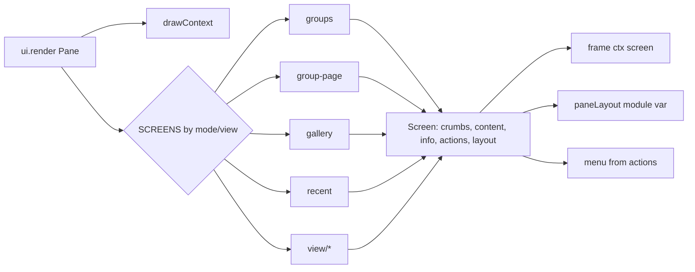
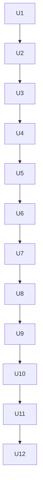

# Peek Structure Refactor - Plan

**Target repo:** shrimpshack, worktree `worktrees/peek-refactor`, branch `task/peek-refactor` (from `3bd6fbd` = main + PR #102 Slack threads + PR #103 hover fix). All paths are relative to the repo root. The PR targets `feature/peek-slack-threads` (#102) and says it also contains #103; if #102 and #103 have merged to main by shipping time, rebase onto main and target main instead.

---

## Goal Capsule

- **Objective:** a person extending peek (a new screen, source or key) can find where it goes, change one place, and trust the tests. Today nearly everything lives in one 4,099-line `register.tsx`, and a new source means editing about eight places.
- **Means:** apply every finding of the thermo-nuclear review (`/Users/shawnroos/.claude/jobs/04b1befa/tmp/thermo/{register,data,kit}.md`) as a sequence of behavior-preserving moves, each landing green.
- **Authority:** the three review reports are the requirements source; this plan orders and sizes them. Engine types at `plugins/peek/.claude-plugin/types/claude-code/index.d.ts` decide what a mod can do; where a report's proposal and the types disagree, the types win and the unit records the fallback.
- **Stop conditions:**
  - Any change in user-visible behavior: pane drawing, keys, ⌃k rows, messages, failure text, tool results, files written.
  - A test edited to accept different behavior. Tests may move files, import from new paths, use shared fixtures, add the characterization or overlay-order checks a unit names, or be deleted when they only cover code U1 removes; no existing expected result changes.
  - A new module above 1,000 lines at any unit, or `register.tsx` above 1,000 lines after U12 (the size check in the Verification Contract).
- **Characterization first:** every characterization test a unit adds is committed and seen passing against the unchanged code before that unit moves anything; a characterization test never observed green on the old code cannot clear a refactor.
- **Execution profile:** TypeScript Claude Code mod, `plugins/peek`. Gates per unit: `claude plugin test .`, `npx -y -p typescript@5.6 tsc -p .` (exit code read directly), `claude plugin validate .`.
- **Who finishes:** `ce-work` implements units in order and commits each; the final live pane check is done by a person.

---

## Product Contract

### Summary

Restructure peek so each concern has one home: screens behind a table, one action model for keys and the menu, one widget kit, one identity type, one adapter per remote source, one failure table, one cache helper, one test world. Nothing the person sees changes.

### Problem Frame

Every recent feature (groups, Slack, live view, media) had to thread itself through one 1,957-line render closure, two parallel key systems glued by a regex, five copies of the item row/card, and data-layer tables that answer "which source is this?" in six places with disagreeing edges. Each feature makes the next one slower and riskier. The pane tests are strong, so a behavior-preserving restructure is safe now and gets harder with every feature.

### Requirements

**Pane**

- R1. The Pane render hook dispatches through a table of screen renderers (groups tab, group page, gallery, recent, view); `register.tsx` holds only atoms, ports and hook wiring, at 600 lines or fewer.
- R2. Footer hotkeys and ⌃k rows come from one `Action` list per screen; reader and live view each have one list; `COMMAND_KEYS` and its regex are gone.
- R3. Item cards, item rows, the icon slot, the hover overlay, section rules and the picture-budget check each exist once, over one `ItemLook` type.
- R4. Each screen reports its selection and scroll layout alongside what it draws; the group page needs no special cases in move, focus or message handling.
- R5. Messages from client modules are one typed union, parsed once and handled by one `switch`.
- R6. Group tools, loaders, the image pipeline, live-view handlers, the group cache and the UI gallery live outside `register.tsx`.

**Data**

- R7. `Ref` is a discriminated union carrying its canonical key; `itemKey` is computed once per ref.
- R8. Each remote source is one `SourceAdapter`; source identity, refresh timing, tier label, trail icon, capture claims and failure text come from it.
- R9. Failure mapping lives in one table module whose rules reproduce today's results exactly, live-view failures have their own type, and Slack's private pseudo-failure is gone.
- R10. Shared wire helpers (JSON guards, safe JSON and URL parsing, entity decoding) and protocol parsers exist once; session caches use one helper; one ports record feeds every module.

**Kit and tests**

- R11. `lib.ts` is split by concern and removed; kind metadata is one table; client modules share one hover helper; dead code is gone.
- R12. Pane tests share one test world and props; `groups-pane.test.ts` is split into tools and page suites.

### Key Decisions

- **Do every review finding in this effort.** (session-settled: user-directed — chosen over doing a subset first.) Governs R1–R12.
- **Behavior must not change; the existing tests stay green at every step.** (session-settled: user-directed — chosen over a redesign that changes behavior.) Governs R1–R12.
- **Follow the reviewers' migration order.** (session-settled: user-approved — chosen over a big-bang rewrite.) Dead code first, then widgets with the early validation check, then moving code out, then screens, actions, layout, messages, and data last. Governs R1–R11.

### Scope Boundaries

- New features or visual changes of any kind.
- `helper/peek-web.swift` (reviewed: no action).
- Splitting `groups.ts` into three files (deferred by the reviewer until it nears ~700 lines).

---

## Planning Contract

### Key Technical Decisions

- KTD1. **Renderers are plain functions in imported modules that receive a `DrawContext` (resolved elements, palette, geometry) and a `PaneActions` port; they never receive `$`.** Same pattern as `remoteIoOf` and `groupsIoOf`. A feasibility probe already passed `claude plugin validate` for a `hooks/pane/` module receiving resolved elements and rendering a `<Client module="../hover-layer.tsx">`; U4 confirms it on the real code with a pane test. If an imported function cannot receive resolved elements, the fallback is that modules return element descriptions or factories that `register.tsx` instantiates. Record which path held in the unit's report. Governs R1, R3.
- KTD2. **One `Screen` shape**, `{ crumbs, content, info, actions, menuOn, pageBg?, layout }`. It names today's `frame(...)` arguments, and `frame(ctx, screen)` stays the single chrome path. `SCREENS` is a plain `Record`; view kinds stay a plain `if` chain over modules, with no plugin system. Governs R1.
- KTD3. **`Action = { id, label, icon, hotkey?, menu?, run }`.** The footer renders hidden buttons from actions with hotkeys; the menu renders actions plus group rows plus recent files. Mode actions come from `MODES` and keep **today's exact behavior per entry point**. The review notes that ⌃k→Recent/Gallery/Peek skip `switchMode` while `e` and ⌃k→Groups use it, which leaves `page` unreset in some paths. Preserve that difference with an explicit per-action note rather than unifying it, because unifying is a behavior change. Governs R2.
- KTD4. **Failure tables reproduce today's per-transport results, including the disagreements.** 404 gives `gone` via HTTP and `not-found-or-no-access` via non-JSON GraphQL; 401 maps three ways. Each is pinned by a table test before any mapper moves. Unifying them is out of scope (a behavior change); record it as a follow-up. Governs R9.
- KTD5. **The persisted `titles` store keeps reading entries under both raw-address and `itemKey` keys.** New writes use `itemKey`. Becoming a view of the refresh cache must not drop titles saved by older versions; a test loads a legacy-keyed store. Governs R10.
- KTD6. **`navigate()` writes the same atoms in the same final state; only the number of intermediate redraws drops.** The dead `section` and `trail` atoms go in U1. Governs R5, R11.
- KTD7. **Keep `ticker.tsx` and the `peek-ui` gallery** (moved to `ui-gallery.tsx`). The review calls them demo code, but `/peek-ui` is a working command, and deleting it would change behavior. Governs R6, R11.
- KTD8. **Delete only code with no production caller** (`grid.tsx`, unused imports/atoms/`scrollLimit`/`jumps`, `lib.starredFirst`/`pageOf`, `tierFor`/`freshness`/`dueAddresses`/`ciSummary`/`ciTone`/exported `resolveNumber`), together with tests that exist only to cover them. Governs R11.
- KTD9. **Commit at every unit.** Each unit ends with the three gates green and the live copy synced from this worktree. A unit that cannot stay green splits rather than landing red. Governs R1–R12.

### High-Level Technical Design

Target module map (directional):

```text
plugins/peek/hooks/
  register.tsx        atoms, ports (portsOf($)), hook wiring, PaneActions, SCREENS dispatch  (<=600)
  pane/
    types.ts          DrawContext, Screen, PaneActions, Action, Layout, ItemLook
    chrome.tsx        header, crumbs (fitCrumbs pure), tabs, footer, frame(ctx, screen)
    menu.tsx          ⌃k menu from Action[] + group rows + recents
    widgets.tsx       ItemIcon, ItemCard, ItemRow, HoverLayer, SectionRule, fitPicture
    layout.ts         LayoutBuilder (section/grid/rows emit JSX + nav/blocks together)
    messages.ts       PaneMessage union + parsePaneMessage (also imported by client modules)
    screens/{groups,group-page,gallery,recent}.tsx
    screens/view/{index,remote,slack,markdown,table,dir,code,image}.tsx
  group-tools.ts      GROUP_TOOLS table + star tool, one tool.call loop
  groups-store.ts     createGroupStore(io): shown, shownOne, write (cache beside writer)
  loaders.ts          Record<Kind, Loader>
  images.ts           toPng, pictures, caches, ImageIo
  live-pane.ts        LiveSession record + handlers
  ui-gallery.tsx      /peek-ui
  sources/
    adapter.ts        SourceAdapter, adapterFor, ok()
    github.ts linear.ts slack.ts web.ts   (adapters)
    classify.ts       failure tables
    linear-credentials.ts
  parsers/{slack-transcript,gh-argv,curl}.ts
  wire.ts  cache.ts  net.ts  refs.ts (Ref union + key)  capture.ts (store only)
  paths.ts markdown.ts measure.ts gallery.ts tabular.ts format.ts kinds.ts hover.ts
tests/fixtures/{world,results}.ts
```

Render flow after U6 (directional):



### Assumptions

- A client module can import a pure helper (`hover.ts`, `pane/messages.ts` types) without failing `claude plugin validate`. U9 checks this on one module first; if it fails, the duplication stays and the unit records why.
- Writing module variables during render is allowed (only UI-state writes are refused); `paneLayout` relies on this, as `navOrder` does today.

### Sources & Research

- Review reports: `/Users/shawnroos/.claude/jobs/04b1befa/tmp/thermo/register.md` (responsibility map with line ranges, findings 2–9, migration order), `data.md` (F1–F9), `kit.md` (findings 1–7).
- Rubric: `/Users/shawnroos/.claude/skills/thermo-nuclear-code-quality-review/SKILL.md`.
- Hover overlay ordering rule and its fixture: `plugins/peek/tests/fixtures/overlay.ts`.

---

## Implementation Units



Strictly sequential: almost every unit touches `register.tsx` or the shared test world.

### U1. Delete dead code

**Goal:** remove code with no production caller.
**Requirements:** R11; KTD8.
**Dependencies:** none.
**Files:** `plugins/peek/hooks/grid.tsx` (delete), `plugins/peek/hooks/register.tsx`, `plugins/peek/hooks/lib.ts`, `plugins/peek/hooks/{sources,refresh,github}.ts`, matching tests.
**Approach:**
1. Delete `grid.tsx`, the unused `fromSection` import, the `section` and `trail` atoms and their writes, `scrollLimit`, and the two unused `jumps`.
2. Delete `lib.starredFirst`, `pageOf`, `codeWindow`, `isImageLine`, `headingAtRow`, `isViewable` and `jsonSummary` where grep confirms no production caller. Also delete `tierFor`, `freshness`, `dueAddresses`, `ciSummary`, `ciTone` and the exported `resolveNumber`.
3. Delete tests that only cover the deleted functions.
**Test scenarios:** the full suite passes unchanged apart from the removed tests; grep shows no remaining reference to any deleted name.
**Verification:** gates green; the test count drops only by the removed dead-code tests.

### U2. Shared test world and groups test split

**Goal:** one test world, one props object, one result-helper set; groups tests split in two.
**Requirements:** R12.
**Dependencies:** U1.
**Files:** `plugins/peek/tests/fixtures/world.ts`, `plugins/peek/tests/fixtures/results.ts` (new), the 7 pane tests, unit tests with `exited`/`record`/`meta`/`ref`, `plugins/peek/tests/groups-pane.test.ts` → `groups-tools.test.ts` + `groups-page.test.ts`.
**Approach:**
1. Move `groupsWorld`'s fake fs, git and lock simulator into `fakeFs`. The shared world holds only identical base handlers; any answer that differs between suites (e.g. the `sh` replies in github and live tests) stays in that suite's own route, never normalized.
2. Add `baseWorld`, `fakeProcess`, `fakeHttp`, `PANE_PROPS`, `PNG_HEAD` and the curl marker, importing the production marker constant instead of retyping it.
3. Convert files one at a time, running the suite after each.
4. Split groups-pane: lines 1–570 hold the tool tests, 571+ the page tests.
5. Add `hoverLayers()` checks to remote-pane and media-pane (kit finding 2).
**Test scenarios:** the same test names and count pass, apart from the added overlay-order checks; no handler is registered twice in one world.
**Verification:** gates green; about 300–400 test lines removed.

### U3. Split lib.ts; one kinds table

**Goal:** lib.ts gone, replaced by modules split by concern; kind metadata in one table.
**Requirements:** R11.
**Dependencies:** U2.
**Files:** `plugins/peek/hooks/{paths,markdown,measure,gallery,tabular,format,kinds}.ts` (new), `lib.ts` (removed), `theme.ts`, all importers, `lib.test.ts` split.
**Approach:**
1. Move one cluster at a time verbatim behind temporary `export *` re-exports in lib.ts.
2. Repoint importers to the new modules.
3. Split `lib.test.ts` to match, then delete lib.ts.
4. Build `KINDS: Record<Kind, {icon, color, glyph, label, type}>`; `iconFor`/`colorFor`/`kindLabel`/`typeOf` become lookups. Move `ruleParts` to measure.ts and `classifyBlocks` beside the chat-message readers.
**Test scenarios:** every moved function keeps its tests; the kinds-table lookups equal the old maps for every `Kind`.
**Verification:** gates green; no file imports `./lib`.

### U4. Pane widgets over ItemLook; validation check

**Goal:** one item card, row, icon slot, hover overlay, section rule and picture-budget helper.
**Requirements:** R3; KTD1.
**Dependencies:** U3.
**Execution note:** before any other extraction, move `SectionRule` alone into `pane/widgets.tsx`, run `claude plugin validate .` and the pane tests, and record which KTD1 path holds.
**Files:** `plugins/peek/hooks/pane/{types,widgets}.tsx` (new), `register.tsx`.
**Approach:**
1. Define `ItemLook` and one `lookOf` from `FileEntry` and `GroupItem`, so the remote-naming branch is written once.
2. Add `ItemIcon`, `ItemCard`, `ItemRow`, `HoverLayer` (always rendered last), `SectionRule` and `fitPicture` (budget accounting inside).
3. Replace each copy listed in register.md finding 4. Keep the raw-href star lookup (`starSet`) exactly as today; record the href-vs-`itemKey` star mismatch as a follow-up.
**Test scenarios:** pane tests pass as-is; the overlay-order fixture passes for every surface; one characterization test pins today's Recent/Gallery star display, including an entry whose stored star href differs in form.
**Verification:** gates green; render code shrinks by about 400 lines.

### U5. Move tools, loaders, images, live, group cache, UI gallery out

**Goal:** `register.tsx` holds no group tools, loaders, image pipeline, live handlers, group cache or gallery.
**Requirements:** R6; KTD7.
**Dependencies:** U4.
**Files:** `plugins/peek/hooks/{navigation,entries,groups-session,group-tools,groups-store,loaders,images,live-pane,ui-gallery}.ts(x)` (new), `register.tsx`.
**Approach:** one move per commit, each over an io port.
0. Before the moves below, also move the `$`-taking session code that has no other home (register.md map 505-1160): remote navigation (`show`, `goBack`, `loadRemote`, `viewOf`) to `navigation.ts`; entry listing (`toHref`, `guess`, `sessionEntries`, `loadScope`) to `entries.ts`; star and person-group commands (`setStar`, `personWrite`, `groupCommands`, group-page row selection, `groupItemLook`) to `groups-session.ts`. Also move `refresh`, `sourceLine`, `tickRemote`, `pressLink`, `docImage` and `setMenu` (register.md 1522-1616) beside their callers. Each module takes a `NavIo` port built in register.tsx that wraps `read`/`update` of the pane atoms plus the engine calls it needs.
1. `group-tools.ts`: tool table plus the `star` tool spec. Keep one literal `on('tool.call', { tool: 'mcp__peek__…' }, …)` registration per tool, each delegating to its table entry, because a loop-registered filter shows as `tool=?` to the validator and its runtime scoping is unverified. Compare `claude plugin validate` output before and after.
2. `groups-store.ts`: `createGroupStore(io)` with the cache beside the writer.
3. `loaders.ts`: a `Record<Kind, Loader>`.
4. `images.ts`: merge `avatarPictures` and `mediaPictures` into one function with an edge parameter.
5. `live-pane.ts`: one `LiveSession` record.
6. `ui-gallery.tsx`.
**Test scenarios:** tool results byte-identical (the groups-tools suite); live and media pane suites pass unchanged.
**Verification:** gates green after each move.

### U6. Screen table

**Goal:** the render hook is a short dispatch through `SCREENS`.
**Requirements:** R1; KTD1, KTD2.
**Dependencies:** U5.
**Files:** `plugins/peek/hooks/pane/{chrome,menu}.tsx`, `pane/screens/**` (new), `register.tsx`.
**Approach:**
1. Add `DrawContext`, `PaneActions` (built in register.tsx), `Screen` and `frame(ctx, screen)`.
2. Make `fitCrumbs` pure (returns `isTabCompact`), and resolve the palette once with no shadowed `C`.
3. Move screens one per commit: groups tab, group page, gallery, recent, then view (`remote` and `slack` as separate modules; markdown, table, dir, code and image).
**Test scenarios:** all pane suites pass after each screen move.
**Verification:** gates green per move; record `register.tsx`'s line count (the 600-line target is checked at U12).

### U7. One Action model

**Goal:** footer keys and ⌃k rows come from one list per screen.
**Requirements:** R2; KTD3.
**Dependencies:** U6.
**Files:** `pane/types.ts`, `pane/menu.tsx`, `pane/chrome.tsx`, screens, `live-pane.ts`.
**Approach:**
1. Screens return `actions`; delete `Key`, `MenuCommand`, `COMMAND_KEYS`, the regex and the `closeAt` splice.
2. Build the mode actions from `MODES`, preserving each entry point's current behavior (KTD3).
3. Use separate `readerActions` and `liveActions` lists; `liveKey` looks keys up in `liveActions`, and the `isTyping` wrapper applies to that one list.
**Test scenarios:** the ⌃k menu lists the same rows, order and hints as before on every screen (characterize first); every hotkey triggers the same action; the live view routes the same keys.
**Verification:** gates green.

### U8. Screens return Layout

**Goal:** selection and scroll layout come from what each screen drew.
**Requirements:** R4.
**Dependencies:** U7.
**Files:** `pane/layout.ts` (new), screens, `register.tsx` (`moveSelection`, `ui.focus`, `ui.message`).
**Approach:**
1. Add a `LayoutBuilder` that emits JSX and nav/blocks together, and store its result in one `paneLayout` module variable.
2. Group-page rows become `NavItem`s, and `groupRows.selected` goes away.
3. Remove the group-page special cases.
**Test scenarios:** cursor movement, focus and scroll positions match before and after on every screen (group page, expanded group cards, Recent with pinned groups, Gallery wrap).
**Verification:** gates green.

### U9. Typed messages, hover helper, navigate()

**Goal:** one message union, one client hover helper, atomic navigation.
**Requirements:** R5, R11; KTD6.
**Dependencies:** U8.
**Execution note:** convert `tabs.tsx` to the shared helper first and run `claude plugin validate .` before converting the other client modules.
**Files:** `pane/messages.ts`, `hooks/hover.ts` (new), `hover-layer.tsx`, `rows.tsx`, `tabs.tsx`, `tasks.tsx`, `live-input.tsx`, `register.tsx`.
**Approach:**
1. Add `PaneMessage` and `parsePaneMessage`; senders post tagged values.
2. `ui.message` becomes one `switch`.
3. Add `hoverable({hit, click})` and `paletteOf`. Hover-layer props become a discriminated union, removing the `??` fallbacks.
4. Add `navigate()` to replace the sequential atom writes in `show`, `goBack`, `openGroupPage` and `switchMode`.
**Test scenarios:** every click and star path on every surface posts and acts as before; an unknown message is ignored; the post-navigation state equals the old one.
**Verification:** gates green.

### U10. Ref union with key; wire helpers and parsers

**Goal:** identity is a typed value; parsing helpers exist once.
**Requirements:** R7, R10.
**Dependencies:** U9.
**Files:** `refs.ts`, `wire.ts`, `parsers/{slack-transcript,gh-argv,curl}.ts` (new), `github.ts`, `linear.ts`, `slack.ts`, `capture.ts`, `defuddle.ts`, `web.ts`, `refresh.ts`, `register.tsx`.
**Approach:**
1. Add `key` to the parsed `Ref`; `itemKey(string)` delegates to it.
2. Convert callers to the field, tighten the union and delete `ItemRef`.
3. Resolve `gh-number` before `load`, and use one `LINEAR_KEY` regex.
4. Add `wire.ts` (`asObj`/`asStr`/`asNum`/`asArr`/`asDay`/`tryJson`/`parseUrl`/`decodeEntities`/`markedStderr`) with linear and slack's semantics. GitHub keeps its own semantics (untrimmed strings, `{}` objects, `0` numbers) as thin local wrappers over `wire.ts`; first add characterization tests for a body starting with indented code, a whitespace-only branch name, and a missing `head` object.
5. Move the protocol parsers out as pure files with their current tests.
**Test scenarios:** every ref fixture parses to the same kind, address and key as before; a GitHub record built from a payload with missing fields is identical before and after.
**Verification:** gates green.

### U11. Source adapters and failure tables

**Goal:** one adapter per source; one failure table module.
**Requirements:** R8, R9; KTD4.
**Dependencies:** U10.
**Files:** `sources/adapter.ts`, `sources/classify.ts` (new), `remote.ts`, `refresh.ts`, `sources.ts`, the four source files, `types/index.d.ts`, `register.tsx` (`TIER_NAMES`, `trailIcon`).
**Approach:**
1. Pin today's failure mapping per transport in a table test.
2. Add `classify.ts`. `ghFailure` and `slackFailure` become table lookups; GraphQL keeps its code logic and uses `fromHttpStatus` with its current context.
3. Split `FailureKind` into `RemoteFailure` and `LiveFailure`. Replace Slack's `'unavailable'` with an explicit skip result.
4. Add `SourceAdapter` and `adapterFor`. Move `isTimed`, tier label, trail icon, `failureText` and the optional `fromCapture` onto it (Slack drops its stub), and use one `ok()` constructor.
5. Delete `sourceFor`, `sourceOf`, `familyOf` and `TIER_NAMES`.
**Test scenarios:** the failure table test passes unchanged across the move; every failure page shows the same title and hint; back-off buckets and refresh timing are unchanged per source.
**Verification:** gates green.

### U12. Caches, ports, capture, minors

**Goal:** one cache helper, one ports record, `capture.ts` as a store, and the minor findings fixed.
**Requirements:** R10; KTD5.
**Dependencies:** U11.
**Files:** `cache.ts`, `net.ts`, `sources/linear-credentials.ts` (new), `capture.ts`, `slack.ts`, `web.ts`, `github.ts`, `sources.ts`, `defuddle.ts`, `refresh.ts`, `linear.ts`, `register.tsx`, `types/{remote,groups,view}.d.ts`.
**Approach:**
1. `sessionMemo({max?, keep?})` replaces the six hand-written memo maps.
2. Titles become a view of the refresh cache (`snapshotTitles`/`hydrate`), still reading legacy raw-address keys (KTD5).
3. `portsOf($)` is built once, with `Pick<>` per module.
4. `net.ts` takes `downloadFile`/`fetchToScratch`/`SCRATCH`/`IMAGE_EXT`; the injected `downloadImage` closure goes.
5. Linear credentials move out of `sources.ts`.
6. Adapters expose capture claims, and `capture.ts` shrinks to a store. `LinearIdentity` gets one owner; `grewLinear` becomes `learned`.
7. Move Slack's `initials`/`whenLabel` to `format.ts`.
8. Rename the two `TITLE_CAP`s; one video regex.
9. Wrap `refresh`'s in-flight state in try/finally; run Linear project queries in parallel.
10. Split `types/index.d.ts` by domain.
**Test scenarios:** a store holding legacy raw-address titles still shows titles; refresh dedupe and back-off are unchanged; capture replay returns the same items; the Linear workspace resolves the same.
**Verification:** gates green; no file over 1,000 lines; `register.tsx` at 600 lines or fewer.

---

## Verification Contract

| Check | Command or step | Applies to |
|---|---|---|
| Tests | `claude plugin test .` (from `plugins/peek`), all pass | every unit |
| Types | `npx -y -p typescript@5.6 tsc -p .`, exit code 0 read directly | every unit |
| Validate | `claude plugin validate .` passes | every unit; first run in U4 and U9 decides KTD1 / the hover-helper assumption |
| Size | `wc -l plugins/peek/hooks/**/*`: no new module over 1,000 at any unit; `register.tsx` at 600 or fewer at U12 | every unit; final |
| Manual live check | after `/reload-plugins`: Recent, Gallery, Groups (fold/expand, star, add/remove via ⌃k), a group page, a GitHub PR page, a Slack thread, a web page and its live view, ⌃k menu on each | final |

---

## Definition of Done

- R1–R12 met; every unit's gates green at its commit.
- No test changed to accept different behavior.
- The manual live check is done by a person and shows no visible difference.
- Follow-ups recorded in the PR: unify the divergent failure mappings (KTD4); the per-entry-point mode-switch difference (KTD3); and the raw-href vs `itemKey` star mismatch (U4).
