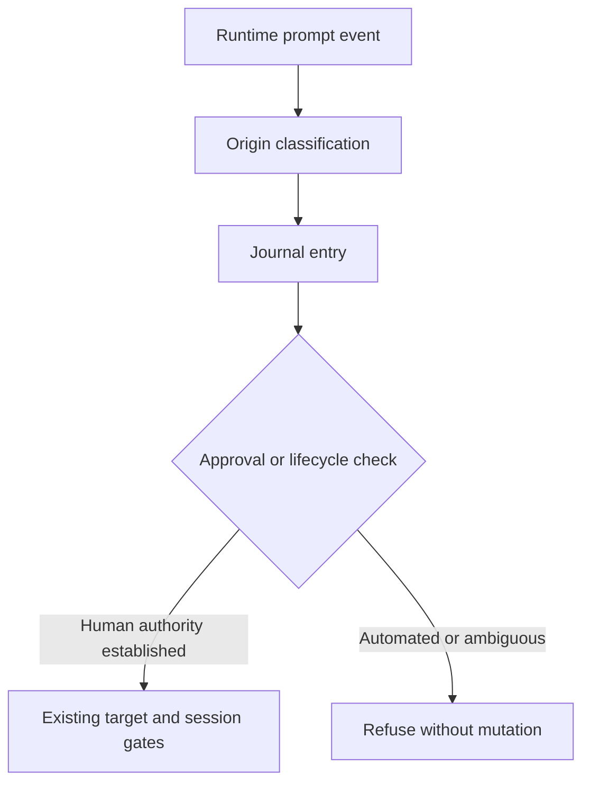

# Programme Approval Origin - Plan

## Goal Capsule

- **Objective:** A background event or worker message cannot authorize programme actions on Shawn's behalf.
- **Means:** Reproduce the observed origin error before changing the approval boundary (KTD1 — evidence before implementation).
- **Authority:** The approved local-only scope and Product Contract govern implementation.
- **Execution:** Test-first investigation, bounded correction, independent review, and local verification.
- **Stop conditions:** Stop on a permission refusal or a required action outside the approved scope.
- **Delivery:** Leave verified changes on a feature branch, without commits, pushes, pull requests, releases, or deployment.

## Product Contract

### Summary

Investigate the prompt-origin error seen during the scratch replay.
Correct any confirmed approval gap while preserving genuine typed approvals.

### Problem Frame

A completed Monitor notification appeared in the programme journal with origin `typed`.
The replay did not use that event as approval.
Classification alone does not establish that the event could authorize an action.

### Requirements

**Approval boundary**
- R1. Automated background events and worker messages must not authorize programme approvals or lifecycle requests.
- R2. Genuine typed input must retain existing target, session, freshness, and consumption checks.
- R3. Resume and compaction must not upgrade an event's authority.

**Evidence and scope**
- R4. Demonstrate the defect through the actual hook and a harmless approval operation before modifying production code.
- R5. Add regression coverage that fails on the original defect and passes after correction.
- R6. Use isolated local state and preserve live user programmes and permission settings.
- R7. Clean up all test sessions, watchers, and leases created by this work through supported lifecycle operations.

### Scope Boundaries

No dependency enforcement, broad hook refactor, external writes, commits, publishing, production changes, or fabricated live typed approvals.
Synthetic inputs are permitted only in isolated automated test fixtures and must not be presented as human approval.

### Acceptance Examples

- AE1 — Automated agreement approval. A background event containing approval-shaped words is journaled without human authority; citing it refuses mutation. Covers R1, R4.
- AE2 — Genuine agreement approval. A genuine typed approval remains usable for its permitted target. Covers R2.
- AE3 — Lifecycle rejection. Automated takeover, handover, and end text cannot create usable lifecycle requests. Covers R1.
- AE4 — Context restoration. Reopening local state or acknowledging restored rules leaves automated events non-authorizing. Covers R3.

## Planning Contract

### Key Technical Decisions

- KTD1. **Evidence before implementation.** Use the existing shell/Python fixture patterns to reproduce classification and approval together. Do not change code if the reported boundary failure cannot be demonstrated.
- KTD2. **Classify from available provenance.** Inspect the actual runtime hook payload and transcript before selecting a correction. Do not assume an undocumented source field exists.
- KTD3. **Reject ambiguity at the approval boundary.** If runtime provenance cannot distinguish human input from automation, report that limitation rather than claim text heuristics prove human intent.
- KTD4. **Keep the audit trail.** Preserve non-human events as non-authorizing journal entries where the existing journal contract permits it. Cover every consumer that currently accepts `typed`.

### High-Level Technical Design

### Sequencing and Parallelism

Reproduction precedes the correction.
Classification and approval changes share a boundary and run sequentially in one implementation stream.
An independent read-only review can run after the correction while the full suite runs.
No parallel agents edit shared hook or journal files.

### Assumptions and Risks

The hook input might not carry trustworthy source metadata.
Runtime inspection resolves that uncertainty before choosing the mechanism.
Known event wrappers are evidence of automation, not proof that all unwrapped text is human.
Existing journal records labeled `typed` may lack sufficient historical provenance; do not silently reinterpret them as newly verified human approvals.

### Sources

- `plugins/auto/lib/on-user-prompt.py`: watcher-text matching followed by a `typed` default.
- `plugins/auto/lib/programme.py`: prompt lookup exposes journal origin to approval checks.
- `plugins/auto/lib/programme_lifecycle.py`: lifecycle request selection and cited typed prompt checks.
- `plugins/auto/tests/integration/programme-hooks.test.sh`: isolated hook fixtures and cron/typed controls.

## Implementation Units

### U1. Reproduce classification and authorization

**Goal:** Establish whether the observed event can cross the approval boundary.
**Requirements:** R1, R2, R4, R6.
**Dependencies:** None.
**Files:** `plugins/auto/tests/integration/programme-hooks.test.sh`; new focused origin test file if isolation is clearer.
**Approach:** Inspect existing runtime evidence, then pass representative events through the real hook in isolated programme state and attempt harmless agreement changes.
**Execution note:** Capture a failing authorization assertion before implementation; distinguish classification failure from usable approval.
**Patterns:** Existing hook fixtures, programme CLI tests, and per-test data directories.
**Test scenarios:**
1. Monitor completion notification with approval-shaped content cannot approve an agreement.
2. Registered cron prompt cannot approve an agreement.
3. Worker message cannot approve an agreement.
4. Genuine typed positive control passes the existing approval gates.
5. Malformed hook input does not create authority or break the hook's fail-open execution contract.
**Verification:** Record observed inputs, origins, refusals, unchanged state, and the positive-control result.

### U2. Correct the confirmed boundary

**Goal:** Apply the smallest correction supported by reproduction evidence.
**Requirements:** R1, R2, R3, R5.
**Dependencies:** U1 — reproduce classification and authorization.
**Files:** `plugins/auto/lib/on-user-prompt.py`; `plugins/auto/lib/programme_journal.py`; `plugins/auto/lib/programme.py`; `plugins/auto/lib/programme_lifecycle.py`; relevant protocol validation module only if the trace requires it; `plugins/auto/tests/integration/programme-hooks.test.sh`; `plugins/auto/tests/unit/programme-journal.test.sh`; `plugins/auto/tests/integration/programme-compact.test.sh`.
**Approach:** Follow KTD2 — classify from available provenance and KTD3 — reject ambiguity. Update affected consumers and tests together, without weakening existing approval checks.
**Test scenarios:**
1. Automated origin never passes an approval check, even with a matching target and the PM's session ID.
2. Automated lifecycle text cannot end or transfer a programme.
3. Cron, Monitor success/failure, worker messages, and restored context retain non-human authority.
4. Genuine typed target-specific approval and lifecycle requests still work.
5. Missing or malformed provenance cannot upgrade an explicitly non-human event.
**Verification:** The new tests fail against the original implementation and pass against the correction. Existing programme tests remain green, except separately proven baseline failures.

### U3. Review, live verification, and cleanup

**Goal:** Verify the complete boundary and leave no active test resources.
**Requirements:** R1 through R7 — approval, evidence, isolation, and cleanup.
**Dependencies:** U2 — correct the confirmed boundary.
**Files:** Focused tests from U1 and U2; local scratch evidence outside the repository.
**Approach:** Run independent code review and relevant regression suites. Exercise the corrected hook with a real harmless background event, using isolated state rather than changing the installed plugin. Record any runtime proof that cannot be obtained within scope.
**Test scenarios:**
1. The corrected hook consumes a real background-event shape and produces a non-authorizing entry.
2. An actual genuine typed prompt supplies the positive control; no synthetic journal row substitutes for it.
3. Every created watcher/session exits and every test lease is released through the supported path.
**Verification:** No unresolved serious review finding. Report exact test totals, baseline failures, runtime limits, and cleanup results.

## Verification Contract

- Run the focused hook, journal, approval, lifecycle, and compaction test files through the honest-run wrapper.
- Require each shell suite's final passed/failed summary as evidence that it ran.
- Run `bash plugins/auto/tests/run.sh` through honest-run for the broader regression check.
- Prove regression sensitivity by running the new assertions against the original production implementation in an isolated copy.
- Run the comment-bloat advisory on changed code. Run the lint router if JS/TS changes enter the diff.
- Complete code review and a second review after any fixes that affect behavior.
- Do not install, publish, or modify the cached plugin as a shortcut for live verification.

## Definition of Done

The confirmed defect is corrected, new regression tests are demonstrably capable of failing, and relevant existing tests pass.
Any broader-suite baseline failure is reproduced separately and reported, not hidden.
Runtime evidence distinguishes what passed from what remains unverified.
All created test resources are cleaned up, abandoned experiments are removed, and no unauthorized outward-facing action occurred.
