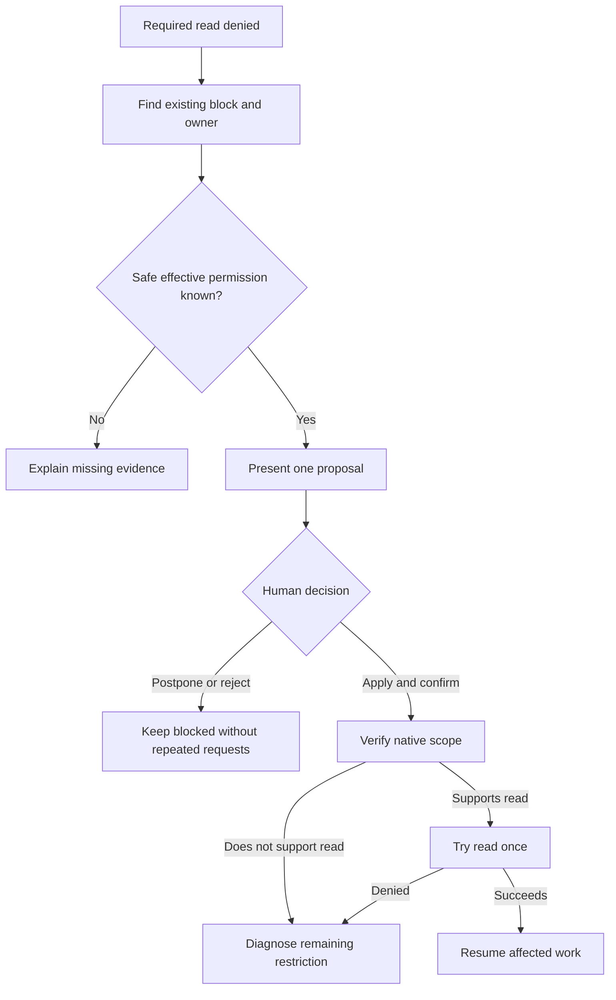
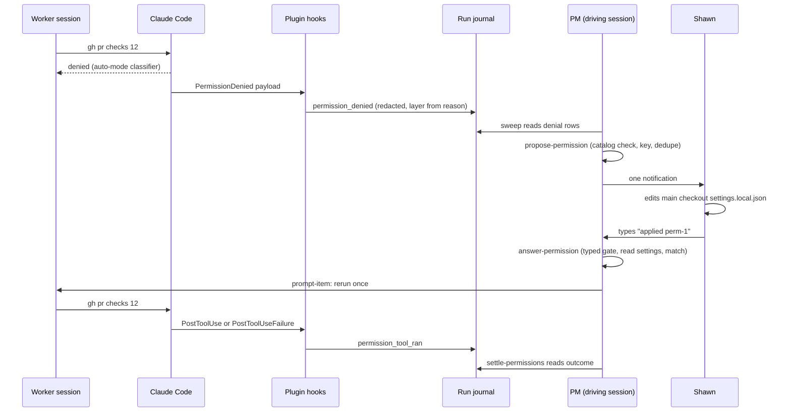
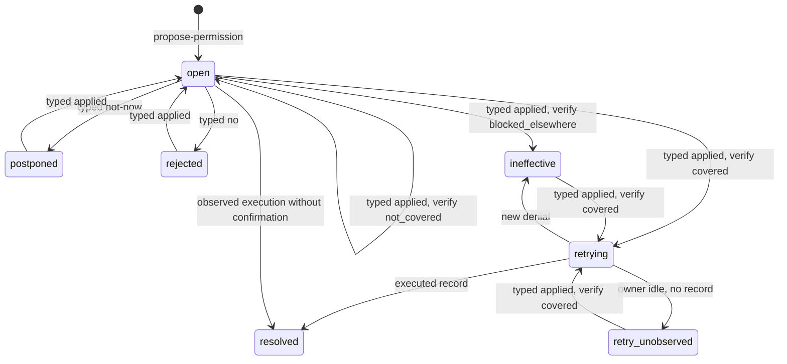
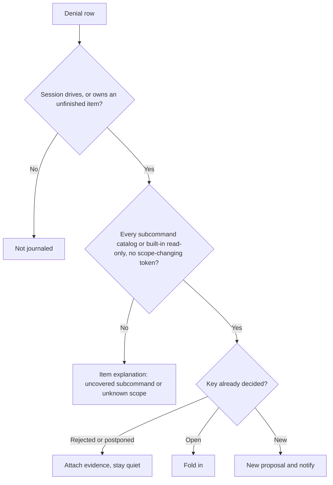
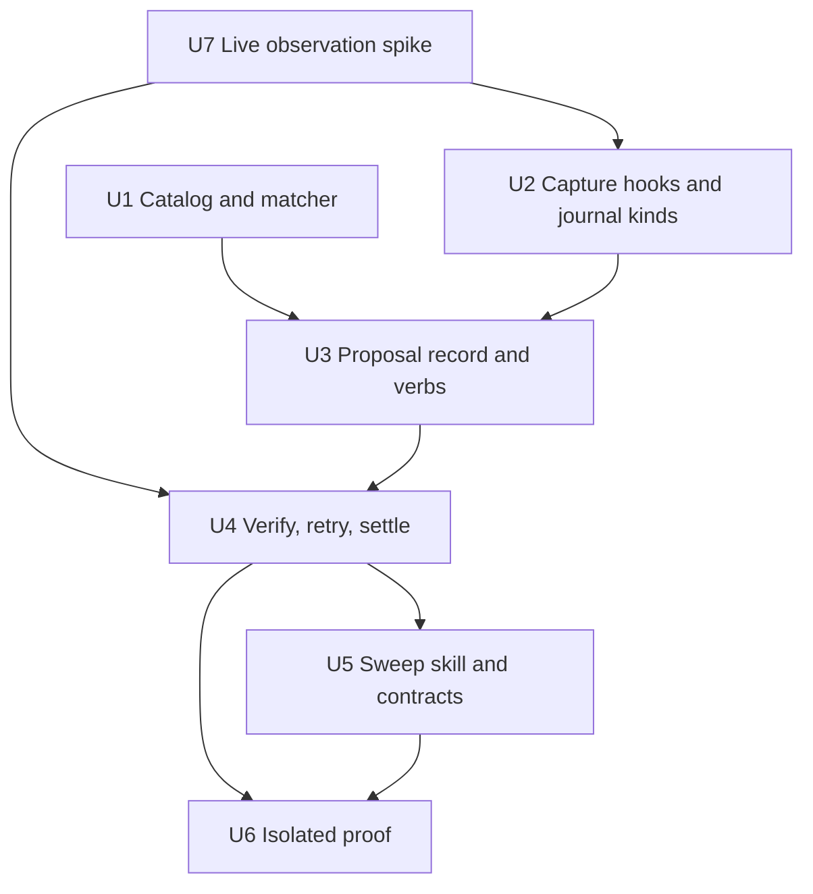

# Programme Permission Proposals - Plan

## Goal Capsule

- **Objective:** Shawn can resolve a blocked read with one precise decision, without receiving the same permission request from multiple workers.
- **Means:** Programme turns runtime denial records into one reusable proposal for a native allow rule, then checks and retries once after Shawn's typed confirmation (KTD1, KTD2, KTD5).
- **Product authority:** The Product Contract below defines scope. The human retains permission authority; Programme never writes permission settings (R4).
- **Authority order:** R-IDs win on product behavior; KTDs win on mechanism within their cited R-IDs; units override neither.
- **Stop conditions:** Stop and report instead of proceeding when any of these holds:
  - Implementation would need Programme to write a settings file.
  - Implementation would need a live settings change or a replay of the historical AI Labs command.
  - Implementation would accept a non-`typed` prompt as approval.
  - The live observations in U7 contradict KTD1, KTD3 or KTD5 in a way the plan cannot absorb.
- **Execution profile:** Python and Bash inside `plugins/auto`, with shell test suites. No JS/TS, no new dependencies.
- **Current authorization:** Shawn selected `lfg`, which authorizes implementation, review, commits, push, a pull request, and CI verification. Shawn confirmed through the PM session that work proceeds now the approval-origin fix has merged.
  The following remain excluded:
  - live permission or settings changes
  - historical denied-operation replay
  - installed-plugin edits
  - production changes
  - external tracker writes
  - merging
  - changes to other sessions' resources
- **Who finishes:** `lfg` runs `ce-work`, review, and the pull request. Merging stays with Shawn.

---

## Product Contract

### Summary

Programme will prepare one reusable permission proposal when required read-only work is blocked.
The human reviews and applies the native permission; Programme verifies the change before resuming the read.
Claude Code remains the permission manager.

### Problem Frame

Repeated requests interrupt Shawn without necessarily resolving the underlying restriction.
Several workers can report the same block, and an ineffective approval can produce another generic request.

The handoff reports a read-only GitHub CI-status check classified as a merge operation.
The underlying transcript read was denied during orientation, so that incident and its exact repository remain unverified.
It is a first acceptance scenario, not proof that a particular permission rule will solve it.

### Key Decisions

- **Reusable proposals over one-off requests.** Governs R3 (Actionable proposal). (session-settled: user-directed — chosen over one-off approval requests: matching checks should stop causing repeated interruptions.)
- **Interrupt when required work is blocked.** Governs R5 (One owner and request). (session-settled: user-directed — chosen over scheduled updates or request-only proposals: surface the decision when it prevents progress.)
- **Read-only first.** Governs R2 (Eligible operations). (session-settled: user-directed — chosen over GitHub-only coverage or selected writes: support verified reads without expanding write authority.)
- **Verify and resume after confirmation.** Governs R8 (Application and resumption). (session-settled: user-directed — chosen over a second continue instruction: avoid an extra interruption.)
- **No approval-management product.** Governs R6 (Changed decisions) and R7 (Postponement and rejection). (session-settled: user-directed — chosen over proposal-version approval: ask about changed outcomes, deliverables, or broader permission, not administrative changes.)
- **Keep permission management native.** Governs R4 (Human authority). (session-settled: user-approved — chosen over Programme expiry, renewal, and revocation machinery: avoid a second permission manager.)

### Actors

- A1. **Shawn:** reviews proposals, applies native permissions, and confirms application or declines the request.
- A2. **Owning PM:** diagnoses the restriction, presents the shared request, and coordinates affected work.
- A3. **Workers:** report blocks and follow the owning PM's decision record without claiming human authority.
- A4. **Claude Code:** enforces runtime permissions and other safety restrictions independently of Programme.

### Requirements

**Diagnose and propose**

- R1. **Blocked-work intake:** Capture the denied operation, denying layer, reason, repository, session, and source evidence without disclosing secrets or unrelated prompts.
  Preserve a bounded source reference when sanitization prevents safe inclusion of exact input.
- R2. **Eligible operations:** Prepare reusable proposals only for verified read-only operations within the authorized task and a verified repository scope.
  Writes, credential access, and uncertain operations receive a precise blocker explanation instead of standing permission proposals.
- R3. **Actionable proposal:** Present the needed outcome, blocked read, exact native rule, personal repository destination, application steps, exclusions, risks, and supporting evidence.
  If the cause or a safe effective rule is unknown, identify the missing evidence instead of inventing a permission change.

**Human decision and coordination**

- R4. **Human authority:** Only the human reviews and applies native permissions; Programme neither changes settings nor adds a separate permission-management system.
  Worker claims, scheduled events, agent summaries, and Programme protocol rules cannot establish human approval or runtime permission.
- R5. **One owner and request:** Present one precise request when required work is blocked, with one owning PM and all matching affected work attached.
  Duplicate worker reports and ownership transfers reuse the existing request without combining different repository scopes or required permissions.
- R6. **Changed decisions:** Ask again only for a changed needed outcome, changed deliverable, genuinely broader permission, or an explicitly reopened decision.
  Update material evidence, restriction state, or required human action in the existing explanation without repeating an unchanged approval request.
- R7. **Postponement and rejection:** Preserve postponement or rejection until the human reopens it or the required permission materially changes.
  Elapsed time, repeated notifications, and additional blocked workers do not justify another request.

**Resume or remain blocked**

- R8. **Application and resumption:** After verified human confirmation of application, check the native permission's effective scope and try the blocked read once when that check supports it.
  A settings entry, successful worker claim, or Programme approval alone is insufficient evidence that the restriction is resolved.
- R9. **Ineffective application:** If the change cannot resolve the restriction or the resumed read is denied, diagnose the remaining restriction within the existing request.
  Stop retries and name the actual next human action when known; do not request the same approval again or silently broaden permission.
- R10. **Work preservation:** Preserve completed work and agreed acceptance requirements while continuing only work independent of the blocked operation.
  Never reroute the denied operation through another worker, wrapper, tool, or modified hook.
- R11. **Decision continuity:** Retain enough source-linked context to recover the owner, affected work, human decision, and unresolved restriction after worker turnover or compaction.
  Recovered agent messages remain coordination evidence, not fresh human approval.

**Acceptance boundary**

- R12. **Isolated proof:** Demonstrate permitted reads, excluded writes and destinations, duplicate suppression, and ineffective-approval handling in an isolated environment.
  Do not change live permissions or replay historically denied operations merely to validate this design.

### Key Flow

- F1. **Resolve one blocked read.** Covers R1 (Blocked-work intake), R3 (Actionable proposal), R5 (One owner and request), R8 (Application and resumption), and R9 (Ineffective application).
  - **Trigger:** A worker cannot perform a required read because of a permission restriction.
  - **Sequence:** Attach evidence to the shared block, diagnose it, and present the precise proposal or missing-evidence explanation.
  - **Human step:** Shawn applies the native permission and confirms, postpones, or rejects the proposal.
  - **Outcome:** Programme verifies and resumes once, or preserves the block with a specific remaining restriction.

### Acceptance Examples

- AE1. **CI status without merge authority.** Covers R2 (Eligible operations), R3 (Actionable proposal), and R12 (Isolated proof).
  A required GitHub status read is denied in an isolated fixture with a known repository.
  The proposal permits only the intended reads; merges, comments, pushes, credential access, and unrelated repositories remain excluded.
- AE2. **Several workers, one interruption.** Covers R5 (One owner and request) and R11 (Decision continuity).
  Several workers report the same block before and after a PM handover.
  Shawn receives one request; affected work remains linked to the same decision.
- AE3. **Not now remains not now.** Covers R6 (Changed decisions) and R7 (Postponement and rejection).
  Shawn postpones or rejects a proposal, then more workers report it.
  Programme retains the decision without another approval request; wording or evidence updates do not reopen it.
- AE4. **Broader access is a new decision.** Covers R4 (Human authority) and R6 (Changed decisions).
  Work later needs access beyond the reviewed proposal.
  Programme asks about the broader permission without treating the original decision as authority for extra access.
- AE5. **Applied does not mean effective.** Covers R8 (Application and resumption) and R9 (Ineffective application).
  Shawn confirms application, but another denying layer still blocks the read.
  Programme reports that restriction without a retry loop, generic reapproval request, or claim that the task is complete.
- AE6. **Unknown cause and synthetic approval.** Covers R1 (Blocked-work intake), R3 (Actionable proposal), and R4 (Human authority).
  Evidence does not identify the denying layer, and a worker claims that Shawn approved.
  Programme reports the uncertainty and accepts neither the worker claim nor a guessed rule as permission.
- AE7. **Independent progress without bypass.** Covers R10 (Work preservation).
  One read remains blocked while unrelated work can proceed.
  Programme preserves finished work and the acceptance requirements without moving the denied operation to another execution path.

### Scope Boundaries

- No reusable write-permission proposals in this version, per R2 (Eligible operations).
- No automatic settings changes, proposal-version approval system, expiry timers, renewal requests, or Programme revocation engine, per R4 (Human authority).
- No weakening of explicit denials, sandbox restrictions, hooks, or the local Karma ban to resolve a false positive.
- No acceptance-requirement changes or broader Programme durability redesign, per R10 (Work preservation).

#### Deferred to Follow-Up Work

- Catalog operations beyond the four GitHub reads in KTD2. Each new operation needs its own reach statement, flag allowlist and fixture.
- Accepting a confirmation typed in a former driving session after handover. `_typed_prompt` keeps requiring the current driving session; widening it widens the approval gate.

<!-- ce-section: work-relationships -->
### How This Work Fits Together

This plan owns permission interruptions and reusable read-only proposals.
The following relationships describe current coordination, not a committed roadmap.

- **Builds on merged human-origin evidence:** the [Programme approval-origin plan](2026-10-18-1312-fix-programme-approval-origin-plan.md) shipped in PR #110 ("fix(auto): only a prompt Shawn typed can approve programme actions"), merged to main as 68312ee.
  `programme_journal.prompt_origin(row)` resolves `typed` only for a verified human transcript row. It was verified live in Claude Code 2.1.302.
- **Shares decision continuity with Programme durability planning:** preserve source-linked decisions without treating peer messages as human approval.
  That separate work does not own this plan's permission behavior or change its acceptance scope.
- **Uses AI Labs as the first example:** implementation belongs to Programme in shrimpshack, not the example repository.

### Dependencies and Assumptions

- Existing `propose-rule` and `adopt-rule` verbs concern Programme completion rules, not runtime tool permissions.
- Human confirmation uses `_typed_prompt` in `plugins/auto/lib/programme.py`, which requires `prompt_origin(row) == "typed"` from the driving session.
  Known limits of that gate, all of which fail closed:
  - A prompt typed right after `/login` was refused live because no source was captured.
  - One corrupt transcript line blocks later approvals.
  - Whether `$.prompt.submit` with `asUser: true` passes is untested.
- Official documentation limits `PermissionDenied` to auto-mode denials. Its payload has no layer field; the layer is inferred from `reason`.
  Explicit deny-rule matches, other `PreToolUse` blocks, sandbox refusals, and manual rejections are not documented to fire it.
- Narrow Bash allow rules resolve before the auto-mode classifier, but `autoMode.classifyAllShell` suspends them.
  A session with server-side classifier review can still block read-only commands. Repository-local `autoMode` entries are ignored.
- In a worktree, Claude Code reads `.claude/settings.local.json` from the main checkout root and `.claude/settings.json` from the worktree. Settings reload mid-session.
- Bash rules match command text only. No rule syntax limits which GitHub repository `gh` reads.

### Outstanding Questions

No blocking questions remain. The Product Contract's R, A, F and AE entries are unchanged.
The runtime facts below are measured by U7 before U2 and U4 are built; each has a fail-closed default in the Planning Contract.

- Which post-tool hook event fires for a `gh` call that runs and exits non-zero? Default: either event counts as executed (KTD6).
- Does a rule in the main checkout's `settings.local.json` reach a sibling worktree session as documented? Default: yes, per the documentation; U7 confirms.
- Does a harmless isolated command produce a real `PermissionDenied` payload? Default: if U7 cannot provoke one honestly, the hook contract rests on documentation plus fixtures, and the live record says so.
- Can authorized evidence establish the historical example's exact repository and operation without exposing unrelated transcript content?
  Until then, use the isolated CI-status scenario rather than claim a verified historical reproduction.

### Sources and Research

- [Directional handoff](../handoff.md): reported incident, permission boundaries, and source-verification limits.
- `plugins/auto/lib/programme.py` `_typed_prompt`, `require_named`, `_write`, `render_rules`: the typed-approval gate and the locked write path.
- `plugins/auto/lib/programme_prompt_source.py` and `plugins/auto/docs/contracts/programme-prompt-source.md`: human-origin evidence.
- `plugins/auto/lib/programme_record.py`: `claim` is the only any-session verb; `hand-item` and `answer-handed` handle notification and a typed choice; `_rewrite_refs` keeps proposal item links through merges; `add-item --session` relinks an item owner.
- `plugins/auto/lib/programme_evidence.py` `_store` and `_wait_on_system`: two unknown results arm a retry watcher, which would replay a denied read.
- `plugins/auto/lib/programme_journal.py` `KINDS` (closed list), `redact`; `plugins/auto/lib/programme_sanitize.py` `clean`, `wrap`.
- `plugins/auto/lib/on-pretooluse-action.py`: existing hooks that journal a refusal (`blocked_driver_send`, `blocked_tracker_write`) and find the run from a worker session.
- `plugins/auto/tests/unit/doc-fence-agent-tool-surface.test.sh`: every verb must be named in `plugins/auto/docs/contracts/agent-tool-surface.md`.
- `plugins/auto/tests/run.sh`: fails the suite if any real `$HOME/.claude` path changes.
- `docs/solutions/best-practices/default-deny-for-an-unattended-agent.md`: `--settings` outranks project settings and a PreToolUse exit 2 blocks before rules, so an applied rule can do nothing.
- `docs/solutions/documentation-gaps/permission-allowlist-is-only-as-narrow-as-its-widest-bare-tool.md`: state everything a rule can reach.
- `docs/solutions/logic-errors/one-answer-recorded-under-two-keys-answers-for-scopes-nobody-asked-about.md`: key a decision by what decides it.
- [Claude Code permissions](https://code.claude.com/docs/en/permissions), [permission modes](https://code.claude.com/docs/en/permission-modes), [auto-mode configuration](https://code.claude.com/docs/en/auto-mode-config), [settings](https://code.claude.com/docs/en/settings), and [hooks](https://code.claude.com/docs/en/hooks#permissiondenied).

Product Contract preservation: Product Contract unchanged in R, A, F and AE. Dependencies, Outstanding Questions, and work relationships were updated for the merged approval-origin fix and the research findings.

---

## Planning Contract

### Key Technical Decisions

- KTD1. **Attribute denials only from runtime-written records, and re-check them before acting.** A new plugin hook on `PermissionDenied` journals each auto-mode denial; the plugin's own PreToolUse refusals already journal theirs. Every other layer is `unknown` and takes the missing-evidence path of R3. A worker's `report-block` links a block it saw but never sets a layer or authority. The hook journals only for the driving session and for the owner or a listed session of an unfinished item (state `open` or `waiting`, outside `FINISHED_ITEM_STATES`), so unrelated sessions in the space leave no record (R1) while blocked workers waiting on Shawn still do. It never emits `retry: true`. Governs R1, R3, R4.
  Workers run as the same user and could append journal rows or pipe made-up payloads into the hook. Before any row changes a proposal, the verb re-reads that session's transcript, the way `programme_prompt_source.origin` does, and requires two things:
  - a tool-use entry with the same `tool_use_id` and the same normalized command
  - for a denial, a permission-denied tool result; for an execution, a tool result that is not a denial

  A tool result counts as a denial when its content matches the Claude Code permission-refusal text or a PreToolUse block message. It counts as executed only when it matches neither. The exact patterns are pinned from the rows U7 observes live, not guessed, because no code in `plugins/auto` parses tool results today. A post-tool event alone never proves execution: a deny rule or a hook block fires no `PermissionDenied`, and only the transcript result tells the two apart.

  The transcript path comes from the session registry, which the SessionStart hook writes, never from the row being checked. Otherwise a forged row could name a transcript its author wrote.

  A row that cannot be confirmed is ignored and counted in the explanation. It never resolves, reopens, or notifies.

  The check stops made-up payloads piped into the hook and rows appended by hand without a matching transcript entry. It does not stop a same-user process that writes both a journal row and a matching transcript entry. The existing typed-prompt gate has the same limit, and this plan does not widen it.
- KTD2. **A closed catalog of read-only operations, keyed by operation id.** The first entries are `gh pr view`, `gh pr checks`, `gh run view` and `gh run list`. A proposal's key is its set of catalog operation ids plus its destination. Rendered rule strings are display data, so a catalog wording change does not reopen old decisions. "Broader" means an operation id that no decided proposal for that destination holds. Eligibility is an allowlist, not a blocklist:
  - Each operation lists its permitted flags and argument shapes, for example a PR number or `--json` with field names.
  - Every token must use a strict character set.
  - Every other subcommand must be in the documented built-in read-only set.
  - Anything else makes the command ineligible: an unlisted flag, an environment prefix, a redirection, a comment, a subshell, `cd`, `-C`, `-R` or `--repo`.

  `--log`, `--log-failed`, `--web` and `--watch` are unlisted, because R2 excludes credential access and long-running reads. Governs R2, R5, R6, R7. (session-settled: user-directed — chosen over GitHub-only coverage or selected writes: support verified reads without expanding write authority.)
  Conflict call-out: R2 asks for a verified repository scope, but Bash rules match command text only. The proposal scopes where the rule applies (sessions in that repository, through its main checkout's local settings), not which GitHub repository a later `gh --repo` call reads. The proposal states this reach as a risk (KTD3). Programme refuses to propose for commands that name another repository.
- KTD3. **Allow-only proposals into the main checkout's `.claude/settings.local.json`.** The destination comes from the item's recorded repository, never from a cwd in a payload. Items do not store a repository today (`add-item --repo` only selects a protocol), so U3 adds a `repo` field. Only the driving session sets it, through `add-item --repo`, and it must match a `remit.repos[].path`. The main checkout is found by reading the worktree's `.git` file and `commondir` directly, without running git in a worker-controlled folder. The resolved main checkout must equal a remit repository path, so a rewritten `.git` file cannot redirect the destination. No companion deny rules: a deny there would block Shawn's own sessions and could not be captured later. Per-subcommand matching already leaves `gh pr checks 1 && gh pr merge 1` uncovered. Each proposal lists everything its rule reaches, such as other repositories through `--repo`, `--web`, and `gh run view --log`.
- KTD4. **A separate `permission_proposals` list, answered by a typed prompt.** It copies the `proposed_rules` shape (programme-level, carries `items`, survives merges) but keeps a separate list, per the `CONCEPTS.md` distinction. `answer-permission <id> applied|not-now|no` goes through `_typed_prompt` and `require_named(prompt, <id>)`, following `answer-handed`. Worker messages, peer messages, scheduled events and accepted suggestions resolve to non-`typed` and are refused.
  The typed text must also carry the choice, so the PM model cannot pick it:
  - "applied" or "apply" for `applied`
  - "not now", "later" or "postpone" for `not-now`
  - "reject" or "decline" for `no`, because `_NEGATIONS` already treats "no" as a negation

  The prompt must be newer than the proposal's last state change. A prompt id an earlier answer already cited is refused, so one message cannot re-arm a retry twice. Only a typed `applied` reopens a postponed or rejected proposal; a repeated `not-now` or `no` there records the answer and keeps the state (R7). Governs R4, R5, R7, R11.
- KTD5. **Verify by reading settings files; Programme never writes them.** On `applied`, the verb reads three files read-only:
  - user `~/.claude/settings.json`
  - the main checkout's `.claude/settings.local.json`
  - the blocked session's worktree `.claude/settings.json`

  A conservative matcher implements the documented semantics: split on `&&`, `||`, `;`, `|`, `|&`, `&` and newlines; deny, then ask, then allow; `*` as any text. It produces one of three outcomes:
  - `not_covered`: no allow covers the blocked command. The proposal returns to `open` with the files read, so an early "applied" is not a dead end, and no attempt is spent.
  - `blocked_elsewhere`: a deny or ask rule matches, or user settings set `autoMode.classifyAllShell`. The proposal becomes `ineffective` and names that rule and file.
  - `covered`: the single retry proceeds.

  A proposal with several linked commands takes the worst outcome among them. Any `blocked_elsewhere` makes it `ineffective`. Otherwise any `not_covered` keeps it `open` and names the uncovered operations. It is `covered` only when every linked command is covered.

  The result always states what files cannot show: managed settings and command-line `--settings`. When the covering rule reaches more than the proposed rule, for example `Bash(gh *)` reaching `gh auth token`, the result says so. The reader extracts only `permissions.allow`, `ask`, `deny` and `autoMode.classifyAllShell`; it never stores or shows other keys such as `env` or `apiKeyHelper`. Governs R4, R8, R9. (session-settled: user-directed — chosen over a second continue instruction: avoid an extra interruption.)
- KTD6. **One reserved retry, judged by hook records, never by exit code.** A `covered` verify reserves one attempt under the run-record lock on the oldest linked item whose owner pane is alive. The reservation records that item's normalized command and session. The verb returns retry text built only from the catalog rendering of that normalized command, never from raw denial text. The PM sends it once with `prompt-item`. Settlement accepts only rows from the reserved session, written after the reservation and confirmed by KTD1, whose command has the reserved operation id and the same PR or run number. A rerun with an added pipe or different `--json` fields still settles; a different operation or target does not.
  The outcome comes from hook rows for that session:
  - A post-tool event (PostToolUse or PostToolUseFailure) whose transcript result is not a denial (KTD1) means executed, even when red CI makes `gh pr checks` exit non-zero. The proposal becomes `resolved`.
  - A new denial makes it `ineffective`, with the diagnosed layer.
  - An idle owner pane with neither record makes it `retry_unobserved`.

  No path retries automatically. Only a new typed `applied` re-arms exactly one attempt from `ineffective` or `retry_unobserved`. Governs R8, R9, R10. (session-settled: user-approved — chosen over repeated approvals or automatic retries: an ineffective application gets a diagnosis, not another loop.)
- KTD7. **Notify at least once, and only once per decision.** `propose-permission` notifies through the existing herdr notification path used by `hand-item`. It stores `notified_at` only after the notifier exits 0, and the sweep re-sends proposals whose `notified_at` is empty. A new need on an unanswered proposal for the same destination folds into it and re-notifies once, because the asked permission changed. A new operation after a decision opens a new proposal for the new operations only. A later denial on a resolved proposal's key attaches as evidence and appears in the item's explanation and in `decisions_for_shawn`. It changes no state and sends no notification, because Programme does not track whether an applied rule was later removed (Scope Boundaries). Notification and view text use the catalog rendering and `programme_sanitize.wrap`, never raw command or reason text. Governs R5, R6, R7.
- KTD9. **A resolution Shawn did not make is visible to him, and the common self-grant paths are refused.** A `resolved` reached with `confirmed: false` is listed in `decisions_for_shawn` with the covering rule and file; that listing is the control. A PreToolUse guard also refuses Write, Edit, MultiEdit, and Bash commands that name the main checkout's `.claude/settings.local.json` for a repository with an unresolved or applied proposal. It applies to the driving session and to owners of unfinished items, and journals each refusal. Other settings files stay editable, so ordinary plugin work that edits `.claude/settings.json` is unaffected. The Bash check is a best-effort text match that a same-user worker can bypass. Shawn's own edits, and "always allow" clicks in the Claude Code UI, are not tool calls and stay unaffected. Governs R4.
- KTD8. **The live proof runs in a scratch repository with a stub `gh`.** Headless `claude -p` runs with `--setting-sources project,local`, a snapshot `--plugin-dir`, and a scratch `CLAUDE_AUTO_DATA_DIR`. Coverage claims (merge and chained merge not allowed) are asserted in `dontAsk` mode, where uncovered means refused; an auto-mode classifier might allow a stub merge and make the assertion meaningless. It never touches real settings or the AI Labs command. Governs R12.

### High-Level Technical Design

Capture, propose, decide, verify and retry, across components:

Proposal states:

`resolved` reached without a typed confirmation records `confirmed: false` and no approval. A typed `applied` on a postponed or rejected proposal re-enters `open` and runs the verify step at once, which takes it on to `retrying`, `ineffective`, or back to `open`.

Eligibility and verify gates:

### Assumptions

The run was headless, so the scoping confirmation was skipped. These defaults were chosen against an alternative the research surfaced; each is open to Shawn's correction in review.

- A typed confirmation after `ineffective` or `retry_unobserved` re-arms exactly one attempt. Without it, R9's "name the next human action" would have no follow-through.
- An execution the hooks observe without a typed confirmation unblocks the item as `resolved` with `confirmed: false`. Shawn may click "always allow" in a worker pane instead of typing in the PM pane.
- The PM's own denials count as required work when the PM attaches them to an item. There is no programme-level pseudo-item.
- The PM never tells a worker to split a compound command, and never passes its own `check-deliverable` result to a blocked worker as a substitute. Both would reroute the blocked read (R10).
- A confirmation typed in the old PM pane before handover is lost. The new PM's view says to retype it.

### Sequencing and Parallelism

- **First:** U7 runs before U2 and U4. Their hook-payload and transcript fixtures must come from observed rows; built against guessed shapes, every real row would read as unconfirmed while every committed test passed.
- **Parallel:** U1 runs alongside U7, then alongside U2. U1 and U2 touch disjoint files and share no code: U2 records every `gh` run from in-scope sessions, and U4 applies U1's eligibility when it settles. U2 owns every new `KINDS` entry so no two units edit that closed list.
- **Sequential:** U3 needs U1's key and eligibility and U2's journal kinds. U4 extends U3's verbs. U5 documents final behavior. U6 proves the whole path last.

### System-Wide Impact

- **Every leased session gains three hooks.** `PostToolUse` and `PostToolUseFailure` fire on every Bash call. The wrapper must stay as cheap as `on-pretooluse-action.sh`: a presence gate with no lease, then a text prefilter for `gh` before any Python starts (U2). Sessions without a lease are unaffected.
- **Approval boundary.** The only new path to a human decision is `answer-permission` through `_typed_prompt`; no new path accepts a non-`typed` origin. `report-block` is open to any session, but it can only add an unknown-cause explanation.
- **Settings stay Shawn's.** Programme reads up to three settings files and writes none. A proposal's destination is the main checkout's local file, which applies to every session and worktree in that repository, including Shawn's own (KTD3).
- **Run record and journal.** New `permission_proposals` list, an item `repo` field, eight journal kinds, and `<home>/blocks.jsonl`. Older records load through the `normalize_programme` default. Cited prompt rows survive `prune_uncited_prompts` because answers cite them.
- **PM context after compaction.** Unresolved proposals enter the rules-in-force block, so a recovered or new PM sees them without reading the journal (R11).

### Risks

| Risk | Mitigation |
|---|---|
| An applied rule does nothing, for example because of managed settings, `--settings` on the worker, classifier-review sessions, or `classifyAllShell` | KTD5 states what files cannot show; the retry outcome decides; `ineffective` names the layer without a loop |
| The proposed rule reaches more than the blocked read, such as other repositories or `--log` output | KTD3 reach statement in every proposal; commands that name another repository are ineligible (KTD2) |
| Denial capture leaks secrets or unrelated prompts | Session scope (KTD1), `redact` then `clean` with caps; only commands and reasons are stored, never prompts |
| The evidence retry replays a denied read | U4 skips `_wait_on_system` for items with an unresolved proposal |
| A worker keeps retrying, so auto mode pauses and prompts in its pane | U5 adds a brief clause: on a denial, do not retry or switch tools; continue independent work |
| A notification is lost or doubled across a crash | KTD7 at-least-once with `notified_at` after success |
| A same-user worker forges journal rows, hook payloads, or a settings edit | Transcript confirmation before any row acts (KTD1); destination from the item's recorded repository (KTD3); unconfirmed resolutions listed for Shawn, plus a best-effort guard on the destination file (KTD9) |
| Hook payload fields differ from the documentation | U7 records the live shape before U2 is built and fixtures follow it; the hook fails open (records nothing) on a parse error |

---

## Implementation Units

### U1. Read-only catalog and conservative matcher

- **Goal:** A pure module that decides eligibility, builds proposal content, and checks whether a set of settings rules covers a command.
- **Requirements:** R2, R3, R6, R8; KTD2, KTD3, KTD5.
- **Dependencies:** none.
- **Files:**
  - create `plugins/auto/lib/programme_permission_rules.py`
  - create `plugins/auto/tests/unit/programme-permission-rules.test.sh`
- **Approach:**
  1. The catalog holds four operations (KTD2). Each has an id, the native allow rule it renders, its permitted flags and argument shapes, its reach statement, and its exclusions.
  2. A splitter breaks a command on the documented operators. Characters outside the strict token set, quotes, `$(`, backticks, `#`, redirections, or anything it cannot split cleanly make the command ineligible as `unknown_scope`.
  3. Eligibility returns either the operation ids with a normalized command, or a reason naming the uncovered subcommand, flag or token. The normalized command is what later units store, show and retry.
  4. Coverage takes allow, ask and deny lists from parsed settings and a command. It returns `covered`, `not_covered` or `blocked_elsewhere` with the matching rule (KTD5).
  5. A broader-than check compares operation-id sets for one destination (KTD2).
  6. A destination helper resolves the main checkout from a recorded repository path by reading the `.git` file and `commondir` directly (KTD3).
- **Patterns to follow:** pure-module style of `plugins/auto/lib/programme_sanitize.py`; test harness of `plugins/auto/tests/unit/programme-verbs.test.sh`.
- **Test scenarios:**
  - `gh pr checks 12` is eligible as `pr_checks`; `gh pr view 12 --json statusCheckRollup` is eligible as `pr_view`.
  - `gh pr checks 12 | head -5` is eligible because `head` is built-in read-only; `gh pr view 12 | jq .x` is ineligible and names `jq`.
  - `gh pr merge 12` and `gh pr checks 1 && gh pr merge 1` are ineligible and name `gh pr merge`.
  - `gh pr checks 12 --repo o/r`, `gh pr checks -R o/r 12`, `GH_REPO=o/r gh pr checks`, `GH_TOKEN=x gh pr checks 12`, `GH_HOST=h gh pr checks 12`, `cd ../x && gh pr checks`, `gh pr checks $(cat n)`, `gh pr checks 12 > out`, and `gh pr checks 12 # note` are all ineligible.
  - `gh run view 5 --log`, `gh run view 5 --log-failed`, `gh pr view 12 --web` and `gh pr checks 12 --watch` are ineligible and name the flag.
  - A command containing a bidi or other control character is ineligible.
  - An environment-prefixed command never counts as `covered`, whatever the allow list holds.
  - A broader covering rule such as `Bash(gh *)` is reported as covering, with a note that it reaches more than the proposed rule.
  - Covers AE1: the `pr_checks` allow covers `gh pr checks 12` but not `gh pr checks 12 && gh pr merge 12`.
  - A deny rule `Bash(gh pr checks *)` gives `blocked_elsewhere` naming it; an ask rule matching the command gives the same.
  - An allow written as `Bash(gh pr checks:*)` counts the same as `Bash(gh pr checks *)`.
  - An empty allow list gives `not_covered`.
  - Broader-than: `{pr_checks, pr_view}` against decided `{pr_checks}` is broader by `pr_view`; `{pr_checks}` against decided `{pr_checks, pr_view}` is not.
  - Every rendered proposal includes a non-empty reach statement and the exclusions merge, comment, push and credential access.
  - A recorded repository path that is a linked worktree resolves to its main checkout root by reading `.git` and `commondir`; a common directory outside the remit repositories is refused.
- **Verification:** the unit test file passes, and every catalog entry has a reach statement and at least one eligibility and one coverage test.

### U2. Denial and execution capture hooks

- **Goal:** Runtime-written journal rows for auto-mode denials and for `gh` executions while a proposal is unresolved, from in-scope sessions only, and a guard that keeps workers out of settings files.
- **Requirements:** R1, R3, R4, R8; KTD1, KTD6, KTD9.
- **Dependencies:** U7.
- **Files:**
  - modify `plugins/auto/lib/on-session-start.py` and `plugins/auto/lib/session_registry.py` (record `transcript_path` per session)
  - modify `plugins/auto/.claude/hooks/hooks.json`
  - create `plugins/auto/.claude/hooks/on-permission-event.sh`
  - create `plugins/auto/lib/on-permission-event.py`
  - modify `plugins/auto/lib/on-pretooluse-action.py` (settings guard)
  - modify `plugins/auto/.claude/hooks/on-pretooluse-action.sh` (prefilter for settings writes)
  - modify `plugins/auto/lib/programme_journal.py`
  - modify `plugins/auto/tests/integration/programme-hooks.test.sh`
- **Approach:**
  1. Register `PermissionDenied`, plus `PostToolUse` and `PostToolUseFailure` with matcher `Bash`, all to one wrapper. The wrapper uses the existing presence gate and exits 0 before Python when no lease exists. For the two post-tool events it also exits before Python unless stdin contains `gh`.
  2. Find the run from the session: driving lease first, else `session_registry.space_of_session` and the space lease, as `on-user-prompt.py` does.
  3. Journal only when the session is the driving session, or the owner or a listed session of an item outside `FINISHED_ITEM_STATES` (KTD1).
  4. `permission_denied` stores the tool name, reason (`redact`, then `clean`, capped at 300), layer from the reason pattern, `tool_use_id`, session, `transcript_path` with its current byte length, and matched item ids. For Bash it also stores the command, redacted and capped at 2000. For any other tool it stores no tool input, because Write content, URLs and MCP arguments can carry secrets.
  5. `permission_tool_ran` is written for any `gh` command, and only while the run has an unresolved proposal. It stores the command (redacted, capped), session, `tool_use_id`, `transcript_path` with its byte length, and event name. It never stores `tool_response`. Eligibility and matching happen in U4, so this unit does not depend on U1.
  6. Add `permission_denied`, `permission_tool_ran`, `permission_proposed`, `permission_answered`, `permission_verified`, `permission_settled`, `permission_block_reported` and `blocked_settings_write` to `KINDS`.
  7. Output is always empty for the three permission events.
  9. The SessionStart hook stores the payload's `transcript_path` on the session's registry row; KTD1's check reads it from there. A session with no recorded path cannot have its rows confirmed.
  10. Payload field names and refusal text come from U7's recorded observations.
  8. In `on-pretooluse-action.py`, add the KTD9 guard, journaling `blocked_settings_write` and following `driver_send_denial`. The guard needs two wiring changes, because today the PreToolUse matcher is `Bash|Write|mcp__.*[Ll]inear.*` and the wrapper exits early outside a repository with `.claude/auto`:
     - Add `Edit|MultiEdit` to that matcher in `hooks.json`.
     - Let the wrapper pass Write and Edit payloads containing `.claude/settings.local.json`, keeping the no-lease early exit.
- **Patterns to follow:** `plugins/auto/.claude/hooks/on-pretooluse-action.sh` wrapper and `plugins/auto/lib/on-pretooluse-action.py` refusal journaling.
- **Test scenarios:**
  - A fixture classifier payload with reason `[Merge Without Review] ...` from an item-owning session writes one `permission_denied` row with layer `classifier` and the item id.
  - Reasons "Auto mode could not evaluate this action" and "Classifier unavailable" map to `classifier_no_verdict` and `classifier_unavailable`; any other reason maps to `unknown`.
  - A payload from a session that owns no item and does not drive writes nothing.
  - A command containing `ghp_` followed by 36 characters, or `TOKEN=abc123xyz`, is stored redacted.
  - No lease file: the wrapper exits 0 and runs no Python (marker check).
  - Malformed JSON on stdin: exit 0, no row, empty output.
  - Hook output never contains `retry`.
  - With an unresolved proposal, a PostToolUseFailure for `gh pr checks 12` from the owner of an item waiting on Shawn writes `permission_tool_ran`. With no unresolved proposal, nothing is written.
  - A denial from the owner of an item in state `waiting` is journaled; one from the owner of a `done` item is not.
  - A PostToolUse for `ls` writes nothing and starts no Python (marker check).
  - A `PermissionDenied` payload for a Write tool stores no file content; one for an MCP tool stores no arguments.
  - A post-tool payload with a `tool_response` containing a token-shaped string stores no part of the response.
  - Covers AE6: with an unresolved proposal for the repository, an item-owner session's Edit, MultiEdit and Write of the main checkout's `.claude/settings.local.json`, and `echo '{}' > .claude/settings.local.json`, are refused and journaled. This holds in a repository without `.claude/auto`.
  - The same calls from a session with no item and no driving role are not refused.
  - An item-owner's Edit of `.claude/settings.json` is not refused, and neither is an edit of a repository with no proposal.
- **Verification:** `programme-hooks.test.sh` passes with the new cases, and no existing hook case changes outcome.

### U3. Proposal record and verbs

- **Goal:** One shared, typed-answerable proposal per key, linked to every affected item, visible after compaction and handover.
- **Requirements:** R3, R4, R5, R6, R7, R10, R11; KTD2, KTD4, KTD7.
- **Dependencies:** U1, U2.
- **Files:**
  - create `plugins/auto/lib/programme_permission.py`
  - modify `plugins/auto/lib/programme.py` (module load, `_ERRORS`, `render_rules` via `rules_in_force`)
  - modify `plugins/auto/lib/programme_home.py` (defaults for `permission_proposals` and item `repo`)
  - modify `plugins/auto/lib/programme_record.py` (`_rewrite_refs`; `add-item --repo` stores the validated repository)
  - modify `plugins/auto/lib/programme_view.py` (`decisions_for_shawn`, `rule_texts`)
  - modify `plugins/auto/docs/contracts/agent-tool-surface.md`
  - create `plugins/auto/tests/unit/programme-permission.test.sh`
- **Approach:**
  1. `propose-permission --item <id>... --denial <row>...` runs in the driving session. For each denial it does three checks before U1 eligibility:
     - The denial's session is on the item's owner or sessions.
     - The denial is confirmed in that session's transcript (KTD1).
     - The destination comes from the item's recorded repository (KTD3).
     - An ineligible command records a `permission_block` explanation on the item instead of a proposal (R3).
     - An eligible command computes the key and applies KTD2 and KTD7 under the run-record lock: append if absent, fold into an open proposal, or attach quietly to a decided one.
     - Affected items wait on `shawn` with reporter `shawn`.
  2. `report-block --run <id> --item <id> --command <text>` is open to any session. It copies `claim`: structured flags, an append to `<home>/blocks.jsonl`, compact-exempt. It stores U1's operation ids and a hash of the command, never the text. It never creates a proposal; the PM reads it in the sweep and can only produce an unknown-cause explanation from it (KTD1).
  3. `answer-permission <id> applied|not-now|no --prompt <id>` uses `_typed_prompt`, `require_named`, the choice-word check, the freshness check and the cited-once check (KTD4). `not-now` and `no` set `postponed` and `rejected`. U4 implements `applied`.
  4. A denial whose session is not on the item is refused with a hint to relink the owner through `add-item --session`. An item with no recorded `repo` gets a missing-evidence explanation (R3) and no proposal. `add-item --repo` keeps selecting the protocol as today, and also stores the path once it matches a `remit.repos[].path` (KTD3).
  5. Proposal ids are `perm-<n>`. Each proposal stores key, destination, rendered rules, reach, exclusions, risks, evidence row ids, items, state, explanation, `notified_at` and answer history with prompt ids.
  6. `_rewrite_refs` rewrites `permission_proposals[].items` the way it rewrites `proposed_rules[].items`.
  7. Unresolved proposals, and resolutions with `confirmed: false`, appear in the rules-in-force text and in `decisions_for_shawn`. All stored external text goes through `programme_sanitize.wrap` when shown (KTD7).
  8. Each new verb gets a bullet in `agent-tool-surface.md`.
- **Patterns to follow:** `propose-rule`/`adopt-rule` in `plugins/auto/lib/programme.py`; `claim`, `hand-item`, `answer-handed` and `notify_handed` in `plugins/auto/lib/programme_record.py`; `_SPECS` and `build_verbs` registration.
- **Test scenarios:**
  - Covers AE2: three workers' denials for `gh pr checks` on three items produce one proposal with three items and one notification.
  - Covers AE2: after a handover that changes `driving_session_id`, a fourth denial attaches to the same proposal with no notification. `render_rules` lists the proposal with its items.
  - Covers AE3: after a typed `not-now`, a new denial with the same key attaches evidence, sends no notification, and keeps the state `postponed`. The same holds after `no`.
  - Covers AE4: after `pr_checks` is rejected, a `pr_view` denial opens a new proposal for `pr_view` only and notifies once.
  - Folding: while `perm-1` is open with `pr_checks`, a `pr_view` denial folds into `perm-1` and re-notifies once.
  - Covers AE6: `answer-permission perm-1 applied` citing a prompt journaled as `unknown` (worker message or peer) is refused, and the state is unchanged.
  - Covers AE6: a typed prompt that does not name `perm-1` is refused; one that negates it ("not perm-1") is refused.
  - A typed "perm-1" with no choice word is refused. "applied perm-1" called with choice `no` is refused. "reject perm-1" sets `rejected`, and "later perm-1" sets `postponed`.
  - A typed prompt older than the proposal's last state change is refused. Re-citing a prompt id an earlier answer used is refused.
  - Covers AE6: a journal row appended directly with no matching transcript tool-use entry is ignored. The proposal is unchanged, no notification is sent, and the explanation counts one unconfirmed row.
  - A denial row whose payload cwd points at another repository still uses the item's recorded repository as destination.
  - `add-item --repo` with a path outside the remit stores no `repo`. An item with no `repo` gets an explanation and no proposal.
  - A worktree whose `.git` file points at a common directory outside every remit repository is refused as a destination.
  - Typed "reject perm-1" on a postponed proposal records the answer and keeps it postponed until a typed "applied perm-1".
  - Covers AE6: `report-block` with a command gives an unknown-cause explanation on the item and no proposal, and `blocks.jsonl` holds no command text.
  - A denial whose reason contains `</auto-external>` and an instruction reaches the view only escaped and wrapped.
  - An ineligible denied command (`gh pr view 1 | jq`) records an explanation naming `jq` and no proposal.
  - A denial from a session not on the item is refused with the `add-item --session` hint.
  - Notifier exits non-zero: `notified_at` stays empty, and a second sweep-driven notify sets it.
  - Merging two items rewrites the proposal's item list.
  - Two proposals for two destinations never fold together.
  - `report-block` from a non-driving session succeeds; `propose-permission` from a non-driving session is refused.
- **Verification:** the new unit test file passes, `doc-fence-agent-tool-surface.test.sh` passes, and existing `programme-verbs` and `programme-items` tests still pass.

### U4. Verify, single retry, and settlement

- **Goal:** After typed confirmation, Programme checks effective scope, retries once, and records a specific outcome without looping.
- **Requirements:** R8, R9, R10, R11; KTD5, KTD6.
- **Dependencies:** U3, U7.
- **Files:**
  - modify `plugins/auto/lib/programme_permission.py`
  - modify `plugins/auto/lib/programme_evidence.py`
  - modify `plugins/auto/docs/contracts/agent-tool-surface.md` (`settle-permissions`)
  - modify `plugins/auto/tests/unit/programme-permission.test.sh`
  - modify `plugins/auto/tests/unit/programme-evidence-more.test.sh`
- **Approach:**
  1. `answer-permission ... applied` reads the three settings files read-only and runs U1 coverage for each linked blocked command (KTD5).
     - Test-only path overrides go behind the existing `CLAUDE_AUTO_TEST_*` and harness-sentinel fence, so tests never read the real home folder.
     - An unreadable or invalid file counts as unknown and is named in the result.
  2. A `covered` result reserves one attempt (KTD6) and returns `retry_item` and `retry_text` for the PM to send with `prompt-item`.
  3. `settle-permissions` runs in the driving session during the sweep. It reads `permission_tool_ran` and `permission_denied` rows after the reservation and confirms each in the transcript (KTD1). It runs U1 eligibility on each row's command and applies KTD6 only to rows from the reserved session with the reserved operation id and target. It reads the owner pane's `agent_status` from the sources view to detect `retry_unobserved`.
  4. On `resolved`, linked items return to `open`. Their workers rerun their own reads as normal work; only one retry was reserved.
  5. A later denial for a resolved key attaches as evidence with no state change and no notification (KTD7). `settle-permissions` registers through `_SPECS` and gets its `agent-tool-surface.md` bullet here.
  6. `_store` skips `_wait_on_system` for an item linked to an unresolved proposal, so evidence retries never replay the blocked read.
  7. Programme writes no settings file anywhere.
- **Patterns to follow:** `_write` with `after` in `plugins/auto/lib/programme.py`; `_clear_retry` and `_wait_on_system` in `plugins/auto/lib/programme_evidence.py`.
- **Test scenarios:**
  - Happy path: an allow present in the fixture local settings plus a typed `applied` gives `retrying`, one reservation, and the retry item and text.
  - Typed before applied: no allow present gives `open` with an explanation naming the three files read and no reservation. A later typed `applied` after the fixture file gains the rule gives `retrying`.
  - Covers AE5: a deny rule in fixture user settings gives `ineffective` naming the rule and file, with no reservation and no notification.
  - Covers AE5: `autoMode.classifyAllShell: true` in fixture user settings gives `ineffective`.
  - Covers AE5: a `permission_denied` row for the reserved session after reservation gives `ineffective`, with the diagnosed layer and no second reservation.
  - A PostToolUseFailure `permission_tool_ran` row (red CI) gives `resolved`, and linked items return to `open`.
  - An idle owner pane with no rows gives `retry_unobserved`; a later typed `applied` re-arms exactly one attempt.
  - A duplicate typed `applied` while `retrying` is a no-op; a typed `no` while `retrying` is recorded and applied after the outcome.
  - A transcript-confirmed `permission_tool_ran` from an affected item's session while `open` gives `resolved` with `confirmed: false`. It records no approval and lists the covering rule and file in `decisions_for_shawn`.
  - A confirmed execution of a different catalog command, or one from a non-reserved session, while `retrying` does not settle the reservation.
  - A `permission_tool_ran` row written before the reservation does not settle it.
  - A rerun from the reserved session with an added `| head -5`, or different `--json` fields, settles the reservation; `gh pr checks 13` against a reservation for PR 12 does not.
  - A post-tool row whose transcript result matches the deny-rule or PreToolUse block text settles as `ineffective`, not `resolved`.
  - A folded proposal holding `pr_checks` and `pr_view`, where the applied rule covers only `pr_checks`, stays `open`, names `pr_view`, and reserves nothing.
  - The retry text equals the catalog rendering of the reserved command, even when the raw denial text held extra characters.
  - Fixture user settings with `env` and `apiKeyHelper` keys produce a result and journal row containing neither.
  - A later denial after `resolved` attaches as evidence, keeps the state `resolved`, sends no notification, and shows in `decisions_for_shawn`.
  - Every result names managed settings and command-line settings as not visible.
  - Covers AE7: an item with an open proposal and two unknown evidence results arms no retry watcher. Its completed deliverables and the item's acceptance requirements are unchanged.
  - The real home folder is untouched (runner hash check).
- **Verification:** the unit tests pass, `programme-evidence-more.test.sh` passes, and a search confirms no new code path opens a settings file for writing.

### U5. Sweep skill, worker brief, and contracts

- **Goal:** The PM and workers follow the new path, and the record format is documented.
- **Requirements:** R1, R5, R10, R11; KTD1, KTD6, KTD7.
- **Dependencies:** U4.
- **Files:**
  - modify `plugins/auto/skills/programme-sweep/SKILL.md`
  - modify `plugins/auto/skills/programme-sweep/references/waits-and-watchers.md`
  - create `plugins/auto/docs/contracts/programme-permission-proposals.md`
  - modify `plugins/auto/docs/contracts/run-record-schema.md`
  - modify `CONCEPTS.md`
- **Approach:**
  1. Add a sweep step: read `permission_denied` rows and `blocks.jsonl`, run `propose-permission` per affected item, re-send unnotified proposals, run `settle-permissions`, and send a returned retry once with `prompt-item`.
  2. Add a worker brief clause: on a permission denial, do not retry the command and do not try another tool or worker for it; continue independent work.
  3. Add a sweep rule against relaying the PM's own evidence to a blocked worker, or telling it to split a command (Assumptions).
  4. The contract document states the hook rows, proposal fields, states, key, verify outcomes, and the never-writes-settings rule.
  5. `CONCEPTS.md` keeps its existing definition. Refine it only if the contract's terms add project-specific meaning.
- **Patterns to follow:** step format and the "Every brief or prompt to a worker carries these two clauses" list in `plugins/auto/skills/programme-sweep/SKILL.md`; `plugins/auto/docs/contracts/programme-prompt-source.md`.
- **Test expectation:** none beyond doc fences — this unit is instructions and contracts. The existing doc-fence and vocabulary tests must stay at their current results; `vocabulary-audit` already fails on main.
- **Verification:** each verb named in the sweep exists in `programme.py describe`, and the contract's state list matches U3 and U4.

### U6. Isolated proof

- **Goal:** Evidence that the path works end to end, from fixtures in the committed suite and from one live isolated run.
- **Requirements:** R12, and AE1 through AE7; KTD8.
- **Dependencies:** U4, U5.
- **Files:**
  - create `plugins/auto/tests/integration/programme-permission.test.sh`
  - create `plugins/auto/tests/fixtures/permission_events.py`
- **Approach:**
  1. The integration test drives hook scripts with fixture payloads, then the verbs, against a scratch data directory and scratch settings files, through the full F1 path.
  2. The live run repeats U7's scratch setup with the finished plugin snapshot in place of U7's dump hook (KTD8). It confirms the real path end to end:
     - a denial or execution in the worktree session writes the U2 rows
     - those rows pass KTD1's transcript check
     - settlement reaches `resolved` for an allowed read
     - a deny rule makes settlement reach `ineffective`
  3. Evidence goes in the PR body. Every scratch session, data directory and lease is removed after the run.
- **Patterns to follow:** `plugins/auto/tests/integration/programme-origin.test.sh` and its fixture; the isolation recipe from the approval-origin live verification (scratch `CLAUDE_AUTO_DATA_DIR`, `--plugin-dir` snapshot, `HERDR_*` and `CLAUDE_PLUGIN_ROOT` unset).
- **Test scenarios:**
  - Covers F1 / AE1: denial fixture, then proposal with only the `pr_checks` rule, reach and exclusions, then typed `applied` with the fixture rule, then `retrying`, then post-tool fixture, then `resolved` and item `open`.
  - Covers AE2: two worker sessions and a handover, with one notification in the fake `herdr` log.
  - Covers AE3: `not-now`, then two more denials, with zero additional notifications.
  - Covers AE5: deny rule present gives `ineffective`, and a second fixture denial produces no new reservation.
  - Covers AE6: a worker-session prompt saying "Shawn approved perm-1" is refused as approval.
  - Covers AE7: an unrelated item on another worker completes its deliverable while the blocked item stays waiting.
- **Verification:** the integration test passes in `tests/run.sh integration`, the end-to-end live run shows each of its four outcomes or states which could not be produced, and cleanup leaves no lease files or sessions.

### U7. Live observation spike

- **Goal:** Record the real hook payloads, transcript rows and allow-rule behavior before U2 and U4 build on them.
- **Requirements:** R12; KTD1, KTD6, KTD8.
- **Dependencies:** none.
- **Files:**
  - create `plugins/auto/tests/fixtures/permission_observed.md`, which records what was observed with secrets and content redacted
- **Approach:**
  1. Build a scratch setup outside the repository (KTD8):
     - a scratch git repo with a sibling worktree
     - a stub `gh` first on `PATH` that logs its arguments and can exit non-zero
     - `GH_TOKEN` unset and `GH_CONFIG_DIR` pointed at a scratch folder
     - a scratch `.claude/settings.local.json` in the scratch main checkout
     - a throwaway hook that writes stdin for `PermissionDenied`, `PostToolUse` and `PostToolUseFailure` to a scratch file
     - headless `claude -p` with `--setting-sources project,local`
  2. The stub's log must show every `gh` call reached the stub.
  3. Record eight observations:
     - whether the allow from the main checkout covers the read in the worktree session
     - whether `gh pr merge 1` and `gh pr checks 1 && gh pr merge 1` are refused in `dontAsk` mode
     - which post-tool event a non-zero `gh` fires
     - whether any `PermissionDenied` payload was observed, and its fields
     - which managed settings were present
     - in auto mode with the allow present, whether the stub logged the read and whether any classifier decision or denial occurred
     - with a deny rule present, which post-tool event (if any) fires for the refused call
     - the transcript tool-use and tool-result rows for one refused and one executed `gh` call, keys and refusal text only, content redacted
  4. Any observation that cannot be made is written down with the assumption U2 and U4 will rest on instead. Do not craft prompts meant to trick the classifier into a denial. Remove every scratch session and file afterwards.
- **Patterns to follow:** the isolation recipe from the approval-origin live verification (scratch `CLAUDE_AUTO_DATA_DIR`, `HERDR_*` and `CLAUDE_PLUGIN_ROOT` unset).
- **Test expectation:** none -- this unit produces observations that U2, U4 and U6 fixtures must match, not shipped behavior.
- **Verification:** `permission_observed.md` answers all eight observations or names the unobservable ones, and the fixtures in U2 and U4 cite it.

---

## Verification Contract

| Gate | Command | Pass signal |
|---|---|---|
| New unit tests | `bash ~/.claude/tools/honest-run/run.sh --expect "passed, 0 failed" -- bash plugins/auto/tests/unit/programme-permission-rules.test.sh` and the same for `programme-permission.test.sh` | verdict PASS |
| Hook tests | honest-run on `plugins/auto/tests/integration/programme-hooks.test.sh` | verdict PASS |
| Integration proof | honest-run on `plugins/auto/tests/integration/programme-permission.test.sh` | verdict PASS |
| Regression | `bash ~/.claude/tools/honest-run/run.sh --expect "TOTAL: [0-9]+ passed" -- bash plugins/auto/tests/run.sh all` | only the two failures already on main: `vocabulary-audit` always, and `programme-watch` in some runs (count runs before calling it flaky) |
| Approval gate unchanged | `programme-origin.test.sh` and `programme-prompt-source.test.sh` | verdict PASS |
| Home isolation | `tests/run.sh` hash check | no real `$HOME/.claude` path changed |
| Live observations | U7 spike | eight observations recorded or named unobservable; cleanup verified |
| Live proof | U6 end-to-end run | four outcomes shown or named; cleanup verified |

## Definition of Done

- Every unit's Verification holds, and the Verification Contract gates pass with only the pre-existing failures.
- No code path writes a Claude Code settings file; a search of the diff for settings writes finds none.
- Every new verb is named in `agent-tool-surface.md` and dispatches.
- The PR body carries the live-proof observations, any that could not be observed, and the Assumptions for Shawn's review.
- Abandoned-attempt code and scratch fixtures outside `tests/` are removed; every scratch session, lease and data directory from the live run is cleaned up.
