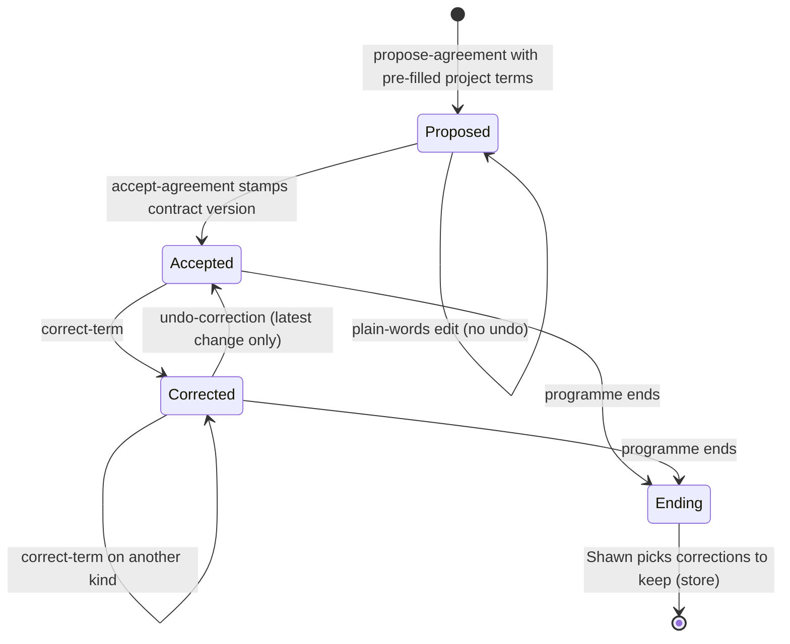
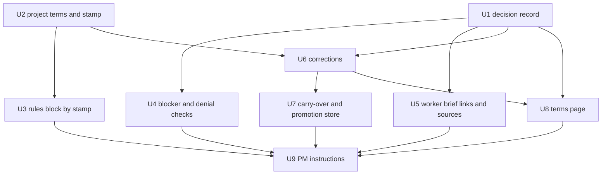

# PM Operating Contract - Plan

## Goal Capsule

- **Objective:** The programme PM keeps work aimed at the agreed product outcome. It decides what its authority covers and brings Shawn only the decisions that R11 lists.
- **Means:** Shared PM judgment rules for every project, plus short project terms in the startup agreement that change when Shawn corrects the PM in chat.
- **Product authority:** Shawn. Durability records, the approval-origin fix, and permission proposals are separate workstreams and not active scope.
- **Open blockers:** None for planning. The correction and carry-over requirements (R14–R18, R22) go live only after the approval-origin fix lands. R1–R13 and R19–R21 can ship before it (see Dependencies).
- **Execution:** Units U1–U9 in the dependency order of the Planning Contract. Corrections are built and tested but stay switched off (KTD5).
- **Stop conditions:** Stop on a permission refusal, on any action outside this repo, or on evidence that a session-settled decision cannot work.
- **Delivery:** Verified changes on `feature/pm-operating-contract`. Commits, pushes and pull requests happen only when Shawn asks.

---

## Product Contract

### Summary

The PM follows one set of judgment rules on every project and works under short project terms that it drafts into the startup agreement.
The terms grow with the project: a correction that Shawn types changes them immediately.
Shawn can open a page that shows the current terms, the decisions made under each term, and recent changes.
The build adds a decision record, project terms stamped at acceptance, four verb-level checks, and a correction step that ships switched off until the approval-origin fix lands.

### Problem Frame

In a recent programme, supporting work displaced product delivery.
An unfinished Linux investigation became a gate on browser acceptance without a demonstrated dependency.
A source-only restriction that the PM wrote itself blocked compilation, and agents treated it as a runtime ban.
Workers reopened settled decisions, and the PM relayed repeated approval requests and acknowledgements instead of deciding within its authority.
Manifests, hashes, and review cycles accumulated while the required product check did not run.

Shawn already has skills and commands for ideation, planning, implementation, and optimization.
The gap is the PM's posture: how it judges requirements, delegates, and involves Shawn.
That posture differs by project, and projects change as the work teaches us more.

Today the startup agreement holds remit, stop rule, autonomy, cadence, and sources (`plugins/auto/lib/programme_home.py`).
It has no place for who decides what, preferred tools per job, or what acceptance means for the project.
The plugin defaults send every product call to Shawn (`plugins/auto/protocol/defaults.json`).

### Actors

- A1. Shawn: the human who owns product authority and accepts the terms.
- A2. PM: the programme agent that drafts terms, decides within them, and applies corrections.
- A3. Worker: a session the PM assigns a change to; it decides within the authority the terms give it.

### Key Decisions

- **Two layers: shared rules plus project terms.** The shared rules address the drift observed on every project. The project terms carry what varies. Governs R1–R8, R9–R13. (session-settled: user-approved — chosen over terms-only in the agreement and over learning-only from corrections: the shared rules give safe starting behavior and the terms carry project variation)
- **Corrections change the terms during the run, not in a later phase.** Projects are emergent, and the contract must learn as the work proceeds. Governs R14–R18. (session-settled: user-directed — chosen over deferring correction-learning until after the base ships: "projects are often emergent - we learn as we do")
- **A correction applies to the project immediately, with a one-line notice.** Waiting for approval on each correction adds the approval traffic this work removes. Governs R14, R15, R16. (session-settled: user-approved — chosen over propose-and-confirm and over run-only scope: fits emergent projects; misreads are caught after the fact through the notice and undo)
- **A correction cannot reach the irreversible areas.** Undo restores a term but not an action the PM already took. Governs R14a. (session-settled: user-approved — chosen over unrestricted corrections and over deferring to planning: keeps fast corrections for the common case while risk, cost, permission and settled-decision escalations stay with Shawn)
- **When the terms are silent, the PM decides.** The earlier default sent every product call to Shawn and produced repeated approval requests. Governs R11. (session-settled: user-approved — chosen over keeping all product calls with Shawn and over worker-first decisions: removes relay traffic without letting workers drift)
- **The contract lives in chat, with a page on request.** A page that is always open is a second surface to keep accurate. Governs R19, R20. (session-settled: user-approved — chosen over an always-open live page and over chat only: smallest surface that still makes a grown contract reviewable)
- **Only newly accepted programmes get the new default.** Nothing changes under Shawn mid-run. An accepted agreement is never accepted again, so a running programme keeps the old default until it ends. Governs R21. (session-settled: user-approved — chosen over switching all running programmes at ship: avoids the PM deciding things Shawn expected to see)
- **Corrections are offered for carry-over when a programme ends.** Shawn chooses which corrections the project keeps. Governs R22. (session-settled: user-directed — chosen over automatic carry-over and over ending corrections with the programme: projects keep what was learned without carrying a misread forward silently)
- **Corrections need a new term-change step on the existing typed-prompt path.** The existing term commands accept only fixed option values and a prompt that names the term and value, so they refuse a casual correction such as "that didn't need me". They also keep no previous value. Governs R14, R16.
- **No new skills.** Terms point to skills and tools that already exist. Governs R10.

### Requirements

**Shared PM judgment (every project)**

- R1. Before the PM dispatches work, adds an acceptance gate, or declares acceptance, it re-checks the requirements that matter to that decision: source, relevance, demonstrated dependency, proportionality, and decision owner.
- R2. Every blocker names the requirement or required check it serves, the evidence of the dependency, and the condition that removes it. A safety or data-loss pause does not need these.
- R3. Before the PM starts more investigation, review, or coordination, it states which uncertainty blocks the next required product check and which result ends the work.
- R4. The PM records each restriction's source: human boundary, runtime refusal, project requirement, PM assignment choice, or worker assumption. It handles each by its source and never reroutes a runtime refusal.
- R5. Acceptance means the intended product outcome is verified. Compile results, green CI, reviews, deployment, and reports are supporting evidence, not acceptance.
- R6. A worker assignment links to the decision it carries. A worker does not reopen a settled decision without new evidence that the decision cannot hold.
- R7. Each change has one owner. The PM does not send acknowledgements or status messages that change no decision.
- R8. A denied operation produces one precise escalation: the operation, why it is needed, and the narrowest grant. The PM does not reassign the operation to avoid the denial.

**Project terms**

- R9. At startup, the PM drafts project terms into the agreement. The terms state who decides each area, the preferred existing skills and tools for each kind of job, and what acceptance means for the project. They can mark areas Shawn reserves for himself; R11 calls these reserved preferences.
- R10. The PM pre-fills the terms from available evidence (the repo, prior runs, and Shawn's installed skills) instead of from a setup interview. It names only skills that exist.
- R11. When the terms are silent, the PM decides and records why. It brings Shawn only decisions that change the outcome or acceptance, reopen a settled human decision, touch a reserved preference, exceed a risk or cost limit, or need a permission that was refused. The plugin rule that the PM never decides a product question narrows to these conditions.
- R12. A preferred tool is not a permission. Missing access to a preferred tool is not an acceptance blocker by itself.
- R13. The PM's behavior follows the job in front of it (ideation, options, requirements, implementation, optimization, acceptance) without fixed sequential modes.

**Corrections**

- R14. When Shawn's typed message corrects the PM's behavior or terms, the PM recognizes it and applies it to this project's terms. The change cites the typed prompt and records the quoted text, the PM's reading of it, and the previous value.
- R14a. A correction changes authority only for the kind of decision it replies to. It never removes R11's escalations for risk or cost limits, refused permissions, or settled human decisions. A wider grant needs Shawn's explicit wording.
- R15. Each applied correction produces a one-line notice that states what changed in the terms.
- R16. Shawn can undo an applied correction in one step.
- R17. A correction applies to all projects only after Shawn explicitly says yes.
- R18. Only Shawn's own typed messages can change terms. Worker messages, summaries, watcher and monitor events, and other sessions never can.

**Visibility**

- R19. On request, the PM shows a page with the current terms, the decisions made under each term, and recent changes with their source.
- R20. Opening, viewing, or navigating the page never counts as approval.

**Rollout**

- R21. The new silent-terms default (R11) applies to programmes accepted after it ships. A running programme keeps the old default until it ends. The agreement records the default at acceptance, so changing the plugin defaults never switches a running programme.

**Carry-over**

- R22. When a programme ends, the PM lists the corrections it applied and asks Shawn which to keep for the project. Kept corrections pre-fill the project terms of the next programme on the same project.

### Key Flows

- F1. Startup with terms
  - **Trigger:** Shawn starts a programme.
  - **Actors:** A1, A2
  - **Steps:** The PM drafts the agreement with pre-filled project terms. Shawn edits or accepts it through the existing acceptance step.
  - **Covers:** R9, R10, R21
- F2. Correction in chat
  - **Trigger:** Shawn types a correction, for example "that didn't need me".
  - **Actors:** A1, A2
  - **Steps:** The PM maps the correction to a term change and applies it to this project. It posts a one-line notice. Shawn can undo it or extend it to all projects.
  - **Covers:** R14–R18
- F3. A decision the terms do not cover
  - **Trigger:** A worker or the PM meets a choice that no term covers.
  - **Actors:** A2, A3
  - **Steps:** The PM checks R11's escalation conditions. If none apply, it decides and records why. If one applies, it brings Shawn one recommendation.
  - **Covers:** R11, R7

### Acceptance Examples

- AE1. An unrelated investigation does not gate acceptance. **Covers R1, R2, R5.**
  - **Given:** A Linux investigation is unfinished, and browser acceptance has no demonstrated dependency on it.
  - **When:** The browser product check is ready to run.
  - **Then:** The PM runs the browser check and does not wait on the investigation.
- AE2. A PM restriction is not a runtime ban. **Covers R4.**
  - **Given:** The PM's own assignment says "source only", and no runtime refusal exists.
  - **When:** Compilation is needed for the next product check.
  - **Then:** The PM identifies the restriction as its own assignment choice and lifts it within its authority.
- AE3. A worker does not reopen settled scope. **Covers R6.**
  - **Given:** Shawn settled a scope decision, and the worker's assignment links to it.
  - **When:** The worker meets that decision again with no new evidence.
  - **Then:** The worker proceeds under the decision and does not ask again.
- AE4. A denial produces one escalation. **Covers R8.**
  - **Given:** The runtime denies an operation.
  - **When:** The PM still needs the operation.
  - **Then:** Shawn receives one precise request. No other worker attempts the operation.
- AE5. Evidence over another report. **Covers R3.**
  - **Given:** A static report answers no open question.
  - **When:** The PM chooses its next action.
  - **Then:** It chooses an action that produces product evidence.
- AE6. A correction changes the terms. **Covers R14, R15.**
  - **Given:** The PM asked Shawn about a technical choice the terms do not cover.
  - **When:** Shawn types "that didn't need me".
  - **Then:** The project terms delegate that kind of choice to the PM, and Shawn sees one line naming the change.
- AE7. A worker message does not change the terms. **Covers R18.**
  - **Given:** A worker message contains correction-shaped text.
  - **When:** The PM processes the message.
  - **Then:** The terms do not change.
- AE8. Undo. **Covers R16.**
  - **Given:** The PM misread a correction and changed a term.
  - **When:** Shawn asks to undo it.
  - **Then:** The term returns to its previous value in one step.
- AE9. Carry-over at the end. **Covers R22.**
  - **Given:** A programme applied two corrections.
  - **When:** The programme ends and Shawn keeps one of them.
  - **Then:** The next programme on the same project shows the kept correction as a pre-filled term in its startup agreement, and not the other.

### Scope Boundaries

- Durability records, the approval-origin fix, and permission proposals stay in their own workstreams. This work does not edit their plans.
- No new skills, and no generated skill inventory.
- No permission-setting changes. Terms never grant a runtime permission.
- No always-open live page. The page opens on request.
- Fixed posture modes (for example "exploratory" or "high-risk") are not part of this work.

#### Deferred to Follow-Up Work

- **PM communication shape (Shawn, 2026-10-19: "it's how I want AUTO to work").** Every PM report, decision request, status output and checkpoint (PR open, merge, handover, end) names each item, PR, session, pane, server or ticket alongside its id; assumes Shawn is juggling a dozen things and has forgotten the previous state; restates that state; and shows a contract checklist (feature flag, code review, tests, PR) plus what is needed from him. Requirement recorded here; built in a follow-up PR so this one stays reviewable.
- **Decision-ready requests (Shawn, 2026-10-19: "have the details that will help them confidently make that decision right there").** Every handed decision and approval request carries, in place: what is being decided and on which named item, the options, what each option changes and costs, what happens if Shawn does nothing, the recommendation and why, and any risk or unverified fact that bears on it. Never "say X to do Y" without the trade-off beside it. Same follow-up PR as the communication shape.

### Dependencies / Assumptions

- R14–R18 depend on the approval-origin fix in `docs/plans/2026-10-18-1312-fix-programme-approval-origin-plan.md`. Today, the prompt hook labels every non-cron prompt as typed, so typed origin does not prove Shawn wrote it. R14–R17 act on typed origin and apply immediately, so they must not go live before the fix. R22 keeps corrections chosen by a typed prompt, so it waits too; before the fix, programme end lists no corrections. The shared rules, project terms, page and rollout (R1–R13, R19–R21) do not depend on it.
- The existing term and rule commands (`amend-term`, `record-instruction`, `propose-rule`, `adopt-rule`) stay the path for the fixed agreement terms and for rule adoption. They refuse casual corrections and keep no previous value, so R14 and R16 need a new term-change step.
- A view of current agreement terms exists in `plugins/auto/lib/programme_view.py`. The page in R19 extends it with linked decisions and changes.

### Sources / Research

- `plugins/auto/commands/programme.md`: the startup agreement and its acceptance step.
- `plugins/auto/protocol/defaults.json`: the current default that sends product calls to Shawn.
- `plugins/auto/skills/programme-sweep/SKILL.md`: how the sweep maps Shawn's replies to term and rule commands.
- `plugins/auto/skills/programme-sweep/references/sequencing.md`: one owner per change and one list of asks.
- `plugins/auto/docs/contracts/programme-protocol-format.md`: plugin, personal, and project rule layers.
- `plugins/auto/lib/on-user-prompt.py` and `plugins/auto/lib/programme_journal.py`: prompt origin classification.
- `docs/solutions/best-practices/default-deny-for-an-unattended-agent.md`: shapes the closed list of correctable decision kinds.
- `docs/solutions/logic-errors/one-answer-recorded-under-two-keys-answers-for-scopes-nobody-asked-about.md`: key a correction by programme and decision kind, never by two scopes at once.
- `docs/solutions/security-issues/a-validator-proven-correct-and-proven-unused.md`: put every authority check in the verb, and test through the hook-to-verb path.
- `docs/solutions/logic-errors/a-test-can-pass-because-it-cannot-fail.md`: each refusal test asserts the specific error and has a mutation proof.

---

## Planning Contract

**Product Contract preservation:** changed: added R22 and AE9 — Shawn chose an end-of-programme carry-over offer during planning. Key Decision governs-link on immediate corrections re-pointed from R17 to R16. All other IDs and meanings unchanged.

**Target area:** `plugins/auto`. Paths below are repo-relative.

### Key Technical Decisions

- KTD1. **One decision record for PM decisions, Shawn's answers and asks.** A new `record-decision` verb writes a decision with an id, a decision kind, the term it used (or "silent"), and why. `hand-item` gains a required decision kind, and `answer-handed` and `accept-agreement` write the same record shape. R6, R11 and R19 all link to these ids. Rationale: three requirements need decision ids and none exist today (`plugins/auto/lib/programme_view.py` only lists open asks).
- KTD2. **Decision kinds are a closed list that extends the protocol's autonomy actions.** The list lives in code next to the decision verb. Unknown kinds refuse. Rationale: R14a and the correctable list need a fixed vocabulary to check against (`docs/solutions/best-practices/default-deny-for-an-unattended-agent.md`).
- KTD3. **Project terms live on the agreement, outside the fixed `terms` map.** They are a list of free-text entries, each with an id, area, value, source and set-by, shaped like standing instructions. `normalize_programme` back-fills the fixed terms from current defaults, so anything inside `terms` would appear on every running programme at its next write. Governs R9, R10, R21. R11's protected escalations (risk or cost limits, refused permissions, settled human decisions, production deploys, releases, spend over cap, merge-around-gate) always override a project term; a term that assigns one of them to the PM or a worker is refused. After acceptance, a project term changes only through a typed prompt that names its area and new text, as `amend-term` requires today, and the previous value is kept.
- KTD4. **The contract version is stamped at `accept-agreement`, and its absence means the old behaviour.** The rules block and the sweep skill branch on the stamp: no stamp keeps "every product question goes to Shawn"; the stamp shows R11's escalation list. `protocol/defaults.json` stays unchanged, because the protocol is reloaded on every call and an edit there would switch running programmes. On a stamped programme the rules block replaces the plugin `product-question` caveat and the `product_call` line with R11's list, and `record-decision` on an item that matched the `product-question` rule finishes it as decided. Unstamped programmes keep the handed-only path. `accept-agreement` refuses a prompt older than the last proposal or project-term edit, so Shawn always accepts the terms he last saw. Governs R11, R21.
- KTD5. **Corrections ship switched off.** A code constant keeps `correct-term`, `undo-correction` and `promote-correction` refusing with "corrections are not on yet" until the release that carries the approval-origin fix flips it. The constant has no environment override, because the PM can set environment variables from its own shell; the `_test_hatch_enabled` pattern is not enough here. Tests import the module and patch the constant inside the test process. `keep-corrections` sits behind the same switch. Before the switch flips, the PM records a correction as a standing instruction and says so. Rationale: the approval-origin plan adds no origin marker this work could key on, so sequencing alone does not hold the gate.
- KTD6. **A correction must reply to a recorded ask or decision.** `correct-term` takes the typed prompt, the id of the ask or decision it replies to, the new owner (PM, worker or Shawn), and the PM's reading. It takes the decision kind from that anchor; the PM never supplies it. It refuses when the anchor was recorded after the prompt, when the kind is not on the correctable list, or when the prompt already drove a correction. It does not use `require_named`: the anchor and the closed list replace naming. When the anchor is a handed ask and the new owner is the PM or a worker, `correct-term` moves the item from handed back to open in the same write, and the PM then records its decision with `record-decision --term`. Governs R14, R14a, R18.
- KTD7. **The correctable list is default-deny and excludes the protected escalations.** Only kinds on the list can be delegated by a correction. Risk or cost limits, refused permissions, settled human decisions, production deploys, releases, spend over cap and merge-around-gate are never on it. A wider grant still goes through `adopt-autonomy --widening`. A programme-scoped correction on a listed kind is exempt from the "widen" word: R14a, the closed list and the session-settled immediate-apply decision replace it. Governs R14a.
- KTD8. **Undo reverts the latest change to a term only.** `undo-correction` needs a typed prompt later than the correction's. It refuses when a later change to the same term exists and names the change that blocks it. The undo notice lists decisions made under the corrected term, because undo does not reverse them. Governs R16.
- KTD9. **All-projects promotion and end-of-programme carry-over share one per-machine store.** The store is a JSON file beside the personal protocol. Entries are keyed by each remit repo's GitHub owner/name, or its normalised path when it has none, or by "all". Pre-fill runs when `set-remit` stores repos on an unaccepted agreement, because `propose-agreement` runs before the remit exists; it looks up every remit repo plus "all" without duplicates. Each entry carries an adoption block like the personal protocol's (machine, run, prompt id, prompt hash, content hash), and pre-fill drops any entry whose adoption does not verify, with a notice naming it. Running programmes never read the store, so a promotion never changes a running programme. Governs R17, R22, R10.
- KTD10. **Four shared rules become verb checks; the rest stay instructions.**

  | Rule | Where | Check |
  |---|---|---|
  | R2 blockers | `set-waiting --blocker` | refuses without what it serves, the dependency evidence and the unblock condition; `--safety` exempts a safety or data-loss pause |
  | R4 restriction source | `start-worker`, `prompt-item` | a restriction carries one of five sources; the view shows it |
  | R6 decision links | `start-worker`, `prompt-item` | `--decision <id>` must name an existing decision; the brief appends its text and a reopen-only-with-new-evidence clause |
  | R8 one escalation | `hand-item` with the denied-operation kind | a second ask for the same operation refuses |
  | R1, R3, R5, R7, R13 | sweep skill | instructions, checked by scenario replay (Verification Contract) |

  R5 already has a verb check: only evidence checks close a `verified` deliverable, and CI does not count.
- KTD11. **Workers get no new channel to reopen a decision.** A worker with new evidence stops and states it in its pane; the PM's sweep reads it. `claim` keeps its structured-deliverable contract.
- KTD12. **New verbs go in new modules.** `programme.py` (820 lines), `programme_record.py` (852) and `programme_evidence.py` (836) are near the 1000-line budget in `plugins/auto/tests/unit/size-budget.test.sh`. Decisions go in `lib/programme_decisions.py`; project terms, corrections and the store go in `lib/programme_terms.py`. Both register through `build_verbs`.
- KTD13. **The page is a terms section of the existing read model.** `programme_view.build` adds the terms, decisions per term, and recent term changes from the journal. `status --terms [--json]` prints it. Status is read-only, so viewing never approves. The always-open `/programme-view` mod is unchanged.

### High-Level Technical Design

Correction path, once the switch is on:

```mermaid
sequenceDiagram
  participant S as Shawn
  participant H as Prompt hook
  participant J as Journal
  participant PM as PM (sweep skill)
  participant V as correct-term verb
  S->>H: types "that didn't need me"
  H->>J: prompt row (origin typed)
  PM->>PM: recognises a correction, picks the ask it replies to
  PM->>V: --prompt id --replies-to ask id --to pm --reading text
  V->>J: checks typed origin, session, anchor before prompt, kind on list, prompt unused
  V->>J: term_corrected (quote, reading, previous value)
  V-->>PM: one-line notice
  PM-->>S: notice; the open ask is decided under the new term
```

Agreement and correction lifecycle:



Unit dependencies and parallel batches:



Batches: U1 and U2 in parallel; then U3, U4 and U5; then U6; then U7 and U8; then U9. Every unit appends to the same shared lists: journal kinds, the exact verb list in `plugins/auto/tests/unit/programme-verbs.test.sh`, `docs/contracts/agent-tool-surface.md` and `docs/contracts/run-record-schema.md`. Parallel branches must merge those by hand and re-run the verb-list test, because a clean automatic merge of an append-only list can drop or duplicate an entry.

### Assumptions

- The approval-origin fix lands in a separate release. That release flips the KTD5 switch and adds `correct-term`, `undo-correction` and `promote-correction` to its coverage of every consumer that accepts typed prompts.
- Scenario replay with a real PM session is the proof for instruction-only rules; this plugin has no eval harness.
- Unconfirmed defaults for three review decisions, taken when Shawn chose to proceed without walking them. Each is cheap to change before the correction switch flips:
  - Undo applies to the latest change to a term (KTD8); "undo in one step" (R16) is read that way. Older corrections are undone newest first.
  - The correctable kinds are technical approach, work sequencing, coordination between workers, tool choice and optimisation depth (KTD7). Product scope, acceptance, reserved areas and the protected escalations are never correctable.
  - A casual correction changes who decides only. Changing a preferred tool or what acceptance means needs an explicit named edit (KTD3); until then the PM records the casual version as a standing instruction.

---

## Implementation Units

### U1. Decision record and decision kinds

- **Goal:** Give PM decisions, Shawn's answers and asks a shared record with an id and a decision kind.
- **Requirements:** R6, R11, R19; KTD1, KTD2.
- **Dependencies:** none.
- **Files:**
  - create `plugins/auto/lib/programme_decisions.py`
  - modify `plugins/auto/lib/programme_record.py` (`hand-item` kind, `answer-handed` writes a decision)
  - modify `plugins/auto/lib/programme.py` (`accept-agreement` writes a decision, verb registration)
  - modify `plugins/auto/lib/programme_journal.py` (new kinds)
  - modify `plugins/auto/docs/contracts/run-record-schema.md`, `plugins/auto/docs/contracts/agent-tool-surface.md`
  - create `plugins/auto/tests/unit/programme-decisions.test.sh`; modify `plugins/auto/tests/unit/programme-verbs.test.sh`
- **Approach:**
  1. `record-decision <item|programme> --kind <kind> (--term <id> | --silent) --why <text>` writes to a decisions list on the programme and journals `pm_decided`.
  2. The decision kinds list extends the protocol's autonomy actions and adds the denied-operation kind.
  3. `hand-item` requires `--kind`; records written before this change read as kind `unknown`, which is never correctable.
  4. On a stamped programme, `record-decision` on an item that matched the `product-question` rule finishes it with a `decided` outcome the stop predicate counts as finished (KTD4).
- **Patterns to follow:** `record-instruction` in `plugins/auto/lib/programme.py` for id-keyed entries; `build_verbs` for registration.
- **Test scenarios:**
  - `record-decision --kind technical_approach --silent --why ...` writes a decision with an id and journals `pm_decided`.
  - An unknown kind refuses with the specific error and writes nothing.
  - `hand-item` without `--kind` refuses; with a kind, the ask carries it.
  - `answer-handed` writes a decision linked to the ask's id.
  - A record written before this change loads, and its asks read as kind `unknown`.
  - On a stamped programme, `record-decision` closes a product-question item as decided; on an unstamped one it refuses and the item still needs `hand-item`.
  - The verb list test includes `record-decision`.
- **Verification:** decisions appear in the run record and journal with ids that later units can cite.

### U2. Project terms and the contract stamp

- **Goal:** Hold free-text project terms on the agreement and stamp the contract version at acceptance.
- **Requirements:** R9, R10, R12, R21; KTD3, KTD4.
- **Dependencies:** none.
- **Files:**
  - create `plugins/auto/lib/programme_terms.py`
  - modify `plugins/auto/lib/programme_home.py` (normalize keeps project terms absent on old records)
  - modify `plugins/auto/lib/programme.py` (`propose-agreement` accepts project terms; `accept-agreement` stamps the version)
  - create `plugins/auto/tests/unit/programme-terms.test.sh`; modify `plugins/auto/tests/unit/programme-home.test.sh`
- **Approach:**
  1. `propose-agreement --project-term "<area>=<text>" --source <evidence>` adds entries. Before acceptance, `edit-project-term` changes one by id with no undo.
  2. After acceptance, `edit-project-term <id> <text> --prompt <id>` needs a typed prompt that names the area and new text (`require_named`), keeps the previous value and journals `project_term_amended` (KTD3).
  3. A project term may mark an area as reserved for Shawn. A term that assigns a protected escalation to the PM or a worker refuses (KTD3).
  4. `accept-agreement` writes the contract version beside `accepted`, and refuses a prompt older than the last proposal or term edit (KTD4). No other verb writes the version.
- **Patterns to follow:** `enabled_sources` and `watcher_kind` in `plugins/auto/lib/programme_home.py` for absent-means-old reads.
- **Test scenarios:**
  - A proposed project term shows its area, text and evidence source in the run record.
  - Acceptance stamps the version; the stamp is absent before acceptance.
  - An old record with no project terms and no stamp survives a write through any verb without gaining either.
  - After acceptance, a typed prompt naming the area and new text changes the term and keeps the previous value.
  - After acceptance, a prompt that does not name the term refuses and writes nothing.
  - A term "deploys: PM decides" refuses in both `propose-agreement` and `edit-project-term`.
  - `accept-agreement` citing a prompt older than the last term edit refuses.
  - A project term never changes a permission setting or protocol layer file.
- **Verification:** new programmes carry project terms and the stamp; old programmes stay byte-equivalent in those fields across writes.

### U3. Rules block and silent-terms default by stamp

- **Goal:** Show R11's escalation list to stamped programmes and the old rule to unstamped ones.
- **Requirements:** R11, R21; KTD4.
- **Dependencies:** U2.
- **Files:**
  - modify `plugins/auto/lib/programme.py` (rules block text) or `plugins/auto/lib/programme_terms.py` if the size budget requires
  - modify `plugins/auto/tests/unit/programme-verbs.test.sh` or `plugins/auto/tests/integration/programme-compact.test.sh`
- **Approach:** the rules block adds an "operating contract" section when the stamp is present. It lists the project terms, the reserved areas, R11's escalation list and the protected escalations that override any term. It replaces the plugin `product-question` caveat and the `product_call` line (KTD4). Without the stamp it prints nothing new.
- **Test scenarios:**
  - A stamped programme's `rules` output includes the escalation list and the project terms, and does not print "The PM never decides a product question".
  - An unstamped programme's `rules` output equals today's output.
  - After compaction, the reprinted rules block for a stamped programme still includes project terms.
- **Verification:** compaction and `rules --ack` carry the contract for stamped programmes only.

### U4. Blocker and denied-operation checks

- **Goal:** Make blockers name what they serve and stop repeated asks for the same denied operation.
- **Requirements:** R2, R8; KTD10.
- **Dependencies:** U1.
- **Files:**
  - modify `plugins/auto/lib/programme_record.py` (`set-waiting`, `hand-item`)
  - modify `plugins/auto/lib/programme_predicate.py` if a new stop reason is needed
  - modify `plugins/auto/tests/unit/programme-items.test.sh`
  - modify `plugins/auto/skills/programme-sweep/SKILL.md` (step 11 blocker wording)
- **Approach:**
  1. Existing blocker tests and the sweep's `--blocker --trace-id` wording change in this unit, so the suite stays green.
  2. `set-waiting --blocker` requires `--serves`, `--evidence` and `--unblocks-when`, or `--safety`.
  3. `hand-item --kind denied_operation --op <name>` refuses when an open ask for the same operation exists.
- **Patterns to follow:** the existing `--trace-id` requirement and `undebugged_blocker` reason.
- **Test scenarios:**
  - Covers AE1. A blocker without `--serves` refuses and names the missing field.
  - A blocker with all three fields records them, and the view shows them.
  - `--safety` records a pause without the three fields.
  - Covers AE4. A second denied-operation ask for the same operation refuses; a different operation succeeds.
  - Mutation proof: disabling the field check through a test hatch turns the refusal test red.
- **Verification:** blockers and denial asks in new records always carry their fields.

### U5. Worker brief decision links and restriction sources

- **Goal:** Link worker assignments to the decisions they carry and record each restriction's source.
- **Requirements:** R4, R6; KTD10, KTD11.
- **Dependencies:** U1.
- **Files:**
  - modify `plugins/auto/lib/programme_sources.py` (`start-worker`, `prompt-item`)
  - modify `plugins/auto/tests/unit/programme-sources.test.sh`
- **Approach:**
  1. `--decision <id>` (repeatable) must name existing decisions. The brief appends each decision's text and a fixed clause: proceed under it; stop and state new evidence instead of reopening it.
  2. `start-worker` passes its brief to spinoff as a file, so with `--decision` it requires `--handoff <file>`, appends to a copy in the programme home, and passes the copy. `prompt-item` appends to its text and refuses when the result exceeds the existing 4000-character prompt cap.
  3. `--restriction "<text>" --source <human|runtime|requirement|pm_choice|worker_assumption>` records the restriction on the item and in the brief.
  4. The journaled `prompt_sent` row carries the decision ids and restrictions.
- **Patterns to follow:** the two fixed clauses every brief already carries (`plugins/auto/skills/programme-sweep/SKILL.md`, step 10).
- **Test scenarios:**
  - Covers AE3. A brief with `--decision` contains the decision text and the reopen clause.
  - An unknown decision id refuses and sends nothing.
  - `start-worker --decision` without `--handoff` refuses; with it, the passed copy contains the decision text and the original file is unchanged.
  - `prompt-item --decision` whose appended text exceeds the prompt cap refuses.
  - Covers AE2. A restriction with source `pm_choice` is recorded with that source and shown in the view.
  - A restriction without a source refuses.
- **Verification:** every brief that names a decision carries its text, and every restriction carries a source.

### U6. Corrections behind the switch

- **Goal:** Apply a typed correction to the programme's project terms, with notice and undo, once the switch is on.
- **Requirements:** R14, R14a, R15, R16, R18; KTD5, KTD6, KTD7, KTD8.
- **Dependencies:** U1, U2.
- **Files:**
  - modify `plugins/auto/lib/programme_terms.py` (`correct-term`, `undo-correction`)
  - modify `plugins/auto/lib/programme_journal.py` (`term_corrected`, `correction_undone`)
  - modify `plugins/auto/lib/programme.py` (rules block lists active corrections)
  - create `plugins/auto/tests/unit/programme-corrections.test.sh`; modify `plugins/auto/tests/integration/programme-hooks.test.sh`
- **Approach:**
  1. Both verbs write through `_write` with a required typed prompt, so the driving-session, compact-flag and origin checks apply.
  2. `correct-term` stores the quote from the journal, the PM's reading labelled as the PM's, the anchor id, the kind and the previous value. Its output is the R15 notice: the quote, the reading and the change.
  3. With the switch off, both verbs refuse with "corrections are not on yet" and write nothing.
  4. When the anchor is a handed ask and the new owner is the PM or a worker, the same write moves the item back to open (KTD6).
- **Execution note:** write the refusal tests first, then the happy path.
- **Test scenarios:**
  - With the switch off, `correct-term` refuses and the run record and journal are unchanged.
  - Exporting `CLAUDE_AUTO_TEST_HARNESS=1` and any hatch variable, then calling `programme.sh correct-term`, still refuses.
  - Covers AE6. With the switch on, a typed prompt replying to a technical-approach ask moves that kind to the PM and prints one notice line with quote and reading.
  - After that correction, the anchored ask is open, and a `record-decision --term` against it succeeds without `answer-handed`.
  - Covers AE7. A cron-origin prompt, another session's prompt and an unknown prompt id each refuse and write nothing.
  - A kind not on the correctable list refuses; a risk-or-cost kind refuses.
  - An anchor recorded after the prompt refuses.
  - A prompt that already drove a correction refuses a second correction.
  - Covers AE8. `undo-correction` with a later typed prompt restores the previous value and lists decisions made under the corrected term.
  - Undo refuses when a later correction to the same term exists and names it.
  - Integration: a prompt fed through the prompt hook, then `correct-term`, changes the term; the same text journaled as cron does not.
  - Mutation proofs: patching each check out in-process (typed origin, anchor order, closed list, prompt reuse) turns its refusal test red.
- **Verification:** with the switch on in tests, every acceptance example for corrections passes; with it off, no correction path writes.

### U7. Carry-over and all-projects store

- **Goal:** Keep chosen corrections for the next programme on the same project, or for all projects.
- **Requirements:** R17, R22, R10; KTD9.
- **Dependencies:** U6.
- **Files:**
  - modify `plugins/auto/lib/programme_terms.py` (`promote-correction`, `keep-corrections`, store read at pre-fill)
  - modify `plugins/auto/lib/programme_lifecycle.py` (end lists applied corrections)
  - modify `plugins/auto/lib/programme_home.py` or the `set-remit` verb (pre-fill when repos are stored)
  - modify `plugins/auto/tests/unit/programme-corrections.test.sh`, `plugins/auto/tests/integration/programme-flow.test.sh` (programme end)
- **Approach:**
  1. The store path honours an env override for tests, like `CLAUDE_AUTO_PERSONAL_PROTOCOL`.
  2. `keep-corrections --prompt <id> <ids...>` writes kept corrections under every remit repo's key. `promote-correction --prompt <id> <id>` writes under "all". Its prompt must name "all projects" through `require_named`, so a negated mention refuses; it must be later than the correction's own prompt and must not have driven another promotion.
  3. Both verbs journal an approval row and write an adoption block on each entry (KTD9).
  4. `set-remit` on an unaccepted agreement pre-fills project terms from the store, each marked with its origin key; entries that fail adoption are dropped with a notice. Running programmes never read the store.
  5. `keep-corrections` and `promote-correction` stay behind the KTD5 switch.
- **Test scenarios:**
  - Covers AE9. Two corrections, one kept: the next programme on the same repo pre-fills only the kept one, marked as carried over.
  - A programme on another repo does not see a project-keyed correction; it does see an "all" correction.
  - A promotion does not change a programme that is already running.
  - Following the real startup order (propose, then set-remit), the kept term appears after `set-remit`.
  - `promote-correction` without "all projects" in the quote refuses; "don't apply that to all projects" refuses; a reused prompt refuses.
  - A hand-written store entry with no valid adoption block is not pre-filled, and the notice names it.
- **Verification:** carried-over terms appear in the next startup agreement and nowhere else.

### U8. Terms page

- **Goal:** Show the terms, decisions per term and recent changes when asked.
- **Requirements:** R19, R20; KTD13.
- **Dependencies:** U1, U6.
- **Files:**
  - modify `plugins/auto/lib/programme_view.py` (terms section)
  - modify `plugins/auto/lib/programme.py` (`status --terms [--json]`)
  - modify `plugins/auto/commands/programme-status.md`
  - modify `plugins/auto/tests/unit/programme-view.test.sh`
- **Approach:** build the section from the run record and the journal entries `build` already receives. Cap recent changes at 20 rows. Quotes show their redacted form.
- **Test scenarios:**
  - A programme with two terms, three decisions and one correction shows each decision under its term and the correction with its quote and source.
  - Silent decisions appear under "no term".
  - `status --terms` writes nothing to the run record or journal.
  - `--json` output carries the same rows.
- **Verification:** `/auto:programme-status terms` shows the page for a test programme.

### U9. PM instructions

- **Goal:** Teach the PM the shared judgment rules and the new verbs.
- **Requirements:** R1, R3, R5, R7, R9, R10, R11, R12, R13, R14, R22; KTD4, KTD5, KTD10, KTD11.
- **Dependencies:** U3, U4, U5, U7, U8.
- **Files:**
  - create `plugins/auto/skills/programme-sweep/references/judgment.md`
  - modify `plugins/auto/skills/programme-sweep/SKILL.md`, `plugins/auto/skills/programme-sweep/references/sequencing.md`
  - modify `plugins/auto/commands/programme.md`, `plugins/auto/commands/programme-end.md`
  - modify `plugins/auto/CONCEPTS.md`
- **Approach:**
  1. `judgment.md` states R1–R8, R12 and R13 with the sweep steps that use them, like `sequencing.md` does. For R12 it says a missing preferred tool is not an acceptance blocker; the PM uses the existing path.
  2. Sweep step 3 gains a correction row: before the switch, record an instruction and say corrections are not on yet; after, call `correct-term`, then decide the open ask under the new term.
  3. A sweep step re-checks typed prompts that no journal row cites, so a correction recognised before compaction is not lost.
  4. The sweep reads the contract stamp from the rules block and follows R11 only when it is present.
  5. Startup pre-fills project terms from evidence; carried-over terms appear after `set-remit`. Programme end offers carry-over once the switch is on.
  6. `CONCEPTS.md` adds project terms, correction, decision kind and contract stamp.
- **Test scenarios:**
  - Test expectation: none for unit tests -- instruction text. The vocabulary audit and the doc fence tests must stay green, and scenario replay (Verification Contract) covers behaviour.
- **Verification:** scenario replay passes for the instruction-only rules.

---

## Verification Contract

| Check | Command or method | Pass signal |
|---|---|---|
| Unit and integration suite | `bash ~/.claude/tools/honest-run/run.sh --expect 'TOTAL: [0-9]+ passed, 0 failed' -- bash plugins/auto/tests/run.sh all` | verdict PASS; each new test file prints its own `N passed` line with N > 0 |
| Size budget and vocabulary audit | part of the suite (`size-budget.test.sh`, `vocabulary-audit.test.sh`) | green with no new allowlist entries |
| Mutation proofs | test hatches for each new refusal check (U4, U6) | each hatch turns its refusal test red |
| Scenario replay | a scratch programme in an isolated `CLAUDE_AUTO_DATA_DIR` driven by a real PM session for AE1, AE2 and AE5, plus F3 | the transcript shows the PM running the product check, lifting its own restriction, and choosing an evidence-producing action |
| Old records | a run record written before this change, driven through accept, sweep and status | no project terms or stamp appear; the rules block equals today's |

Do not run anything against live programmes or change permission settings.

## Definition of Done

- U1–U9 are implemented and every test scenario above exists and passes.
- The suite passes through honest-run with a verdict line.
- With the KTD5 switch off, no correction verb writes; with the test hatch on, all correction acceptance examples pass.
- Scenario replay for AE1, AE2, AE5 and F3 is recorded.
- `docs/contracts/agent-tool-surface.md`, `docs/contracts/run-record-schema.md` and `plugins/auto/CONCEPTS.md` describe every new verb, journal kind and term.
- Abandoned approaches and dead code are removed from the diff.
