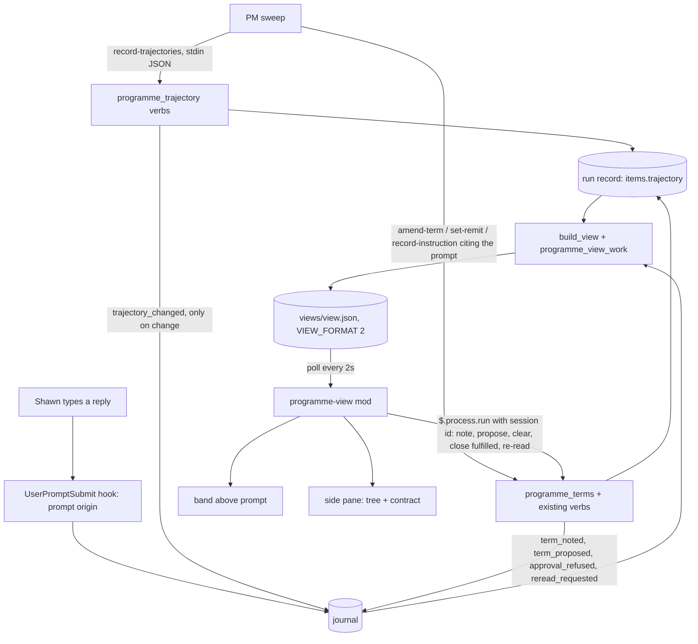
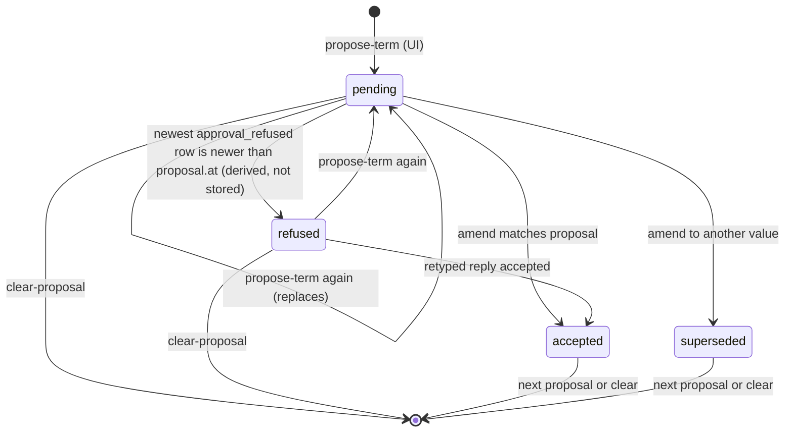
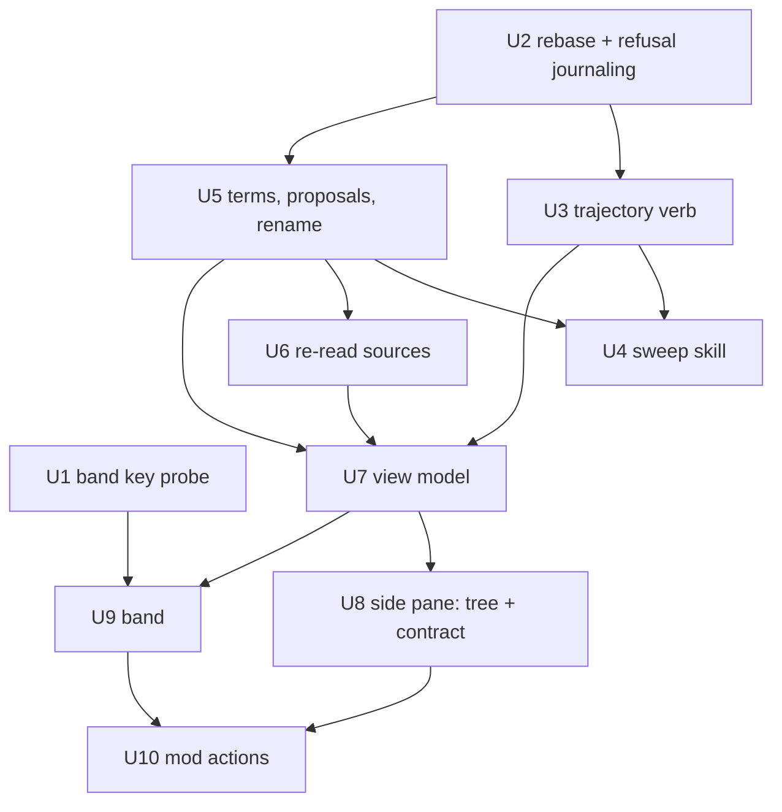

# Programme Sessions and Contract View - Plan

## Goal Capsule

- **Objective:** Shawn can see who is working on what in a programme, and what each task will do next and after, without opening sessions or scrolling threads. He can also read and change the PM's operating contract with the basis for every step in view.
- **Means:** the PM records a trajectory for each work item on every sweep (KTD1), and the `/programme-view` mod grows into a band above the prompt, a tree list in the side pane, and an interactive contract view (KTD2, KTD7).
- **Product authority:** Shawn. The Product Contract below wins on behaviour; Key Technical Decisions win on mechanism. Authority levels, escalation, enforcement and per-job preferred tools belong to the PM operating-contract work and are not active scope here.
- **Open blockers:** none for planning. U2 must rebase this branch onto the approval-origin fix (commit `0b80deb` on `bugfix/programme-prompt-origin`) before any other unit's code lands (KTD9). U1 writes no branch code and may run first.
- **Execution profile:** Deep, ten units; order in Sequencing. U1 is a live probe whose result can change U9's key handling.
- **Stop conditions:** stop and ask Shawn if U1 shows the band cannot take keys after a click (the fallback in KTD7 then needs his confirmation), or if the rebase in U2 changes the approval check's behaviour.
- **Finishes and ships:** the implementing session, through `ce-work`, ending in one PR to `main`.

---

## Product Contract

Product Contract preservation: changed: R4, R5, R6, R10, R12, R24, R25, R26, R27; added R28–R31. These changes come from planning research Shawn confirmed on 2026-10-19:
- the mod API cannot tell Tab from the arrow keys, and the band takes keys only after a click
- instructions are Shawn's typed words, so opening or withdrawing one needs a typed reply
- "2 sweep intervals" has no value under the default on-change cadence
- refused approvals are now recorded

### Summary

The PM writes each work item's trajectory (done steps, the current step, planned steps and the finish) on every sweep, and each step names the agreement clause it relies on, or shows that it has none. The programme mod shows these trajectories in a band above the prompt and a tree list in the side pane, always leading with the work. A contract view lets Shawn inspect every term and its options, propose and note changes, and accept or amend a term by typing the exact reply the view shows him.

### Problem Frame

Shawn spends a lot of time clicking around and scrolling through threads to learn who is working on what and what each session will do next. The current mod shows one `doing` slot and a PM queue. It has no per-item path, so a plan change is invisible until it has already happened.

The agreement has the same problem from the other side. The view already carries each term's value, options, why and set-at time, but nothing explains what a term or an option means. Nothing links the PM's actions to the clause that permits them. Shawn cannot tell whether the PM is still working to the current terms after a change. He wants the contract to be "more interactive and considered": something he can inspect and change in place, not a condensed status block.

### Key Decisions

- **Trajectory belongs to the work item, not the session.** Governs R1, R6. (session-settled: user-directed — chosen over a session-owned trajectory or hosting the list in Peek: a task outlives the session working on it)
- **The PM records next steps every sweep.** Governs R1–R4. (session-settled: user-directed — chosen over deriving steps from the PM queue or worker reports: Shawn wants the projected path, "even if that changes")
- **One mod.** `/programme-view` grows to hold the band, the list and the contract view. Governs R6, R13, R18. (session-settled: user-directed — chosen over a separate mod or a Peek-hosted pane)
- **Lead with the work.** Location and session come after, dimmed. Governs R7. (session-settled: user-directed — chosen over session-first grouping: the question is "what is being done", not "which pane")
- **Display follows the agreed sketch.** It covers the track glyphs, inline sessions wrapping to two lines, theme colours on icons and fills only, and no colour past the next step. Governs R8, R9, R11, R14. (session-settled: user-directed — settled by iterating on the TUI sketch in `docs/ideation/2026-10-19-programme-trajectory-sketch.py`)
- **Old step data shows its age and fades.** Governs R5. (session-settled: user-directed — chosen over event-driven refresh)
- **Anything a command can do, the UI can do; approval stays a prompt Shawn types.** Governs R25, R26. (session-settled: user-directed — chosen over command-only access, and over click-to-approve)
- **Accept, amend, widen, and opening or withdrawing an instruction show the exact reply for Shawn to type.** Governs R26. (session-settled: user-approved — chosen over a dim suggestion Shawn takes: live verification showed an accepted suggestion records as `suggestion_accepted` and the approval check refuses it by design; an instruction is stored as Shawn's own typed words)
- **The band takes keys only after a click; then Tab moves between tasks and the arrows move through steps.** Governs R10, R12. (session-settled: user-directed — chosen over one focus ring through tasks and steps, or a display-only band: keeps the agreed task-versus-step split)
- **A step with no clause warns and never blocks.** Governs R3, R16. (session-settled: user-directed — blocking would be an enforcement change, which belongs to the PM operating-contract work)
- **Waits show their watch state in v1.** Governs R17. (session-settled: user-approved — a wait the PM believes is covered but that nobody watches is the "who is doing what" gap)
- **Fade threshold.** Governs R5. (session-settled: user-approved — chosen over a flat "2 sweep intervals", which has no value under the default on-change cadence)
- **The view works only in the driving session.** Governs R28. (session-settled: user-approved — watching from another session is out of scope; every write is already limited to the driving session)

### Requirements

**Recording the trajectory**

- R1. On every sweep, the PM records a trajectory for each open work item: steps done, the current step, the planned steps in order, and the finish (the deliverable that closes the item).
- R2. Each step has a short title in plain words, written as an action.
- R3. Each current or planned step names the agreement clause it relies on: a term, a protocol rule or an active instruction. A step with no clause is recorded as such, not refused.
- R4. When a sweep's trajectory differs from the previous one (a step added, dropped, reordered or retitled), the change is recorded and the item shows a plan-changed marker until Shawn has viewed it.
- R29. An item's first recording, and its first recording after the driving session changes, never count as a plan change.
- R5. Each trajectory carries the time it was recorded. Every view shows its age and dims it once it is older than the fade threshold: twice the fixed cadence interval, or under on-change cadence twice the gap between the last two sweeps, and never less than 30 minutes.

**Band above the prompt**

- R6. The band shows every work item in the open or waiting state on one track line each, inline, wrapping to at most 2 lines, then "+N more". Done, handed and dropped items do not show.
- R7. Each collapsed entry reads: task title, step dots, deliverable. The tab › pane name and the session show only on the focused entry, dimmed and after the work. Herdr codes never show.
- R8. Step glyphs: done is a filled circle, the current step is a filled pill (rounded ends), planned is an open circle, and the finish is a goal icon. A waiting current step uses the waiting icon instead of the play icon.
- R9. Colours come from the terminal theme and apply to icons and fills only. Text stays the default colour, and steps past the next one carry no colour.
- R10. The band is read-only until Shawn clicks it. After a click, Tab and Shift-Tab move between tasks, the arrow keys move through a task's steps, and a click selects a task or a step. The selected step opens as the pill with its title. Hover is a bonus.
- R11. The focused task expands to show the selected step's title and its location, and always stays visible even when it would fall past "+N more". Other tasks stay collapsed.
- R12. Whenever the band does not have focus, it renders read-only, and the side pane list carries full keyboard navigation.

**Side pane list**

- R13. The side pane shows each open or waiting work item as a tree with style guides (├─ └─): the item and its location, a done count with the last done step, the current step, numbered planned steps, then the finish.
- R14. Each current and planned step shows the clause it relies on, dimmed, after the step title.
- R15. The list uses the same glyphs and colour rules as the band (per R8, R9) and the same plan-changed marker (per R4) and age fade (per R5).
- R16. A step with no clause shows a warning icon and "no clause" in place of the clause name.
- R17. A waiting step shows its watch state: a live watcher (with its interval when known, else the last beat's age), a named reporter only, a retry that never started, or nothing watching (shown as a warning).

**Contract view**

- R18. The contract view lists every agreement term, one per row: name, active setting, and a one-line description of what the term controls.
- R19. Opening a term shows, one fact per line: how it is bound (checked in code, written guidance only, or nothing reads it), how many current and planned steps rely on it, who set it with when and why, Shawn's notes, its proposal if any, and its options.
- R20. Each option shows a one-line description, and the active option is marked. The view shows the options the agreement defines for that term and no others.
- R21. Every term and every option has a written description. A term or option without one shows "no description" rather than a blank.
- R22. Three terms take custom options: remit (add a herdr space), cadence (a custom interval) and tools of record (a multi-select checklist, plus adding a tool). Tools of record replaces the current "sources" term and stays programme-wide.
- R23. Active instructions show under the terms: Shawn's quoted words, what they apply to, whether this is set on the item or comes from the programme, and how many steps rely on them.
- R24. The view shows when the PM last re-read the rules in force, counting both a re-read after compaction and the load at session start, and lists the terms that changed since then. After Shawn asks for a re-read, it shows "re-read requested" until the PM re-reads.

**Acting from the UI**

- R25. These actions run directly from the view: inspect, add or clear a note, propose an option or clear a proposal, close an instruction as fulfilled, and ask the PM to re-read the rules.
- R26. Accept, amend, widen, opening an instruction and withdrawing an instruction never act from the UI. The view shows the exact reply, or for a new instruction a template Shawn completes, and Shawn types and sends it himself. The mod never sends a prompt by any means, including `$.prompt.suggest` and `$.prompt.submit`.
- R27. A proposed change that has not been recorded as accepted stays marked "pending" after Shawn sends the reply. If the approval check refused his reply, the view shows "refused" with the reason, so he can type it again.
- R30. Each term holds at most one proposal. A new proposal replaces the old one.
- R31. When a term is amended, its proposal clears. The view shows "accepted" if the new value matches the proposal, or "superseded" if it does not.

**Where the view works**

- R28. The view and its actions work only in the programme's driving session. After a handover, the new driving session shows them.

### Key Flows

- F1. Following the work
  - **Trigger:** Shawn opens `/programme-view` during a programme.
  - **Steps:** the band shows every task collapsed; Shawn clicks the band; Tab focuses a task, which expands to its current step and location; → moves to the next planned step and shows its title; the side pane shows the same task as a tree with each step's clause.
  - **Outcome:** Shawn knows who is doing what and what comes next without opening a session.
  - **Covered by:** R6–R17

- F2. Changing a term
  - **Trigger:** Shawn wants to change how the PM works.
  - **Steps:** he opens a term in the contract view and reads its binding, its reliant steps and the option descriptions; he proposes an option; the view shows the exact reply; he types and sends it; the PM records the change, or the approval check refuses it; the view shows "accepted" or "refused"; the term shows as changed since the PM's last re-read until the PM re-reads.
  - **Outcome:** the term changes with a typed approval on record, and Shawn can see the PM picked it up.
  - **Covered by:** R18–R20, R24–R27, R30, R31

### Acceptance Examples

- AE1. Covers R4. **Given** the PM recorded "Write view test → Run auto suite → Open PR" for an item, **when** the next sweep records "Write view test → Fix flaky test → Run auto suite → Open PR", **then** the item shows the plan-changed marker in the band and the list until Shawn views it.
- AE2. Covers R5. **Given** the cadence is fixed at 15 minutes and an item's trajectory was recorded 40 minutes ago, **when** Shawn opens the view, **then** that item shows "40m" and is dimmed.
- AE3. Covers R3, R16. **Given** the PM plans "Install toolchain" with no clause behind it, **when** the sweep records the step, **then** it is recorded, and the list shows a warning icon and "no clause" next to it.
- AE4. Covers R26, R27. **Given** Shawn proposes a new cadence, **when** he presses accept, **then** nothing is sent and the view shows the reply to type. **When** he types and sends it and the approval check refuses it, **then** the term shows "refused" with the reason and the proposal stays.
- AE5. Covers R26. **Given** the view shows the accept reply, **when** Shawn takes a prompt suggestion with that text instead of typing it, **then** the term is not changed and shows "refused".
- AE6. Covers R17. **Given** a waiting step whose reporter is named but which has no watcher, **when** Shawn looks at the list, **then** the step reads "named reporter only", not "watcher live".
- AE7. Covers R10, R12. **Given** Shawn has not clicked the band, **when** he presses Tab, **then** the band stays read-only and the prompt keeps the key; he can move through tasks in the side pane.
- AE8. Covers R29. **Given** a handover moved the programme to a new driving session, **when** that session's first sweep records every item's trajectory, **then** no item shows the plan-changed marker.
- AE9. Covers R31. **Given** Shawn proposed cadence "every 15 min", **when** he instead types an amend to "every 30 min" and it is accepted, **then** the proposal clears and shows "superseded".

### Scope Boundaries

- Authority thresholds, autonomy levels, escalation, enforcement and per-job preferred tools: owned by the PM operating-contract work.
- Blocking a step that has no clause: an enforcement change, out of scope (see R16).
- Accept by clipboard paste: not pursued. Nobody has tested whether a pasted prompt records as typed.
- Watching the view from a session other than the driving session (see R28).
- Custody gaps and lease relay history: not stored, so they cannot be shown.
- Showing work items from outside the programme's remit.

#### Deferred to Follow-Up Work

- Writing the descriptions for terms the PM operating-contract work adds (autonomy levels and later terms).
- A monitor watcher's interval. It is not stored today, so R17 shows the last beat's age instead.

---

<!-- ce-section: work-relationships -->
## How This Work Fits Together

This plan covers the work view and the contract view in the programme mod. The relationships below are the current understanding, not a committed roadmap.

- Original programme plan (`docs/plans/2026-10-06-1551-feat-auto-programme-runs-plan.md`)
  - Enables this work: it defines the agreement (R13–R17) and the working model and mod (R25–R28) that this plan extends.
- Approval-origin fix (`docs/plans/2026-10-18-1312-fix-programme-approval-origin-plan.md`, commit `0b80deb` on `bugfix/programme-prompt-origin`)
  - This work depends on it for R26 and R27, and builds on it in U2.
- PM operating contract (worktree `pm-operating-contract`)
  - Shares the agreement terms and their descriptions.
  - Owns autonomy levels, thresholds, escalation and enforcement. When those land, the contract view shows them through R19 and R20 with no new UI.
  - Still to decide: which plan writes the descriptions for terms the operating-contract work adds.

---

### Dependencies / Assumptions

- The approval-origin fix is committed (`0b80deb`) but not yet merged to `main`. Live verification on 2026-10-19 showed typed prompts approve, while SDK prompts, task notifications and accepted suggestions are refused.
- That fix leaves one question open: whether `$.prompt.submit` with `asUser: true` produces a transcript row the approval check accepts. R26 forbids this mod from sending any prompt either way.
- The same verification saw one typed prompt refused right after `/login`, cause not established. R27 shows such a refusal.
- `autonomy` currently has one option (`protocol`). Its levels come from the PM operating-contract work, so the contract view shows one option for it until that lands.
- The mod API documents band focus (a click or ctrl+x tab) and hover. It does not document whether Tab reaches a band key handler after a click. U1 tests this.
- Outside fullscreen, the side pane is not docked: it sits above the prompt with the band.

### Sources / Research

- Agreed shape: `docs/ideation/2026-10-19-programme-trajectory-sketch.py` (run with `--print`). The sketch is a shape reference only: its autonomy options are placeholders, its "a accept (fills prompt)" footer is superseded by R26, and its "Would change N open tasks" line is not in scope.
- Ideation that ranked the five directions: `docs/ideation/2026-10-19-programme-sessions-and-contract-ideation.html`.
- Current view model and text rendering: `plugins/auto/lib/programme_view.py`. The mod: `plugins/auto/mods/programme-view/register.tsx`.
- Terms already carry options, why and set-at time through `rules_in_force` and `_terms_view` in `plugins/auto/lib/programme.py`. Default terms and their options: `default_terms` in `plugins/auto/lib/programme_home.py`.
- Autonomy is computed by `match()` in `plugins/auto/lib/programme_protocol.py` and dropped by `_apply_match` in `plugins/auto/lib/programme_record.py`. That is the gap R3 closes for planned steps.

---

## Planning Contract

### Key Technical Decisions

- KTD1. **One batch verb per sweep, journaled only on a plan change.** The PM sends every item's trajectory as JSON on stdin to a new `record-trajectories` verb. The verb writes each item's `trajectory` field and appends a `trajectory_changed` journal row only for items whose plan changed (per R4, R29). Unchanged items still update `recorded_at`, but write no journal row and no item history row. Each call also shifts `programme.trajectory_sweeps = [previous, latest]`, the batch times KTD5 reads. Precedents: `tracker-synced` skips unchanged writes, and `record-issues` takes bulk stdin with a byte cap (`plugins/auto/lib/programme_record.py`). Rejected: one call per item. That rebuilds the view and re-reads the journal per item, and the "just did" list shows only the last 8 rows, so per-item rows would push everything else out.
- KTD2. **The mod writes by running programme verbs in the driving session.** Direct actions (R25) call `$.process.run` on `plugins/auto/lib/programme.sh <verb>` with `CLAUDE_CODE_SESSION_ID` set to `$.session.id()`, so `_guard` accepts them. The PM's own calls carry the same session id, so the exemptions below are fixed per verb, never a caller flag:
  - `propose-term`, `clear-proposal`, `note-term` and `request-reread` never update `loop.last_beat_at`, so a note cannot make a stalled PM look alive.
  - The same four verbs are `compact_exempt`, so a re-read request works right after compaction. None of them changes what the PM is permitted to do.
  - `close-instruction --as fulfilled` keeps the compact guard for every caller, so a just-compacted PM cannot close Shawn's instructions before it re-reads. The pane shows the verb's compaction error.
  - UI calls carry `origin: "ui"` in the journal payload as a display label only. No approval check, protocol match or proposal state reads it.

  Rejected:
  - A request file the PM reads next sweep: an action takes effect only on the next sweep, up to one cadence later.
  - `$.prompt.submit`: forbidden by R26.
  - Engine calls resolve with a refusal instead of throwing (learning in `docs/solutions/`), so every `$.process.run` result is checked for both a non-zero exit and a refusal.
- KTD3. **Rename "sources" to `tools_of_record` inside `normalize_programme`, with no separate migration.** On every read and write, a record that still has `agreement.terms.sources` has its value, `set_by`, `set_at`, `why`, `prompt_id` and `quote` copied to `tools_of_record`, and `sources` is dropped. Only the agreement term is renamed. The availability block `programme["sources"]` written by `set-source` is a different thing and stays. The watcher and the stop predicate read the programme block raw, without `normalize_programme`, so `enabled_sources` also falls back to the old `sources` term when `tools_of_record` is absent. Tests run against records the old code wrote. This follows the read-time fallback learning: "nothing is migrated: every old record still answers".
- KTD4. **Descriptions and bindings live in code; tools of record options become record data.** A new constant holds each term's description, its binding (`code`, `guidance`, `none`) and each built-in option's description, next to `default_terms`. `tools_of_record` keeps its `options` list on the term so "add a tool" can grow it; an added tool's description is the text Shawn entered when proposing it.
- KTD5. **Fade threshold computation.** Under fixed cadence the threshold is `2 × cadence.seconds`. Under on-change cadence it is twice the gap between the two newest sweeps. Both are floored at 30 minutes (R5). The view computes the gap from `programme.trajectory_sweeps` (KTD1), not from item `recorded_at` values, which all come from the latest batch. With fewer than two batches recorded, the floor applies. Governs R5. (session-settled: user-approved — chosen over the code's fallback `cadence.seconds = 3600`, which would hide staleness for two hours)
- KTD6. **Plan-change detection.** A change compares the whole ordered path (done, then current, then planned step titles) after normalising (trimmed, case-folded, internal whitespace collapsed). A step moving from current to done keeps its position, so ordinary progress is not a change, while adds, drops, reorders and retitles are. The trajectory stores the driving session id it was recorded under. When that id differs from the stored one, or nothing was stored before, the write is a first recording (R29).
- KTD7. **Band keys come from a `Client` surface module after a click.** The band renders through `ui.render` for `AbovePrompt`. After a click, a `Client` module's `onKey` maps Tab and Shift-Tab to tasks and the arrow keys to steps. If U1 shows Tab never reaches `onKey`, the fallback is:
  - letter hotkeys on the band's buttons: `n` and `p` for tasks, `h` and `l` for steps
  - the side pane as the full keyboard route

  The fallback still needs Shawn's confirmation (Goal Capsule stop condition). Governs R10, R12. (session-settled: user-directed — chosen over one focus ring through tasks and steps, or a display-only band)
- KTD8. **Refused approvals are journaled, never stored on the record.** When `_typed_prompt` refuses a cited prompt, the verb journals `approval_refused` with the verb, the term or instruction it targeted, the prompt id and the reason, then fails as it does today. The run record is unchanged. The view renders "refused" when the newest `approval_refused` row for a term is newer than its `proposal.at`, with that row's reason (R27). (session-settled: user-approved — chosen over a vague "not yet accepted")
- KTD9. **This branch is rebuilt on the approval-origin fix.** U2 rebases `feature/programme-sessions-contract` onto `0b80deb` before other code lands. Both change `_typed_prompt` and `prompt_lookup` in `plugins/auto/lib/programme.py` and the prompt-origin parts of `plugins/auto/lib/programme_journal.py`. (session-settled: user-approved — chosen over merging later: on today's `main`, any non-cron prompt counts as typed)
- KTD10. **New verbs go in new modules.** `plugins/auto/lib/programme.py` is at 820 lines and `plugins/auto/lib/programme_record.py` at 852, against a 1000-line budget per file and 120 per function. Trajectory verbs go in `plugins/auto/lib/programme_trajectory.py`, and term and contract verbs in `plugins/auto/lib/programme_terms.py`. Both register through `build_verbs(host)`. The view's new model parts go in `plugins/auto/lib/programme_view_work.py`.
- KTD11. **Proposals live on the term.** `term.proposal = {value, extras, at, origin, state}`, where `state` is one of `pending`, `accepted` or `superseded`. `propose-term` overwrites it (R30). `clear-proposal` removes it. `amend-term` and `set-remit` end the pending proposal per R31: its state records `accepted` or `superseded` for display until the next proposal or clear. "Refused" is derived from the journal (KTD8), never stored. `_terms_view` drops `proposal` so an unapproved proposal never reaches the rules-in-force block the PM reloads. A new `propose-term` verb is needed because `propose-agreement` refuses once the agreement is accepted.
- KTD12. **Watch state is a new four-way classifier.** It reads `item.waiting_on` and `programme.watchers` in this order:
  1. A live watcher process or task whose beat is newer than the liveness window is `watcher_live`.
  2. A retry watcher with no process or task id and no beat is `retry_never_started`.
  3. A named reporter is `reporter_only`.
  4. Anything else is `nothing_watching`.

  It cannot reuse `_watched` in `plugins/auto/lib/programme_predicate.py`, which counts any named reporter as watched before checking watchers. The interval shows only for cron watchers, as the cadence. Otherwise the view shows the last beat's age.
- KTD13. **Re-read sources.** The `SessionStart` hook journals a `rules_loaded` row when it renders the rules block for a driving session. A new `request-reread` UI verb journals `reread_requested`. "Last re-read" is the newest `rules_acked` or `rules_loaded` row. "Requested" shows while a `reread_requested` row is newer than both. "Changed since" compares each term's `set_at` against the last re-read.
- KTD14. **"Viewed" is local to the mod.** An item counts as viewed once it was focused in the band or selected in the pane. The mod stores a hash of the item's trajectory in `$.store`. The plan-changed marker shows while the stored hash differs from the newest `trajectory_changed` hash. `$.store` holds only this per-viewer mark, never state the PM reads.
- KTD15. **The view model ships as `VIEW_FORMAT = 2`.** `view.json` adds `work`, `contract` and `reread` parts beside the existing `model` and `rows`. The mod reads the parts; `rows` stays for the text fallback. `programme_view.VIEW_FORMAT` and `register.tsx` are bumped together, which `plugins/auto/tests/unit/programme-view.test.sh` already pins.
- KTD16. **Opening an instruction uses a lead-word template.** The view shows `Instruction for <item title>: ` for Shawn to complete. A new row in sweep step 3 maps a typed prompt starting with "Instruction" to `record-instruction`. Withdrawing shows `Withdraw instruction "<quote>"`.

### High-Level Technical Design

Data flow: who writes, where it lands, and what the mod reads.



Proposal lifecycle on a term (R27, R30, R31, KTD11):



Band focus (R10, R12, KTD7):

```mermaid
stateDiagram-v2
  [*] --> ReadOnly
  ReadOnly --> Focused: click (or ctrl+x tab)
  Focused --> Focused: Tab or Shift-Tab = task; arrows = step; click = select
  Focused --> ReadOnly: Escape, or prompt takes focus
  ReadOnly --> ReadOnly: Tab stays with the prompt
```

### Sequencing



- **Parallel-safe:** U1 runs alongside U2. After U2, U3 and U5 run in parallel because they touch different new modules. U8 and U9 run in parallel after U7.
- **Sequential:** U4 needs both verb sets. U7 needs U3, U5 and U6. U10 needs both mod surfaces.
- **Shared-file risk:** U3 and U5 both edit `plugins/auto/lib/programme.py` (verb registration; U5 also changes `amend-term`), `plugins/auto/lib/programme_journal.py` (allowed kinds) and `plugins/auto/docs/contracts/agent-tool-surface.md`. Merge U3 first, then rebase U5 onto it. A clean auto-merge of an append-only list is the risky case, so re-read both lists after the merge.

### Risks

| Risk | Mitigation |
|---|---|
| Tab never reaches the band's key handler (U1) | KTD7 fallback, confirmed with Shawn before U9 lands |
| The approval-absence test cannot fail | U10 proves it red by adding a `$.prompt.submit` call, then removes it |
| A clean merge of the journal kinds list drops a kind | Re-read the list after every merge of U3 and U5 |
| The rename loses a running programme's "sources" value | KTD3 tests on records the old code wrote |
| The view model grows past the size budget | KTD10 module split; `plugins/auto/tests/unit/size-budget.test.sh` runs in the unit suite |
| Mod tests are not run by `plugins/auto/tests/run.sh` today | U8 wires them in; a green run must report the mod test count |

---

## Implementation Units

### U1. Probe band keys in a real terminal

**Goal:** find out whether, after a click on the band, Tab, Shift-Tab and the arrow keys reach a `Client` module's `onKey`, and whether ctrl+x tab does the same.

**Requirements:** R10, R12. KTD7.

**Dependencies:** none.

**Files:** a throwaway mod in the session scratchpad, never committed. Record the finding in `docs/solutions/` as a new learning.

**Approach:**
1. Build a minimal mod that renders a band with a `Client` module and logs each key `onKey` receives.
2. Run it in a real Claude Code terminal session: click the band, then press Tab, Shift-Tab and the four arrows. Repeat with ctrl+x tab instead of a click.
3. Record which keys arrive, and whether the engine's focus ring moves first.

**Execution note:** this is a runtime probe, not unit coverage. A fake host proves nothing about key routing.

**Test expectation:** none -- a probe whose output is a written finding.

**Verification:** the learning names each key and whether it reached `onKey` after a click and after ctrl+x tab. If Tab does not arrive, stop and confirm the KTD7 fallback with Shawn.

### U2. Rebase onto the approval-origin fix and journal refusals

**Goal:** this branch carries the typed-only approval check, and every refused approval is journaled.

**Requirements:** R26, R27. KTD8, KTD9.

**Dependencies:** none.

**Files:**
- `plugins/auto/lib/programme.py` (`_typed_prompt` and the verbs that call it)
- `plugins/auto/lib/programme_journal.py` (add `approval_refused` to the allowed kinds)
- `plugins/auto/docs/contracts/run-record-schema.md` (journal kinds)
- `plugins/auto/tests/unit/programme-verbs.test.sh`
- `plugins/auto/tests/unit/programme-journal.test.sh`

**Approach:**
1. Commit the working docs (`CONCEPTS.md`, `docs/handoff.md`, the ideation files and this plan). Remove the untracked copy of `docs/plans/2026-10-18-1312-fix-programme-approval-origin-plan.md`, which `0b80deb` adds with the same content. Then rebase onto `0b80deb`. Its parent is this branch's base `f9934a3`, so the rebase is a fast-forward of the code.
2. Where `_typed_prompt` refuses, journal `approval_refused` with the verb, its target, the prompt id and the reason. The refused write itself still fails and changes nothing in the record (KTD8).
3. `_typed_prompt` raises inside the locked mutate, so the `after` hook never runs on a refusal. Catch the refusal around the locked write in `_write`, append `approval_refused`, then re-raise.

**Patterns to follow:** the journal append at the end of `_write` (`plugins/auto/lib/programme.py`).

**Test scenarios:**
- `amend-term cadence fixed --seconds 900` citing a `suggestion_accepted` prompt is refused, the term is unchanged, and one `approval_refused` row names `cadence` and the reason.
- The same verb citing a typed prompt succeeds and writes no `approval_refused` row.
- `accept-agreement` citing a prompt id that is not in the journal is refused and journaled with a "not found" reason.
- `record-instruction` citing an SDK prompt is refused, journaled, and adds no instruction.
- The full origin suite from the fix still passes after the rebase.

**Verification:** the unit suite passes on the rebased branch, and `git log` shows `0b80deb` as an ancestor.

### U3. Record trajectories each sweep

**Goal:** the PM can record every open item's trajectory in one call, with clause checks and plan-change detection.

**Requirements:** R1, R2, R3, R4, R5, R29. KTD1, KTD6, KTD10.

**Dependencies:** U2.

**Files:**
- `plugins/auto/lib/programme_trajectory.py` (new: `record-trajectories` verb)
- `plugins/auto/lib/programme.py` (register `build_verbs`)
- `plugins/auto/lib/programme_home.py` (`normalize_item` default `trajectory: None`)
- `plugins/auto/lib/programme_record.py` (`_merge_into` rule)
- `plugins/auto/lib/programme_journal.py` (`trajectory_changed`)
- `plugins/auto/docs/contracts/run-record-schema.md`
- `plugins/auto/docs/contracts/agent-tool-surface.md`
- `plugins/auto/tests/unit/import-topology.test.sh` (declare the module)
- `plugins/auto/tests/unit/programme-trajectory.test.sh` (new)

**Approach:**
1. Input shape per item: `{item, done[], current, planned[], finish, location}`, where each step is `{title, clause}` and `location` is `{tab, pane}` names from the PM's herdr read (sanitised, capped, optional). A clause is `term:<key>`, `rule:<id>`, `instruction:<id>` or `null`.
2. Validate each clause against `rules_in_force()`. An unknown clause is stored as `null` with an `unknown_clause` note, never refused (R3).
3. Sanitise titles with the existing `_text` helpers and a title cap. Cap the input bytes like `record-issues`.
4. Store `{done, current, planned, finish, location, recorded_at, session_id, hash}` on the item, and shift `programme.trajectory_sweeps` (KTD1).
5. Decide whether the plan changed per KTD6, and journal `trajectory_changed` with the old and new hash only on a change.
6. Items not in the input keep their last trajectory. Items in done, handed or dropped states are refused with a per-entry reason, without failing the batch.
7. On merge, `_merge_into` keeps the destination's trajectory, or the newer of the two if both have one.

**Patterns to follow:**
- the `tracker-synced` change check and `record-issues` stdin batch in `plugins/auto/lib/programme_record.py`
- the `_SPECS` and `build_verbs` registration in the same file

**Test scenarios:**
- Happy path: two open items with steps and clauses are both stored. The first recording journals nothing (R29).
- Covers AE1. A second sweep inserts "Fix flaky test" before "Run auto suite": one `trajectory_changed` row is written for that item and none for the unchanged item.
- Ordinary progress: the current step moves to done and the next planned step becomes current, with nothing else changed. No `trajectory_changed` row is written (KTD6).
- A retitle that differs only in case or spacing is not a change (KTD6).
- A second call shifts `trajectory_sweeps` so the first call's time becomes `previous`.
- An entry with `location: {tab: "AI-Editor", pane: "owner-history"}` stores both names. An entry without `location` stores none.
- Covers AE8. The same steps recorded under a new driving session id give no change row, and the stored session id updates.
- Covers AE3. Step `{title: "Install toolchain", clause: null}` is stored, with no refusal.
- A clause naming a missing instruction is stored as `null` with an `unknown_clause` note.
- An entry for a done item is skipped with a reason, and the rest of the batch is stored.
- Input over the byte cap is refused whole, with no partial write.
- Empty input `[]` writes nothing and journals nothing.
- A record with no `trajectory` field, written by the old code, reads as `None` and accepts a first recording.
- Merging two items that both have trajectories keeps the newer one.
- Integration: after a recording, `views/view.json` is rebuilt once per call, not once per item.

**Verification:** `bash plugins/auto/tests/run.sh unit` passes, including the size budget, import topology and the agent-tool-surface fence.

### U4. Teach the sweep to record trajectories and map new replies

**Goal:** the PM records trajectories every sweep and recognises the new typed replies.

**Requirements:** R1, R26, R31. KTD1, KTD16.

**Dependencies:** U3, U5.

**Files:**
- `plugins/auto/skills/programme-sweep/SKILL.md` (step 13 records trajectories; step 3 table rows)
- `plugins/auto/commands/programme.md` (`tools_of_record` replaces `sources`)
- `plugins/auto/skills/programme-sweep/references/waits-and-watchers.md` (the four watch states)

**Approach:**
1. In step 13, the PM reads each item's stored trajectory, updates it from its own plan, and sends every open or waiting item in one `record-trajectories` call. For a step it is not changing, it reuses the stored title word for word, so rewording never reads as a retitle. Each step names a clause, or `null` with no reason given. Each entry carries the item's tab and pane names from the PM's herdr read.
2. Add step-3 rows for: accepting a proposed term; adding a tool of record; a prompt starting "Instruction for"; and a prompt starting "Withdraw instruction".
3. Replace "sources" with "tools of record" in prompts and examples.

**Test expectation:** none -- skill prose. Its behaviour is checked in the manual run in the Verification Contract.

**Verification:** a manual sweep in a test programme records trajectories for all open items in one call. The journal shows no `trajectory_changed` rows on the first sweep, and none on a second sweep with no plan change.

### U5. Terms: descriptions, proposals, notes, custom options and the rename

**Goal:** every term carries a description, binding, notes and at most one proposal, and "sources" becomes `tools_of_record`.

**Requirements:** R18–R22, R25, R27, R30, R31. KTD3, KTD4, KTD8, KTD10, KTD11.

**Dependencies:** U2.

**Files:**
- `plugins/auto/lib/programme_terms.py` (new: `propose-term`, `clear-proposal`, `note-term`, descriptions and bindings constant)
- `plugins/auto/lib/programme_home.py` (`tools_of_record` default; rename in `normalize_programme`; `enabled_sources` and `source_enabled` read the new key)
- `plugins/auto/lib/programme.py` (`_check_value`, `amend-term` and `require_sources_named` use the new key; amend sets the proposal state)
- `plugins/auto/lib/programme_predicate.py`
- `plugins/auto/lib/programme-watch.py`
- `plugins/auto/lib/programme_sources.py`
- `plugins/auto/lib/programme_view.py` (the "off" source rows)
- `plugins/auto/lib/programme_journal.py` (`term_proposed`, `term_noted`, `proposal_cleared`)
- `plugins/auto/docs/contracts/agent-tool-surface.md`
- `plugins/auto/docs/contracts/run-record-schema.md`
- `plugins/auto/tests/unit/vocabulary-audit.test.sh` (`sources → tools_of_record` row)
- `plugins/auto/tests/unit/programme-terms.test.sh` (new)
- `plugins/auto/tests/unit/programme-source-reads.test.sh`
- `plugins/auto/tests/unit/programme-watch.test.sh`

**Approach:**
1. Rename per KTD3. Only the agreement term changes; leave `programme["sources"]` alone.
2. `propose-term <key> <value> [--seconds N] [--add <tool> --description <text>]` needs no prompt. It validates against the term's options, plus custom values for remit, cadence and tools of record, then writes `term.proposal` per KTD11.
3. `note-term <key> <text> | --clear` writes `term.notes`.
4. `amend-term` and `set-remit` update the proposal state per R31 and KTD11.
5. `enabled_sources` reads `tools_of_record` and falls back to the old `sources` term (KTD3). `_terms_view` drops `proposal` (KTD11).
6. Write the description and binding for each of the five terms and their built-in options. Shawn reviews the wording in the PR.

**Patterns to follow:**
- `propose-agreement` and `amend-term` in `plugins/auto/lib/programme.py`
- the rename audit table in `plugins/auto/tests/unit/vocabulary-audit.test.sh`

**Test scenarios:**
- A record from the old code with `sources = ["tracker"]` reads back as `tools_of_record = ["tracker"]` with the same `set_by` and `set_at`, and no `sources` term.
- `programme["sources"]["tracker"]` availability entries survive the rename untouched.
- The watcher skips a tool turned off in `tools_of_record`.
- Given an un-normalised old record with the tracker turned off under `sources`, the watcher and the stop predicate still treat the tracker as off.
- `rules_in_force` for a term with a pending proposal carries no `proposal` key.
- `propose-term cadence fixed --seconds 900` writes a pending proposal, a `term_proposed` row and no change to the value.
- A second `propose-term cadence fixed --seconds 1800` replaces the first (R30).
- Covers AE9. With a pending 900s proposal, an accepted amend to 1800s marks the proposal `superseded`. An amend to 900s marks it `accepted`.
- Covers AE4. A refused amend leaves the value and the stored proposal unchanged (still `pending`), and writes one `approval_refused` row with the reason. U7 tests the derived "refused" display.
- `propose-term autonomy other` is refused: the value is not an option.
- `propose-term tools_of_record --add sentry --description "Error reports"` stores the tool as a pending proposal. After an accepted amend, it is in the term's options with its description.
- `clear-proposal` removes the proposal and journals `proposal_cleared`.
- `note-term remit "revisit after week 1"` stores the note. `--clear` removes it.
- Every term and every built-in option has a description and every term has a binding: a table test over the constant.
- Integration: `note-term` does not update `loop.last_beat_at`, and it succeeds while `.compact-flag` exists (KTD2).
- `close-instruction <id> --as fulfilled` is refused while `.compact-flag` exists, whoever calls it (KTD2).

**Verification:** the unit suite passes, including vocabulary audit, size budget and the agent-tool-surface fence.

### U6. Re-read sources

**Goal:** the view can say when the PM last re-read the rules, and show a pending re-read request.

**Requirements:** R24, R25. KTD13.

**Dependencies:** U5.

**Files:**
- `plugins/auto/lib/on-session-start.py` (journal `rules_loaded` for the driving session)
- `plugins/auto/lib/programme_terms.py` (`request-reread` UI verb)
- `plugins/auto/lib/programme_journal.py` (`rules_loaded`, `reread_requested`)
- `plugins/auto/skills/programme-sweep/SKILL.md` (on a pending request, run `rules --ack`)
- `plugins/auto/tests/integration/programme-hooks.test.sh`
- `plugins/auto/tests/unit/programme-terms.test.sh`

**Approach:**
1. The `SessionStart` hook already renders the rules block. When it does so for a driving session, it also journals `rules_loaded`.
2. `request-reread` journals `reread_requested` with `origin: ui`, and does not set the compact flag.
3. The sweep's first step checks for a request newer than the last re-read and runs `rules --ack`.

**Test scenarios:**
- A session start for the driving session journals one `rules_loaded` row. A non-driving session journals none.
- `request-reread` while `.compact-flag` exists succeeds and journals `reread_requested`.
- After `rules --ack`, the newest re-read is later than the request, so the request no longer counts as pending.

**Verification:** the unit and integration suites pass.

### U7. Build the work and contract view model

**Goal:** `view.json` carries everything the band, tree and contract view draw, already computed.

**Requirements:** R4–R7, R13, R14, R16–R24, R27–R31. KTD5, KTD12, KTD13, KTD14, KTD15.

**Dependencies:** U3, U5, U6.

**Files:**
- `plugins/auto/lib/programme_view_work.py` (new)
- `plugins/auto/lib/programme_view.py` (call it; bump `VIEW_FORMAT` to 2)
- `plugins/auto/lib/programme.py` (`build_view` passes the journal tail it already reads)
- `plugins/auto/tests/unit/programme-view.test.sh`
- `plugins/auto/tests/unit/import-topology.test.sh`

**Approach:**
1. `work`: one entry per open or waiting item, ordered waiting first, then plan-changed, then by join time. An item with no trajectory yet still gets an entry, with "no plan yet" in place of steps (R6). Each entry carries:
   - title, location as the stored tab › pane names (no location when none is stored, never a herdr code), and the session label
   - steps with glyph kind and clause label
   - finish
   - `recorded_at`, `age_seconds` and `faded` (KTD5)
   - the latest change hash (KTD14)
   - watch state (KTD12)
2. `contract`: each term carries:
   - key, label, value text and description
   - binding
   - the reliant step count, counted from open items' current and planned steps
   - set_by, set_at, why and notes
   - the proposal with its stored state, or "refused" with the reason derived per KTD8
   - options with descriptions and the active mark

   Instructions carry their quote, scope, "own" or "inherited", and reliant count.
3. `reread`: last re-read time, terms changed since, and whether a request is pending (KTD13).
4. Text `rows` stay, and gain a short "work" section for the text fallback.

**Patterns to follow:** `_watching`, `_rules` and `build` in `plugins/auto/lib/programme_view.py`.

**Test scenarios:**
- Covers AE2. Fixed cadence 900s, trajectory recorded 2400s ago: `age_seconds` is 2400 and `faded` is true.
- On-change cadence with `trajectory_sweeps` 10 minutes apart: the threshold is 30 minutes, so a 25-minute-old trajectory is not faded.
- On-change cadence with `trajectory_sweeps` 40 minutes apart and two items recorded in the latest batch: a 70-minute-old trajectory is not faded, and an 81-minute-old one is.
- Fixed cadence of 10 minutes: the threshold is the 30-minute floor, not 20 minutes.
- Only one batch recorded: the 30-minute floor applies.
- An open item with no trajectory appears in `work` with "no plan yet".
- A term with a pending proposal at 09:00 and an `approval_refused` row at 09:05 renders "refused" with that row's reason. A refusal row older than the proposal does not.
- Covers AE6. An item waiting on a named reporter with no watcher gives `reporter_only`.
- A retry watcher with no process id and no beat gives `retry_never_started`.
- A cron watcher with a fresh beat gives `watcher_live` with the cadence interval.
- A waiting item with no reporter and no watcher gives `nothing_watching`.
- Done, handed and dropped items are absent from `work`.
- Ordering: a waiting item comes before an open one, and a plan-changed open item before an unchanged one.
- The reliant count for `term:cadence` counts current and planned steps across open items, and excludes done steps.
- A term without a description gives "no description" (R21).
- A refused proposal carries state `refused` and the journal's reason.
- `reread`: `rules_loaded` at 09:10 and an amend to cadence at 09:30 give "changed since: cadence".
- A record with no trajectories anywhere gives an empty `work` list and a valid view.
- `VIEW_FORMAT` in Python and `register.tsx` match (the existing pin).

**Verification:** the unit suite passes, and `programme_view.py` and the new module are under the size budget.

### U8. Side pane: tree list and contract view

**Goal:** the side pane draws the work tree and the contract view from the model, with full keyboard navigation.

**Requirements:** R12–R23, R27, R28, R31. KTD14, KTD15.

**Dependencies:** U7.

**Files:**
- `plugins/auto/mods/programme-view/register.tsx` (read `VIEW_FORMAT` 2 parts; route to views)
- `plugins/auto/mods/programme-view/tree.tsx` (new)
- `plugins/auto/mods/programme-view/contract.tsx` (new)
- `plugins/auto/mods/programme-view/palette.ts` (new: theme keys)
- `plugins/auto/mods/programme-view/tree.test.ts` (new)
- `plugins/auto/mods/programme-view/contract.test.ts` (new)
- `plugins/auto/tests/run.sh` (run `claude plugin test plugins/auto/mods/programme-view` in the unit suite)

**Approach:**
1. The pane takes the keyboard after a click or ctrl+x tab, like the band. Its hotkeys arm only while it is focused, so they never collide with prompt typing.
2. The pane has two views, work and contract, toggled by `w` and `c`. Each row is one focusable button, so the focus ring walks rows. Per-action keys: `p` propose, `x` clear proposal, `n` note, `f` close as fulfilled, `e` ask the PM to re-read.
3. The tree uses ├─ └─ guides and the R8 glyphs, with theme colours on icons only (R9).
4. In the contract view, opening a term expands it in place to one fact per line. Only one term is open at a time, and the focused row is kept in view with `$.ui.scroll`, because outside fullscreen the pane is short.
5. Selecting an item marks it viewed (KTD14). The band and the pane share one selected task.
6. Lease discovery stays limited to the driving session (R28).

**Patterns to follow:**
- the per-row buttons and `ui.focus` redirect in the peek mod's `hooks/register.tsx` and `hooks/pane/widgets.tsx`
- theme keys from the code-modernization plugin's `hooks/views/palette.ts`

**Test scenarios:**
- A model with two items renders two trees, with the done count, current step, numbered planned steps and finish, in that order.
- A step with `clause: null` renders the warning icon and "no clause".
- A faded item renders its age and the dim style.
- The plan-changed marker shows until the item is selected. Re-rendering with the same hash keeps it cleared, and a new hash brings it back.
- A focus walk with person-origin focus steps through rows in order.
- The contract view lists five terms. Opening `cadence` shows binding, reliant count, set by, notes, proposal and options, with the active option marked.
- Opening a second term closes the first. In a 12-row pane, the focused option row is scrolled into view.
- Hotkeys do nothing while the pane is not focused.
- A refused proposal renders "refused" and its reason. A superseded one renders "superseded".
- A lease for another session renders nothing.
- The unit suite runs the mod tests and reports their count. A run reporting zero mod tests is a failure.

**Verification:** `bash plugins/auto/tests/run.sh unit` runs and passes the mod tests.

### U9. Band above the prompt

**Goal:** the band shows every open or waiting task on track lines, and takes keys after a click.

**Requirements:** R6–R12. KTD7, KTD14.

**Dependencies:** U1, U7.

**Files:**
- `plugins/auto/mods/programme-view/band.tsx` (new)
- `plugins/auto/mods/programme-view/band-keys.tsx` (new `Client` module, or KTD7 fallback hotkeys)
- `plugins/auto/mods/programme-view/register.tsx` (`ui.render` for `AbovePrompt`)
- `plugins/auto/mods/programme-view/band.test.ts` (new)

**Approach:**
1. Render on `AbovePrompt`. Step aside with `next(e)` when a survey holds the band, when not in a terminal, or when there are no tasks.
2. Lay entries inline and wrap at 2 lines, then "+N more". The focused task always gets a visible slot (R11). Collapsed titles truncate with an ellipsis at 24 columns, and a task with more than 8 steps shows the first done, the current, the next and the finish, with "…" between.
3. When focused, keys move the task and step selection (KTD7), and the selected step renders as the pill. Tab wraps from the last task to the first, the arrow keys stop at the first and last step, and a bare click on a task selects its current step.
4. Focusing a task marks it viewed (KTD14).
5. Outside fullscreen, cap the band at 2 rows so the pane keeps the rest.

**Patterns to follow:** the band handler that yields to a survey in the code-modernization plugin's `hooks/register.ts`.

**Test scenarios:**
- Five tasks at 120 columns fill at most 2 lines, then "+N more" with the right N.
- At 80 columns, a 60-character title truncates and the band still fits in 2 lines.
- A task with 12 steps renders the shortened track with "…".
- A task with no trajectory renders its title and "no plan yet".
- Focusing the seventh task while 4 are visible swaps it into the last visible slot.
- A collapsed entry shows title, dots and deliverable, with no location. The focused entry adds the dimmed tab › pane name.
- Glyphs: done is filled, current is the pill, planned is open, finish is the goal icon. A waiting current step uses the waiting icon.
- Steps past the next one carry no colour.
- With a survey present, the band yields.
- With zero open tasks, the band renders nothing.
- Covers AE7. Without a click, a Tab keypress leaves the band unfocused.
- After a click, Tab moves to the next task and → moves to the next step. Per U1's result this uses the `Client` handler or the fallback hotkeys.

**Verification:** mod tests pass, plus the manual check in the Verification Contract.

### U10. Actions from the UI

**Goal:** direct actions run from the pane, and approval actions only show the reply to type.

**Requirements:** R25, R26, R27, R30. KTD2, KTD11, KTD16.

**Dependencies:** U8, U9.

**Files:**
- `plugins/auto/mods/programme-view/actions.ts` (new: `$.process.run` wrapper)
- `plugins/auto/mods/programme-view/contract.tsx` (buttons: propose, clear, note, close as fulfilled, re-read; reply text for accept, amend, widen, open and withdraw)
- `plugins/auto/mods/programme-view/actions.test.ts` (new)
- `plugins/auto/mods/programme-view/no-prompt.test.ts` (new)

**Approach:**
1. Wrap `$.process.run` on `programme.sh` with the session id env, per KTD2. Treat a non-zero exit and an engine refusal as failure, and show the verb's error in the pane.
2. Approval actions show the exact reply as plain text on its own line under the term, labelled "Type this:". Shawn types it into the prompt himself. Nothing is written to the prompt (R26).
3. The note input uses the engine's `Input` component.
4. Custom options (R22) build one proposal:
   - remit: a `Select` of the herdr spaces the PM already lists for the remit
   - cadence: an `Input` for an interval in minutes
   - tools of record: a checklist where toggles build the new value, plus "Add a tool…" with two `Input`s for a name and a description

   Pressing `p` sends the result as one `propose-term` call.

**Execution note:** prove the no-prompt test can fail before trusting it. Add a `$.prompt.submit` call to the mod, watch the test go red, then remove the call.

**Patterns to follow:** the prompt fixtures in the diff mod's `tests/fixtures/typed-prompt-of.ts`.

**Test scenarios:**
- Propose on cadence "every 15 min" runs `propose-term cadence fixed --seconds 900` with `CLAUDE_CODE_SESSION_ID` set to the session id.
- A verb that exits non-zero shows its error, and the pane keeps the old state.
- An engine refusal (`{deny}`) is shown as an error, not as success.
- Covers AE4. Accept on a pending proposal renders the exact reply text, and the fake host records no `prompt.submit`, `prompt.suggest` or draft call.
- Open instruction renders `Instruction for <item title>: `. Withdraw renders `Withdraw instruction "<quote>"`.
- Close as fulfilled runs `close-instruction <id> --as fulfilled --why <text>`. While the compact flag is set, the pane shows the verb's compaction error.
- Ticking two tools and adding "sentry" with a description, then pressing `p`, runs one `propose-term tools_of_record` call carrying all three changes.
- A custom cadence of 20 minutes runs `propose-term cadence fixed --seconds 1200`.
- Re-read runs `request-reread`, and the pane shows "re-read requested".
- No-prompt guard: a test fails if any mod source calls `$.prompt.submit`, `$.prompt.suggest` or the draft setter, and is proven red per the execution note.

**Verification:** mod tests pass, and the no-prompt test was seen failing once.

---

## Verification Contract

| Check | Command or action | Proves |
|---|---|---|
| Python and shell suite | `bash ~/.claude/tools/honest-run/run.sh --expect "passed" -- bash plugins/auto/tests/run.sh unit` | Verbs, view model, fences, size budget, topology, vocabulary |
| Integration | `bash plugins/auto/tests/run.sh integration` | Hooks (`rules_loaded`), flow |
| Mod tests | `claude plugin test plugins/auto/mods/programme-view` (also run inside the unit suite after U8) | Band, tree, contract, actions, no-prompt guard |
| Mutation proof | U10 execution note | The no-prompt test can fail |
| Lint | `/lint-router:lint-router` on changed TS | Mod code |
| Manual, real terminal, recorded | Start a test programme with three items. Run two sweeps with a plan change. Open `/programme-view`. Click the band, then Tab and the arrows. Propose a cadence and type the reply. Type a reply as a taken suggestion. | F1, F2, AE1, AE4, AE5, AE7 in a live session |

A run with no `verdict:` line from honest-run did not finish and is not a pass.

## Definition of Done

- Every unit's verification holds, and every acceptance example has a passing test or a recorded manual check.
- The manual check is recorded as a video showing the band, the tree, the contract view, a typed accept and a refused suggestion-accept.
- The branch contains `0b80deb` as an ancestor.
- No mod source calls `$.prompt.submit`, `$.prompt.suggest` or a draft setter. The guard test was seen failing once.
- The term and option descriptions are in the PR for Shawn to review.
- `plugins/auto/docs/contracts/agent-tool-surface.md`, `plugins/auto/docs/contracts/run-record-schema.md` and the sweep skill match the shipped verbs and journal kinds.
- The U1 probe code and other abandoned-attempt code are not in the diff. The U1 finding is in `docs/solutions/`.
