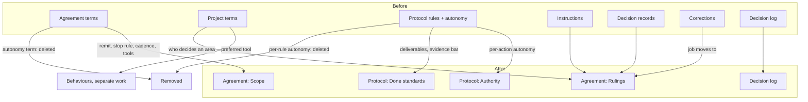
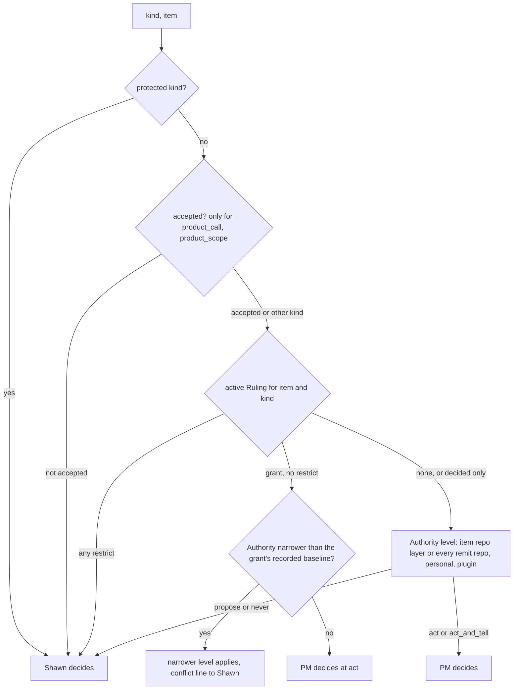
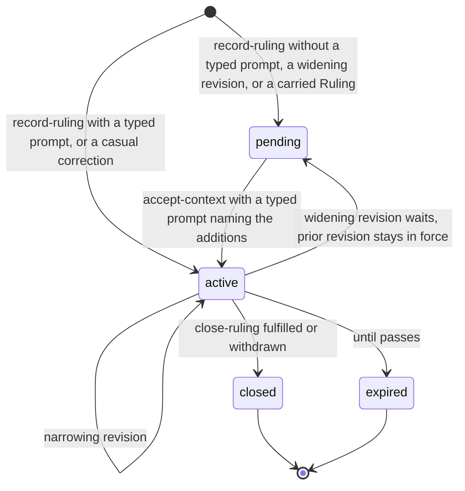
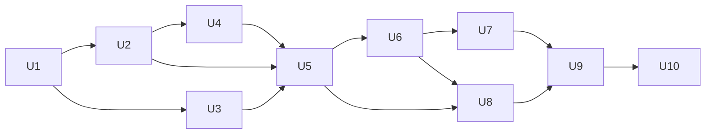

# Agreement Consolidation - Plan

## Goal Capsule

- **Objective:** Every question about how the Programme PM behaves has exactly one place that answers it, so Shawn and the PM each read one source per question and no fact is stored twice.
- **Means:** Shrink the per-programme agreement to Scope and Rulings, keep Authority and Done standards once in the protocol, keep the decision log apart, and delete the concepts that duplicate or do nothing.
- **Product authority:** Shawn. The approval rule (only a prompt Shawn types approves, PR #110 "typed-prompt approval") is not changed by this work.
- **Execution profile:** Deep refactor of the auto plugin (`plugins/auto/`), ten units, run in the dependency order under Planning Contract; three units can run in parallel after U1.
- **Stop conditions:** Stop and ask Shawn if a change would alter who may approve (PR #110), add a decision kind, or need a bulk rewrite of existing records; stop if evidence shows a session-settled decision cannot work.
- **Who finishes:** `ce-work` implements and verifies on `feature/agreement-consolidation`; Shawn approves the merge.
- **Open blockers:** None.

---

## Product Contract

### Summary

The programme agreement holds only what is specific to one programme: Scope and Rulings.
Authority (who decides each decision kind) and Done standards (deliverables and evidence bar per kind of change) live once in the protocol and are read live by every programme.
The decision log stays outside both and approves nothing.
The agreement's autonomy term is deleted, and corrections become Rulings.

### Problem Frame

Auto is a new plugin, and Shawn wants it simple and free of sprawl before he dogfoods Programme and accepts agreements under the current model.
Today seven concepts shape the PM's behaviour, and several answer the same question.
"Who decides" has four answers: the agreement's autonomy term, project terms, the protocol's per-action autonomy map and per-rule autonomy, and corrections.
"Standing scoped order from Shawn" has two: instructions and decision records.

The code shows that most of this overlap is dead weight rather than conflicting gates.
Only one code path gates a PM decision, `_check_pm_may_decide` in `plugins/auto/lib/programme_decisions.py`, and it reads only the protocol's per-action autonomy map and the contract stamp.
The agreement's autonomy term has one option and nothing reads its `overrides`.
The protocol computes a per-rule autonomy level that no caller stores.
Corrections are switched off and feed no gate.
The PM still has to read and reconcile all of these as text in the sweep skill.

Timing matters: auto 0.15.1 is now published, so agreements accepted under the current model may already exist.
The read path for old records (R17) is therefore live, not hypothetical, and every later week adds records to read.

### Key Decisions

- **Agreement holds only per-programme specifics; Authority and Done standards live once in the protocol.** (session-settled: user-directed — chosen over a four-section agreement with defaults copied in at start, and over dropping editable authority to the code-fixed protected list only: copies drift, and the in-between levels "act and tell" and "propose" are worth keeping.) Governs R1, R2, R5, R6.
- **Changes to the protocol reach running programmes live, and each PM reports what changed.** (session-settled: user-directed — chosen over freezing the protocol version at acceptance and over asking per programme: one source of truth, no per-programme copy.) This reverses the operating-contract plan's rule that only newly accepted programmes get a new default. Governs R8.
- **Done standards stop carrying an autonomy level.** Authority is the single answer to "who decides"; a rule's autonomy duplicates it, and today no gate reads it (only display and the widening check do). Governs R6, R7.
- **Delete what does nothing; replace corrections rather than drop what they were for.** The agreement's autonomy term carries no behaviour and is removed. Corrections are switched off but carry a settled intent from the operating-contract plan ("projects are often emergent - we learn as we do"), so their job moves to Rulings instead of disappearing. Governs R10, R11.
- **Success means fewer places to look, not new capability.** This is merge and delete only; it adds no decision kinds and no new approval paths. Governs R14.
- **Product calls stay with Shawn until he accepts the agreement.** After acceptance the PM decides them as today; the accepted marker keeps gating product calls only. (session-settled: user-approved — chosen over dropping the stamp as a gate entirely: shared Authority has no notion of acceptance, so dropping it would hand product calls to the PM on unaccepted and old programmes.) Governs R14.
- **Old free-text waivers keep working for old records.** (session-settled: user-approved — chosen over breaking every pre-existing waiver: releases that passed before would start blocking.) Governs R14a, R17.

### Requirements

**The agreement (per programme)**

- R1. A programme's agreement has exactly two sections: Scope and Rulings.
- R2. Scope holds what the programme covers (remit), when the PM may stop (stop rule), cadence and budget, and the sources the PM watches.
- R3. The sources-watched setting turns sources on and off as tools of record does today; the preferred tool per job (for example Amplitude for prioritisation) moves out of project terms into Behaviours, at the programme layer when it applies to one programme; it is read in place until Behaviours lands, and Behaviours migrates it.
- R4. Rulings hold Shawn's dated, scoped orders and decisions, each with his words, a decision kind, the list of items it applies to, its limits, until when, and its revision history; one Ruling concept replaces both instructions and decision records.
- R4a. An instruction becomes a one-revision Ruling, and context requirements, item assignments, blockers, pauses and denials keep working unchanged, pointing at Rulings by id.
- R5. A Ruling binds only when a prompt Shawn typed accepts it, and a Ruling that widens an earlier one needs a new typed prompt that names what it adds.

**The protocol (standing, shared by all programmes)**

- R6. Authority is one table that says, for each decision kind, who decides and at what level (act, act and tell, propose, never), across the plugin, personal and project layers.
- R7. Done standards say, for each kind of change, the required deliverables and evidence bar, and carry no autonomy level.
- R8. When Shawn changes Authority or Done standards, each running programme reads the new setting on its next sweep and the PM tells Shawn which programmes it affected.
- R9. The "who decides in this area" part of today's project terms becomes a Ruling in that programme, carrying a decision kind and the area it covers; the project layer of Authority holds only per-repo levels keyed by decision kind, read from the repo's default branch as today, and gets no new write command.

**Removals**

- R10. Corrections' verbs, switch and display are removed, and their job moves to Rulings: a casual typed correction ("that didn't need me") becomes a Ruling for that decision kind, applies at once with a one-line notice because the correction is itself the typed prompt, and at programme end the PM offers to carry the Rulings Shawn picks to the next programme on the project.
- R11. The agreement's autonomy term is removed.
- R12. Protected escalations (production deploys, releases, spend over cap, merging around a gate, refused permissions, risk or cost limits, reopening a settled human decision) stay fixed in code, and neither Authority nor a Ruling can hand them to the PM.

**What stays and what reads it**

- R13. The decision log is unchanged: it records every call and who made it, and approves nothing.
- R14. The PM answers "may I decide this?" from Authority plus the protected list plus any Ruling, and from no other source except one: before Shawn accepts the agreement, product calls stay with him, and after acceptance the PM decides them as today.
- R14a. Checks that ask "is this waived?" or "is this protected?" read a Ruling's decision kind, never its free text; only instructions recorded before this change keep their old text match for waivers.
- R14b. Authority holds the standing answer to who decides a kind, and a Ruling may widen or narrow it only for its named items until its end date; when Authority changes after a Ruling was accepted, the narrower of the two applies until Shawn confirms which he wants, and the PM tells him about the conflict.
- R15. The contract view, `/auto:programme-status terms`, the sweep skill, the recovery packet, permission proposals, the release check's eval-waiver lookup, the worker brief's settled-decisions section and the step citations each show or read the new shape and name no removed concept.
- R16. Setup walks Scope and Rulings for each programme, and sets Authority and Done standards once rather than per programme.

**Compatibility**

- R17. Programme records and protocol files written before this change keep reading correctly under the read-compat guarantee in `plugins/auto/CONCEPTS.md`, with no bulk rewrite.
- R18. `plugins/auto/CONCEPTS.md` and the repo `CONCEPTS.md` describe the new concepts and drop the removed ones.

### Acceptance Examples

- AE1. **Covers R8.** Given two running programmes, when Shawn changes `prod_off_flag` in his personal Authority from act to propose, then each PM's next sweep refuses to decide `prod_off_flag` itself and reports to Shawn that the change reached it.
- AE2. **Covers R5.** Given an accepted Ruling "skip full eval for AI-1050", when the PM proposes widening it to all of the AI-1050 stack, then the wider Ruling does not bind until Shawn types a prompt naming the added items, and the narrower Ruling stays in force meanwhile.
- AE3. **Covers R12, R6.** Given a project-layer Authority entry that tries to give `prod_deploy` to the PM, then it is refused, because production deploys are protected in code.
- AE4. **Covers R12, R5.** Given Shawn types "you can deploy AI-1050 to production yourself", then the PM does not record it as a Ruling that lets it deploy, and it still hands every production deploy to Shawn.
- AE5. **Covers R17.** Given a programme record that holds instructions, context decisions, project terms and an autonomy term from before this change, when the PM reads it, then the instructions and decisions show as Rulings, the preferred tools stay readable where they are today until Behaviours lands, the sources it watched stay on, and nothing fails to load.
- AE6. **Covers R14b, R8.** Given an active Ruling that lets the PM decide `tool_choice` for AI-1050, when Shawn changes his personal Authority for `tool_choice` to propose, then the PM asks Shawn about tool choice on AI-1050 items too and tells him the Ruling and Authority now disagree, until he confirms which one he wants.

### Scope Boundaries

- Who may approve is unchanged; the "Programme setup in the mod" work (branch `feature/programme-setup-in-mod`) owns its own change to picker approvals before acceptance.
- No new decision kinds, change kinds or approval paths.
- The decision log's shape and verbs are not changed.
- Behaviours (branch `feature/programme-behaviours`) own how agents work: situation, do and don't, preferred skills, tools, agents, formats and communication, in personal, repo and programme layers. A behaviour carries no decision kind, no items list and no authority; "may the PM decide X, for these items, until when" stays a Ruling.
- Fixes for the runtime-test findings (branch `bugfix/auto-runtime-findings`) are separate work.
- R16 changes what the existing `/auto:programme` setup asks; the "Programme setup in the mod" work owns where setup renders and how it is walked.

### Dependencies / Assumptions

- R3 and AE5 depend on Behaviours having a programme layer; Behaviours owns migrating today's preferred tools, and this work reads them in place until then.
- The end-of-programme carry-over in R10 is one offer that lists both Rulings and programme-layer Behaviours; whichever work builds second hooks into the first.
- The next auto release after 0.15.x is held until this lands, so the old shape stops growing.
- The "Programme setup in the mod" session builds its walkthrough on R16; Shawn's choice of this shape changes its earlier assumption of four agreement sections.

### Outstanding Questions

**Deferred to Planning**

None. Each earlier question is answered by a Key Technical Decision in the Planning Contract: the Authority table (KTD6), the gate's sources (KTD3, KTD8), protected kinds (KTD4), rule autonomy compat (KTD5), change reporting (KTD10), the accepted marker (KTD9), the terms page name (KTD14).

### Sources / Research

- `plugins/auto/lib/programme_decisions.py` — `_check_pm_may_decide`, `AUTONOMY_ACTIONS`, `DECISION_KINDS`.
- `plugins/auto/lib/programme_protocol.py` — layers, `CHANGE_KINDS`, `match()` per-rule autonomy, `load()` read fresh per call.
- `plugins/auto/lib/programme_terms.py` — project terms, `PROTECTED_STEMS`, `CORRECTIONS_ON = False`.
- `plugins/auto/lib/programme_home.py` — `default_terms`, `TERM_GUIDE`.
- `plugins/auto/lib/programme.py` — instructions, agreement verbs, `rules_in_force`.
- `plugins/auto/lib/programme_context.py` — `record-decision`, `accept-context`.
- `plugins/auto/lib/programme_view.py`, `plugins/auto/lib/programme_view_work.py` — contract and terms views.
- `plugins/auto/skills/programme-sweep/SKILL.md` — how the PM reads these today.
- `plugins/auto/CONCEPTS.md` — concept entries and the read-compat guarantee.
- `docs/plans/2026-10-19-0854-feat-pm-operating-contract-plan.md` — origin of project terms, decision kinds and corrections.

---

## Planning Contract

**Product Contract preservation:** changed: R14, R14a — the accepted marker keeps gating product calls, and pre-existing waivers keep their text match (both user-approved in the plan scoping synthesis); Problem Frame timing corrected (auto 0.15.1 is published); Dependencies release line updated; AE5 aligned with R3 (preferred tools read in place until Behaviours lands); Outstanding Questions resolved into KTDs below. All other R/AE IDs unchanged.

**Target repo paths** below are relative to the repo root; plugin code lives under `plugins/auto/`.

### Key Technical Decisions

- KTD1. **Rulings live in the existing context decision store, with verbs in a new module.** A Ruling is a revision chain in the programme context's decisions section, extended with kind, effect, until and Shawn's quote; `lib/programme_rulings.py` holds `record-ruling` and `close-ruling`, and `accept-context` stays. This keeps decision ids, requirement links, item assignments and recovery references working unchanged (R4a), and `lib/programme.py` (966 of 1000 lines) cannot take new verbs. Item merges resolve Ruling targets by canonical id at read time, the decision-record rule, and the instruction-target rewrite in merge-item goes. Governs R4, R4a.
- KTD2. **Each Ruling carries an explicit effect: decided, grant or restrict.** "Decided" records Shawn's own call, "grant" hands a kind to the PM for the named items, "restrict" pulls a kind back to Shawn. A revision widens when it gives the PM more power: a grant that adds items, drops a limit or extends its end date, or a restrict that loses items, drops a limit or shortens its end date; any widening waits for a typed prompt that names what it adds (R5). A grant revision records the merged Authority level for its kind at the moment it becomes active; that baseline is what R14b's conflict check compares against, and Shawn confirms a conflict by accepting a new revision, which records a new baseline. Governs R4, R5, R14b.
- KTD3. **The who-decides gate is one pure function.** It takes the Authority entry for the kind, the protected kinds, the active Rulings for the item and kind at the current time (each grant with its recorded baseline), and the accepted marker, and returns a level and a reason. When several Rulings apply, restrict wins over grant; a decided Ruling does not change the gate, it is Shawn's answer the PM follows and logs. `log-decision` is its only caller; `hand-item` stays ungated because handing a call to Shawn is always allowed. Governs R14, R14b.
- KTD4. **Protected kinds are a closed tuple of decision kinds in `lib/programme_decisions.py`.** The tuple is `prod_deploy`, `full_release`, `spend_over_cap`, `merge_around_gate`, `denied_operation`; the module is a leaf that the pure context module may load. The two protected escalations that are not decision kinds are enforced by rule: reopening a settled human decision means changing or closing a "decided" Ruling, which needs a new typed prompt naming it, and risk or cost limits are covered by `spend_over_cap` plus a Ruling's own limits. Stem matching on free text stops being a gate. Governs R12, R14a.
- KTD5. **A protocol rule's `autonomy` field becomes an optional legacy key.** Validation accepts it, the adoption hash still covers the entry exactly as written so old adoptions verify, and the merged rule, `match()` and `summary()` drop it; the rule-widening branch goes. New adoptions still write the field with the level of the rule they override in the layer below, or `propose` for a new rule id, so a machine on an older plugin reading the synced personal file never sees a widening it must reject. Authority keeps the on-disk section key `autonomy` and the target `autonomy:<action>`, so every existing adoption still matches its journal approval; the rename is display and docs only. Governs R6, R7, R17.
- KTD6. **Authority lists every decision kind.** The plugin defaults add the seven kinds the PM decides today without a setting (`technical_approach`, `work_sequencing`, `worker_coordination`, `tool_choice`, `optimisation_depth`, `product_scope`, `acceptance`) at "act", and raise `product_call` from propose to act, which together match today's behaviour exactly: the accepted marker (KTD9), not Authority, keeps product calls with Shawn before acceptance. Protected kinds show as fixed rows from the code tuple and no layer stores a level for them. Governs R6, R12. (session-settled: user-approved — chosen over leaving them out of the table: they stay PM-decided either way, and listing them makes them visible and changeable.)
- KTD7. **A hand edit that narrows Authority applies without a typed prompt; widening still needs one.** An Authority entry whose adoption fails to verify still applies when its level is no wider than the layer below it; unverified Done-standard rules and checks are still rejected as today. Governs R8. (session-settled: user-approved — chosen over today's silent rejection of every hand edit: AE1 cannot pass otherwise.)
- KTD8. **The gate loads the project layer from the item's repo, never from a flag.** For an item with a recorded repo it reads that repo; for a programme-level decision, or an item with no recorded repo, it reads every remit repo and takes the narrowest level. The sweep's rules view loads the same layers. Governs R8, R9.
- KTD9. **The accepted marker is the existing `contract_version` stamp.** It keeps its key, so old records need no migration, and it now gates only `product_call` and `product_scope` before acceptance. Governs R14.
- KTD10. **Protocol change reporting compares an acknowledged snapshot at read time.** `ack-protocol` stores the acknowledged merged levels per remit repo in the programme block: kind to level, and rule id to content hash. The rules view computes the current merged state at read time, compares it with that map, and lists each changed entry; the PM reports once and acknowledges. The same pass lists grant Rulings whose kind Authority now holds narrower than their recorded baseline (KTD2); they apply at the narrower level until Shawn confirms (R14b). The comparison runs at read time, so a stalled PM never shows a stale view. Governs R8, R14b.
- KTD11. **A casual correction is a `record-ruling` that replies to an ask or decision.** The anchor supplies the item and kind, the typed prompt must come after the anchor, and the Ruling applies at once with a one-line notice; protected kinds are refused. Governs R10, R5.
- KTD12. **Carry-over reuses the existing carry-over store.** `lib/programme_carryover.py` already keeps adopted entries per machine with verified hashes; it now keeps Rulings. The offer runs inside `end` and through a sweep-callable verb that records an offer-made marker; the pure stop predicate adds one stop-blocking reason while active Rulings exist and that marker is absent, so a programme that ends on its own still gets the offer, and making the offer, not Shawn's answer, clears the stop; carried Rulings arrive pending, with no items, and bind when Shawn's typed prompt names the new items. The offer function is the hook point Behaviours adds its programme-layer entries to. No released version wrote carry-over entries (the corrections switch was always off), so the repointed store needs no read compatibility. Governs R10.
- KTD13. **Old instructions read as kind-less legacy Rulings that are inert at the gate.** They show in views and the recovery packet; only the release check still matches their text for "waiv". Reserved project terms read as kind-less legacy restrict Rulings, also inert at the gate, and the rules view lists each one with a line asking Shawn to re-record it as a Ruling with a kind, so no old reservation is lost silently. Governs R14a, R17.
- KTD14. **The verb set changes with no aliases.** Added: `record-ruling`, `close-ruling`, `ack-protocol`. Removed: `record-instruction`, `close-instruction`, `record-decision`, `correct-term`, `undo-correction`, `keep-corrections`, `promote-correction`, and the `--reserved-term` option. `/auto:programme-status terms` is renamed `agreement`. Project-term verbs stay only for preferred-tool text until Behaviours replaces them. Governs R9, R10, R15. (session-settled: user-approved — chosen over keeping old names as aliases: aliases would keep two names per action.)
- KTD15. **Retired keys read through `normalize_programme`, the existing pop-and-rename pattern.** The new key wins when both exist, a grep test proves no shipped code reads a retired key outside the fallback, and `plugins/auto/CONCEPTS.md` gets a read-compat sentence for programme records and protocol files. `lib/format_compat.py` is the wrong home: it passes programme blocks through untouched. Governs R17, R18.
- KTD16. **Compatibility tests use records the current code wrote.** U1 captures them before any change, so a test suite of new-shape records alone cannot hide a broken read (see `docs/solutions/` "answer under two keys"). Governs R17.

### High-Level Technical Design

The gate, as a truth table over one decision. Directional, not a specification.

A Ruling's lifecycle.

### Sequencing and Parallelism

- U1 runs first and alone: its fixtures must come from today's code.
- U2 and U3 run in parallel after U1: they touch `lib/programme_decisions.py` and `lib/programme_protocol.py` with `protocol/defaults.json`, with no file overlap. U4 starts when U2 lands, because it imports U2's protected tuple; U4 runs in parallel with U3 and is the only unit in that wave to edit the shared fence files (`tests/unit/programme-verbs.test.sh`, `tests/unit/import-topology.test.sh`).
- Then U5, then U6. U7 and U8 may run in parallel after U6: they touch different modules. U9 and U10 follow in order.
- Rebase onto `origin/main` before U1: main has gained the takeover and stop-reason fixes in `lib/programme_lifecycle.py`, which U8 edits.

### Assumptions

- An item records its repo only when `add-item --repo` names a remit path (`_set_repo` in `lib/programme_record.py`); many tracker items have none, which KTD8 covers.
- `feature/programme-setup-in-mod` derives setup steps from the agreement's term list, so removing the autonomy term removes its step with no change on that branch; its `SHARED_TERMS` constant becomes harmless.
- `feature/programme-noise-fixes` edits only the sweep skill's reporting rules and `references/waits-and-watchers.md`; U10 edits only the concept passages and `references/judgment.md`.

### Risks

| Risk | Mitigation |
|---|---|
| Stripping `autonomy` before hashing silently rejects every adopted personal rule, and Done standards fall back to plugin defaults | KTD5; U3 test loads a personal rule adopted under today's code and asserts it verifies |
| A machine on an older plugin rejects new-format rules in the synced personal file | KTD5: new adoptions still write the legacy field; U3 test checks an old-validator read of a new adoption |
| A widening adopted on one machine is rejected on others, so "live" is per machine | KTD10's change report names rejected entries so Shawn sees which machine lacks them |
| The PM leaves out a repo and skips a project-layer restriction | KTD8 removes the flag as the source |
| Gate tests pass while unable to fail | U2 and U5 carry mutation checks on the protected and restrict arms |
| Old waiver text stops matching and releases that passed now block | KTD13; U7 test on a U1 fixture waiver |
| A committer to a remit repo's default branch narrows a kind and stalls programmes with no prompt from Shawn | Narrowing cannot widen the PM's power; KTD10's change report names the entry so Shawn sees it |
| Context digest changes force one extra re-read after compaction | Expected; noted in U7, no fix |

---

## Implementation Units

### U1. Capture old-shape fixtures from today's code

**Goal:** Freeze records and protocol files exactly as the current code writes them, so later units prove they still read.
**Requirements:** R17, AE5. KTD16.
**Dependencies:** none (rebase onto `origin/main` first).
**Files:**
- `plugins/auto/tests/fixtures/agreement-legacy/` (new: a generator script plus its outputs)
- `plugins/auto/tests/unit/agreement-legacy-fixtures.test.sh` (new)

**Approach:**
1. Write a generator that drives today's verbs to produce: a programme with an accepted, stamped agreement, two instructions (one a waiver), two decision records (one accepted, one pending widening), a reserved and an open project term, the autonomy term, an assignment and a requirement linked to a decision.
2. Produce a personal protocol file with an adopted rule carrying `autonomy` and an adopted autonomy entry.
3. Commit the outputs; the generator is kept for reference but not run by the suite.

**Execution note:** Run the generator on unmodified code only; regenerating after any later unit invalidates the fixtures.
**Patterns to follow:** `plugins/auto/tests/fixtures/format-v1/`.
**Test scenarios:**
- The fixture programme loads with today's code and its rules view lists both instructions, both decision records and both project terms.
- The fixture personal protocol loads with every entry verified and none rejected.

**Verification:** fixtures exist, are committed, and the new test passes on today's code.

### U2. Protected kinds and the pure who-decides gate

**Goal:** One function answers "may the PM decide this kind for this item now".
**Requirements:** R12, R14, R14b, AE3, AE4. KTD3, KTD4, KTD9.
**Dependencies:** U1.
**Files:**
- `plugins/auto/lib/programme_decisions.py`
- `plugins/auto/tests/unit/programme-decisions.test.sh`

**Approach:**
1. Add the protected-kinds tuple (KTD4) and a pure gate function over the inputs KTD3 names; it does not load the protocol or the journal.
2. Keep the existing refusal message shape ("kind X stays with Shawn (...): use hand-item").
3. Leave `_check_pm_may_decide` calling the old path until U5 wires the new one.

**Patterns to follow:** `lib/goal-route.py` and its truth-table test.
**Test scenarios:**
- Each of the 20 decision kinds × {no Ruling, decided, grant, restrict, expired grant, grant plus restrict} × {protected, not protected} returns the level and reason in the diagram above.
- `product_call` and `product_scope` on an unaccepted programme return "Shawn decides" even with a grant Ruling; on an accepted one they follow Authority.
- Covers AE3. A personal or project Authority level of "act" on `prod_deploy` still returns "Shawn decides".
- A grant Ruling whose kind Authority now narrows returns the narrower level and a conflict reason.
- An expired grant behaves as no Ruling.
- A grant made while Authority was already at propose returns "PM decides", not a conflict.
- A grant plus a restrict on the same item and kind returns "Shawn decides".
- A decided Ruling alone falls through to the Authority level.
- Default Authority on an accepted programme makes `product_call` PM-decidable.
- Mutation: removing the protected check makes the protected rows fail; removing the restrict branch makes the restrict rows fail.

**Verification:** the truth-table test passes and both mutation checks fail when their line is removed.

### U3. Protocol: Authority table, legacy rule autonomy, narrowing hand edits

**Goal:** The protocol exposes Authority and Done standards, keeps old adoptions verifying, and loads the right project layers.
**Requirements:** R6, R7, R8, R9, R17, AE1, AE3. KTD5, KTD6, KTD7, KTD8.
**Dependencies:** U1.
**Files:**
- `plugins/auto/lib/programme_protocol.py`
- `plugins/auto/protocol/defaults.json`
- `plugins/auto/tests/unit/programme-protocol.test.sh`

**Approach:**
1. Make rule `autonomy` an optional legacy key that new adoptions still write (KTD5); drop it from the merged rule, `match()` and `summary()`; remove the rule-widening branch.
2. Add the seven kinds at "act" and raise `product_call` to act in the defaults (KTD6); refuse, at load, any layer entry that sets a protected kind.
3. Apply an unverified Authority entry when it is no wider than the layer below; keep rejecting unverified rules and checks (KTD7).
4. Accept a list of repos and merge their project layers, narrowest wins (KTD8).

**Patterns to follow:** existing `_verify_adoption` and `_merge_rules`.
**Test scenarios:**
- Covers AE5. The U1 personal protocol loads with every adoption verified.
- A new rule proposal without `autonomy` validates; one with an unknown key still fails.
- `match()` output has no autonomy field.
- A rule adopted by the new code loads through the U1 snapshot of today's validator and merge path with no rejection.
- A hand-edited personal rule that drops a `requires` entry is listed as rejected.
- Covers AE1. A hand-edited personal entry narrowing `prod_off_flag` from act to propose applies with no typed prompt.
- A hand-edited entry widening a kind past the plugin default is rejected.
- Covers AE3. A project-layer entry setting `prod_deploy` is refused at load and listed as rejected.
- Two repos whose project layers set `tool_choice` to act and propose merge to propose.
- Every kind in the decision-kinds list has an Authority row after load.

**Verification:** protocol tests pass, including the old-adoption fixture case.

### U4. Rulings: store shape, verbs, effect and widening

**Goal:** One Ruling concept with the decision-record shape plus kind, effect, until and quote.
**Requirements:** R4, R4a, R5, R9, AE2, AE4. KTD1, KTD2, KTD11.
**Dependencies:** U1, U2.
**Files:**
- `plugins/auto/lib/programme_rulings.py` (new)
- `plugins/auto/lib/programme_context.py`
- `plugins/auto/lib/programme.py` (register the module)
- `plugins/auto/tests/unit/programme-rulings.test.sh` (new)
- `plugins/auto/tests/unit/programme-context.test.sh`
- `plugins/auto/tests/unit/programme-verbs.test.sh`
- `plugins/auto/tests/unit/import-topology.test.sh`

**Approach:**
1. Extend the decision revision content with kind, effect, until and quote; keep revisions, `accept-context` and the shared id namespace.
2. Redefine the widening delta per effect, and record the Authority baseline on a grant when it becomes active (KTD2).
3. Add `record-ruling` (with an optional reply-to anchor for casual corrections, KTD11) and `close-ruling` in the new module, registered the way other verb modules are.
4. Refuse a Ruling that would grant or decide a protected kind.
5. Treat a Ruling past its end date as inactive at read time.

**Patterns to follow:** `lib/programme_decisions.py` verb registration; `programme_context` revision helpers; the host-module rule in `tests/unit/import-topology.test.sh`.
**Test scenarios:**
- A Ruling recorded with a typed prompt is active; without one it is pending.
- Covers AE2. Widening an accepted grant to more items stays pending until a typed prompt names the added items, and the prior revision stays in force.
- Narrowing a grant (fewer items) applies at once; narrowing a restrict (fewer items) is a widening and waits.
- Covers AE4. A Ruling that grants `prod_deploy` is refused and nothing is written.
- A reply-to correction on a handed ask binds to that ask's item and kind and applies at once with a notice; one whose prompt predates the anchor is refused.
- A Ruling whose end date has passed reads as expired.
- A grant that becomes active records the Authority level in force for its kind; a later narrowing revision keeps that baseline, and a newly accepted revision records a fresh one.
- `close-ruling --as withdrawn` needs a typed prompt; `--as fulfilled` needs a reason.
- Changing or closing a "decided" Ruling needs a new typed prompt naming it.
- After an item merge, a Ruling naming the old id still applies to the merged item.
- `programme_context` still loads no protocol or journal module.

**Verification:** Rulings and context tests pass; verb list and topology fences are updated in the same change.

### U5. Wire the gate into log-decision

**Goal:** `log-decision` decides through the U2 gate fed by U3's Authority and U4's Rulings.
**Requirements:** R14, R14b, AE4, AE6. KTD3, KTD8, KTD9.
**Dependencies:** U2, U3, U4.
**Files:**
- `plugins/auto/lib/programme_decisions.py`
- `plugins/auto/lib/programme_record.py` (protocol loading by item repo)
- `plugins/auto/tests/unit/programme-decisions.test.sh`
- `plugins/auto/tests/unit/programme-items.test.sh`

**Approach:**
1. Replace the body of `_check_pm_may_decide` with a call to the gate, loading Authority for the item's repo (KTD8) and the item's active Rulings.
2. Remove the `--repo` source for the project layer in `log-decision`.
3. Keep the stamp check only through the accepted-marker input (KTD9).

**Test scenarios:**
- Covers AE6. With a grant Ruling on `tool_choice` for one item and personal Authority changed to propose, `log-decision` on that item is refused with a conflict reason.
- A project-layer propose on the item's repo refuses a PM decision even when the PM omits any repo flag.
- A programme-level decision uses the narrowest level across remit repos.
- An item with no recorded repo is refused when one remit repo's project layer sets that kind to propose.
- Each of the seven newly listed kinds is still PM-decidable by default.
- Caller count: the gate function has exactly one caller and the old Authority lookup has none.

**Verification:** decision and item tests pass; a grep shows no other reader of the autonomy map in gate code.

### U6. Read compatibility and removals

**Goal:** Old records read in the new shape, and the retired verbs and corrections are gone from code.
**Requirements:** R9, R10, R17, AE5. KTD13, KTD14, KTD15.
**Dependencies:** U4, U5.
**Files:**
- `plugins/auto/lib/programme_home.py`
- `plugins/auto/lib/programme.py`
- `plugins/auto/lib/programme_terms.py`
- `plugins/auto/lib/programme_record.py` (merge-item instruction rewrite)
- `plugins/auto/tests/unit/programme-home.test.sh`
- `plugins/auto/tests/unit/programme-proposals.test.sh`
- `plugins/auto/tests/unit/programme-terms.test.sh`
- `plugins/auto/tests/unit/programme-corrections.test.sh` (delete)
- `plugins/auto/tests/unit/programme-verbs.test.sh`
- `plugins/auto/tests/unit/doc-fence-agent-tool-surface.test.sh`

**Approach:**
1. In `normalize_programme`, present old instructions as kind-less legacy Rulings (KTD13), and present reserved project terms as legacy restrict Rulings carrying their area.
2. Remove the corrections switch, verbs and display, and the instruction and decision-record verbs (KTD14).
3. Remove the `--reserved-term` option; keep project-term verbs for preferred-tool text only.
4. Keep the retired keys readable; U9 pops them and turns on the retired-key grep test once the last reader has moved.

**Execution note:** Sweep every test that asserts the old behaviour in the same change; this is a deliberate reversal.
**Test scenarios:**
- The U1 fixture programme loads; its instructions and decisions show as Rulings, its preferred-tool text is still readable, and its sources stay on.
- A record carrying both an old instruction and a new Ruling with the same id keeps the new one.
- A legacy Ruling never makes the gate return "PM decides".
- `describe` lists the KTD14 verb set exactly.
- The rules view lists each U1 reserved-term restrict with a re-record line.

**Verification:** home, proposals, terms and verbs tests pass; the corrections test file is gone; the size budget holds.

### U7. Consumers of instructions and decision records

**Goal:** Every code path that read instructions or decision records reads Rulings.
**Requirements:** R14a, R15. KTD1, KTD13.
**Dependencies:** U6.
**Files:**
- `plugins/auto/lib/programme_evidence.py`
- `plugins/auto/lib/programme_trajectory.py`
- `plugins/auto/lib/programme_recovery.py`
- `plugins/auto/lib/programme_resume.py`
- `plugins/auto/lib/programme_sources.py`
- `plugins/auto/tests/unit/programme-evidence-more.test.sh`
- `plugins/auto/tests/unit/programme-trajectory.test.sh`
- `plugins/auto/tests/unit/programme-recovery.test.sh`
- `plugins/auto/tests/integration/programme-compact.test.sh`

**Approach:**
1. Release check: a waiver is an active Ruling of kind `eval_waiver` with effect decided naming the item; the text match runs only on legacy Rulings.
2. Trajectory: steps cite `ruling:<id>`; stored `instruction:<id>` clauses still resolve.
3. Recovery packet and resume digest: Rulings replace instructions and decision records in the binding section; old references still resolve.
4. Worker brief: "Settled decisions this work carries" lists Rulings and keeps decision-log rows.

**Test scenarios:**
- A decided Ruling of kind `eval_waiver` on an item satisfies the release check; one of another kind does not, whatever its text says.
- A grant or restrict Ruling of kind `eval_waiver` on the item does not satisfy the release check.
- The U1 legacy waiver instruction still satisfies the release check.
- A trajectory step citing an old `instruction:<id>` clause still counts as reliant on it.
- A recovery packet built from the U1 fixture names every Ruling and resolves every old reference.
- The worker brief for an item lists its grant and restrict Rulings.

**Verification:** evidence, trajectory and recovery tests pass; the compaction integration test passes after one expected re-read.

### U8. Change reporting and carry-over

**Goal:** Each PM reports protocol changes and Ruling conflicts, and programme end offers to carry Rulings forward.
**Requirements:** R8, R10, R14b, AE1, AE6. KTD10, KTD12.
**Dependencies:** U3, U4, U5, U6.
**Files:**
- `plugins/auto/lib/programme_protocol_changes.py` (new: acknowledged snapshot, comparison, `ack-protocol` verb)
- `plugins/auto/lib/programme.py` (one call from `rules_in_force` and `render_rules`)
- `plugins/auto/lib/programme_carryover.py`
- `plugins/auto/lib/programme_lifecycle.py`
- `plugins/auto/lib/programme_predicate.py` (stop-blocking reason only; no carry-over import)
- `plugins/auto/tests/unit/programme-carryover.test.sh`
- `plugins/auto/tests/unit/programme-protocol-changes.test.sh` (new)
- `plugins/auto/tests/integration/programme-hooks.test.sh`

**Approach:**
1. Compare the current merged Authority and Done standards per remit repo with the acknowledged map at read time, and list changed entries and conflicting grants in the rules block (KTD10); the comparison and `ack-protocol` live in the new module, registered like other verb modules, with the verb-list and import-topology fences updated in the same change.
2. Repoint the carry-over store from corrections to Rulings (KTD12) and expose one offer function for Behaviours to extend.
3. Run the offer inside `end` and from a sweep-callable verb that records the offer-made marker; the predicate only reads the marker (KTD12).

**Test scenarios:**
- Covers AE1. After a hand edit to personal Authority with no programme write, the next rules block lists the change; after `ack-protocol` it does not.
- Covers AE6. A grant Ruling that Authority now narrows shows a conflict line until Shawn records a revision or closes it.
- A widening rejected on this machine appears in the change report as rejected.
- `end` lists active Rulings for carry-over; a carried Ruling arrives pending in the next programme with no items.
- A programme with active Rulings and no offer-made marker cannot stop; once the offer is made it can, with no answer from Shawn.
- `programme_predicate` still loads no protocol or journal module.

**Verification:** the new and updated tests pass; the rules block stays one block.

### U9. Views, status command and the PM-view mod

**Goal:** Every screen shows Scope, Rulings, Authority and Done standards, and names no removed concept.
**Requirements:** R1, R2, R11, R15, R17, AE5. KTD14, KTD15.
**Dependencies:** U7, U8.
**Files:**
- `plugins/auto/lib/programme_home.py`
- `plugins/auto/lib/on-pretooluse-askuser.py` (stale comment)
- `plugins/auto/lib/programme_view.py`
- `plugins/auto/lib/programme_view_work.py`
- `plugins/auto/commands/programme-status.md`
- `plugins/auto/mods/programme-view/contract-state.ts`
- `plugins/auto/mods/programme-view/contract.tsx`
- `plugins/auto/mods/programme-view/view.ts`
- `plugins/auto/mods/programme-view/actions.ts`
- `plugins/auto/mods/programme-view/contract.test.ts`
- `plugins/auto/mods/programme-view/actions.test.ts`
- `plugins/auto/mods/programme-view/test-world.ts`
- `plugins/auto/mods/programme-view/no-prompt.test.ts`
- `plugins/auto/tests/unit/programme-view.test.sh`

**Approach:**
1. Rename the terms page to `agreement` and render Scope terms, Rulings (active, pending, expired), Authority rows (protected kinds marked fixed) and Done standards.
2. Drop the autonomy row, project-term and correction sections; group the decision log by Ruling id.
3. Point the mod's instruction actions at `close-ruling`, keep its no-prompt rule, and update its tests.
4. Remove the autonomy term from `default_terms` and its guide entry, and update `plugins/auto/lib/on-pretooluse-askuser.py`'s stale comment.
5. Pop the retired keys, including the autonomy term, in `normalize_programme`, and add the grep test that no shipped code reads a retired key outside it.

**Test scenarios:**
- Covers AE5. The U1 fixture programme loads with no autonomy term, its instructions and decisions show as Rulings, its preferred-tool text is still readable, and its sources stay on.
- The agreement page for the U1 fixture shows Rulings in place of instructions and decision records, and no autonomy row.
- The contract test expects terms remit, stop rule, cadence and tools of record, and no autonomy.
- A mod action on a Ruling fills a `close-ruling` reply and submits nothing.
- A source scan finds no "correction", "project term" or "instruction" label in rendered view text.
- The grep test fails when a shipped file reads `programme["instructions"]` outside the fallback.

**Verification:** view tests, the mod test runner and the retired-key grep test pass.

### U10. Skill text, contracts, glossary and setup

**Goal:** The PM's instructions and the docs describe one home per question.
**Requirements:** R15, R16, R18.
**Dependencies:** U9.
**Files:**
- `plugins/auto/skills/programme-sweep/SKILL.md` (concept passages only)
- `plugins/auto/skills/programme-sweep/references/judgment.md`
- `plugins/auto/commands/programme.md`
- `plugins/auto/docs/contracts/programme-protocol-format.md`
- `plugins/auto/docs/contracts/agent-tool-surface.md`
- `plugins/auto/CONCEPTS.md`
- `CONCEPTS.md`

**Approach:**
1. Rewrite the sweep skill's verb rows and who-decides passages for Rulings, Authority and `ack-protocol`; leave reporting rules to `feature/programme-noise-fixes`.
2. Rewrite judgment section 11 around the gate's order.
3. Make `/auto:programme` setup walk Scope and Rulings and point at Authority and Done standards as standing settings.
4. Update the protocol format contract (legacy `autonomy` on rules, Authority section) and the tool-surface verb list.
5. Replace the glossary rows; add legacy rows in "Reading older code" and the read-compat sentence (KTD15).

**Test expectation:** the doc fence and vocabulary audit cover this unit; no new behaviour.
**Verification:** doc-fence and vocabulary-audit tests pass; both CONCEPTS files name the same concepts on a manual read.

---

## Verification Contract

| Check | Command | Proves |
|---|---|---|
| Unit suite | `bash ~/.claude/tools/honest-run/run.sh --expect "TOTAL: [0-9]+ passed, 0 failed" -- bash plugins/auto/tests/run.sh unit` | every unit test, size budget, import topology, verb and doc fences |
| Integration suite | `bash ~/.claude/tools/honest-run/run.sh --expect "TOTAL: [0-9]+ passed, 0 failed" -- bash plugins/auto/tests/run.sh integration` | compaction, hooks, takeover flows |
| Mod tests | run through `plugins/auto/tests/unit/programme-view-mod.test.sh` inside the unit suite | contract screen and no-prompt rule |
| Lint | `/lint-router:lint-router` | changed Python and TypeScript |
| Mutation checks | revert the protected and restrict lines in U2 by hand, run that test file, restore with a WIP commit, never `git checkout --` | the gate tests can fail |

Read the `verdict:` line; a run with no verdict line did not finish.

---

## Definition of Done

- Every unit's verification holds and both suites report zero failures with a verdict line.
- AE1 through AE6 each have a named passing test.
- The U1 fixtures load without edits, and no adopted personal rule in them is rejected.
- `describe` lists exactly the KTD14 verb set.
- No shipped file outside `normalize_programme` reads a retired key.
- No experimental or abandoned code remains in the diff.
- No version bump or publish is part of this work.
