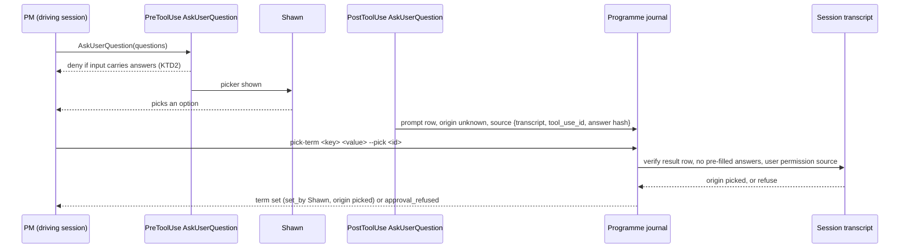
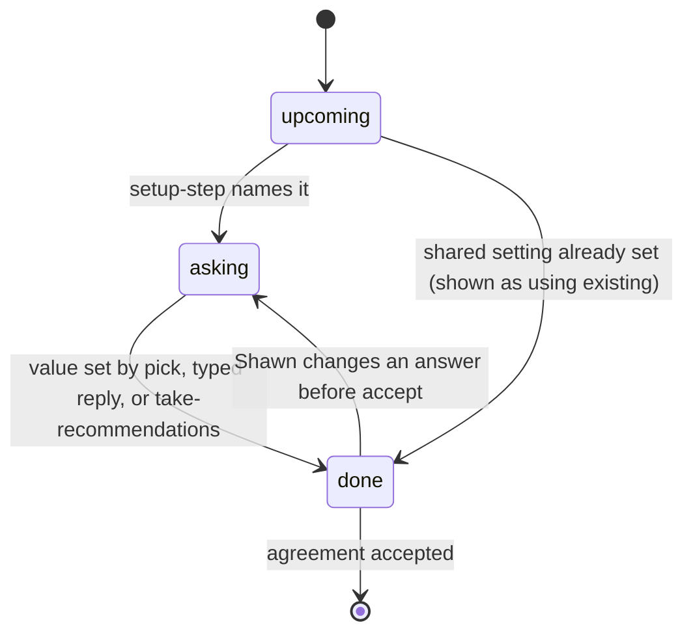
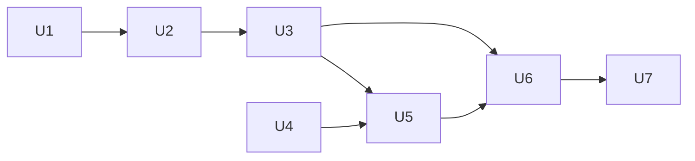

# Programme Setup in the Mod - Plan

## Goal Capsule

- **Objective:** Shawn can get an auto programme running with little effort, sees plainly what the programme covers and what it leaves out, and is only asked to act in chat when something needs his reply.
- **Means:** the chat walks setup one step at a time while the Programme pane mirrors the draft agreement; after setup, status and sweep output live in the pane and band, not the chat.
- **Product authority:** Shawn. Two neighbouring pieces of work own adjacent rules and are not active scope here: the agreement's sections belong to `docs/plans/2026-10-20-1200-refactor-agreement-consolidation-plan.md` (branch `feature/agreement-consolidation`), and the pending-asks data, the reporting rules and the sweep's chat rules belong to the "Programme noise fixes" work (branch `feature/programme-noise-fixes`).
- **Open blockers:** none for planning. The walkthrough is defined against whatever sections the agreement exposes (R2), so it does not wait on the consolidation landing.
- **Stop conditions:** stop and ask Shawn if planning or a live probe shows a picker answer cannot be told apart from text the model wrote (R8); if `bugfix/auto-runtime-findings` cannot be rebased under this work without changing its behaviour; or if the consolidation changes the single typed accept (R7).

---

## Product Contract

### Summary

Running `/auto:programme` opens the Programme pane and turns the chat into a step-by-step setup guide: one question per step, the PM's recommendation first, the pane filling in as Shawn answers, ending on one accept he types. After setup the chat goes quiet: status and sweep results show in the pane and band, and the chat speaks only when Shawn must reply, when something stops the PM, or when he asks.

### Problem Frame

Today `/auto:programme` prints one large setup screen into the chat (remit, rules, sources, items to adopt, project terms) and waits for a typed reply (`plugins/auto/commands/programme.md`, step 4). The PM does nothing to move setup forward; Shawn has to read the block, work out what to change, and phrase it himself. `/auto:programme-status` also prints its full report into the chat. Shawn juggles a dozen things, so a block that scrolls away is lost, and he cannot tell at a glance what a programme covers and what it leaves out.

The Programme mod already has the pieces for a better split. PR #112 added a band above the prompt, a work tree in the side pane and an interactive contract view that shows each term's options, proposals and the exact reply to type (`plugins/auto/mods/programme-view/contract.tsx`). But the pane opens only when Shawn types `/programme-view` (`register.tsx`), and before acceptance it offers no setup view.

The agreement itself is being reshaped in parallel. The consolidation plan settles on two per-programme sections (Scope and Rulings) plus who-decides-what and done standards set once and shared by every programme (its R16 covers setup). That shape is not on `main` yet, which today carries five agreement terms.

### Key Decisions

- **Setup and reports ship together in one plan.** Governs R1–R16. (session-settled: user-directed — chosen over setup first or reports first: one release that makes the PM both guide and quiet)
- **Chat leads, pane mirrors.** The chat asks one question per step and the pane shows the whole draft. Governs R2–R6, R12. (session-settled: user-directed — chosen over a pane form with a chat coach, and over one pane card per step, after comparing all three in a TUI sketch: the session must move setup forward)
- **Picker answers approve this programme's setup choices before acceptance.** Governs R8–R11. (session-settled: user-directed — chosen over typing every step and over picks that only propose with one typed accept: fewer steps, and the loosening ends at acceptance)
- **The final accept stays typed.** Governs R7, R9. (session-settled: user-approved — the moment the PM gains authority is always something Shawn typed; picks cover only the steps before it)
- **Settings shared across programmes stay typed, even during setup.** Governs R9. (session-settled: user-approved — they change every running programme, so a click in one setup must not change the rules for others)
- **The pane opens on its own.** Governs R1. (session-settled: user-directed — chosen over the chat asking first and over Shawn typing `/programme-view`)
- **A quiet sweep says nothing in chat.** Governs R13. (session-settled: user-directed — chosen over a one-line heartbeat and over a line only when something changed)
- **A fast path takes every recommendation.** Governs R4. (session-settled: user-approved — "really easy to get going" was Shawn's first success signal)
- **Scope shows what is out as well as what is in.** Governs R6. (session-settled: user-approved — "clarity about what's in/out" was Shawn's second success signal)
- **`/auto:programme-status` opens the pane instead of printing.** Governs R15. (session-settled: user-approved — reports belong in the mod)
- **Build now, driven by the section list the agreement exposes, rather than waiting for the consolidation to land.** Governs R2. Waiting would hold this work behind a refactor that has no implementation yet; a section-agnostic walkthrough survives a rename or merge of sections.
- **Data for pending asks comes from the Programme noise fixes work; this work renders it.** Governs R14, R16. Agreed with that session on 2026-10-20 so the two branches do not build the same list twice.

### Actors

- A1. Shawn: starts the programme, answers setup questions, types the accept and any reply a decision needs.
- A2. The PM (the driving session): runs the walkthrough, records choices, sweeps, and decides what reaches the chat.
- A3. The Programme mod: the side pane and band; displays only, never submits or fills a prompt.

### Requirements

**Setup walkthrough**

- R1. Running `/auto:programme` opens the Programme pane on its own, showing a setup view of the draft agreement; if the pane cannot open, the chat's first line names the one command that opens it.
- R2. The chat walks setup one step per agreement section, in the order the agreement defines, then items to adopt, then accept; a setting shared across programmes is walked only when it is unset, and is otherwise shown as one line saying the existing settings are in use.
- R3. Each step asks one question in a picker, with the PM's recommendation first and the source of every proposed default shown beside it.
- R4. The first question offers "take all recommendations", which applies every recommended per-programme choice and moves straight to the accept.
- R5. The pane lists every setup step as done, current or upcoming, with the values chosen so far and what the current step proposes, and updates as each answer lands.
- R6. The scope step and the top of the pane list what the programme leaves out (herdr spaces, repos and tracker work not covered) as well as what it covers.
- R7. Setup ends on one accept that Shawn types; the chat and the pane show the exact line to type.

**Approval during setup**

- R8. Before acceptance, a picker answer given in the driving session approves the per-programme setup choice it answers, and only when the programme can verify the answer came from Shawn rather than from text the model wrote.
- R9. A picker answer never approves the final accept, a setting shared across programmes, a reserved area, or anything the agreement says binds only on a typed prompt (rulings); those steps show the reply to type instead.
- R10. After acceptance only a typed prompt approves anything, unchanged from PR #110.
- R11. Every choice a picker answer approves is recorded with its question, the answer and its origin, so the record shows it was a pick and not a typed prompt.

**Reports after setup**

- R12. After setup, status, sweep results and one-line notices show in the pane and band, not in the chat.
- R13. A sweep that needs nothing from Shawn writes nothing in the chat.
- R14. The chat speaks only when a decision needs Shawn's typed reply, when an error stops the PM, or when Shawn asks; a decision request carries the details the reporting rules require.
- R15. `/auto:programme-status` opens or focuses the pane instead of printing, and prints in the chat only for another programme's run or when no pane is available.
- R16. The pane shows pending decisions and the exact reply to type for each, using the data the view provides rather than composing replies itself.

### Visualization

The agreed layout (option A from the TUI sketch), during setup. Directional: wording and glyphs are not settled.

```text
 chat                                         │ side pane
 PM                                           │ Programme setup        draft, not accepted
 Step 2: what the PM watches.                 │ ✓ Scope · where
 Remit done: AI-Editor · 2 repos · Linear WEB │     in:  AI-Editor · shrimpshack, ai-chat-backend
                                              │     out: Infra tab · ai-editor-backend
 Which sources should I watch?                │ ▸ Scope · sources          ← current
   ◉ All three (Recommended)                  │     tracker  Linear (answered)
   ○ Tracker + tasks, no plans                │     tasks    3 sessions with lists
   ○ Tracker only                             │     plans    4 recent
                                              │ ○ Rulings
                                              │ ○ Shared settings   using existing
                                              │ ○ Items to adopt    3 proposed
                                              │ ○ Accept            type: accept the agreement
 ─────────────────────────────────────────────────────────────────────────────
 band: Setup 2/6 · sources ▸ rulings ▸ shared ▸ items ▸ accept
```

### Key Flows

- F1. First setup
  - **Trigger:** Shawn types `/auto:programme` in a herdr space with no programme.
  - **Actors:** A1, A2, A3
  - **Steps:** the PM takes the lease and the pane opens; the chat asks the fast-path question; Shawn walks each step in a picker; the pane marks each step done as answers land; the shared-settings step is skipped when already set; the PM proposes items to adopt; the chat shows the accept line and Shawn types it; the PM arms its wake-ups.
  - **Outcome:** an accepted programme, with no setup block left in the chat.
  - **Covered by:** R1–R8, R11
- F2. Fast path
  - **Trigger:** Shawn picks "take all recommendations" at the first question.
  - **Actors:** A1, A2
  - **Steps:** the PM applies every recommended per-programme choice; steps that need a typed reply (R9) still show their reply; the chat shows the accept line.
  - **Outcome:** setup reaches the accept in one pick plus the typed lines R9 requires.
  - **Covered by:** R4, R7, R9
- F3. A sweep after setup
  - **Trigger:** a watcher line or the cron wakes the PM.
  - **Actors:** A2, A3, A1
  - **Steps:** the PM sweeps and updates the view; the pane and band redraw; if a new decision needs Shawn, the chat shows it with its details and reply; otherwise the chat stays empty.
  - **Outcome:** Shawn sees state in the pane and is interrupted only to act.
  - **Covered by:** R12–R14, R16

### Acceptance Examples

- AE1. **Covers R8, R11.** Given the agreement is not yet accepted, when Shawn picks "fixed, every 15 min" for the cadence in the setup picker, then the cadence is set and the record shows the change came from a pick.
- AE2. **Covers R9.** Given setup is at the shared-settings step and the settings are unset, when the PM asks about done standards, then the chat and pane show the reply to type, and a picker answer alone changes nothing.
- AE3. **Covers R10.** Given the agreement is accepted, when the PM asks a question in a picker and Shawn answers it, then the answer approves nothing and any change it implies waits for a typed reply.
- AE4. **Covers R13, R12.** Given an accepted programme, when a sweep finds nothing that needs Shawn, then the pane and band update and the chat shows nothing from that sweep.
- AE5. **Covers R1.** Given the pane cannot open in this session, when Shawn runs `/auto:programme`, then the chat's first line names the command that opens it and setup continues in the chat.
- AE6. **Covers R15.** Given an accepted programme driven by this session, when Shawn types `/auto:programme-status`, then the pane opens or takes focus and the chat shows no report.

### Scope Boundaries

- The agreement's sections, their contents and who decides what: owned by the consolidation plan. This work walks whatever sections the agreement exposes.
- The pending-asks data, the reporting rules (names beside every ID, restated prior state, decision details) and the sweep skill's rules on what goes to chat: owned by Programme noise fixes. This work renders their data.
- The decision log view: owned by the consolidation plan.
- Watching a programme from a session other than the driving one.
- Bumping the plugin version or cutting auto 0.16.0; that release is on hold until the consolidation is decided.

### Dependencies / Assumptions

- `bugfix/auto-runtime-findings` changes `plugins/auto/lib/programme_view.py`, which this work extends; this work builds on it once merged, or rebases onto it.
- No hook records picker answers today (`plugins/auto/lib/on-pretooluse-askuser.py` only gates the call), so R8 needs a new path that the harness, not the model, feeds.
- The mod is forbidden from submitting, suggesting or filling a prompt (`plugins/auto/mods/programme-view/no-prompt.test.ts`); nothing here changes that.

### Outstanding Questions

Planning resolved the questions this section carried; the answers live in the Planning Contract (KTD1–KTD6). Two remain for execution, both recorded under Deferred to Implementation.

### Sources / Research

- `plugins/auto/commands/programme.md`: today's setup flow; step 4 prints the setup screen and waits for a typed reply.
- `plugins/auto/commands/programme-status.md`: prints its output into the chat.
- `plugins/auto/skills/programme-sweep/SKILL.md`: works from the store, "not from this chat"; chat output is limited to one-line notices.
- `plugins/auto/lib/programme.py` (`_typed_prompt`): approval requires a journaled prompt with origin `typed` from the driving session.
- `plugins/auto/mods/programme-view/`: `register.tsx` (pane opens only on `/programme-view`), `contract.tsx` and `actions.ts` (term options, proposals, "Type this:" replies).
- `docs/plans/2026-10-19-1205-feat-programme-sessions-contract-plan.md`: PR #112's display decisions this work keeps.
- `docs/plans/2026-10-19-0854-feat-pm-operating-contract-plan.md`: "Deferred to Follow-Up Work" records the reporting rules now owned by Programme noise fixes.
- `docs/plans/2026-10-20-1200-refactor-agreement-consolidation-plan.md` (branch `feature/agreement-consolidation`), R16: setup walks Scope and Rulings per programme and sets shared settings once.

---

## Planning Contract

Product Contract preservation: Product Contract unchanged except Outstanding Questions, whose planning-owned items are answered here (KTD1–KTD6). All paths below are under `plugins/auto/` unless they start with `docs/`.

### Key Technical Decisions

- KTD1. **A pick is verified from the session transcript, never from the hook payload or a stored label.** A new PostToolUse hook on AskUserQuestion journals a prompt row stored with origin `unknown` and a source record (transcript path, tool-use id, answer-text hash). The row reads as `picked` only when a transcript check finds the result row for that tool use, finds that its assistant `tool_use` input carried no `answers`, and finds a user permission source. Rationale: the PM runs shell, so env vars, caller arguments and hook rows are forgeable (`docs/solutions/` learnings on restraining switches and transcript-read refusals). `programme_prompt_source.origin()` returns any stored label other than `typed`/`unknown` unchecked (`lib/programme_prompt_source.py`, the `cron` path), so storing `picked` directly would trust it. Governs R8, R11.
- KTD2. **The driving session may not pre-fill a picker.** The existing PreToolUse AskUserQuestion hook denies a call from a programme's driving session whose input already carries `answers`. AskUserQuestion accepts `answers` in its own input, so without this guard the model could answer its own question. Governs R8.
- KTD3. **Picks change attribution, not gates.** Before acceptance, `propose-agreement`, `set-remit` and `edit-project-term` already take no prompt; only `amend-term` needs one (`lib/programme.py`, `lib/programme_terms.py`, `lib/programme_lifecycle.py`). A new `pick-term` verb applies a picked choice with `set_by` Shawn, the pick cited and origin `picked`, refusing after acceptance and refusing any target R9 keeps typed. It journals under a kind that `programme_terms.check_accept_order` counts, so the typed accept must come after the last pick. Every existing typed gate stays typed: `_typed_prompt`, `programme_archive._write`, the lifecycle request checks, the protocol adoption check and `programme_context._source`. Governs R8–R11 (session-settled: user-directed — chosen over typing every step and over picks that only propose: fewer steps, and the loosening ends at acceptance).
- KTD4. **The pane opens inside Shawn's own command.** The mod adds a `command.run` hook for `/auto:programme` that calls `$.ui.open` before passing the command on. A pane opened during the person's command is placed at any width; one opened later by a timer shows only from 144 columns. The pane renders a waiting state until the lease exists, then the existing 2 s poll picks up the first view `start` writes. A second `command.run` hook answers `/auto:programme-status` (no run argument, this session drives a programme) by focusing the pane and returning one line, without passing the command on. Governs R1, R15 (session-settled: user-directed — chosen over the chat asking first and over Shawn typing `/programme-view`).
- KTD5. **Setup steps are derived from data, not hard-coded.** A new optional `setup` part in `view.json` lists the steps: one per agreement section in the order the agreement exposes (today `programme_view_work._ordered_terms` over `programme_home.TERM_GUIDE`), then rulings and reserved areas, shared settings, items to adopt and accept. Each step's state is derived from the record (`set_by`, remit set, project terms, items adopted, `agreement.accepted`). The one stored value is the step the PM is asking now, written by a non-approval `setup-step` verb in the `_ui_write` style. The part is optional, so `VIEW_FORMAT` stays 3. Governs R2, R5, R6.
- KTD6. **New verbs live in a new module.** `lib/programme.py` is at 966 of 1000 lines (`tests/unit/size-budget.test.sh`). `pick-term`, `take-recommendations` and `setup-step` go in a new `lib/programme_setup.py` registered by `build_verbs(host)`, each with a row in `docs/contracts/agent-tool-surface.md` (enforced by `tests/unit/doc-fence-agent-tool-surface.test.sh`).
- KTD7. **The sweep's chat rules and the pending-asks data come from Programme noise fixes.** This plan does not edit `skills/programme-sweep/`. It renders whatever pending-ask fields that branch adds to `view.json`, and until those land it renders today's `decisions_for_shawn`. Governs R12–R14, R16.

### High-Level Technical Design

How a pick becomes an approval (pre-acceptance only):



Setup step states (one per step; derived except "asking"):



### Assumptions

- R12–R14 are delivered by the Programme noise fixes branch (quiet wakes, pending asks in the view, chat repeats an ask only when new or changed). This PR ships setup, picks, the pane and status; the two branches together meet the brainstorm's "setup and reports together".
- A free-text "Other" answer in a picker is recorded as a pick but applies only when it names one of the step's options; otherwise the PM treats it as a request and shows the reply to type.
- The setup steps for rulings, reserved areas and shared settings always show a reply to type (R9), so the fast path ends at the accept line plus any of those Shawn wants to change.

### Sequencing



U4 can run in parallel with U2 and U3 (separate files). Rebase onto `main` (now at #119) before U2; if `bugfix/auto-runtime-findings` merges first, rebase onto it before U4, since both touch `lib/programme_view.py`.

### Deferred to Implementation

- How the mod tells the PM the pane was not placed (R1 fallback). Default: the walkthrough's first line always names `/programme-view` as the fallback; a placement signal is optional polish.
- Whether `command.run` names the plugin command `auto:programme` or `programme` (U1 settles it).

---

## Implementation Units

### U1. Probe the picker transcript and plugin-command hooks

**Goal:** Prove the two runtime facts later units depend on, and capture fixtures.
**Requirements:** R1, R8, R15
**Dependencies:** none
**Files:** `tests/fixtures/askuser_transcript.jsonl` (new), `docs/solutions/` note only if a finding surprises
**Approach:**
1. In a scratch session, answer one AskUserQuestion and one AskUserQuestion whose input carries `answers`; save the two transcript excerpts (redacted) as the fixture.
2. Confirm the result row carries the answers, the `sourceToolAssistantUUID` link, and a user permission source, and that the pre-filled call is distinguishable.
3. Confirm a mod `command.run` hook fires for the plugin markdown command `/auto:programme` and record the command name it sees.
**Execution note:** This is a probe; stop and report to Shawn if step 2 finds no field that separates a human pick from a pre-filled answer (Goal Capsule stop condition).
**Test expectation:** none -- probe and fixture capture; U2 and U5 tests consume the fixture.
**Verification:** the fixture exists with both row shapes, and the command name is recorded in U5's approach.

### U2. Verified picked origin

**Goal:** A picker answer in the driving session is journaled and resolves to origin `picked` only after a transcript check.
**Requirements:** R8, R11; KTD1, KTD2
**Dependencies:** U1
**Files:** `.claude/hooks/hooks.json`, `.claude/hooks/on-posttooluse-askuser.sh` (new), `lib/on-posttooluse-askuser.py` (new), `lib/programme_pick_source.py` (new), `lib/programme_journal.py`, `lib/programme_prompt_source.py`, `lib/on-pretooluse-askuser.py`, `docs/contracts/programme-prompt-source.md`, `tests/unit/programme-pick-source.test.sh` (new), `tests/integration/programme-pick-origin.test.sh` (new), `tests/integration/advisor-gate.test.sh`
**Approach:**
1. Add the PostToolUse hook, gated on a lease file for this session as `on-user-prompt.sh` is; it journals through `append_prompt` with origin `unknown` and a pick source record.
2. Add `picked` to `PROMPT_ORIGINS` as a resolved value only; `prompt_origin` resolves it through the new verifier, and a stored `picked` label is never trusted.
3. Extend the PreToolUse AskUserQuestion hook to deny a driving-session call that carries `answers`.
4. Document the picked rules beside the typed rules.
**Patterns to follow:** `lib/programme_prompt_source.py` (`capture`, `origin`), `lib/on-user-prompt.py` (journaling, `<auto-data>` prompt id), `tests/integration/programme-origin.test.sh` (fake transcript builders).
**Test scenarios:**
- Covers AE1. A transcript with a human pick resolves the journaled row to `picked`.
- A row whose stored label says `picked` but whose transcript has no matching result resolves to `unknown`.
- A pick whose assistant `tool_use` input carried `answers` resolves to `unknown`.
- A pick from a session other than the driving session is not journaled for the programme.
- Setting every test hatch and `CLAUDE_AUTO_*` variable on the PM's route still leaves a forged pick unverified.
- The PreToolUse hook denies a driving-session AskUserQuestion carrying `answers` and allows one without.
- A session that drives no programme gets no journal row and no denial (hook exits 0).
**Verification:** the new unit and integration tests pass, and each was seen failing once with its guard line mutated.

### U3. Setup verbs that consume picks

**Goal:** The PM can apply a picked choice, take all recommendations, and record the current step, with every typed gate unchanged.
**Requirements:** R4, R7, R8, R9, R10, R11; KTD3, KTD6
**Dependencies:** U2
**Files:** `lib/programme_setup.py` (new), `lib/programme.py` (register `build_verbs` only), `lib/programme_terms.py` (`check_accept_order`), `docs/contracts/agent-tool-surface.md`, `tests/unit/programme-setup.test.sh` (new, including the picked-id refusal in each typed-gate twin), `tests/integration/programme-hooks.test.sh`
**Approach:**
1. `pick-term <key> <value> --pick <id>`: before acceptance only, per-programme terms only; records `set_by` Shawn, the pick quote and origin `picked`; refusals go through the `_write` catch so they journal `approval_refused`.
2. `take-recommendations --pick <id>`: applies every per-programme term's recommended value in one write, citing the pick.
3. `setup-step <name>`: non-approval write of the current step (`compact_exempt`, no beat).
4. Add the pick-term journal kinds to `check_accept_order`.
5. Add a refusal test for a `picked` prompt id in each typed gate twin listed in KTD3.
**Patterns to follow:** `build_verbs(host)` registration in `lib/programme.py`; `_ui_write` in `lib/programme_proposals.py`; `amend-term` in `lib/programme.py` for the term write.
**Test scenarios:**
- Covers AE1. `pick-term cadence fixed --pick <verified id>` before acceptance sets the term with `set_by` Shawn and origin `picked`.
- Covers AE3. `pick-term` after acceptance refuses, the record is unchanged and exactly one `approval_refused` is added.
- Covers AE2. `pick-term` on a reserved term, a shared protocol setting, or a ruling refuses.
- `accept-agreement --prompt <picked id>` refuses (the accept stays typed).
- `accept-agreement` citing a typed prompt older than the last pick refuses.
- `amend-term`, `record-instruction`, `adopt-rule`, the archive closure verbs and the lifecycle requests each refuse a picked prompt id.
- `take-recommendations` sets only per-programme terms and leaves reserved and shared settings untouched.
- `setup-step` with an unknown step name refuses; with a known one it updates the view.
**Verification:** tests pass; the size budget and the agent-tool-surface doc fence pass.

### U4. Setup part in the view

**Goal:** `view.json` carries the setup steps, their states, recommendations with sources, and the in and out lists.
**Requirements:** R2, R3, R5, R6; KTD5
**Dependencies:** none (parallel with U2 and U3; uses `setup-step` data once U3 lands, defaulting to the first unfinished step)
**Files:** `lib/programme_view_setup.py` (new), `lib/programme_view.py` (merge the part), `tests/unit/programme-view-setup.test.sh` (new), `tests/unit/programme-view.test.sh`
**Approach:**
1. Build steps from the ordered agreement sections, then rulings and reserved areas, shared settings (done when every protocol layer value is set), items to adopt (from the sweep's proposals) and accept.
2. Each step: name, state, current values, recommendation and its source, and whether it needs a typed reply (R9).
3. In and out: in from the remit; out from the herdr tabs, repos and tracker scope the source probe saw that the remit does not cover.
4. Omit the part once the agreement is accepted.
**Patterns to follow:** `programme_view_work.contract` and `_ordered_terms`; keep this builder apart from the pending-asks builder Programme noise fixes adds.
**Test scenarios:**
- A fresh proposal yields steps in agreement order, the first unfinished one current.
- Adding a term to the agreement data adds a step with no code change (section-agnostic).
- Shared settings already set show as done with "using existing".
- A remit narrower than the sources seen lists the excluded tabs and repos under out.
- After acceptance the setup part is absent.
- An empty sweep proposal list yields an items step with no items, not a crash.
**Verification:** tests pass; a hand-built view for a fake programme shows all six step kinds.

### U5. Setup view, auto-open and status in the mod

**Goal:** The pane opens during `/auto:programme`, shows setup progress, and `/auto:programme-status` focuses the pane.
**Requirements:** R1, R5, R6, R7, R15, R16; KTD4, KTD7
**Dependencies:** U1, U4
**Files:** `mods/programme-view/register.tsx`, `mods/programme-view/view.ts`, `mods/programme-view/setup.tsx` (new), `mods/programme-view/band.tsx`, `mods/programme-view/setup.test.ts` (new), `mods/programme-view/programme-view.test.ts`, `mods/programme-view/test-world.ts`
**Approach:**
1. `command.run` hook for the programme command (name from U1): open the pane, show a waiting state with no lease, start polling, pass the command on.
2. Parse the optional `setup` part; while it is present the pane opens in a setup mode drawn by `setup.tsx` (steps, values, current step, in and out, the accept line to type).
3. The band shows setup progress while setup runs and the work track after.
4. `command.run` hook for `/auto:programme-status`: with no run argument and a lease, focus the pane and return one line; otherwise pass on.
5. Render pending decisions from the view's decision data with their reply to type (R16), today from `decisions_for_shawn`.
**Patterns to follow:** `openView` and the poll in `register.tsx`; `contract.tsx` "Type this:" rendering; `test-world.ts` mocks.
**Test scenarios:**
- Covers AE5. `/auto:programme` with no lease opens the pane in a waiting state; when a view appears the pane shows setup.
- The setup view marks done, current and upcoming steps and shows the in and out lists.
- A step that needs a typed reply shows "Type this:" and no picker hint.
- Covers AE6. `/auto:programme-status` with a lease focuses the pane and returns one line without running the command.
- `/auto:programme-status <other run>` passes through to the command.
- After acceptance the pane shows the work view and the band shows work tracks.
- No action in the setup view submits, suggests or fills a prompt (`no-prompt.test.ts` and the source scan still pass).
**Verification:** mod tests pass through `tests/unit/programme-view-mod.test.sh`.

### U6. Walkthrough command

**Goal:** `/auto:programme` walks setup one question per step instead of printing the setup screen.
**Requirements:** R2, R3, R4, R7, R9, R12; KTD3
**Dependencies:** U3, U5
**Files:** `commands/programme.md`, `commands/programme-status.md`, `tests/unit/programme-command-shape.test.sh` (new)
**Approach:**
1. Keep steps 1–3 (lease, goal check, propose, probe, remit, project terms) but print nothing beyond one line per step.
2. Replace step 4 with the walkthrough: first question offers "take all recommendations"; then one AskUserQuestion per step from the view's setup part, recommendation first with its source, followed by `setup-step` and `pick-term`; steps that need a typed reply show the line to type.
3. End on the typed accept; step 7's "type /programme-view" line becomes the R1 fallback line at the start.
4. `programme-status.md` keeps printing for another run or when the mod passes the command on.
**Test scenarios:**
- The command text no longer instructs printing the full setup screen.
- The command text names `pick-term`, `take-recommendations` and `setup-step`, and says the accept is typed.
- The command text never tells the PM to pre-fill picker answers.
**Verification:** a live run in a scratch herdr space reaches an accepted agreement with picks recorded as `picked` and no setup block in the chat (recorded for the PR).

### U7. Docs and glossary

**Goal:** The overview and glossary describe the walkthrough and the picked origin.
**Requirements:** R8, R11
**Dependencies:** U6
**Files:** `docs/programme-overview.md`, `CONCEPTS.md`, `docs/contracts/programme-prompt-source.md` (if not finished in U2)
**Approach:** add the setup walkthrough to the overview; add "picked prompt" beside "typed prompt" in the glossary.
**Test expectation:** none -- documentation only.
**Verification:** doc-fence tests pass.

---

## Verification Contract

- Unit: `bash tests/run.sh unit` from `plugins/auto`.
- Integration: `bash tests/run.sh integration` from `plugins/auto`.
- Mod: `bash tests/unit/programme-view-mod.test.sh` (needs `claude` on PATH).
- Run long suites through `~/.claude/tools/honest-run/run.sh` and read its verdict line.
- Each new guard test is seen failing once with its guarded line mutated.
- Live check before the PR: one `/auto:programme` run in a scratch herdr space, wide terminal, ending in an accepted agreement; record the pane opening, a pick recorded as `picked`, a refused pick-term after accept, and a quiet chat.

## Definition of Done

- Every unit's tests pass under the commands above, with an honest-run verdict line.
- A forged or pre-filled pick never approves anything (U2, U3 tests).
- After acceptance only typed prompts approve (U3 twin tests).
- The live check above is recorded in the PR body.
- No plugin version bump and no 0.16.0 release in this PR.
- No dead-end or probe code left in the diff; U1's fixture is the only probe artifact kept.
