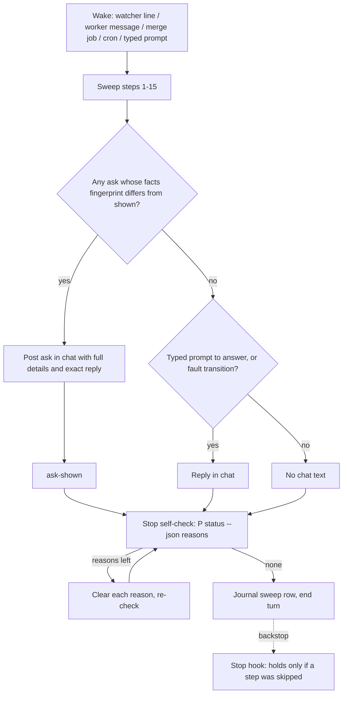
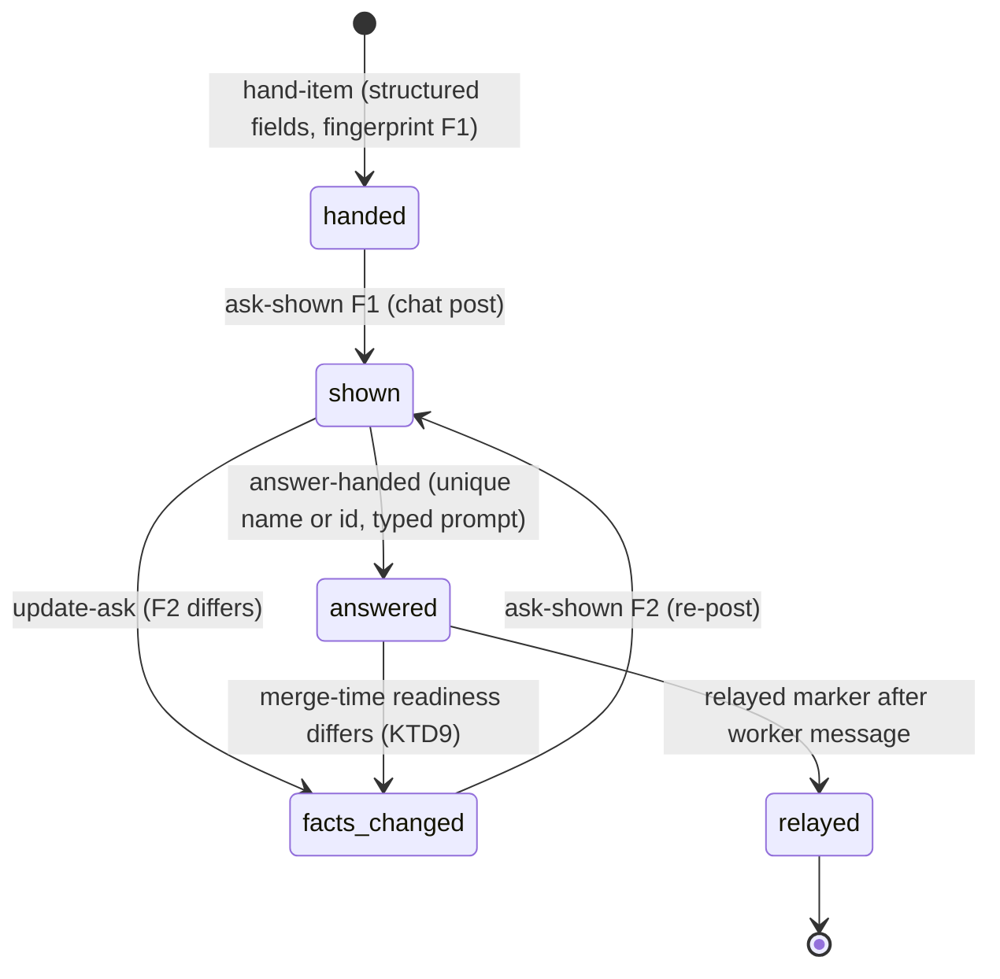
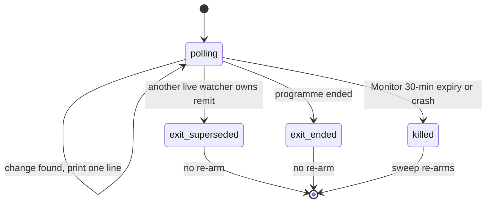

# Quiet Programme PM - Plan

## Goal Capsule

- **Objective:** While an auto programme runs, Shawn sees a chat message only when he must decide something or asked something. Each such message names every item, PR, session and ticket. It also carries the facts he needs to decide there, so he can approve with one typed reply that names the item.
- **Product authority:** Shawn. He chose the scope, the silence rule, the stop-hook approach and name-based approval in this session. The reporting rules and the pinned agents are his direction, sent through the "PM: Auto" session.
- **Means:** Asks become structured records the view and chat both draw from (KTD3). The sweep skill gains a silence rule and an end-of-turn stop self-check (KTD6). Four runtime fixes land beside them (KTD1, KTD4, KTD6, KTD10), with a merge-readiness read (KTD2) and name-based approval (KTD5).
- **Open blockers:** None.
- **Stop conditions:** Stop and report if a change would weaken the PR #110 typed-prompt approval check, or would need a `view_format` bump the mod cannot read.
- **Execution profile:** Three parallel lanes, then pinned agents, then the sweep skill rewrite (see Sequencing). One PR on `feature/programme-noise-fixes`. No version bump.
- **Product Contract preservation:** changed: R7, R13, R16, Success Criteria (watcher and agents lines). Added AE9–AE12. Why: Monitor caps every watch at 30 minutes; pinned agents must not write to the programme, and a hook (not the session-id guard) has to enforce that; a duplicate watcher's exit ends a Monitor stream and wakes the PM; R7 now counts matches across all non-final items and binds a name approval to the choice word and to the facts Shawn saw.

---

## Product Contract

### Summary

The programme PM stays silent in chat unless something needs Shawn. Results go to the Programme view and the journal. Each decision request names the real session or item, carries its options, effects, do-nothing outcome and recommendation, and for a merge it includes evidence that the PR is merge-ready. The same change also makes four runtime fixes: the remit watcher keeps running, skipped required checks do not count as failures, the stop hook becomes a backstop, and the PM's routine reads move to cheaper pinned agents.

### Problem Frame

Shawn said "The plugin is very noisy." The Mac Studio "PM & Planning" session (herdr workspace "Ai Editor", programme `prog-20261020-085403-0dbda2`, installed auto 0.15.0) gave measured numbers for the first hour. The remit watcher ended and was re-armed 22 times, 16 worker messages arrived, the stop hook held 8 times, and 4 merge jobs finished. Shawn typed only 7 prompts in that hour. The PM printed 68 messages (about 43,000 characters), and 61 ended in "Next:", some repeating the same ask three times.

The asks were also hard to act on. One live example was `Next: reply "ship herdr:w2/p7G" so the programme records the go-ahead.` It gave a bare code with no item name, no effect and no do-nothing outcome. Shawn had already typed "ive given the the skill agent the go ahead", but the approval check accepts only item ids, so the PM asked again. The PM also relayed the go-ahead to the worker before the programme recorded it, so the record and reality disagreed.

The merge check also caused false corrections. It marked Slate web-app PR #6987 (AI-1115) and PR #6976 (AI-1109 "Editor places missed crop") as not merged. GitHub showed both merged with all required checks green. One required job on each PR had been skipped on purpose.

### Key Decisions

- **A wake that changes nothing for Shawn prints nothing in chat, not even one line.** The view and the journal are the only record that it ran. Governs R1, R2, R3. (session-settled: user-directed — chosen over a one-line receipt and a periodic summary: Shawn wants the chat quiet; the view shows status.)
- **The PM checks the stop rule itself before it ends its turn. The hook stays as a backstop.** No hold reason is removed. A hold Shawn sees therefore means the PM skipped a step. Governs R11, R12. (session-settled: user-directed — chosen over fewer hold reasons and over both changes together: keeps the enforcement whole.)
- **Shawn approves by typing the item's session name or title.** He no longer has to learn herdr codes. The PR #110 rule is kept: only a typed prompt approves, and the reply must name exactly one open ask. Governs R7, R8. (session-settled: user-directed — chosen over a copy-this reply with the id and a short handle per ask: "Use actual pane names". The code stores a session name and a title per item, not a pane name, so those two are the names that count.)
- **Merge asks carry merge-readiness evidence, read before merge.** Governs R5, R14. (session-settled: user-directed — Shawn: "include evidence that its merge ready". No check reads that state before merge today.)
- **One plan and one PR for both the chat work and the runtime fixes.** (session-settled: user-directed — chosen over two PRs and over deferring the runtime fixes.)
- **Ownership is split with the other programme sessions.** "Programme setup in the mod" owns the mod layout, the rendering and the setup data. This work owns the pending-asks data, each ask's details, the reply to type, the chat rules and auto's reporting rules. "One agreement, four sections" owns the authority source, Rulings and corrections. Governs R4, R10.

### Requirements

**When the PM speaks**

- R1. A sweep produces a chat message only when it makes a new ask, when an ask's facts change, when it answers a prompt Shawn typed, or when it finds a fault Shawn must act on. In all other cases the PM ends its turn with no visible message.
- R2. Worker messages, merge-job completions, watcher wakes and cron wakes are handled quietly. Their results go to the journal and the Programme view.
- R3. The PM does not repeat an open ask in chat. It repeats one only when the ask is new or its facts have changed.

**Asks Shawn can act on**

- R4. Every open ask is in the Programme view's pending-asks list with its full details and the exact reply to type. The view data comes from this work. Its rendering belongs to "Programme setup in the mod".
- R5. Every ask states what is being decided and on which named item. It gives the options, what each option changes and costs, what happens if Shawn does nothing, the recommendation and why, and any risk or unverified fact. A merge ask also gives the full PR URL and title, the tracker ticket URL and title when one exists, and the merge-readiness evidence from R14.
- R6. Every item, PR, session, pane, server or ticket appears by its human name, with its id beside it. This applies in chat asks, in status output and at checkpoints (PR open, merge, handover, end). Each report restates the prior state of what it mentions and shows the contract checklist: feature flag, code review, tests, PR.
- R7. A typed reply approves an ask when it names the item by id, session name or title, that name identifies exactly one non-final item, and that item has an open ask. A name-based approval also needs the choice word ("ship" or "decline") directly before the name, and the prompt must come after the ask's current facts were set. A name that matches more than one non-final item, or none, approves nothing, and the PM then shows the exact reply to type. The existing negation guard ("not", "never", "no" before the name) still applies.
- R8. When Shawn's plain words point to exactly one open ask but do not name it, the PM approves nothing. It shows the exact reply to type, using the item's name.
- R9. The PM records a decision before it relays it to a worker. If the decision needs Shawn's typed reply, the PM shows the reply and waits; it does not relay first.
- R10. Tracker comments keep herdr codes out. PR and ticket ids appear with their titles. This replaces the current "no internal ids" wording in the tracker skill.

**Stop hook**

- R11. The sweep's last step reads the programme's current stop reasons and clears each one before the PM ends its turn.
- R12. The stop hook keeps every hold reason, including the unwatched-wait safety. It no longer adds its own "auto held the stop" message. The block reason stays short and names each item by name.

**Remit watcher**

- R13. The remit watcher keeps running across events. It wakes the PM only on a real change and does not end its stream after each event. The sweep re-arms it only after its Monitor stream ends by expiry or crash, never because a sweep ran.

**Merge evidence**

- R14. A merge-readiness check reads an open PR's state before merge: mergeable state (it must be CLEAN), review decision, draft status, required checks and unresolved review threads. The check reports these facts as evidence for the ask.
- R15. The merged check treats a SKIPPED or NEUTRAL required check as passing, the same way GitHub does. A cancelled, failed or timed-out required check still fails it.

**Pinned agents**

- R16. Bounded, repeated sweep reads run on pinned cheaper agents that return results and write nothing to the programme. Evidence and merge-readiness re-checks, inbox and claim reads, and tracker issue updates use Sonnet. Plain status reads use Haiku. The PM applies every programme write, and plan and design judgement and the PM's working model stay on the calling session.
- R17. The pinned agents are referenced by their namespaced names (`auto:<name>`). They follow the agent-file shape in `plugins/nerd/agents/`.

### Acceptance Examples

- AE1. **Covers R1, R2.** **Given** a programme with no open asks, **when** a worker sends a progress message and the PM records it, **then** the chat shows no message from the PM and the journal has the entry.
- AE2. **Covers R3, R5.** **Given** an open merge ask shown in an earlier turn, **when** a later sweep finds the same facts, **then** the chat does not repeat the ask. **When** a later sweep finds the PR's required checks have gone red, **then** the PM posts the ask again with the changed facts.
- AE3. **Covers R7.** **Given** one open ask on the item whose session is named "Reframe skill: skills vs code", **when** Shawn types "ship Reframe skill: skills vs code", **then** the programme records the approval.
- AE4. **Covers R7.** **Given** two open asks on items whose sessions are both named "Continue previous session", **when** Shawn types "ship Continue previous session", **then** nothing is approved and the PM shows each ask's exact reply.
- AE5. **Covers R8, R9.** **Given** one open ask, **when** Shawn types "ive given the skill agent the go ahead", **then** nothing is recorded and nothing is relayed. The PM shows the exact reply to type, and relays to the worker only after the approval is recorded.
- AE6. **Covers R11, R12.** **Given** a sweep that leaves an unread worker claim, **when** the PM reaches its last step, **then** it reads and records the claim before it ends its turn, and the stop hook does not fire.
- AE7. **Covers R15.** **Given** a merged PR whose required job was skipped on purpose and whose other required checks passed, **when** the merged check runs, **then** the result is confirmed.
- AE8. **Covers R14, R5.** **Given** an open PR with mergeable state BLOCKED, **when** the PM makes a merge ask, **then** the ask shows the BLOCKED state and which gate is unmet. It does not recommend merging.
- AE9. **Covers R15.** **Given** a merged PR whose only checks were all skipped, **when** the merged check runs, **then** the result is refuted with "no check run succeeded".
- AE10. **Covers R15.** **Given** a merged PR with a skipped non-required job and passing required checks, **when** the merged check runs, **then** the result is confirmed.
- AE11. **Covers R14.** **Given** a readiness read where `gh` fails or GitHub has not computed the mergeable state yet, **when** the PM prepares a merge ask, **then** the readiness result is unknown and the ask does not recommend merging.
- AE12. **Covers R14, R7.** **Given** Shawn approved a merge ask, **when** the PR's head or readiness changed since the ask was shown, **then** the PM does not merge and posts the ask again with the changed facts.

### Success Criteria

- In a one-hour run of the same shape as the Mac Studio session, the PM's chat messages fall from 68 to roughly the count of new asks plus Shawn's 7 prompts.
- No chat message contains a herdr code without its name beside it.
- Remit watcher restarts in an hour fall from 22 to at most 2, the floor set by Monitor's 30-minute limit, and none of those restarts prints a chat message.
- One real sweep runs with its reads on the pinned cheaper agents and gives the same journal and record result as a sweep with every read on the calling session.

### Scope Boundaries

- The Programme mod's layout and rendering, setup walkthrough and pane behaviour belong to "Programme setup in the mod".
- Where the PM's authority comes from, Rulings, corrections, and the sweep skill's concept passages belong to "One agreement, four sections". The decision log keeps its shape and its commands (`log-decision`, `hand-item`, `answer-handed`).
- Version bumps are handled by the 0.16.0 release, not here.
- Fuzzy or partial name matching for approval is out of scope. A name counts only when it matches one open ask.

### Dependencies / Assumptions

- The "repeated stop reasons" fix on `bugfix/auto-runtime-findings` touches the same stop-hook output as R12. Whichever change lands second rebases onto the first.
- Item session names are recorded only when the PM passes a session id with the name. Items with neither a session name nor a title can be approved only by id.
- The installed plugin cache regenerates programme state, so the live Mac Studio programme keeps the old behaviour until it runs a released version with this change.

### Outstanding Questions

**Deferred to Implementation**

- The exact field names under the view's `asks` key. KTD3 fixes their meaning; U5 sends the final names to "Programme setup in the mod".
- Whether a once-per-transition source state needs a debounce beyond one poll, or whether one confirming poll is enough to stop flapping. Decide from the watcher tests in U3.

### Sources / Research

- `docs/handoff.md` — the measured noise numbers and the five original fixes.
- `docs/plans/2026-10-19-0854-feat-pm-operating-contract-plan.md` "Deferred to Follow-Up Work" — the PM communication shape and the decision-ready request rules.
- `plugins/auto/lib/programme_evidence.py` — `PASSING` and `BAD_OUTCOMES`; `_merged_bar`; `check_merged`, which reads only post-merge fields.
- `plugins/auto/lib/programme-watch.py` `_remit_mode` — exits after it prints a change. `plugins/auto/skills/programme-sweep/SKILL.md` step 16 — re-arms the watcher every sweep.
- `plugins/auto/lib/on-stop.py` `decide` — the full and terse hold reasons, and the `systemMessage` on a new hold.
- `plugins/auto/lib/programme_record.py` `_item_names` and `require_named` in `plugins/auto/lib/programme.py` — approval matching by id only. Item `title` and `sessions[].name` are the stored names.
- `plugins/auto/lib/programme_view.py` `_decisions` — the decision rows the view shows today. `P status --json` exposes `may_stop` and the stop reasons.
- `plugins/nerd/agents/*.md` — the pinned-agent file shape.
- `docs/solutions/` lessons that shape units here: a staleness display computed at write time cannot show a stalled writer; a switch that restrains an agent cannot be read from the agent's environment; a test can pass because it cannot fail; a routing decision made before the lock must be rechecked under it.

---

## Planning Contract

### Key Technical Decisions

- KTD1. **Required checks pass on SUCCESS, SKIPPED or NEUTRAL. "Some check run succeeded" stays SUCCESS-only. SKIPPED leaves the refuting list.** One constant (`PASSING`) does both jobs today in `plugins/auto/lib/programme_evidence.py`. Adding SKIPPED to it would let an all-skipped PR confirm (AE9). So the fix splits it into a required-pass set and a run-succeeded set. Unknown conclusions stay default-deny. Governs R15.
- KTD2. **The merge-readiness check is a new read verb in a new module, `plugins/auto/lib/programme_readiness.py`, not a deliverable checker.** It judges an open PR, while deliverables judge finished work. `programme_evidence.py` is at 844 of the 1000-line budget that `tests/unit/size-budget.test.sh` enforces. It reuses `parse_pr_ref`, `_gh_env`, `_run_json` and `_check_outcomes`. It returns `ready`, `not_ready` or `unknown` with the facts and a fingerprint over head, merge state, review decision, draft status, unresolved-thread count and check outcomes. A gh failure, a null or UNKNOWN mergeable state, or an empty check list is `unknown`. Only `CLEAN` with no unmet gate is `ready`. Governs R14.
- KTD3. **An ask is a structured record on the item's `handed` block, with a facts fingerprint and a shown fingerprint.** Fields: subject, options (each with its effect and cost), if-nothing, recommendation, risks, evidence, PR and ticket links, and a computed reply to type. Each field gets its own sanitize cap, so a full ask is not cut at 500 characters. A new `update-ask` verb replaces the facts and fingerprint without re-handing. On an answered ask that has not been acted on, it voids the answer: the answer moves to `superseded_answers`, an `ask_answer_voided` row is journaled, and the item returns to `handed` so a fresh typed approval can record. `ask-shown` records which fingerprint was posted in chat. The PM posts an ask only when the facts fingerprint differs from the shown one. Because both live in the record, a compaction or takeover does not re-post every open ask. Governs R3, R4, R5.
- KTD4. **The remit watcher loops until superseded, ended or killed, and prints one line per change. Its last line names why it stopped.** Sources keep once-per-transition state, so recovery prints once and a second outage is reported. A superseded or ended watcher prints `remit-watcher-exit superseded` or `remit-watcher-exit ended` before exiting. The sweep re-arms only on a Monitor expiry or crash notice, never on a superseded or ended exit and never as a routine sweep step. Monitor's 30-minute cap still ends the stream about twice an hour, and the sweep treats that wake as quiet. Governs R13.
- KTD5. **Approval names come from one resolver: the item id forms, the title, and every recorded session name.** A name counts only when it identifies exactly one non-final item. A name that matches more than one non-final item, including a title that appears as a word run inside another item's title, refuses as ambiguous. The refusal lists each candidate's exact reply. A name that normalizes to nothing, squashes to fewer than 6 characters, or equals a choice or negation word is dropped. An item left with no usable name (a "need" in `programme_naming.missing`) refuses rather than passes. A name-based match also needs the choice word that `--choice` passes affirmed directly before the name, and a prompt journaled after the ask's current `facts_at`. `answer-handed` recomputes the match under the record lock and does not trust the id the PM passes. Governs R7. (session-settled: user-directed — chosen over a copy-this id reply and a short handle per ask: "Use actual pane names". Item title and session name are the stored human names.)
- KTD6. **The PM's stop self-check reads actionable reasons from `P status --json`.** They carry kind, target and the target's name, and appear under every stop rule. The self-check clears them and ends the turn when only a rule reason (`never_stop`, `not_done`, `until_time`) remains. The stop hook drops its `systemMessage` and names targets with the shared name formatter (KTD7). The hold logic in `plugins/auto/lib/programme_predicate.py` does not change. Governs R11, R12. (session-settled: user-directed — chosen over fewer hold reasons: keeps enforcement whole.)
- KTD7. **One shared name formatter renders "Name (id)" for items, PRs, sessions and tickets.** It is used everywhere code builds a string Shawn sees: `notify_handed`, the stop-hook reason, status text, view rows and ask replies. A string a model writes is covered by the sweep skill's reporting rules, not by code. Governs R6.
- KTD8. **Record before relay is enforced by a `relayed_at` marker on an answered ask.** The PM relays only after `answer-handed` succeeds, then records `relayed`. Each sweep's typed-answers step relays any answered, unrelayed ask, so a crash between record and relay heals on the next sweep. Governs R9.
- KTD9. **A merge after approval re-reads readiness and pins the reviewed head.** Before merging, the PM runs the readiness verb with `--pin`. That writes the `merge_pinned` journal row that `_pin_for` already reads; no code writes it today. If the head or readiness differs from the fingerprint Shawn saw, the PM does not merge and runs `update-ask` instead. Governs R5, R14 (AE12).
- KTD10. **Pinned agents write nothing to the programme, and a PreToolUse hook enforces it.** `_guard` does not stop a sub-agent: a dispatched Agent inherits the parent's `CLAUDE_CODE_SESSION_ID` (a review sub-agent reported this from a live probe; also recorded in `docs/plans/2026-09-11-1404-feat-data-presentation-report-templates-plan.md`). So a new PreToolUse Bash hook denies any programme CLI call whose verb is outside a read allowlist (`status`, `inbox`, `describe`, the readiness verb without `--pin`) when the hook input identifies a sub-agent. It also denies `gh pr merge` from a sub-agent. The discriminator is settled by U8's first-step probe: `agent_id` in the hook input if PreToolUse carries it (`lib/on-pre-compact.py` reads it for a different event), else a `transcript_path` under `<session>/subagents/`. Where `_guard` can read the same signal in-process, it refuses too, so the hook is not the only wall. Agents run read verbs with `--run <id>`, `gh` reads, and tracker writes limited to the issue ids and labels the PM passes. Each agent returns JSON, and the PM applies every programme write. An empty or failed return counts as unknown, never as "nothing changed". Agent files carry an explicit `tools` allowlist and no bypass flags. Governs R16, R17.
- KTD11. **Pending-ask data reaches the mod as a new top-level `asks` key in view.json, with `view_format` kept at 3.** The mod rejects any other format (`mods/programme-view/view.ts`), and `partsOf` ignores extra keys. Ask age is not stored; the record keeps `at` and `facts_at`, so the mod can compute age when it draws. Governs R4.
- KTD12. **A quiet sweep still writes one journal row (`sweep`) with what it handled.** "The view is the only record" must not mean a dead PM looks like a quiet one. A persistent fault (gh down, a source down) is told to Shawn once per transition, not every sweep. Governs R1, R2.

### High-Level Technical Design

How one wake flows after this change. The diagram shows direction, not exact control flow:

The lifecycle of an ask. `handed` and `answered` exist today. `facts_changed`, `shown` and `relayed` are new:

The remit watcher's lifetime. The Monitor stream ends only on the last three exits:

### Sequencing

| Lane | Units | Why separate |
|---|---|---|
| A | U1, then U2 | Both touch `programme_evidence.py` and its tests |
| B | U3 | Watcher script and its tests, plus the `watcher-beat` handler in `programme_record.py`; rebase on lane C's U6 before merging |
| C | U6, then U5, then U4 | U6 and U5 touch `programme_record.py`; U5 and U4 touch `programme_view.py` |
| After A | U8 | Its evidence agent calls U2's read verb |
| Last | U7 | The sweep skill text cites verbs from every other unit |

Lanes A, B and C can run in parallel worktrees. U8 starts once U2 lands. U7 runs after all the others.

### Assumptions

- The default `agents/` folder loads for the auto plugin without a `plugin.json` entry, as it does for nerd. U8 checks this with one real dispatch.
- PreToolUse hook input identifies a sub-agent's Bash call (by `agent_id` or a `/subagents/` transcript path). Unverified for this event; U8's first step probes it, and KTD10 is not done until the real-dispatch refusal test passes.
- The "repeated stop reasons" fix on `bugfix/auto-runtime-findings` lands separately. U4's change to `on-stop.py` rebases onto it if it lands first.
- The live Mac Studio programme keeps the old behaviour until it runs a release that contains this change.

---

## Implementation Units

### U1. Skipped and neutral required checks pass the merged check

- **Goal:** A merged PR with an intentionally skipped required job confirms, and an all-skipped PR still does not.
- **Requirements:** R15, AE7, AE9, AE10. KTD1.
- **Dependencies:** None.
- **Files:** `plugins/auto/lib/programme_evidence.py`, `plugins/auto/tests/unit/programme-evidence.test.sh`, `plugins/auto/tests/helpers/fixtures/evidence/` (new graphql variants).
- **Approach:**
  1. Split `PASSING` into a required-pass set (SUCCESS, SKIPPED, NEUTRAL) and a run-succeeded set (SUCCESS).
  2. Remove SKIPPED from `BAD_OUTCOMES`. Keep CANCELLED, FAILURE, TIMED_OUT, ACTION_REQUIRED and the rest, and update the miss text to "checks cancelled or failed".
  3. Treat any conclusion outside both lists as not passing for a required check.
- **Patterns to follow:** existing `variant` and `fx` fixture helpers in `programme-evidence.test.sh`.
- **Test scenarios:**
  - Covers AE7. Required job SKIPPED, other required checks SUCCESS: confirmed.
  - Required job NEUTRAL, others SUCCESS: confirmed.
  - Covers AE9. Every check SKIPPED: refuted with "no check run succeeded".
  - Covers AE10. Non-required job SKIPPED, required SUCCESS: confirmed.
  - Required job FAILURE beside a SKIPPED one: refuted, and the miss names the failed job.
  - Required job with an unknown conclusion string: refuted (default-deny).
  - Mutation check: put SKIPPED back in `BAD_OUTCOMES` and confirm the AE7 case fails.
- **Verification:** `programme-evidence.test.sh` passes, including the mutation check, and the Slate PR #6987 (AI-1115) fixture shape confirms.

### U2. Merge-readiness read verb with optional pin

- **Goal:** The PM, or a pinned agent, can read whether an open PR is merge-ready, with evidence to cite in an ask.
- **Requirements:** R14, R5, AE8, AE11, AE12. KTD2, KTD9.
- **Dependencies:** U1.
- **Files:** `plugins/auto/lib/programme_readiness.py` (new), `plugins/auto/lib/programme_evidence.py` (shared helpers and `_pin_for`), `plugins/auto/lib/programme.py` (verb registration), `plugins/auto/tests/unit/programme-readiness.test.sh` (new), `plugins/auto/tests/helpers/fixtures/evidence/gh-graphql-open-*.json` (new).
- **Approach:**
  1. Read `state`, `isDraft`, `mergeable`, `mergeStateStatus`, `reviewDecision`, `baseRefName`, `headRefOid`, title, URL, head checks (with `isRequired`) and unresolved review threads in one GraphQL query.
  2. Return `ready`, `not_ready` or `unknown` with the facts, the unmet gates and the KTD2 fingerprint.
  3. Use the remit-repo guard that the other checkers use.
  3a. Register the verb from `programme_readiness.py`, not by growing `_SPECS` in `programme.py` (966 of 1000 lines). If `_SPECS` cannot take entries from another module, extract it first.
  4. Without `--pin` it is a read verb with no write. With `--pin` it needs an item argument and is a write verb that appends `merge_pinned` with `{item, ref, head}`, the ref in canonical `owner/repo#N` form.
  5. Make `_pin_for` compare canonical refs, so a URL ref and an `owner/repo#N` ref for the same PR match.
- **Patterns to follow:** `check_merged` and `_PR_QUERY` in `programme_evidence.py`. Verb registration in `_SPECS`.
- **Test scenarios:**
  - CLEAN, approved, not draft, required checks green, no unresolved threads: `ready`.
  - Covers AE8. BLOCKED with one required check failing: `not_ready`, and the gate list names that check.
  - Draft PR: `not_ready` with "draft".
  - Covers AE11. gh exits non-zero: `unknown`. Mergeable state null or UNKNOWN: `unknown`. Empty checks list: `unknown`.
  - Already merged PR: `not_ready` with "already merged".
  - `--pin` appends one `merge_pinned` row with item, canonical ref and head sha. A later merged check with that pin and a different merged head is refuted.
  - Pin with a PR URL ref, then run the merged check with an `owner/repo#N` claim ref: the pin applies.
  - `--pin` without an item argument refuses.
  - Without `--pin`, the journal is unchanged.
  - A PR outside the remit repos refuses.
  - The same facts always give the same fingerprint, and a changed check outcome changes it.
- **Verification:** The new test file passes, and the size-budget test passes for every touched module, including `programme.py`.

### U3. Remit watcher keeps running across changes

- **Goal:** One watcher process serves many changes and prints one line for each.
- **Requirements:** R13. KTD4. The heartbeat change keeps the unwatched-wait hold (R12) honest once re-arming stops being routine.
- **Dependencies:** None.
- **Files:** `plugins/auto/lib/programme-watch.py`, `plugins/auto/lib/programme_record.py` (`watcher-beat` only), `plugins/auto/tests/unit/programme-watch.test.sh`, `plugins/auto/skills/programme-sweep/references/waits-and-watchers.md`.
- **Approach:**
  1. In `_remit_mode`, after printing a change, continue polling instead of returning.
  2. Give each `Source` once-per-transition down and recovered state, so recovery prints once and a second outage prints again.
  3. Print an exit-reason line for superseded and ended exits.
  4. Update the module docstring and `waits-and-watchers.md` to say a watcher runs until Monitor expiry.
  5. For monitor-kind watchers only, stop the PM's `watcher-beat --task-id` from refreshing the heartbeat. A dead Monitor then cannot look live and hide an unwatched wait. Cron watchers keep the stamp.
  6. Record the beating session id on the remit watcher entry. A live watcher counts as current only when its session is the driving session, so after a takeover the new PM's watcher is not superseded by the old session's.
- **Execution note:** Flip the existing exit-after-change tests first and watch them fail, then change the loop.
- **Patterns to follow:** the existing `source-unavailable` path, which already prints and keeps polling. Test helpers `start_watch`, `wait_for` and `--max-polls`.
- **Test scenarios:**
  - Two separate pane changes in one run: two lines, and the process is still alive after both.
  - Claim, wait-due, tracker, tasks and plans changes each print one line and the process keeps polling. These replace the existing exit-after-change cases.
  - Source down, then up, then down again: prints unavailable, available, unavailable, each once.
  - The record keeps `unavailable_since` across several polls after recovery: `source-available` prints once.
  - A second watcher starts while the first is live: the second prints `remit-watcher-exit superseded` and exits 0, and the first keeps running.
  - Programme ends: prints `remit-watcher-exit ended` and exits 0.
  - The PM's `watcher-beat --task-id` on a monitor watcher leaves `last_beat_at` unchanged. On a cron watcher it still stamps it.
  - A live remit watcher whose recorded session is not the driving session does not supersede a new watcher started by the driving session.
- **Verification:** `programme-watch.test.sh` passes with no exit-after-change case left.

### U6. Approval by unique name

- **Goal:** Shawn can approve by typing an item's title or session name, and an ambiguous or empty name never approves.
- **Requirements:** R7, R8, AE3, AE4, AE5. KTD5.
- **Dependencies:** None.
- **Files:** `plugins/auto/lib/programme_naming.py` (the unique-name resolver), `plugins/auto/lib/programme_record.py` (`_item_names` and the answer-handed, drop-item and reopen-item callers), `plugins/auto/tests/unit/programme-naming.test.sh`, `plugins/auto/tests/unit/programme-items.test.sh`.
- **Approach:**
  1. Build each item's names from its id forms, its title and every recorded session name.
  2. Before accepting a match, check the quote against the names of every other non-final item. Refuse as ambiguous when another item also matches, and list each candidate's exact reply.
  3. Drop names that normalize to nothing, squash to fewer than 6 characters, or equal a choice or negation word. Refuse when no usable name is left.
  4. For a name-based match, require the `--choice` word affirmed directly before the name and a prompt journaled after the ask's `facts_at` (the field U5 adds; until U5 lands, the ask's `at`).
  5. Run the match inside the record lock in `answer-handed`.
  6. Keep the gate a code constant. Nothing in the env, an argument or a file can turn the typed-prompt rule off.
- **Patterns to follow:** `programme_naming.missing` and `require_named`. Lesson: a switch that restrains an agent cannot be read from the agent's environment.
- **Test scenarios:**
  - Covers AE3. Typed "ship Reframe skill: skills vs code", one open ask whose session name matches: recorded.
  - Typed title match with a different case and punctuation: recorded.
  - Covers AE4. Two non-final items whose session names are both "Continue previous session": refused as ambiguous, and the refusal lists both exact replies.
  - Title "Fix crop" and another item titled "Fix crop export", typed "ship Fix crop export": refused as ambiguous. Typed with the id: recorded.
  - Covers AE5. Typed "ive given the skill agent the go ahead": refused, nothing recorded.
  - "don't ship Reframe skill: skills vs code": refused by the negation guard.
  - Title made only of non-ASCII letters is the only name: refused, never a silent pass.
  - A prompt that is not typed (cron or tool origin) naming the item: refused as before.
  - A question that names the title ("what is left on Reframe skill: skills vs code?"): refused, no choice word.
  - "decline Reframe skill: skills vs code" with `--choice ship`: refused.
  - A prompt typed before the ask's current facts were set: refused.
  - An item titled "ok": approvable only by id.
  - Mutation check: remove the uniqueness scan and confirm the AE4 case fails.
- **Verification:** The naming and items tests pass, the existing PR #110 typed-origin tests still pass, and the size-budget test passes for `programme_record.py`.

### U5. Structured asks, update-ask, shown and relayed markers, view data

- **Goal:** Every open ask carries its full decision details, the chat repeats it only on new facts, and the view gets the data to show it.
- **Requirements:** R3, R4, R5, R6, R9, AE2. KTD3, KTD7, KTD8, KTD11.
- **Dependencies:** U6 (the reply to type uses the unique-name resolver).
- **Files:** `plugins/auto/lib/programme_asks.py`, `plugins/auto/lib/programme_record.py` (`hand-item` options, `notify_handed` title), `plugins/auto/lib/programme_decisions.py` (`new_ask` fields), `plugins/auto/lib/programme_view.py` (`asks` key and decision rows), `plugins/auto/lib/programme.py` (verb registration), `plugins/auto/tests/unit/programme-asks.test.sh` (new), `plugins/auto/tests/unit/programme-view.test.sh`.
- **Approach:**
  1. Extend `hand-item` with structured fields. Each field gets its own sanitize cap.
  2. Compute the facts fingerprint and the reply to type. The reply uses the shortest unique name, falling back to the id.
  3. Add `update-ask`, `ask-shown` and `ask-relayed` verbs in the new module. Put field parsing, per-field caps, the fingerprint and the reply computation there too, so `_h_hand_item` in `programme_record.py` only calls it.
  3a. `update-ask` on an answered, unacted ask voids the answer per KTD3.
  3b. Switch U6's time-binding from the ask's `at` to `facts_at`.
  3c. Register the new verbs from `programme_asks.py`, not by growing `_SPECS` in `programme.py` (966 of 1000 lines).
  4. Recompute every open ask's reply whenever an item's names change, so a reply that just became ambiguous falls back to the id.
  5. Add the shared name formatter and use it in `notify_handed` and the view rows.
  6. Write the top-level `asks` key with `view_format` kept at 3.
  6a. Extend the existing "Decisions for Shawn" text rows, which today's mod already renders, with each ask's options, recommendation, if-nothing outcome and exact reply. The asks are then visible before the setup-in-mod session renders the structured key.
  7. Send the field names to "Programme setup in the mod".
- **Patterns to follow:** `new_ask` and the handed flow in `programme_record.py`. View model building in `programme_view.py`. Lesson: a staleness display computed at write time cannot show a stalled writer, so the view gets timestamps, not ages.
- **Test scenarios:**
  - hand-item with options, if-nothing, recommendation, risks and evidence: the record keeps every field and the view `asks` entry has them all.
  - A 1,500-character ask across fields: no field is cut, and each field stays within its own cap.
  - Covers AE2. `update-ask` with the same facts leaves the fingerprint unchanged. With a changed check outcome it changes, and the view shows the shown fingerprint as stale.
  - `ask-shown` with a fingerprint that is not current refuses.
  - `ask-relayed` before `answer-handed` refuses. After it, it records `relayed_at`.
  - The view lists answered, unrelayed asks so the sweep can relay them.
  - A second item opens with the same title as an open ask: the first ask's reply switches to its id.
  - `notify_handed` title shows "Name (id) needs you".
  - hand, answer ship, then `update-ask` with a changed readiness fingerprint: the item is handed again, the old answer is in `superseded_answers`, and a second `answer-handed` records.
  - The "Decisions for Shawn" rows show the options, recommendation, if-nothing outcome and reply for an open ask.
  - view.json still has `view_format` 3, and the existing mod tests pass.
- **Verification:** The new and updated tests pass, the mod test wrapper `tests/unit/programme-view-mod.test.sh` passes, the size-budget test passes for `programme_record.py` and `programme.py`, and a rendered Programme view shows an open ask's details and reply.

### U4. Stop reasons with targets, hook without extra message

- **Goal:** The PM can clear every stop reason itself, and a hook hold is short and names items.
- **Requirements:** R11, R12, AE6. KTD6, KTD7.
- **Dependencies:** U5 (shared name formatter).
- **Files:** `plugins/auto/lib/programme_view.py` (full reasons in the status model), `plugins/auto/lib/on-stop.py`, `plugins/auto/tests/unit/stop-session-scope.test.sh`, `plugins/auto/tests/unit/programme-view.test.sh`.
- **Approach:**
  1. Return the floor reasons from `programme_predicate.compute` as a separate `actionable_reasons` list, read side only, so they are visible under `never_stop`, `only_when_done` and `until_time` rules too. Put them in the status model with kind, target and target name. `may_stop` and the hold logic do not change.
  2. In `on-stop.py`, drop the `systemMessage` from programme holds. Format the reason with the shared name formatter.
  3. Keep the task-run hold message and every hold reason unchanged.
- **Patterns to follow:** `_programme_reason_texts` and the terse path in `on-stop.py`.
- **Test scenarios:**
  - `P status --json` with an unread claim and an unwatched wait: both reasons have kind, target and name.
  - Under `never_stop` with an unread claim: the claim is in `actionable_reasons`, and `may_stop` is still false.
  - Covers AE6. Programme hold: the decision has `reason` and no `systemMessage`.
  - The hold reason shows "Reframe skill: skills vs code (herdr:w2/p7G)", not the bare id.
  - Unwatched wait still blocks.
  - Re-fired stop still allows silently.
  - Task-run hold still carries its own message.
- **Verification:** The stop and view tests pass.

### U8. Pinned agents for sweep reads, with a write block

- **Goal:** Routine sweep reads run on cheaper models, and a hook stops any programme write from leaving the PM.
- **Requirements:** R16, R17. KTD10.
- **Dependencies:** U2.
- **Files:** `plugins/auto/agents/programme-status-reader.md` (haiku), `plugins/auto/agents/programme-evidence-reader.md` (sonnet), `plugins/auto/agents/programme-inbox-reader.md` (sonnet), `plugins/auto/agents/programme-tracker-updater.md` (sonnet), `plugins/auto/lib/on-pretooluse-subagent.py` (new hook), the plugin's hook registration, `plugins/auto/skills/programme-sweep/SKILL.md` (the sub-agent ground rule), `plugins/auto/tests/unit/pretooluse-subagent.test.sh` (new), `plugins/auto/tests/smoke/agents.test.sh` (new).
- **Approach:**
  1. Write each agent with `name`, `model`, `tools` allowlist, `description` and `whenToUse`, following `plugins/nerd/agents/*.md`.
  0. Probe first: dispatch one trivial agent whose Bash call hits a logging PreToolUse hook, and record what the input carries (`agent_id`, `transcript_path`, env). Pick the discriminator from that, per KTD10.
  1a. Add the PreToolUse hook per KTD10 as its own module, since `lib/on-pretooluse-action.py` is at 907 of the 1000-line budget. Register it beside the existing Bash PreToolUse hook.
  1b. Correct the sweep ground rule that says a sub-agent has its own session id.
  2. Each prompt states the no-programme-write rule, the `--run <id>` requirement, and a JSON return shape with an explicit `unknown` for a failed read.
  3. The PM runs `tracker-synced --check` and passes the tracker updater only the due issue ids and labels. The updater writes only those issues, never sets a done or canceled state, never posts a root-cause comment, and returns what it wrote so the PM can record `tracker-synced`.
- **Patterns to follow:** `plugins/nerd/agents/context-scanner.md` (haiku) and `experiment-executor.md` (sonnet). Lesson: default-deny for an unattended agent.
- **Test scenarios:**
  - Every file in `plugins/auto/agents/` has a `model` of haiku or sonnet and a `tools` list.
  - No agent prompt tells the agent to run a programme write verb (hand-item, answer-handed, mark-read, validate, check-deliverable, tracker-synced, the readiness verb with `--pin`).
  - No agent file contains a permission-bypass flag.
  - Each agent name is unique against the plugin's skills and commands.
  - Hook input with `agent_id` running `answer-handed`, `hand-item`, the readiness verb with `--pin`, or `gh pr merge`: denied.
  - Hook input with `agent_id` running `status --json`: allowed.
  - Hook input without `agent_id` running `answer-handed`: allowed (the PM).
  - The tracker updater prompt names the issue-id scope and the no-proof rule.
- **Verification:** The hook and smoke tests pass. One real dispatch of `auto:programme-status-reader` returns status JSON for a test programme, which also proves the default `agents/` folder loads. One real dispatch that tries `answer-handed` is refused, with no journal row written. Run both before U7 cites the agents.

### U7. Sweep skill: silence, asks, self-check, re-arm, reporting rules

- **Goal:** The PM follows the new rules: quiet by default, asks with full details, record before relay, and stop self-check.
- **Requirements:** R1, R2, R3, R5, R6, R8, R9, R10, R11, R13, R16, AE1, AE5, AE6, AE12. KTD3, KTD4, KTD6, KTD8, KTD9, KTD10, KTD12.
- **Dependencies:** U1–U6, U8.
- **Files:** `plugins/auto/skills/programme-sweep/SKILL.md`, `plugins/auto/skills/programme-sweep/references/judgment.md`, `plugins/auto/skills/programme-sweep/references/sequencing.md`, `plugins/auto/skills/programme-tracker/SKILL.md`, `plugins/auto/tests/unit/programme-sweep-skill.test.sh` (new text assertions).
- **Approach:**
  1. Add a "When to speak" ground rule that states R1 and R3 and points to `ask-shown`.
  2. Step 3: on plain words that point to one ask, show the exact reply and approve nothing. After `answer-handed`, relay, then `ask-relayed`. Relay any answered, unrelayed ask.
  3. Step 13: hand asks with structured fields. For a merge ask, cite the readiness read. Before merging, run readiness with `--pin`, compare fingerprints, and run `update-ask` on a mismatch.
  4. Step 16: arm the remit watcher at start, resume or takeover, and on a Monitor expiry or crash notice only.
  5. Step 17: run the self-check loop on `P status --json` actionable reasons (KTD6), write the `sweep` journal row, then end the turn. End with no chat text when R1 does not apply.
  6. Add the reporting rules from the operating-contract follow-up to `judgment.md`: name next to every id, restate prior state, contract checklist, decision details in place, faults once per transition.
  7. Name which reads go to which `auto:` agent and that their returns are data. The PM runs `tracker-synced --check` before it dispatches the tracker updater, and records `tracker-synced` after.
  8. Replace the tracker voice rule per R10.
  9. Leave the concept passages that "One agreement, four sections" owns unchanged.
- **Patterns to follow:** existing step structure and "tell Shawn" sites. Comment and prose bar: plain, no internal ids.
- **Test scenarios:**
  - SKILL.md has the "When to speak" rule and no instruction to end a sweep with a "Next:" line.
  - Step 16 no longer re-arms every sweep.
  - Step 17 names the status self-check and the `sweep` journal row.
  - The tracker skill's voice rule allows PR and ticket ids with titles and bans herdr codes.
- **Verification:** The skill text tests pass. A manual sweep on a test programme with no changes ends with no chat text and one `sweep` journal row.

---

## Verification Contract

| Check | Command | Proves |
|---|---|---|
| Unit suite | `bash plugins/auto/tests/run.sh unit` | U1–U7 behaviour and the size budget |
| Full suite | `bash plugins/auto/tests/run.sh all` | Integration and smoke, including the U8 agents |
| Single file while iterating | `bash plugins/auto/tests/unit/<name>.test.sh` | The unit under change |
| Mod tests | `bash plugins/auto/tests/unit/programme-view-mod.test.sh` | The mod still reads view.json at format 3 |
| Lint | `bash ~/.claude/tools/slate-unicorn-lint/run.sh` | Changed JS/TS in the mod, if any |
| Mutation checks | the U1 and U6 mutations named in their test scenarios | The new tests can fail |

Run long suites through `~/.claude/tools/honest-run/run.sh --expect "passed"` and read its verdict line. A missing verdict means the run did not finish.

Manual checks:
1. One real sweep on a scratch programme with its reads on the pinned agents. The journal and record result must match a sweep with every read on the calling session.
2. One sweep with no changes: no chat text, one `sweep` row.
3. A remit watcher under Monitor that sees two changes: two notifications and one stream.

---

## Definition of Done

- Every unit's verification holds, and the full suite passes with a verdict line.
- The U1 and U6 mutation checks fail as expected, then are reverted.
- The manual checks above are done, with their results written in the PR body.
- The view.json field names for asks have been sent to "Programme setup in the mod".
- No version bump in `plugin.json` or `marketplace.json`.
- No dead-end or experimental code from abandoned attempts is left in the diff.
