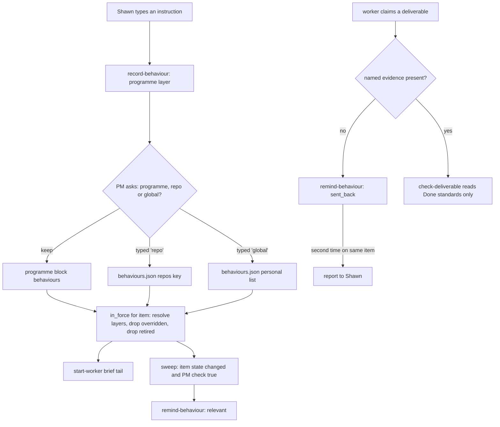
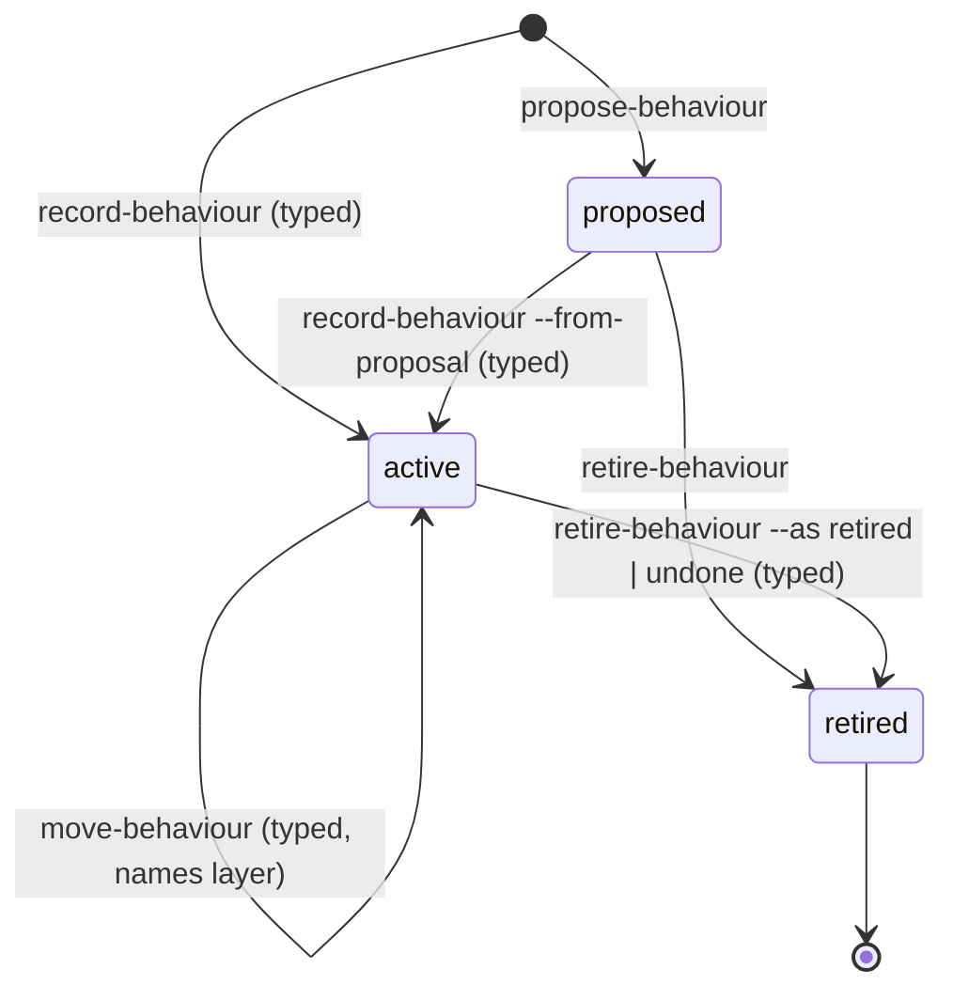
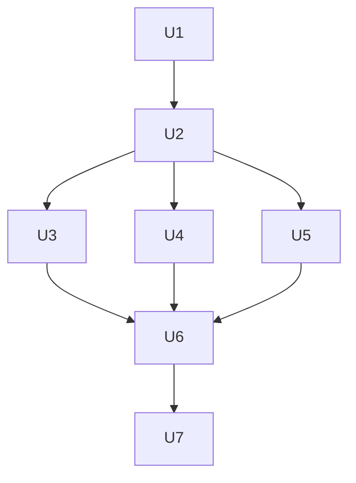

# Programme Behaviours - Plan

## Goal Capsule

- **Objective:** The PM and its workers follow Shawn's standing guidance on how to do the work at the moment it applies, and Shawn can see and change that guidance in one place by saying it in plain words.
- **Means:** A new entry type, the behaviour, held in auto's own layers (personal, repo, programme), delivered through worker briefs and PM messages, and edited by a PM command driven by Shawn's typed words.
- **Product authority:** Shawn. Only a prompt Shawn types approves (PR #110 "only a prompt Shawn typed can approve programme actions"); this work does not change that rule.
- **Open blockers:** None.
- **Execution profile:** Python verbs in `plugins/auto/lib/` and skill prose in `plugins/auto/skills/` and `plugins/auto/commands/`, proven by the bash unit suite.
- **Stop conditions:** Stop and report if a unit needs a change to the worker claim format, a write to a repo's default branch, or a new hook; each is out of scope (see Scope Boundaries).
- **Who finishes:** `ce-work` implements U1-U7; the PR goes to Shawn for merge and release.

---

## Product Contract

### Summary

A behaviour is a standing instruction on how the PM or its workers go about the work: when a situation is true, who it applies to, what to do and not do, which skills, tools, agents and formats to prefer, how to communicate, what evidence shows it was followed, and when to stop.
Behaviours live in three layers (personal, repo, programme); the PM puts the matching ones in each worker's brief, reminds agents when one becomes relevant, and sends work back when one was skipped.
When Shawn says "always do X", the behaviour applies at once to the current programme, and the PM asks whether to keep it there, move it to the repo, or make it global.

### Problem Frame

Shawn already teaches agents how he wants work done, and those lessons sit in his feedback memories and in his habits: verify UI in a browser and record it, reproduce a reported bug before planning, run `/reflect` and close the session after a merge.
Three things go wrong today.
Agents miss the lesson at the moment it matters, for example a worker reports "verified" from unit tests alone.
Shawn cannot see in one place what agents are told to do, and the PM cannot show, propose or retire that guidance in the Programme view.
Workers start without it: the worker brief carries settled decisions and restrictions, but no how-to guidance.

The agreement-consolidation work (`docs/plans/2026-10-20-1200-refactor-agreement-consolidation-plan.md`, branch `feature/agreement-consolidation`) settles who decides (Authority), what counts as done (Done standards) and Shawn's dated orders (Rulings).
None of those answers "how should an agent go about this kind of work".

### Key Decisions

- **Behaviours own how agents work; they carry no authority, no done bar and no dated orders.** They point at Authority, Done standards and Rulings instead. (session-settled: user-directed — chosen over behaviours becoming the single entry type that replaces Authority, Done standards and Rulings: that would reopen a settled plan and give "who decides" two homes again.) Governs R3, R4, R14.
- **Three layers: personal, repo and programme.** (session-settled: user-directed — chosen over personal plus repo only, personal only, and per-programme only.) Governs R6, R7, R8.
- **Behaviours live in auto's own layers, not in Claude memory or compiled skills.** (session-settled: user-directed — chosen over tagged memory files, which tie auto to one person's memory setup and are not approval-gated, and over compiled skills, whose fuzzy triggering loses the checks.) Governs R6.
- **The "when" is plain words, turned into checks with Shawn.** (session-settled: user-directed — chosen over a fixed event list and over plain words with no checks: Shawn describes the situation and the PM helps define how it is determined.) Governs R2, R10.
- **Delivery is the worker brief plus the PM at events it can see; no in-session hooks.** (session-settled: user-directed — chosen over brief only, over adding Claude Code hooks, and over a check at done only.) Governs R11, R12.
- **Compliance is nudging, not a done gate.** The PM reminds, sends work back and repeats reminders; acceptance still reads only Done standards. (session-settled: user-directed — chosen over evidence that is merely optional, and over behaviour evidence feeding the done gate.) Governs R13, R14.
- **A new behaviour applies at once to the current programme; widening needs Shawn's typed answer.** (session-settled: user-directed — chosen over always proposing first and over always instant at any layer.) Governs R16, R17.
- **A new behaviour reaches work in progress as a reminder, without send-backs.** (session-settled: user-directed — chosen over full effect at once and over new work only.) Governs R19.
- **The narrower layer wins.** Programme over repo over personal, so a one-off can override a standing preference. (session-settled: user-approved — proposed in the scoping summary with the PM flagging contradictions; Shawn confirmed.) Governs R8, R18.
- **The PM may propose a behaviour, never apply one, after Shawn corrects it twice on the same thing.** (session-settled: user-approved — proposed in the scoping summary; Shawn confirmed.) Governs R20.

### Actors

- A1. Shawn: states behaviours in plain words, approves checks and widening, and sees all behaviours in the Programme view.
- A2. The PM: drafts behaviours from Shawn's words, matches them to work, writes them into briefs, reminds and sends back.
- A3. Workers: receive behaviours in their brief and in PM messages, follow them, and report the evidence they name.

### Requirements

**What a behaviour is**

- R1. A behaviour has these fields: when, applies to (PM, workers, or both), do, don't, preferred skills and commands, preferred tools and MCP servers, preferred agents, artifact formats, communication requirements, evidence, stop condition, examples (one good, one bad), why and source, and layer.
- R2. The "when" is Shawn's plain-words description of the situation plus one or more checks, each a thing being true or false or having a property ("the item's PR is merged", "the diff touches UI files").
- R3. A behaviour has no decision kind, no item list and no authority effect; nothing in a behaviour can let the PM decide something Authority or a Ruling does not let it decide.
- R4. A behaviour's evidence names what shows it was followed (for example "a browser recording attached"); it is never a condition of acceptance.
- R5. A stop condition says when the agent gives up on the situation's work and reports to Shawn, and it may name dates, attempt counts or cost and time limits.

**Layers and precedence**

- R6. Behaviours live in three layers: personal (every project), repo (every programme on that repo) and programme (one programme).
- R7. The programme layer holds the preferred tool for each kind of job that project terms hold today; behaviours take this over from the agreement's Scope, and the PM migrates today's values by asking Shawn which project terms are tool preferences, so each one his typed reply names becomes a programme-layer behaviour.
- R8. When two behaviours apply to the same situation and disagree, the narrower layer wins, programme over repo over personal.
- R9. The Programme view shows every behaviour in force for the programme, with its layer, its state (active, proposed, retired) and its source in Shawn's words.

**Matching and delivery**

- R10. Each check is marked as one the PM can test from what the sweep sees, or one the agent in the work judges; the PM keeps as many checks PM-testable as it can and tells Shawn which ones it cannot test.
- R11. When the PM starts a worker, the brief includes every behaviour that applies to workers and whose checks hold, or may hold, for that item.
- R12. When the sweep sees a behaviour's checks become true for an item (a claim arrives, a PR merges, an item is blocked), the PM sends the matching behaviour to that item's worker, or applies it itself when it applies to the PM.

**Compliance**

- R13. When a worker claims a deliverable and a behaviour that applied names evidence that is missing, the PM sends the work back with the behaviour quoted before it checks acceptance.
- R14. Acceptance reads only Done standards; a behaviour never adds a deliverable or evidence bar to acceptance, so work the worker cannot bring into line is judged on Done standards and the skip is reported under R15.
- R15. When the same behaviour is skipped again on the same item, the PM reminds the worker again and reports the repeat to Shawn.

**Changing behaviours**

- R16. When Shawn types an instruction about how work should be done ("always X", "never Y", "when X, do Y"), the PM drafts a behaviour from his words, applies it at once at the programme layer, and shows him the drafted checks with an undo.
- R17. After applying it, the PM asks whether to keep it at the programme layer, move it to the repo, or make it global; moving it needs Shawn's typed answer naming the layer.
- R18. When a new behaviour overlaps or contradicts one already in force, the PM names the conflict and which one wins under R8 in the same message, and Shawn's typed reply settles it.
- R19. A new or changed behaviour reaches work already in progress as a reminder from that point on; work that already passed the behaviour's trigger is not sent back.
- R20. When Shawn corrects the PM twice on the same thing, the PM may propose a behaviour; a proposed behaviour applies only after Shawn's typed reply.
- R21. Shawn can retire a behaviour in plain words; a retired behaviour stops being delivered and stays visible as retired.

**Programme end**

- R22. At programme end, the PM makes one carry-over offer that lists both the programme's Rulings and its programme-layer behaviours, and moves the ones Shawn picks to the repo or personal layer.

**Boundaries that stay**

- R23. Protected escalations (production deploys, releases, spend over cap, merging around a gate, refused permissions, risk or cost limits, reopening a settled human decision) stay fixed in code, and no behaviour can change how they are handled.
- R24. The design names no repository-specific path or tool as a requirement, so behaviours keep working when auto moves to its own repo.

### Key Flows

- F1. Shawn adds a behaviour
  - **Trigger:** Shawn types "when work is merged, run /reflect then close the session".
  - **Actors:** A1, A2
  - **Steps:** The PM drafts the behaviour and its checks; applies it at the programme layer; shows the checks with an undo; asks programme, repo or global; Shawn types "global"; the PM moves it to the personal layer.
  - **Covered by:** R2, R16, R17, R10
- F2. Delivery and send-back
  - **Trigger:** The PM starts a worker on an item that changes UI.
  - **Actors:** A2, A3
  - **Steps:** The brief carries "browser-verify UI"; the worker claims its deliverable without a recording; the PM sends the work back quoting the behaviour; the worker records and claims again; acceptance then reads Done standards only.
  - **Covered by:** R11, R13, R14

### Acceptance Examples

- AE1. **Covers R16, R17.** Given a running programme, when Shawn types "always reproduce a reported bug before planning", then the behaviour applies to that programme at once, the PM shows its checks with an undo, and it moves to the repo or personal layer only after Shawn types which.
- AE2. **Covers R13, R14, R15.** Given an active "browser-verify UI" behaviour naming a recording as evidence, when a worker claims its deliverable on a UI change without one, then the PM sends the work back quoting the behaviour. When the worker claims again still without a recording, the PM reminds it again and reports the repeat to Shawn, and acceptance is judged on Done standards alone.
- AE3. **Covers R19.** Given a worker that already claimed its deliverable, when Shawn adds a behaviour that applies at the claim, then the PM tells the worker it applies from now on and does not send that claim back.
- AE4. **Covers R8, R18.** Given a personal behaviour "prioritise with Datadog" and a programme behaviour "prioritise with Amplitude", when both apply, then the programme one wins, and the PM named the conflict when the second was added.
- AE5. **Covers R3, R23.** Given Shawn types "when a fix is ready, deploy it to production yourself", then the PM does not record a behaviour that lets it deploy, and every production deploy still goes to Shawn.
- AE6. **Covers R10.** Given Shawn types "when a PR is opened, request a CodeRabbit review", when the PM drafts the checks, then it tells Shawn it cannot see a PR being opened unless the worker reports one, and marks that check as worker-judged or asks the worker to report the PR in its claim.

### Scope Boundaries

- Turning Shawn's existing feedback memories into behaviours; memory stays separate in this version.
- Hooks that fire inside a worker session; delivery is the brief and the PM only.
- A plugin default layer of behaviours shipped with auto.
- Reporting rules for the PM itself (name every ID, restate state); the "Programme noise fixes" work (branch `feature/programme-noise-fixes`) owns those.
- Where setup renders and how it is walked; the "Programme setup in the mod" work (branch `feature/programme-setup-in-mod`) owns that and shows behaviours using R9. This work puts behaviours into the view data and the text views; the mod's TSX render is that branch's.

### Deferred to Follow-Up Work

- An optional evidence ref on the worker claim, so the PM reads behaviour evidence from the claim instead of judging it from the ref and the pane; it changes the worker contract.
- Sharing repo-layer behaviours with other people through a file committed to the repo.
- A detector for an opened PR.
- The plugin version bump and release; the auto 0.16.0 release is held for the agreement-consolidation work.

### Dependencies / Assumptions

- The agreement-consolidation work removes "preferred tool per job" from Scope and leaves those values readable in place until this work migrates them (R7). That session agreed this on 2026-10-20.
- The carry-over offer in R22 is the same offer as the agreement-consolidation plan's R10; whichever lands second hooks into the first.
- The sweep can see worker claims, merged PRs and blocked items, and the PM can send text to a running worker (`P prompt-item`); it has no detector for an opened PR.

### Outstanding Questions

**Deferred to Planning**

- How repo-layer behaviours are stored and approved, given the protocol's project layer is read from the default branch and needs a local adoption.
- How the PM records which checks it can test (R10) and how it re-tests them each sweep without rereading every behaviour.
- The term for the collection ("behaviours" alone, or a name such as "playbook").

### Sources / Research

- `plugins/auto/lib/programme_protocol.py` — the three existing layers (plugin, personal, project) and typed-prompt adoption.
- `plugins/auto/lib/programme_sources.py` — `start-worker` brief copy with settled decisions and restrictions; `prompt-item`.
- `plugins/auto/skills/programme-sweep/references/judgment.md` section 9 — a preferred tool is not a permission.
- `plugins/auto/lib/programme_evidence.py` — the merged-PR checker the sweep already uses.
- `plugins/auto/lib/programme_carryover.py` — today's per-machine carry-over store.
- `plugins/auto/lib/programme_view.py` — where the Programme view renders terms today.
- `plugins/auto/lib/programme_terms.py` — project term shape and `PROTECTED_STEMS`.

---

## Planning Contract

**Product Contract preservation:** changed: R7 — the PM migrates preferred tools by asking Shawn which project terms are tool preferences, because nothing in a project term marks it as one; R13, F2, AE2, AE3 — "claims ready" now reads "claims its deliverable", because a claim names one of the item's deliverables and there is no "ready" claim.

### Key Technical Decisions

- KTD1. **Personal and repo behaviours live in a sibling file beside the personal protocol, `behaviours.json`, holding a personal list and a list per repo key.** An older loader rejects a whole protocol layer that carries an unknown top-level key (`plugins/auto/lib/programme_protocol.py` `_layer_shape`, `LAYER_KEYS`), and no verb writes the repo's `.claude/auto-protocol.json`, which is read from the default branch and committed by hand. The repo key is the GitHub owner/name or the normalised path, as in `plugins/auto/lib/programme_carryover.py` `key_of`. Implements the Key Decision "behaviours live in auto's own layers" (Governs R6). Conflict call-out: the repo layer lives on Shawn's machines (synced with the personal protocol), not in the repo, so other people working on the repo do not see it.
- KTD2. **Programme-layer behaviours live in the programme block under a `behaviours` list.** `normalize_programme` (`plugins/auto/lib/programme_home.py`) keeps unknown keys and back-fills with `setdefault`, so a record without the key reads as empty and older code keeps the key. Governs R6, R9.
- KTD3. **Applying, moving and retiring a behaviour go through `_write` with a typed prompt; `propose-behaviour` stores a proposal with no prompt, because a proposal applies nothing.** Personal and repo writes also journal a `rule_adopted` row and carry an adoption block. On load, adoption is verified with `programme_protocol._verify_adoption(..., local_only=False)`, as the personal protocol layer does, not with the carry-over store's same-machine `_verified`; so an entry adopted on Shawn's other machine loads (a behaviour carries no authority, R3, and the file syncs between his machines), and an entry adopted on this machine whose hash or prompt does not verify loads as rejected with a reason. The module defines `BehaviourError(Exception)` and adds it to `_write`'s refusal catch and `_ERRORS` in `plugins/auto/lib/programme.py`, the way `programme_terms.TermsError` is added, so refusals are journaled as `approval_refused` (`docs/solutions/best-practices/a-refusal-log-and-a-writes-nothing-test-must-be-reconciled-not-picked.md`). Governs R16, R17, R20.
- KTD4. **A check is stored as text plus who tests it (`pm` or `agent`); the PM evaluates PM checks in the sweep, and there is no event engine.** The sweep already reads item state (step 5) and tracker changes (step 15). Each delivery is recorded on the item by behaviour id and reason (`brief`, `relevant`, `sent_back`) with its time, the way `_launch_assign` records restrictions. A `brief` record does not stop a later `relevant` reminder; the sweep skips a behaviour for an item only when that item already has a `relevant` or `sent_back` record for it. The item also records when each trigger passed (its claim, merge or block), so R19's "already past the trigger" compares the behaviour's creation time with that trigger time. Implements the Key Decision on the "when" (Governs R2, R10, R12, R19).
- KTD5. **Delivery reuses the brief tail and `prompt-item`; the PM judges missing evidence from the claim's ref and the worker's pane.** `_brief_tail` (`plugins/auto/lib/programme_sources.py`) gains a "Behaviours this work follows:" block of short lines (id, when, do, don't). `start-worker` keeps its rule that a non-empty tail needs `--handoff`, and the sweep skill always passes one when behaviours match. A new `remind-behaviour` verb sends one behaviour to an item's worker through the `prompt-item` path, inside its 4000-character cap, and records the delivery with its reason per KTD4. Implements the Key Decisions on delivery and compliance (Governs R11, R12, R13, R15).
- KTD6. **Disagreement is recorded as an `overrides` link, set in R8's direction when the PM names a conflict.** Code cannot tell that two behaviours disagree, so the PM judges it whenever a behaviour is recorded or moved (R18) and passes `--conflicts-with <id>`; the verb sets the link with the narrower layer overriding the broader one, and Shawn's typed reply may reverse it. At resolution, a behaviour overridden by one in force is not delivered. Implements the Key Decision "the narrower layer wins" (Governs R8, R18).
- KTD7. **PM-proposed behaviours follow the `propose-rule` / `adopt-rule` pattern.** `propose-behaviour` stores a proposal on the programme; `record-behaviour --from-proposal <id> --prompt <id>` applies it only with Shawn's typed reply. The same proposal path carries R7's migration: `propose-behaviour --from-term <term-id>` drafts a behaviour from a project term Shawn named. Governs R7, R20.
- KTD8. **A behaviour whose `do` lines or preferred skills, tools or agents name a protected escalation is refused with `PROTECTED_STEMS` from `plugins/auto/lib/programme_terms.py`.** The check skips `when`, `dont`, `stop`, `evidence`, `why` and `examples`, because those stems match substrings such as "cost", "limit", "publish" and "denied" that R5's stop conditions and ordinary "don't" lines need. Governs R23.
- KTD9. **Moving a behaviour needs a typed prompt that names the target layer, checked with the strict no-negation rule of `_check_all_projects` in `plugins/auto/lib/programme_terms.py`.** The stored layer values are `programme`, `repo` and `personal`; the typed words "global" and "all projects" map to `personal`. Governs R17.
- KTD10. **The new verbs and logic live in a new module, `plugins/auto/lib/programme_behaviours.py`, registered through `build_verbs(host)`.** `programme.py` is at 966 of its 1000-line budget (`plugins/auto/tests/unit/size-budget.test.sh`). Follows `plugins/auto/lib/programme_terms.py`'s `_SPECS` table.
- KTD11. **There is no new slash command; the "command" is the set of behaviour verbs, reached through the sweep skill's typed-answer table.** Shawn speaks in the PM's session, and the table routes his words to the verbs (U6), as it does for instructions and terms today. Governs R16, R17, R21.
- KTD12. **A move marks the programme-layer entry `moved_to: <layer>` instead of deleting it, and reads `behaviours.json` inside the write's change step.** An unreadable store refuses the move before anything commits; `in_force` hides a moved entry only when the store holds a verified entry with the same id, so a failed store write never loses a behaviour. Governs R17, R22.

### High-Level Technical Design

Where a behaviour lives and how it reaches an agent:



A behaviour's state over its life:



Directional entry shape (not an implementation specification):

```text
behaviour:
  id, layer (programme | repo | personal), repo_key (repo layer only)
  when: { text, checks: [ { text, by: pm | agent } ] }
  applies_to: pm | workers | both
  do, dont, skills, tools, agents, formats, comms: lists of short lines
  evidence, stop, examples { good, bad }
  why, source { prompt_id, quote }, state, overrides, history
  adoption (personal and repo layers only)
```

### Assumptions

- The repo layer is per-machine (KTD1); a file committed to the repo is follow-up work.
- The PM judges whether named evidence is present from the claim's ref and the worker's pane (KTD5); the claim format does not change.
- No detector exists for an opened PR; a check that depends on one is marked as agent-tested (R10, AE6).
- Checks are evaluated by the PM in the sweep, not by code (KTD4).
- The mod's TSX render of behaviours is the setup-in-mod branch's work.
- The agreement-consolidation work has not reached code; this work lands against today's project terms, instructions and carry-over store, and the second of the two to land re-targets the shared end-of-programme offer.

### Sequencing

U1 first, then U2. U3, U4 and U5 depend on U2 and can run in parallel. U6 depends on U3, U4 and U5, because the skill names their verbs and a test scans the skill for unknown verbs. U7 runs last.



---

## Implementation Units

### U1. Behaviour shape, layers and resolution

**Goal:** One module defines a behaviour, validates it, reads and writes the three layers, and resolves which behaviours are in force for an item.

**Requirements:** R1, R2, R3, R4, R5, R6, R8, R23. KTD1, KTD2, KTD3, KTD6, KTD8, KTD10.

**Dependencies:** None.

**Files:**
- Create `plugins/auto/lib/programme_behaviours.py`
- Modify `plugins/auto/lib/programme_home.py` (add `behaviours` to the programme block back-fill)
- Create `plugins/auto/tests/unit/programme-behaviours.test.sh`

**Approach:**
1. Validate an entry the way `programme_protocol` validates rules: known keys, required `when.text`, `do` or `dont`, `applies_to`, and a reason name on each rejection.
2. Read and write `behaviours.json` beside the personal protocol under a lock, refusing to overwrite an unreadable file, the way `_read_personal` and `_write_personal` in `plugins/auto/lib/programme.py` do; honour an environment override for the path in tests, like `CLAUDE_AUTO_CARRYOVER_STORE`.
3. Verify each personal and repo entry's adoption on load per KTD3; entries that fail go to a rejected list with a reason.
4. `in_force(record, item, repo)` merges personal, repo and programme entries, drops retired ones, drops any entry overridden by one in force (KTD6), hides a programme entry marked `moved_to` once the store holds it (KTD12), and filters by `applies_to`.
5. Refuse an entry per KTD8.
6. Re-check the store's promoted state under the lock on every write path (`docs/solutions/logic-errors/a-routing-decision-made-before-the-lock-must-be-rechecked-under-it.md`).

**Patterns to follow:** `plugins/auto/lib/programme_carryover.py` (file beside the personal protocol, repo keys, lock, adoption), `plugins/auto/lib/programme_protocol.py` (validators and rejected list), `plugins/auto/lib/programme_terms.py` (`PROTECTED_STEMS`).

**Test scenarios:**
- A personal entry, a repo entry for the item's repo and a programme entry all resolve as in force for that item.
- A repo entry for a different repo is not in force.
- Covers AE4. A programme entry with an `overrides` link to a personal entry hides the personal one.
- A retired entry is not in force.
- An entry with `applies_to: pm` is not returned for workers.
- A programme entry marked `moved_to: personal` stays in force while the store lacks a verified entry with its id, and is hidden once the store has one.
- Covers AE5. An entry whose `do` reads "deploy it to production yourself" is refused with the protected-escalation reason and nothing is written.
- An entry whose `stop` reads "after $1 of paid runs or 30 minutes" and whose `dont` reads "never publish without an eval run" is accepted.
- An entry whose adoption names another machine (set through the machine-name override) loads as in force.
- An entry missing `when.text` is rejected with `missing_field`; an unknown key is rejected with `unknown_key`.
- An entry in `behaviours.json` adopted on this machine whose adoption hash does not match is rejected on load and does not appear in force.
- A programme record written before this change (no `behaviours` key) reads with an empty list and keeps its other fields.
- An unreadable `behaviours.json` is reported, and a write refuses rather than overwriting it.
- Mutation check: removing the `overrides` filter turns the AE4 scenario red.

**Verification:** The new test file passes, and the size-budget test passes with the new module.

### U2. Verbs to record, move, retire and propose behaviours

**Goal:** The PM can create, widen, retire, undo and propose behaviours from Shawn's typed words, and every change is journaled.

**Requirements:** R7, R16, R17, R18, R20, R21. KTD3, KTD7, KTD9, KTD10.

**Dependencies:** U1.

**Files:**
- Modify `plugins/auto/lib/programme_behaviours.py` (verb handlers, `_SPECS`, `build_verbs`)
- Modify `plugins/auto/lib/programme.py` (register the verbs; add `BehaviourError` to `_write`'s refusal catch and `_ERRORS`, per KTD3)
- Modify `plugins/auto/lib/programme_journal.py` (new kinds `behaviour_recorded`, `behaviour_proposed`, `behaviour_moved`, `behaviour_retired`)
- Modify `plugins/auto/docs/contracts/run-record-schema.md`
- Modify `plugins/auto/docs/contracts/agent-tool-surface.md` (Programme verbs section)
- Modify `plugins/auto/tests/unit/programme-verbs.test.sh` (exact verb list)
- Modify `plugins/auto/tests/unit/programme-behaviours.test.sh`

**Approach:**
1. `record-behaviour --prompt <id>` with flags for each field writes a programme-layer behaviour; `--from-proposal <id>` applies a stored proposal; `--conflicts-with <id>` sets the `overrides` link per KTD6.
2. `move-behaviour <id> --to programme|repo|personal --prompt <id>` moves an entry between the programme block and `behaviours.json` per KTD12, with the adoption block and `rule_adopted` row; the typed words map to layers per KTD9.
3. `retire-behaviour <id> --as retired|undone --prompt <id>` retires an entry at any layer; the entry stays readable with its state.
4. `propose-behaviour` (with `--from-term <term-id>` for R7) stores a proposal on the programme and needs no prompt.
5. The verb output for `record-behaviour` lists the drafted checks and the undo command, and names any in-force behaviour whose `when` text shares the item area or tool, so the PM can raise the conflict (R18).

**Patterns to follow:** `_h_record_instruction`, `propose-rule` / `adopt-rule` and `_h_adopt_autonomy` in `plugins/auto/lib/programme.py`; `_check_all_projects` and `keep-corrections` in `plugins/auto/lib/programme_terms.py`.

**Test scenarios:**
- Covers AE1. A typed prompt records a programme-layer behaviour, the record shows it active, and one `behaviour_recorded` row cites the prompt.
- Covers AE1. `move-behaviour --to personal` with a typed prompt that says "make it global" moves the entry into `behaviours.json` with a verifying adoption block.
- With an unreadable `behaviours.json`, `move-behaviour --to personal` is refused and the behaviour stays in force at the programme layer.
- `record-behaviour --conflicts-with <personal-id>` at the programme layer sets the programme entry to override the personal one.
- `move-behaviour --to repo` with a prompt that says "not the repo" is refused, writes nothing and journals one `approval_refused` row.
- `record-behaviour` with a cron or untyped prompt is refused and writes nothing.
- `retire-behaviour --as undone` right after recording removes it from force and keeps it visible as retired.
- `propose-behaviour` stores a proposal; `record-behaviour --from-proposal` without a typed prompt is refused; with one, the proposal becomes active and leaves the proposals list.
- `propose-behaviour --from-term <id>` copies the term's area and value into the draft and leaves the project term unchanged.
- A write on an ended programme is refused.
- The verb list test and the agent-tool-surface fence pass with the new verbs.
- Mutation check: neutering `_journal_refusal` turns the refused-move scenario red.

**Verification:** Unit suite passes, including the verb-list, run-record-schema and agent-tool-surface fences.

### U3. Delivery through the brief and reminders

**Goal:** Workers receive the behaviours in force when they start, and the PM can send one behaviour to a worker as a reminder or a send-back, with every delivery recorded on the item.

**Requirements:** R11, R12, R13, R15, R19. KTD4, KTD5.

**Dependencies:** U2.

**Files:**
- Modify `plugins/auto/lib/programme_sources.py` (`_brief_tail`, `start-worker` request record)
- Modify `plugins/auto/lib/programme_behaviours.py` (`remind-behaviour` verb, delivery record)
- Modify `plugins/auto/lib/programme_journal.py` (kind `behaviour_reminded`)
- Modify `plugins/auto/docs/contracts/run-record-schema.md`, `plugins/auto/docs/contracts/agent-tool-surface.md`
- Modify `plugins/auto/tests/unit/programme-sources.test.sh`, `plugins/auto/tests/unit/programme-behaviours.test.sh`, `plugins/auto/tests/unit/programme-verbs.test.sh`

**Approach:**
1. `_brief_tail` appends "Behaviours this work follows:" after the restrictions block, with one short line per worker behaviour in force for the item whose PM checks all hold on the item's current state, plus every behaviour whose checks include an agent check (R11).
2. `start-worker` records each brief behaviour on the item with reason `brief` (KTD4) and adds the ids to the recovery request, so a replay is the same request.
3. `remind-behaviour <item> <id> --reason relevant|sent_back` composes the short text, sends it through the `prompt-item` path and records the delivery; its output reports how many times this behaviour was sent back on this item.
4. The item records when each trigger passed (claim, merge, block); a behaviour created after the trigger it applies to is reported as "remind, do not send back" for that item, and one created before it is sent back under R13 (R19, KTD4).

**Patterns to follow:** `_launch_assign` and `_h_prompt_item` in `plugins/auto/lib/programme_sources.py`.

**Test scenarios:**
- Covers F2. `start-worker` with a matching worker behaviour writes a brief copy that contains the behaviours block, and the item records the delivery.
- `start-worker` with a matching behaviour and no `--handoff` is refused with the existing message.
- `start-worker` with no matching behaviour and no decisions needs no `--handoff`, as today.
- A PM-only behaviour does not appear in a worker brief.
- A worker behaviour whose only check is a PM check that is false for the item is left out of the brief; one with an agent check is included.
- A behaviour delivered in the brief is still due for `remind-behaviour --reason relevant` when its PM check becomes true.
- A behaviour created after the worker started but before its claim is sent back when the claim lacks its evidence.
- Covers AE2. `remind-behaviour --reason sent_back` twice on the same item reports a count of 2 on the second call.
- Covers AE3. A behaviour recorded after the item's claim is reported as remind-only for that item.
- A reminder whose text would exceed the 4000-character cap is cut to fit and still names the behaviour id.
- `remind-behaviour` to an item with no owner pane is refused like `prompt-item`.
- Mutation check: dropping the delivery record turns the AE3 scenario red.

**Verification:** `programme-sources.test.sh` and `programme-behaviours.test.sh` pass.

### U4. Behaviours in the Programme view and status

**Goal:** Shawn and a compacted PM see every behaviour in force, with its layer, state and source.

**Requirements:** R9.

**Dependencies:** U2.

**Files:**
- Modify `plugins/auto/lib/programme.py` (`rules_in_force` adds behaviours)
- Modify `plugins/auto/lib/programme_view.py` (`_behaviour_text`, rules rows, terms page)
- Modify `plugins/auto/lib/programme_view_work.py` (`contract()` adds `behaviours`)
- Modify `plugins/auto/tests/unit/programme-view.test.sh`

**Approach:**
1. `rules_in_force` adds behaviours in force plus proposed and retired ones, each with layer, state and source quote.
2. The text views and the `<auto-rules>` compaction block render one line per behaviour after instructions.
3. The view's contract part carries `behaviours`; `VIEW_FORMAT` stays, because only a key is added.

**Patterns to follow:** `_instruction_text` and `rule_texts` in `plugins/auto/lib/programme_view.py`.

**Test scenarios:**
- A programme with one behaviour at each layer renders three lines with the right layer names.
- A proposed behaviour shows as proposed and a retired one as retired.
- The `<auto-rules>` block contains the behaviour line.
- The contract part of the view JSON has a `behaviours` key.
- A record with no behaviours renders the same as before this change.
- Mutation check: removing the layer field from the rendered line turns the first scenario red.

**Verification:** `programme-view.test.sh` passes, and `programme-view-mod.test.sh` still passes.

### U5. Carry-over offer at programme end

**Goal:** At programme end, Shawn gets one offer that lists the programme-layer behaviours, and the ones he picks move to the repo or personal layer. Rulings do not exist in code yet; when the agreement-consolidation work adds them, they join this same offer (R22, Dependencies).

**Requirements:** R22. KTD1, KTD3.

**Dependencies:** U2.

**Files:**
- Modify `plugins/auto/lib/programme_behaviours.py` (`keep-behaviours` verb)
- Modify `plugins/auto/commands/programme-end.md`
- Modify `plugins/auto/tests/unit/programme-behaviours.test.sh`, `plugins/auto/tests/unit/programme-verbs.test.sh`
- Modify `plugins/auto/docs/contracts/agent-tool-surface.md`

**Approach:**
1. `keep-behaviours <id>... --to repo|personal --prompt <id>` moves the named programme-layer behaviours into `behaviours.json` per KTD12, deduped by behaviour id.
2. `programme-end.md` reads behaviours from status and lists them in the existing end-of-programme offer (which today lists corrections when they are on), waits for the typed reply, runs `keep-behaviours`, and only then runs `end`.

**Patterns to follow:** `keep-corrections` in `plugins/auto/lib/programme_terms.py`; `plugins/auto/commands/programme-end.md` steps 1-4.

**Test scenarios:**
- `keep-behaviours` with a typed prompt naming two behaviours and "repo" moves both under the programme's repo key.
- Running it twice does not duplicate entries.
- A prompt that names only one of two behaviours moves only that one.
- After `end`, `keep-behaviours` is refused.
- Mutation check: removing the dedupe turns the second scenario red.

**Verification:** Unit tests pass; `programme-end.md` lists behaviours before `end`.

### U6. Sweep skill, judgment and command prose

**Goal:** The PM routes "always / never / when X do Y" to behaviours, delivers and checks them in the sweep, proposes them after repeated corrections, and offers the preferred-tool migration.

**Requirements:** R7, R10, R11, R12, R13, R14, R15, R16, R17, R18, R19, R20. KTD4, KTD5, KTD7.

**Dependencies:** U3, U4, U5.

**Files:**
- Modify `plugins/auto/skills/programme-sweep/SKILL.md`
- Modify `plugins/auto/skills/programme-sweep/references/judgment.md`
- Modify `plugins/auto/tests/unit/programme-verbs.test.sh` (skill verb scan still passes)

**Approach:**
1. Split the typed-answer table rows for "always ..." and "corrects a preferred tool": instructions about how work is done go to `record-behaviour`, followed by the checks, the undo and the layer question; dated orders stay with `record-instruction`. Add rows for move, retire, undo and settling a conflict.
2. Add the send-back step between the inbox read and `check-deliverable`; `check-deliverable` stays unchanged (R14).
3. In step 5 and step 15, evaluate PM checks only for items whose state changed, skipping behaviours already reminded or sent back on that item (KTD4), then run `remind-behaviour`.
4. In "drive workers", pass `--handoff` whenever behaviours match the item.
5. Add the rule that the PM runs `propose-behaviour` after Shawn corrects it twice on the same thing, and the one-time offer to migrate preferred-tool project terms with `propose-behaviour --from-term`.
6. Reword `judgment.md` sections 9 and 10 to read preferred tools from behaviours, keeping "a preferred tool is not a permission".

**Patterns to follow:** existing rows and steps in `plugins/auto/skills/programme-sweep/SKILL.md`.

**Test scenarios:**
- The skill's verb scan passes with the new verb names.
- The skill's verb scan fails when a step names a behaviour verb that does not exist (mutation check on the fence).

**Verification:** Unit suite passes. Read-through: each requirement in R10-R20 maps to a row or step in the skill.

### U7. Glossary and contract docs

**Goal:** The plugin glossary and contract docs describe behaviours and the new file.

**Requirements:** R24.

**Dependencies:** U6.

**Files:**
- Modify `plugins/auto/CONCEPTS.md` (vocabulary row for behaviour; note that a project term no longer holds preferred tools once migrated)
- Create `plugins/auto/docs/contracts/programme-behaviours-format.md`
- Modify `CONCEPTS.md` (keep the Behaviour entry consistent with the plugin glossary)

**Approach:** Describe the file's shape, adoption and load rules once in the new contract doc, and cite it from the glossary rows.

**Patterns to follow:** `plugins/auto/docs/contracts/programme-protocol-format.md`.

**Test scenarios:** Test expectation: none -- documentation only; the vocabulary-audit test must still pass.

**Verification:** `vocabulary-audit.test.sh` passes, and the glossary names no repo-specific path as a requirement.

---

## Verification Contract

| Check | Command | Proves |
|---|---|---|
| Unit suite | `bash ~/.claude/tools/honest-run/run.sh --expect "TOTAL: [0-9]+ passed, 0 failed" -- bash plugins/auto/tests/run.sh unit` | All units, fences and size budget |
| One file while iterating | `bash ~/.claude/tools/honest-run/run.sh --expect "passed, 0 failed" -- bash plugins/auto/tests/unit/programme-behaviours.test.sh` | U1-U3, U5 |
| Mutation checks | Apply each unit's named mutation, run its test file, see it fail, revert with a targeted edit (not `git checkout` of the file) | The tests can fail |
| Lint | `bash ~/.claude/tools/slate-unicorn-lint/run.sh` | Runs only if a JS/TS file changed; none is planned |

---

## Definition of Done

- U1-U7 are implemented, and the unit suite passes through honest-run with a verdict line.
- Each unit's mutation check was run and turned its test red.
- No abandoned-attempt code is left in the diff.
- The agreement-consolidation session is told which verbs and file this work added, so the second branch to land can re-target the shared end offer.
