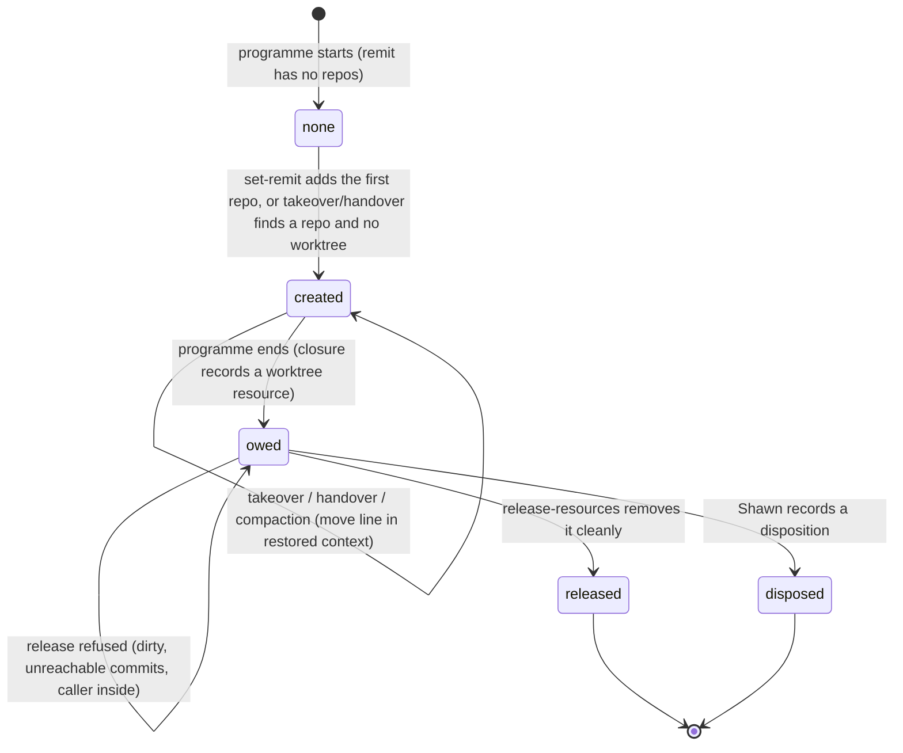
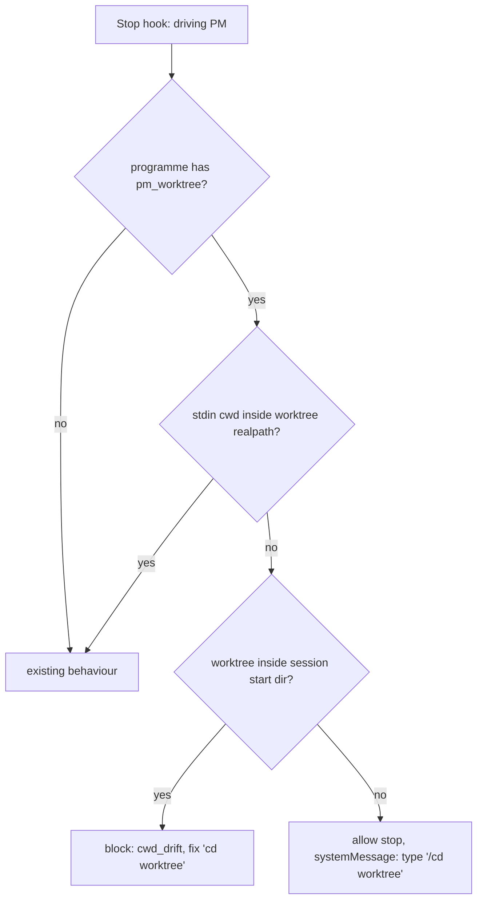
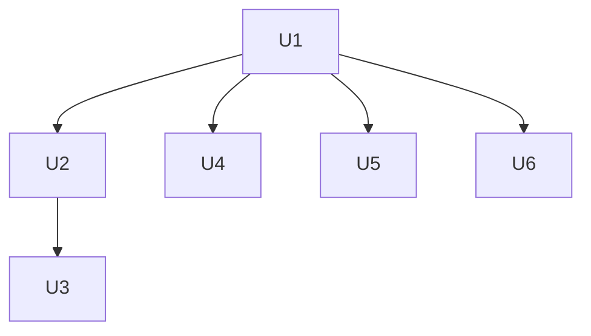

# Programme Worktree - Plan

## Goal Capsule

- **Objective:** an auto programme's PM always works from the same directory for the life of the programme, whichever session holds the PM role, so repo-relative commands, `git` state and the paths the PM reports stay correct after every takeover, handover, compaction and restart.
- **Means:** each programme gets one git worktree of its first remit repo, recorded on the programme (KTD1, KTD2). Takeover and handover move the PM into it, and the Stop hook catches drift (KTD4, KTD5). The worktree is released as a closure resource at programme end (KTD6).
- **Product authority:** Shawn. The Product Contract wins on behaviour. Key Technical Decisions win on mechanism.
- **Open blockers:** none for planning. Rebase onto PR #121 (set a programme up one question at a time) if it merges first; the overlapping files are listed under Risks.
- **Execution profile:** Standard, six units. U1 first, then U2 to U6 in the order under Sequencing.
- **Stop conditions:** stop and ask Shawn if a live check shows that a `cd` into a path inside the session's start directory does not persist for a PM session, or that `/cd` does not change the cwd the Stop hook receives. Both are the premises of KTD4.
- **Finishes and ships:** the implementing session, through `ce-work`, ending in one PR to `main`.

---

## Product Contract

### Summary

Each programme gets its own git worktree at `<main checkout>/worktrees/programme-<run>` in the first remit repo, and that worktree is the PM's working directory. auto creates it when the first repo joins the remit and records it on the programme. Takeover and handover end with the PM moving into it. The Stop hook catches a PM that has drifted out. The worktree is released when the programme ends, without losing uncommitted work.

### Problem Frame

A PM's working directory today is whatever directory its session happened to start in. A takeover runs from any session in the herdr space, so the new PM inherits that session's cwd, which can be a worker's worktree or a plugin subdirectory. A Bash `cd` also persists, so a PM drifts during normal work: the session that wrote the brief for this work moved from the repo root into `plugins/auto` and into worktrees. Repo-relative commands, `git` state and the paths the PM reports all depend on the cwd, so a drifted PM reports wrong paths and runs commands in the wrong checkout.

Two constraints shape the fix. A Bash `cd` persists only when the target is inside the directory the session was started in; a `cd` outside it is reset on the next call (verified in the planning session). Claude Code's typed `/cd <path>` moves a session anywhere, but only Shawn can type it.

### Key Decisions

- **The directory belongs to the programme, not to a session.** It survives takeover, handover, compaction and restart. Governs R1, R5.
- **Moving into the directory is part of takeover and handover succeeding**, not a follow-up the PM may skip. Governs R6, R7.
- **A worktree per programme under `<repo>/worktrees/`.** (session-settled: user-approved — chosen over a dot folder in the repo root and a folder outside the repo: a dot folder leaves the PM one level down inside the shared main checkout, which is the drift this work removes.) Governs R1, R2.
- **Shawn decides whether the worktree is on a branch or detached.** (session-settled: user-directed — chosen over auto refreshing a detached checkout each sweep: attach and detach are the user's prerogative.) Governs R4.
- **When a PM's `cd` cannot persist, Shawn types `/cd <worktree>`.** (session-settled: user-directed — chosen over the PM relaunching its own pane through herdr and over refusing takeover from a session started outside the repo.) Governs R6, R9.

### Requirements

**The worktree**

- R1. A programme whose remit has at least one repo has exactly one programme worktree, recorded on the programme with its path and the main checkout it belongs to.
- R2. The worktree sits at `<main checkout>/worktrees/programme-<run>`, where the main checkout is the first remit repo resolved to its main checkout even when the remit names a linked worktree.
- R3. A programme whose remit has no repos has no programme worktree, and every behaviour below is inactive for it.
- R4. auto creates the worktree detached and never switches, resets, pulls or forces anything in it afterwards.
- R5. The recorded worktree does not move when the remit's repo list changes later; status reports when the recorded repo is no longer in the remit.

**Moving in**

- R6. Takeover ends by telling the PM to run `cd <worktree>`, or, when that `cd` cannot persist for this session, by telling Shawn to type `/cd <worktree>`.
- R7. A PM that receives the programme by handover, compaction or restart gets the same move line in its restored context.
- R8. Programmes already running get their worktree at their next takeover or handover, or at the next `set-remit` that leaves the remit with a repo.

**Drift**

- R9. When the driving PM stops with a cwd outside its programme worktree, the Stop hook blocks with the `cd` that fixes it when the PM can run it, and otherwise shows Shawn a non-blocking message naming `/cd <worktree>`.
- R10. A cwd inside the worktree, including a subdirectory of it, is not drift.
- R11. The drift check fails open: a missing record, a missing worktree, an ended programme or any error lets the stop through.

**End**

- R12. A programme that ends owes its worktree as a closure resource; `release-resources` removes it only when it is clean, holds no commits that no branch or remote reaches, and the caller's cwd is outside it.
- R13. A worktree that cannot be removed safely blocks the archive under a named check until Shawn cleans it or records a disposition, and a branch Shawn made in it survives removal.

### Scope Boundaries

- No automatic refresh of the worktree to the latest default branch. The PM or Shawn updates it.
- No herdr relaunch of the PM pane, and no change to who may run herdr.
- No setup question for the directory. `/auto:programme` setup stays as it is, which keeps this work clear of PR #121 (set a programme up one question at a time).
- Worker sessions and their worktrees are unchanged.

#### Deferred to Follow-Up Work

- A status line or sweep note when the worktree is behind the default branch.
- A setup-time choice of repo or path, once PR #121's setup flow has landed.

---

## Planning Contract

### Key Technical Decisions

- KTD1. **One new programme-block key, `pm_worktree`, defaulting to `null`.** It holds the worktree path, the main checkout path and the creation time. It is added to `PROGRAMME_FIELDS` so `normalize_programme` back-fills `null` on running programmes, documented in `run-record-schema.md` §10.5, and written only through `programme_authority.write`. The record is a JSON blob in the programme store, so no SQLite migration and no `PROGRAMME_FORMAT` bump. The repo is recorded once and never re-derived from `remit.repos[0]` (R5), because a remit's repo order can change.
- KTD2. **A new module `lib/programme_worktree.py` owns the worktree.** It resolves the main checkout with `_bootstrap.resolve_host_repo_root`, creates the worktree with `git worktree add --detach` through `programme_exec.bounded`, records it, answers "is this cwd inside it", and releases it. `lib/programme.py` is at 966 of its 1000-line budget, so the rest of the code calls into this module with one-line hooks. Creation is idempotent because every caller targets the same path: when `git worktree list --porcelain` already registers a worktree of the same repo at the target path, creation adopts it instead of adding one. Creation is a slow subprocess, so it runs before the leases lock, and the record is written under the lock only when the programme still has none. A refused verb or a lost race therefore leaves at most one registered, unrecorded worktree at the target path, which the next call adopts. Nothing on this path ever removes a worktree. Creation gets a timeout sized for a large checkout. If the timeout kills it, the record stays `null` and the verb reports the path. A later call adopts the registered worktree only after `git status` succeeds inside it, and otherwise reports it for Shawn to remove.
- KTD3. **`--detach` at creation, and nothing after.** `git worktree add <path>` with no flag creates a branch named after the folder, so git forces a choice at creation. Detached is the choice that creates nothing Shawn has to clean up. He can `git switch -c` inside it whenever he likes (KTD3 instantiates the branch-or-detached Key Decision and cites R4). When `worktrees/` is not ignored in the repo, creation adds `worktrees/` to the repo's `.git/info/exclude`, so the worktree never shows in the main checkout's `git status` or gets swept in by `git add -A`. That file is local and never committed.
- KTD4. **"Can the PM's `cd` stick?" is answered from the session's start directory.** A `cd` persists when the worktree is inside the directory the session was started in. When it is not, the move line asks Shawn to type `/cd`. The start directory is the `cwd` on the session's newest `startup` or `resume` row in the session registry, never a `compact` or `clear` row: `record_session` appends a row on every SessionStart, a compaction row can carry a post-`cd` cwd, and a resumed session keeps its id but starts in the directory it was resumed from. One helper in `programme_worktree.py` answers this for takeover, restored context and the Stop hook. When there is no such row (trimmed, or a session without `HERDR_PANE_ID`), it assumes the `cd` cannot stick and names `/cd`, which is always safe. This instantiates the `/cd` Key Decision (R6, R9).
- KTD5. **Drift is a hook-only check in `on-stop.py`, outside the predicate.** The predicate is a pure function of the record, and drift is session state, so `cwd_drift` does not join `REASON_KINDS` and `/auto:programme-status` does not change. `decide()` reads `cwd` from the hook stdin (never the shell's `$PWD` or herdr's pane cwd) and compares realpaths with the recorded worktree. The check runs before the filter that drops holds whose programme may stop, so an idle PM and a handover successor still get it. When the `cd` can stick, the hook blocks with the fix line. When it cannot (KTD4), the hook lets the stop through with a `systemMessage` naming `/cd`, because a block the PM cannot clear would cost a wasted turn on every stop. The check is off once the programme has ended. The expected path comes only from the programme record, and no environment variable turns the check off (docs/solutions/best-practices/a-switch-that-restrains-an-agent-cannot-read-the-agents-environment.md).
- KTD6. **Removal is a closure resource, not a step inside `end`.** `programme_archive._owed` gains a `worktree` resource. `_observe` confirms it once `git worktree list --porcelain` no longer lists the recorded path, and `release-resources` attempts a plain `git worktree remove` (never `-f`) first. Removal is refused, with a named detail, when the worktree is dirty, when it holds commits no branch or remote reaches, or when the verb's own cwd is inside it. This keeps every end path covered (end, expire, takeover of an expired lease, successor creation), matches the durability rule that nothing is deleted automatically, and leaves the PM's cwd valid while `end` runs.
- KTD7. **The move line lives in the restored context, not in `render_rules`.** The move-line helper takes the reading session's id and its current cwd, and returns nothing when that cwd is already inside the worktree, so a PM that has moved, by `cd` or `/cd`, is not asked again. `render_restore` (`lib/programme.py`) gains an optional session id and one call to the helper. Takeover already prints `render_restore`, and compaction and restart reach it through the SessionStart hook. `_guard` prints `render_rules`, not `render_restore`, so `_guard` appends the helper's line itself. That is how a handover successor learns it on its first refused write. PR #121 edits `render_rules`, so keeping out of it avoids a conflict.
- KTD8. **The PM's own cwd is excluded from the plans sweep.** `_sweep_sources` passes every pane's cwd to `programme_plans.read`, so the PM worktree would show up as a second plans root for the same repo. The PM pane is skipped there, using the same `role(pane, drivers)` test the sweep already uses to tell the PM from workers.

### High-Level Technical Design

Lifecycle of a programme worktree:

Stop-hook decision for the driving PM (directional):

### Sequencing

U1 lands first: every other unit reads the `pm_worktree` record and calls its helpers. U2 and U3 both edit `_h_takeover` in `lib/programme_lifecycle.py`, so they run in that order. U4, U5 and U6 touch separate files (`on-stop.py`, `programme_archive.py`, `programme_sources.py`) and can run in parallel with U2 and U3 once U1 is in.

### Risks

| Risk | Mitigation |
|---|---|
| PR #121 (set a programme up one question at a time) also edits `commands/programme-takeover.md`, `commands/programme-handover.md`, `docs/contracts/run-record-schema.md`, `CONCEPTS.md` and the verb list in `tests/unit/programme-verbs.test.sh` | Keep edits to those files small and additive. If #121 merges first, rebase before U3. PR #121's new setup verb also takes repos, so U2's creation hook must be checked against it after the rebase. |
| PR #122 (keep the settings guard's deny under a held store) edits `_h_end` and `read_programme` | U5 does not touch `_h_end`. Rebase if #122 merges first. |
| After Shawn types `/cd`, the session's `startup` row still shows the old start directory | KTD4 then names `/cd` where a `cd` would have worked. That is safe, and the cwd already matches after `/cd`. U4's live probe records whether `/cd` writes a new registry row. |
| A worktree in a large repo costs disk (a Slate web-app worktree is about 5 GB) | Creation reports the path. The removal path in U5 frees it at end. |

### Sources / Research

- `lib/programme_lifecycle.py`: `_move` (`extra` callback), `_finish`, `_h_takeover` (prints after `_finish`), `_h_handover` and `_flag_for_successor`, `_h_set_remit` and `_repo_entry`.
- `lib/programme_home.py`: `PROGRAMME_FIELDS`, `normalize_programme`, `new_programme_block` (remit repos start empty), `create_programme`.
- `lib/programme_archive.py`: `_owed`, `_observe`, `_h_release`, `_unreleased`.
- `lib/on-stop.py`: `decide`, `_driven_programmes`, `_REASON_FIXES`, `_nag_signature`, `_hook_input`.
- `lib/_bootstrap.py` `resolve_host_repo_root`; `lib/programme_exec.py` `bounded`; `lib/auto-spawn.py` worktree helpers (shape only; its `remove -f` is not reused).
- docs/solutions/logic-errors/a-routing-decision-made-before-the-lock-must-be-rechecked-under-it.md: write through the authority path and re-check under the lock.
- docs/solutions/best-practices/pgrep-pkill-by-shared-script-name-is-unsound-across-worktrees.md: identify the worktree by its recorded path, never by globbing `worktrees/programme-*`.
- Git 2.54 behaviour, probed during planning: `worktree add` with no flag creates a branch; plain `worktree remove` refuses a dirty worktree and keeps branches made inside it.

---

## Implementation Units

### U1. Record and create the programme worktree

**Goal:** a programme can hold one recorded worktree, and one module can create, describe and answer questions about it.

**Requirements:** R1, R2, R3, R4, R5; KTD1, KTD2, KTD3, KTD4.

**Dependencies:** none.

**Files:**
- `plugins/auto/lib/programme_worktree.py` (new)
- `plugins/auto/lib/programme_home.py` (`PROGRAMME_FIELDS`, `new_programme_block`)
- `plugins/auto/docs/contracts/run-record-schema.md` (§10.5 row for `pm_worktree`)
- `plugins/auto/CONCEPTS.md` (one row: **programme worktree**)
- `plugins/auto/tests/unit/programme-worktree.test.sh` (new)
- `plugins/auto/tests/unit/programme-home.test.sh`
- `plugins/auto/tests/unit/import-topology.test.sh` (pin the new module if the DAG requires it)

**Approach:**
1. Add `pm_worktree` with a `null` default (KTD1).
2. In the new module: resolve the main checkout of a repo path, compute the target path, create it detached (KTD3), add the exclude line when `worktrees/` is not ignored, and return the record value.
3. Refuse to create when the target path exists and is not a registered worktree of that repo. Never rename or overwrite.
4. Add the helpers later units call: "is this path inside the worktree" (realpath, subdirectories count as inside), "can a `cd` stick for this session" (KTD4), and the move line text.

**Patterns to follow:** `programme_exec.bounded` for git calls; `auto-spawn.py` `_existing_worktree_slugs` for reading `git worktree list --porcelain`; the `trajectory_sweeps` and `permission_proposals` precedents for adding a programme key.

**Test scenarios:**
- A programme record without `pm_worktree` normalizes to `null`, and one with a value keeps it.
- Creating from a main checkout makes `<checkout>/worktrees/programme-<run>`, registered and detached, with no new branch in `git branch --list`.
- Creating from a path that is a linked worktree of the repo puts the worktree under the main checkout, not under the linked worktree.
- A repo without `worktrees/` in its ignore rules gets the exclude line once; creating twice does not duplicate it; the main checkout's `git status` shows nothing.
- A plain folder already sitting at the target path makes creation refuse with a message naming the path, and the folder is untouched.
- The inside-check returns true for the worktree and a subdirectory, false for its parent and a sibling, and true when one side goes through a symlink (`/tmp` versus `/private/tmp`).
- The `cd`-can-stick helper returns true when the worktree is under the cwd of the session's newest `startup` or `resume` row, false for a session started in a sibling worktree, and false when the registry has no such row.
- A session whose `startup` row is the main checkout and whose newer `compact` row is a sibling worktree still counts as started in the main checkout.
- A session whose `startup` row is the main checkout and whose newer `resume` row is a sibling worktree counts as started in the sibling worktree.
- A registered worktree already at the target path is adopted, not re-added, and creation makes no second worktree.
- A registered worktree at the target path where `git status` fails is reported, not adopted and not recorded.
- The move-line helper returns nothing when the given cwd is inside the worktree.

**Verification:** the unit suite passes, including the size budget and import topology, and the schema doc fence accepts the new row.

### U2. Create the worktree when a repo arrives

**Goal:** every programme with a repo in its remit gets its worktree without a separate step, including programmes already running.

**Requirements:** R1, R3, R8; KTD2.

**Dependencies:** U1.

**Files:**
- `plugins/auto/lib/programme_lifecycle.py` (`_h_set_remit`, `_h_takeover`, `_h_handover`)
- `plugins/auto/tests/unit/programme-remit.test.sh`
- `plugins/auto/tests/integration/programme-takeover.test.sh`
- `plugins/auto/tests/integration/programme-permission.test.sh` (the scripted handover)

**Approach:**
1. In `set-remit`, takeover and handover: when the programme has a repo and no `pm_worktree`, create it before the leases lock and record it inside the existing write (KTD2).
2. For takeover and handover, record it through `_move`'s `extra` callback so the path also lands in the JSON line and the `taken_over` / `handed_over` journal row.
3. When the remit has no repos, do nothing.
4. `programme.sh status` (`_h_status` in `lib/programme.py`) gains one line from the module: the worktree path, plus a note when the recorded repo is no longer in the remit (R5).

**Patterns to follow:** the slow-read-before-lock comment in `_h_takeover`; `_rearm_list` as the `extra` precedent.

**Test scenarios:**
- `set-remit` adding the first repo to a programme with none creates and records the worktree; a second `set-remit` adding another repo leaves the record unchanged.
- `set-remit` that reorders repos or removes the recorded repo leaves the record unchanged, and `status` then notes that the recorded repo is no longer in the remit.
- Takeover of a programme recorded before this change (`pm_worktree` null, one remit repo) creates the worktree and includes its path in the JSON line.
- Handover of such a programme creates it as well.
- A programme with no remit repos goes through set-remit, takeover and handover with `pm_worktree` still null and no git call made.
- Two creations racing (a gate file holding the first under the lock) end with one registered worktree, recorded once, and the recorded worktree still exists.
- A takeover that is refused after creation leaves the worktree registered but unrecorded, and the next takeover adopts and records it.

**Verification:** the remit and takeover suites pass, and a takeover in a scratch repo leaves exactly one registered `programme-<run>` worktree.

### U3. Move the PM in on takeover and handover

**Goal:** the PM that holds the programme after a takeover, handover, compaction or restart is told exactly how to move into the worktree.

**Requirements:** R6, R7; KTD4, KTD7.

**Dependencies:** U1, U2.

**Files:**
- `plugins/auto/lib/programme.py` (`render_restore`: optional session id and one call to the move-line helper; `_guard`: append the helper's line)
- `plugins/auto/lib/on-session-start.py` (pass the session id and hook `cwd` to `render_restore`)
- `plugins/auto/commands/programme-takeover.md` (first step after success: run the `cd`, or ask Shawn to type `/cd`)
- `plugins/auto/commands/programme-handover.md` (tell Shawn the successor will move into the worktree)
- `plugins/auto/commands/programme-end.md` (leave the worktree before `release-resources`)
- `plugins/auto/tests/integration/programme-takeover.test.sh`
- `plugins/auto/tests/integration/programme-resume.test.sh`

**Approach:**
1. The move line names the worktree path and either "run `cd <path>`" or "ask Shawn to type `/cd <path>`" (KTD4).
2. Takeover gets the line through the `render_restore` it already prints, called with the taking-over session's id. No separate print is added. The restored context and `_guard` carry it for every other route (KTD7).
3. The end command doc gains a step to `cd` to the main checkout, or have Shawn type `/cd`, before `release-resources`.

**Test scenarios:**
- Takeover by a session whose registry start cwd is the main checkout prints `cd <worktree>`.
- Takeover by a session started in a sibling worktree prints the `/cd <worktree>` line for Shawn.
- The takeover output contains the move line exactly once.
- A handover successor's first refused write prints the move line with the rules.
- The restored context after compaction names the move line when the session's cwd is outside the worktree, and omits it when the cwd is inside.
- A programme with no worktree prints no move line anywhere.

**Verification:** the takeover and resume suites pass, and the command docs read in the order the PM acts.

### U4. Catch drift in the Stop hook

**Goal:** a PM that leaves its worktree is sent back at its next stop, or Shawn is told how to move it when it cannot move itself.

**Requirements:** R9, R10, R11; KTD5.

**Dependencies:** U1.

**Files:**
- `plugins/auto/lib/on-stop.py` (`decide`, ahead of the `may_stop` filter)
- `plugins/auto/docs/contracts/run-record-schema.md` (§10.9 Stop hook state)
- `plugins/auto/tests/unit/stop-reason-fixes.test.sh` (name `cwd_drift` as a hook-only kind with a fix, so the pinned set stays exact)
- `plugins/auto/tests/unit/stop-cwd-drift.test.sh` (new)

**Approach:**
1. Read `cwd` from the hook stdin. For the driving PM of a live programme with a worktree, check it before the `may_stop` filter (KTD5).
2. When the cwd is outside the worktree and the `cd` can stick, block with the fix line `cd <worktree>`. Otherwise allow the stop and emit a `systemMessage` naming `/cd <worktree>`.
3. Include the drift text in `_nag_signature` so a repeat block keeps the fix text.
4. Wrap the check so any error, missing record, missing worktree or ended programme allows the stop.

**Execution note:** start with the live probe from the Verification Contract: confirm the hook's stdin `cwd` follows a Bash `cd`, a compaction and a `/cd`. If it does not, stop and ask Shawn (Goal Capsule). Then prove the drift test can fail: break the realpath comparison and watch the block disappear before restoring it.

**Test scenarios:**
- A driving PM whose stdin cwd is the worktree, or a subdirectory of it, stops normally.
- A driving PM whose stdin cwd is the main checkout, with the worktree inside its start cwd, is blocked with `cd <worktree>` in the reason, even when the programme may otherwise stop.
- The same drift for a session started in a sibling worktree is not blocked and gets a `systemMessage` naming `/cd <worktree>`.
- A second stop with `stop_hook_active` set is let through.
- A worker session in a different directory is never blocked for drift.
- A driving PM whose programme has nothing to do (it may stop) but whose cwd has drifted is still blocked with the fix.
- A programme with `pm_worktree` null, a recorded path that no longer exists, a malformed record, or an ended programme lets the stop through.
- `/auto:programme-status` output is unchanged by a drifted cwd.
- Setting every `CLAUDE_AUTO_*` variable the hook reads does not turn the drift block off.
- The fixes test still pins the exact set of unhinted reason kinds, with `cwd_drift` hinted.

**Verification:** the stop tests pass, and a live check in a real session confirms the stdin `cwd` changes after a Bash `cd` and after `/cd`.

### U5. Release the worktree at programme end

**Goal:** an ended programme's worktree is removed without losing work, and an unsafe removal blocks the archive instead.

**Requirements:** R12, R13; KTD6.

**Dependencies:** U1.

**Files:**
- `plugins/auto/lib/programme_archive.py` (`_owed`, `_observe`, `_h_release`)
- `plugins/auto/lib/programme_worktree.py` (the safe-remove helper)
- `plugins/auto/docs/contracts/programme-durability.md` (the worktree resource and its removal rule)
- `plugins/auto/tests/integration/programme-closure.test.sh`
- `plugins/auto/tests/unit/programme-archive.test.sh`

**Approach:**
1. Add a `worktree` resource to the closure when the programme has `pm_worktree`.
2. `release-resources` removes it with a plain `git worktree remove` when the safety checks pass (KTD6), and records a receipt.
3. Otherwise it leaves the resource unreleased with a detail naming the reason and the fix: commit or clean, `cd` out, or `dispose-action --resource`.

**Test scenarios:**
- Ending a programme with a clean detached worktree, then running `release-resources` from outside it, removes the worktree and lets `check-archive` pass.
- A worktree with an untracked file is not removed, and `check-archive` names it.
- A detached worktree holding a commit no branch reaches is not removed.
- A worktree where Shawn ran `git switch -c` and committed is removed, and his branch still exists.
- Running `release-resources` with its cwd inside the worktree refuses with a message naming the `cd` out.
- A worktree already deleted by hand is confirmed as released.
- A programme with no worktree owes no worktree resource.

**Verification:** the closure and archive suites pass, and no code path calls `worktree remove -f`.

### U6. Keep the PM worktree out of the plans sweep

**Goal:** the sweep does not list the remit repo's plans twice because the PM sits in a worktree of it.

**Requirements:** KTD8.

**Dependencies:** U1.

**Files:**
- `plugins/auto/lib/programme_sources.py` (`_sweep_sources`)
- `plugins/auto/tests/unit/programme-sources.test.sh` (or the sweep test that covers `_sweep_sources`)

**Approach:** skip the PM pane's cwd when collecting plan roots, using the sweep's existing `role(pane, drivers)` test.

**Test scenarios:**
- A sweep with the PM pane in the programme worktree and a worker in the main checkout lists each plan once.
- A worker pane in its own worktree still contributes its plans.

**Verification:** the sources tests pass.

---

## Verification Contract

| Gate | Command | Proves |
|---|---|---|
| Unit suite | `bash ~/.claude/tools/honest-run/run.sh --expect "passed" -- bash plugins/auto/tests/run.sh unit` | Record key, worktree module, Stop hook, fixes fence, size budget, import topology, schema fence |
| Integration suite | `bash ~/.claude/tools/honest-run/run.sh --expect "passed" -- bash plugins/auto/tests/run.sh integration` | Takeover, handover, resume, closure and release in scratch repos |
| Live check | In a real session started in the repo's main checkout: take over a scratch programme, run the printed `cd`, stop, then `cd ..` and stop again | The `cd` persists, the hook's stdin `cwd` follows it, and drift blocks with the right fix |
| Live check | Repeat from a session started in a sibling worktree; type the `/cd` the takeover prints | The non-blocking message appears, and `/cd` clears the drift |

## Definition of Done

- Every unit's test scenarios exist and pass, and the drift test was shown to fail when its comparison was broken.
- Both live checks above were run and their results recorded in the PR description.
- No code path removes a worktree with `-f`, and no environment variable disables the drift check.
- `run-record-schema.md`, `programme-durability.md`, `CONCEPTS.md` and the three command docs describe the shipped behaviour.
- Abandoned-attempt code is removed from the diff.
