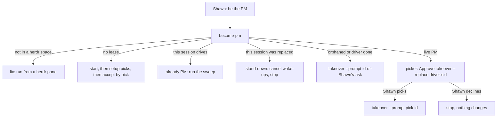
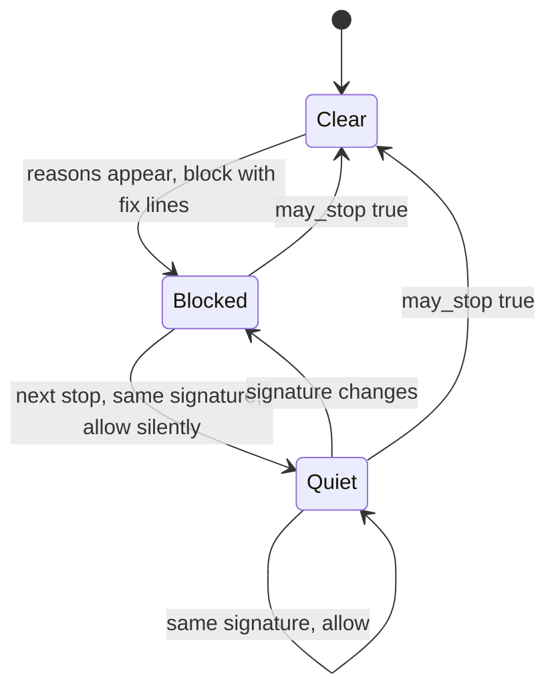

# PM Self-Setup - Plan

## Goal Capsule

- **Objective:** when Shawn asks a Claude session to be the PM of a herdr space, that session becomes the PM and keeps the programme moving. Shawn's only part is his request and his picker answers. He never types commands, session ids or `/cd` lines, and he never answers the same question every hour. The one exception is the one-time unstick of today's Peek PM, described under Operational Notes.
- **Means:**
  - The PM works from wherever its session runs (KTD1).
  - A session Shawn asked takes over by an exact-label pick, or with no pick when the old PM is orphaned (KTD2, KTD3).
  - A replaced PM stands down (KTD7).
  - The agreement is accepted by a terms-bound pick (KTD4).
  - Every refusal and stop block carries a runnable fix (KTD5), and a stop block is shown once (KTD6).
- **Product authority:** Shawn. Settled this session through pickers on 2026-10-27.
- **Open blockers:** none.
- **Execution profile:** Deep, seven units. U1 lands first. U2, U6 and U7 follow in parallel. U3 and U5 need U2. U4 needs U3.
- **Finishes and ships:** one PR to `main`, squash-merged pinned to the reviewed head, published as auto 0.16.3, installed on the MacBook and the Mac Studio. Then the Peek PM is unstuck.
- **Stop conditions:** stop and report in either case:
  - a session in a Claude Code harness worktree cannot read its herdr space;
  - the same P0/P1 review finding recurs three rounds in a row.

---

## Product Contract

### Summary

Auto stops refusing a PM for things the PM cannot change, and starts telling it what to do next. Any session Shawn asks can start a programme or take one over:

- **Live PM:** Shawn confirms the takeover with a pick.
- **Orphaned PM:** the takeover needs no pick.

A replaced PM stops instead of asking Shawn to hand the programme back. The PM folder requirement from #128 "give each programme one fixed PM working directory" is removed. A stop block shows its fix once, then lets the PM stop until something changes.

### Problem Frame

The Peek PM (programme `prog-20261018-102220-10892e`, session `aabe367e-82e7-4281-bed5-d0fda064f6cd`) runs inside a Claude Code harness worktree, `.claude/worktrees/task+focus-flash`. Claude Code resets every `cd` there and refuses to enter any worktree outside `.claude/worktrees/`.

What went wrong:

- Auto 0.16 requires the PM to work from `worktrees/programme-<run>`. The stop hook blocked with `cwd_drift` on every turn end, 12 times in one night.
- The PM asked Shawn the same three-option question in prose every hour for nine hours.
- When Shawn moved the session with `/cd`, Claude Code refused every command run from the new folder.
- Shawn typed `/auto:programme-takeover` in the old PM. It refused, and the PM told him to open a new session and type a session id.
- `no_rule_proposed` blocked 16 times.
- The PM asked Shawn 31 questions in prose instead of pickers.

Shawn's words: "agents cannot use the tool, they have no idea what to do, how it works, what to do in order to make it work". And: "that transcript is filled with the agent being unable to action my explicit wish for it to take over as PM and get the project moving forward". He accepts a takeover that asks him through a picker, as long as it works.

### Requirements

**PM location**

- R1. The PM works from whatever folder its session runs in, including a Claude Code harness worktree. No hook, verb or restore line asks the PM or Shawn to move.
- R2. New programmes, takeovers, handovers and remit changes create no programme worktree. A programme that already recorded one still releases it safely at end.

**Becoming the PM**

- R3. A session that Shawn asked to be PM runs one read-only verb that names its single next step. The step depends on the lease:
  - no lease: `start`;
  - orphaned lease, or driver gone: `takeover`;
  - live PM: a pick, then `takeover`;
  - this session was replaced: stand down.
- R4. A live PM is replaced only after Shawn picks the exact approval label naming the current driver's session id, in the session taking over. The pick is single-use and verified from that session's transcript.
- R5. An orphaned or gone PM is replaced with no pick. The new session must cite a verified human prompt (typed, suggested or picked) from itself, given after the lease went orphaned or the driver went gone. That cited prompt is Shawn's ask. The new session must also be in the lease's herdr space, and herdr must not report the old driver as present. The journal records the takeover as unrequested, so the programme view shows it.
- R6. The typed takeover and handover paths keep working unchanged.
- R7. Shawn accepts the agreement with a pick whose label names a digest of the terms he is shown. A pick older than the last term change still refuses.
- R12. A session whose lease moved to another session stops its own wake-ups and sweeps, and does not ask Shawn anything about it.

**Telling the PM what to do**

- R8. Every programme verb refusal prints one `fix:` line. The line names a command that works in the calling session, or names the picker question to ask Shawn.
- R9. Every stop-hook block reason carries a fix line.
- R10. A stop block whose reasons have not changed since the session last saw them lets the stop through without a message. A change in reasons blocks again. Hook notes are deduplicated the same way.
- R11. The PM instructions say to ask Shawn only through AskUserQuestion pickers, and only for approvals. The PM runs every fix that needs no approval itself.

### Key Decisions

- **The PM works where its session is.** (session-settled: user-directed — chosen over keeping the fixed programme folder with better advice: a harness-isolated session can never move there.) Governs R1, R2.
- **An agent can start a takeover, and Shawn confirms with a pick.** (session-settled: user-directed — chosen over typed-only takeover requests. Shawn: "I dont mind if takeover requires me to accept via ask user tool. But it needs to work".) Governs R3, R4, R6, R12.
- **A silent PM is replaced with no pick.** (session-settled: user-approved — chosen over also waiting for a pick: the orphan rule already proves two missed cadences.) Governs R5.
- **The agreement is accepted by a pick.** (session-settled: user-directed — chosen over a typed accept.) Governs R7.
  - This reverses a user-approved decision of 2026-10-20 and part of #131 "approve a programme change by exact pick or accepted suggestion". Both held that "the moment the PM gains authority is always something Shawn typed".
  - The replacement protection is a terms-bound label, a single-use pick, and the accept-order check.
  - Shared settings, rulings, instructions and `set-remit` stay typed.
- **Fix it before asking.** (session-settled: user-directed — chosen over explaining the problem and asking Shawn.) Governs R8, R9, R11.
- **A block is reported once, then the stop goes through until something changes.** (session-settled: user-approved — chosen over repeating a shortened block on every turn end.) Governs R10.

### Acceptance Examples

- AE1. Covers R1. Given the Peek PM in `.claude/worktrees/task+focus-flash`, when its turn ends, then no `cwd_drift` block or move note appears.
- AE2. Covers R3, R4.
  - **Given:** a live PM `aaaa…` and a new session in the same space.
  - **When:** Shawn says "take over as PM".
  - **Then:** the session runs `become-pm` and asks one picker whose recommended option is `Approve takeover --replace aaaa…`. After Shawn picks it, `takeover --prompt <pick id>` moves the lease.
- AE3. Covers R4. Given the same pick, when the session cites it a second time, or after a different session became PM, then takeover refuses.
- AE4. Covers R5. Given a PM that missed two cadences and that herdr does not show as present:
  - a session where Shawn typed "be the PM" afterwards runs `takeover --prompt <that prompt>`, and the lease moves with reason `orphaned`, `request: null` and `unrequested: true`;
  - a session with no human prompt since the orphaning refuses;
  - a session outside the space refuses.
- AE5. Covers R7. Given the agreement as `status` shows it, with terms digest `3f9a2c1d`:
  - Shawn picks `Approve accept-agreement --terms 3f9a2c1d` after the last term change, and the agreement is accepted;
  - a pick naming an older digest refuses;
  - a pick taken before a later `amend-term` refuses.
- AE6. Covers R10. Given a `no_rule_proposed` block shown at 10:00:
  - when the PM stops again at 11:00 with the same reasons, the stop goes through silently;
  - when a new item opens at 12:00, the next stop blocks with the full fix text.
- AE7. Covers R12. Given session A replaced by session B, when A's hourly sweep fires, then A's first programme verb refuses with the fix `become-pm`. `become-pm` prints `stand-down`, and A cancels its wake-ups without messaging Shawn.

### Scope Boundaries

- Claude Code's own worktree lock is out of scope. It refused the PM's git, sed and herdr commands, and only Claude Code can change it.
- `set-remit`, `edit-project-term`, `record-instruction`, `close-instruction` and shared settings stay typed-only.
- Accepted suggestions do not approve a takeover from a live PM, or the agreement. Those take a pick or typed text only. An accepted suggestion does count as Shawn's ask for the orphan route (R5).

#### Deferred to Follow-Up Work

- Rewriting all 532 refusal messages into fix-first wording. This plan adds fix lines through the shared print point and a per-verb fix table, with specific fixes for the refusals the new flows hit first.
- Deleting `programme_worktree.py` creation code outright. It stays because existing tests build their fixtures with it.

---

## Planning Contract

### Key Technical Decisions

- KTD1. **Stop creating and requiring the programme worktree, but keep the release path.**
  - Remove `_drift` from `lib/on-stop.py`, plus `cd_can_stick`, `move_line`, `restore_line`, `status_line` and `start_dir` from `lib/programme_worktree.py`.
  - Remove `_make_worktree` and `_record_worktree` from the takeover, handover and set-remit call sites.
  - Keep `create`, `observe`, `release`, the `pm_worktree` field and the archive's worktree resource, so recorded worktrees still close.
  - Drop #128 KTD8 (the plans sweep skipping the PM pane's cwd), because the PM may now sit in a real checkout.
  - (session-settled: user-directed — chosen over a fixed folder with better advice: a harness-isolated session cannot move there.) Governs R1, R2.
- KTD2. **Pick capture covers a session that wants to become PM, and its picks can serve only the takeover.**
  - The AskUserQuestion PostToolUse hook and the pre-filled-answers deny in the PreToolUse hook share one lease lookup, lifted from `on-user-prompt._journal_request`. It resolves the driving lease, else the lease `--replace` names, else the space lease.
  - A non-driving pick row is journaled against that run with `driving: false` and the session's own transcript source.
  - `programme_pick_source.verify` is reused unchanged.
  - Every approval gate other than `takeover` refuses a row with `driving: false`. That covers `programme_approval.prompt` and `programme_setup._picked`. Picks collected before a takeover therefore never become PM approvals after it.
  - Governs R4, R5.
- KTD3. **Takeover gets a pick route and a cited-ask route, both checked under the leases lock.**
  - **Pick route** (live driver): `takeover --prompt <id>`. The pick must be verified `picked`, from this session and single-use through `pick_use`. Its answer must equal `programme_approval.label(["takeover", "--replace", <driver sid>])`, and the named sid must still be the driver under the lock. `approval-label` prints this label for `takeover`. `takeover` stays out of `PICK_VERBS`, because its check is its own.
  - **Cited-ask route** (orphaned or gone): `takeover --prompt <id>`. The id must name a verified human prompt (`typed`, `suggested` or `picked`) from this session, journaled after the lease turned orphaned or the driver went gone. The caller must be in the lease's herdr space, and `_presence` must not be `present`. The status must come from a readable run record. A record that fails to load reads as orphaned today, and that does not count.
  - Both routes journal `taken_over` with `request: null`. The cited-ask route also sets `unrequested: true` and the cited prompt id, on both the orphaned and the gone reason.
  - The checks live in `lib/programme_approval.py`. `programme.py` is at 989 of its 1000 lines.
  - The typed-request branches are unchanged.
  - Sub-agents and worker sessions get no special denylist. The cited prompt must come from Shawn in the calling session, and that is the binding.
  - (session-settled: user-directed — chosen over typed-only takeover.) Governs R4, R5, R6.
- KTD4. **`accept-agreement` joins `PICK_VERBS` with `--terms <digest>`, required when the cited prompt is a pick.**
  - The digest is a short hash of the agreement terms exactly as `status` and the setup view render them. `approval-label accept-agreement` computes it.
  - The verb refuses a digest that does not match the current terms.
  - `check_accept_order` also counts `term_amended` as a term change. Today it does not, so a pick taken before an `amend-term` would pass.
  - Accepted suggestions stay refused for this verb, through an explicit exclusion beside `PICK_VERBS`.
  - (session-settled: user-directed — chosen over a typed accept.) Governs R7.
- KTD5. **Fix lines print through the one shared print point, from one fix table.**
  - `ProgrammeError` gains an optional `fix`. `verb_cli.dispatch` prints `fix: <text>` after the refusal.
  - When a refusal carries no fix, `dispatch` looks up the verb's default in a new `lib/programme_fixes.py` table keyed by verb name. A verb missing from the table falls back to `programme.sh become-pm`, which names the caller's role and next step.
  - Specific fixes go on the refusals the new flows hit first:
    - the driving-session guard and takeover's no-request refusal: `become-pm`;
    - "not typed" and "needs a typed prompt": `approval-label` plus a picker;
    - the compact flag: `rules --ack`.
  - Governs R8.
- KTD6. **A stop block is shown once per session, programme and reason set, then allowed.**
  - The signature is the stop-rule kind plus `actionable_reasons`, not `reasons`. Under `never_stop`, `only_when_done` and `until_time`, `reasons` holds one fixed entry and would hide new items.
  - The signature is stored in the programme home, keyed by session id. A change of cwd therefore does not reset it.
  - On a match, the stop is allowed with no `systemMessage`, and a `stop_quiet` row is journaled so the view shows the PM chose to stop.
  - Notes are deduplicated on the same signature.
  - Task-run blocks and the `stop_hook_active` re-fire guard are unchanged. The hook still lets every stop through on any error.
  - Every reason kind gets a fix line, including the five that have none today and `authority_*`.
  - (session-settled: user-approved — chosen over repeating a shortened block every turn.) Governs R9, R10.
- KTD7. **`become-pm` is a read-only routing verb, and it covers standing down.**
  - It reads the space lease, its status, herdr presence, and whether this session drove the run before. It prints exactly one next step as JSON plus a line.
  - For a live PM, the step carries the takeover label. For a replaced session, the step is `stand-down`: cancel this session's programme wake-ups and stop, with no message to Shawn.
  - It cannot see sub-agents. KTD3's cited-ask binding covers that case.
  - It lives in `lib/programme_lifecycle.py`.
  - Governs R3, R12.

### High-Level Technical Design

Routing for a session asked to be PM (`become-pm`, KTD7):

Stop-hook reporting (KTD6). The signature is the stop-rule kind plus the actionable reasons:

### Assumptions

- A session in a Claude Code harness worktree keeps `HERDR_PANE_ID` and its registry row. Evidence: the Peek PM ran `beat` and `validate` from `task+focus-flash` every hour on 2026-10-26.
- Claude Code 2.1.304+ writes the same AskUserQuestion transcript rows in a non-driving session as in a driving one. U2 checks this with fixtures, and the post-install live check confirms it on a real session.

### Sequencing and Parallelism

1. U1 lands first. It edits `on-stop.py`, `programme.py` and `programme_lifecycle.py`, which U6 and U7 also touch.
2. Then U2, U6 and U7 run in parallel. They touch separate files.
3. U3 and U5 follow U2.
4. U4 follows U3.

---

## Implementation Units

### U1. Drop the programme worktree requirement

- **Goal:** the PM is never asked to move, and no new programme worktree is made.
- **Requirements:** R1, R2. Implements KTD1.
- **Dependencies:** none.
- **Files:**
  - `plugins/auto/lib/on-stop.py`
  - `plugins/auto/lib/programme_worktree.py`
  - `plugins/auto/lib/programme_lifecycle.py`
  - `plugins/auto/lib/programme.py` (`_worktree`, `render_restore`, `_guard`, status line)
  - `plugins/auto/lib/on-session-start.py`
  - the plans-sweep source filter from #128 KTD8
  - `plugins/auto/commands/programme-takeover.md`, `programme-handover.md`, `programme-end.md`
  - `plugins/auto/CONCEPTS.md`, `plugins/auto/docs/contracts/run-record-schema.md`
  - Tests: delete `plugins/auto/tests/unit/stop-cwd-drift.test.sh` and `plugins/auto/tests/integration/programme-move-in.test.sh`. Trim `tests/integration/programme-worktree-arrival.test.sh` and `tests/unit/programme-worktree.test.sh`. Update `tests/unit/stop-reason-fixes.test.sh`.
- **Approach:**
  1. Remove the drift branch and its `_REASON_FIXES` entry.
  2. Remove the move helpers and their call sites.
  3. Stop calling `_make_worktree` and `_record_worktree`. Keep the `pm_worktree` field and the release code.
  4. Restore the PM pane's cwd as a plans-sweep source.
  5. In the docs, remove the move-in steps. Keep the "leave the worktree before release" line for programmes that recorded one.
- **Patterns to follow:** #128's own release path in `lib/programme_archive.py` (`_release_worktree`).
- **Test scenarios:**
  - A driven programme with `pm_worktree` recorded, and the session cwd elsewhere: the stop hook output has no `cwd_drift` and no move note.
  - `takeover`, `handover` and `set-remit` journal rows carry no `pm_worktree` key and create no directory under `worktrees/`.
  - A programme with a recorded worktree still ends, and `release-resources` handles the worktree under the existing default-deny rules. The existing archive tests stay green.
  - The SessionStart and compact restore text has no "Run `cd`" or "type `/cd`" line.
  - The plans sweep includes the PM pane's cwd.
- **Verification:** `grep` finds no `cwd_drift`, `cd_can_stick`, `move_line` or `restore_line` in `lib/`, and the archive and closure suites pass.

### U2. Capture picks in a session that is not yet the PM

- **Goal:** a session in a herdr space with a programme lease can journal a verified pick, cannot pre-fill its own picker answer, and cannot later use those picks as PM approvals.
- **Requirements:** R4, R5. Implements KTD2.
- **Dependencies:** U1.
- **Files:**
  - `plugins/auto/lib/on-posttooluse-askuser.py`
  - `plugins/auto/lib/on-pretooluse-askuser.py`
  - `plugins/auto/lib/on-user-prompt.py` (lift the lease lookup into a shared helper)
  - `plugins/auto/lib/programme_approval.py`, `plugins/auto/lib/programme_setup.py` (refuse `driving: false` rows)
  - `plugins/auto/docs/contracts/programme-prompt-source.md`
  - Tests: `plugins/auto/tests/integration/programme-pick-origin.test.sh`, `plugins/auto/tests/integration/programme-hooks.test.sh`, `plugins/auto/tests/unit/programme-setup.test.sh`
- **Approach:**
  1. Resolve the run with the shared helper: the driving run, else the lease named by `--replace`, else the space lease.
  2. Journal the pick with `driving: false` and the session's transcript path.
  3. Apply the same lookup to the pre-filled-answers deny.
  4. Make the existing approval gates refuse `driving: false` rows.
- **Patterns to follow:** `on-user-prompt._journal_request` for non-driving rows. `programme_pick_source.verify` for the transcript check.
- **Test scenarios:**
  - A non-driving session in a space with a live lease answers a picker: a prompt row is journaled with `origin: unknown`, `driving: false`, and a source pointing to that session's transcript.
  - The same session's picker with `answers` pre-filled is denied at PreToolUse.
  - A session in a space with no lease: nothing is journaled, and nothing is denied (no change from today).
  - A pick journaled with `driving: false`, cited by `adopt-rule` after that session took over: refuses.
  - A driving session's picks behave exactly as before. The existing pick-origin cases stay green.
- **Verification:** `programme_pick_source.verify` returns `picked` for a non-driving row built from the fixture transcript.

### U3. Takeover by pick and by cited ask, with no typing

- **Goal:** `takeover` moves the lease after a verified exact-label pick from a live PM, or after Shawn's verified ask when the PM is orphaned or gone.
- **Requirements:** R4, R5, R6. Implements KTD3.
- **Dependencies:** U2.
- **Files:**
  - `plugins/auto/lib/programme_lifecycle.py` (`_h_takeover`, `taken_over` payload, `_SPECS` text)
  - `plugins/auto/lib/programme_approval.py` (takeover checks, `approval-label takeover`)
  - `plugins/auto/commands/programme-takeover.md`
  - `plugins/auto/CONCEPTS.md` (the lease entry)
  - `plugins/auto/docs/contracts/agent-tool-surface.md`, `plugins/auto/docs/contracts/run-record-schema.md`
  - Tests: `plugins/auto/tests/integration/programme-takeover.test.sh`
- **Approach:**
  1. Add `--prompt` to `takeover`.
  2. Inside the locked `body()`, after `_fresh_status`, pick the route by lease status. Apply the KTD3 check for that route.
  3. Write `request: null` and `unrequested: true` into the journal.
  4. Keep every typed-request branch as it is.
- **Execution note:** keep the existing default-deny cases green before adding new branches. They are the regression net for R6.
- **Patterns to follow:** `programme_approval._picked_answer` for label matching. `_since_driver_changed` for the rule that a pick against an earlier PM cannot displace a later one.
- **Test scenarios:**
  - Covers AE2. A live driver, and a verified pick of `Approve takeover --replace <driver sid>` from the calling session: the lease moves with reason `replaced`, and the pick is cited.
  - Covers AE3. The same pick cited twice: the second refuses as already used.
  - Covers AE3. A pick naming driver A after B took over: refuses, and the fix line names `become-pm`.
  - Pick failures, each refused:
    - an answer that is any other option;
    - a pre-filled pick;
    - a pick from another session.
  - Covers AE4. An orphaned lease, with herdr not showing the driver, and a typed "be the PM" in the calling session after the orphaning: moves, with `request: null`, `unrequested: true` and the prompt cited.
  - Covers AE4. Cited-ask failures, each refused:
    - an orphaned lease and no human prompt since the orphaning;
    - a prompt from before the orphaning;
    - a prompt from another session.
  - Covers AE4. An orphaned lease with the caller outside the space (`--run` from another workspace): refuses.
  - Beats missed while herdr shows the driver present: the session is sent down the pick route.
  - A run record that fails to load: refuses, and does not read as orphaned.
  - A driver that herdr shows as gone, plus a cited ask: moves with reason `driver_gone` and `unrequested: true`.
  - `approval-label takeover --replace <sid>` prints the exact label the pick route checks.
  - The existing typed `--replace`, background-event, peer-message and agent-added `--replace` cases keep their current outcomes.
- **Verification:** the takeover integration suite passes, including the new cases, and existing typed takeovers work unchanged.

### U4. `become-pm`: one verb that names the next step

- **Goal:** an agent asked to be PM, or a PM that was replaced, learns its single next action without reading the contracts.
- **Requirements:** R3, R11, R12. Implements KTD7.
- **Dependencies:** U3.
- **Files:**
  - `plugins/auto/lib/programme_lifecycle.py` (new read-only verb, listed in `NO_OP_VERBS`)
  - `plugins/auto/commands/programme.md`, `plugins/auto/commands/programme-takeover.md`
  - `plugins/auto/skills/programme-sweep/SKILL.md` (asking Shawn: pickers only, approvals only; on `stand-down`, cancel the cron and Monitor wake-ups)
  - `plugins/auto/docs/contracts/agent-tool-surface.md`
  - Tests: `plugins/auto/tests/integration/programme-become-pm.test.sh` (new), `plugins/auto/tests/unit/programme-verbs.test.sh`, `plugins/auto/tests/unit/programme-command-shape.test.sh`
- **Approach:**
  1. Read the lease, its status, herdr presence and the journal's driver history.
  2. Print one of these steps:
     - `start`;
     - `takeover`, with the cited-ask instruction;
     - `ask-shawn`, with the exact label and the follow-up command;
     - `already-pm`;
     - `stand-down`;
     - `refused`, with a fix.
  3. Rewrite the command docs so the agent begins with `become-pm` whenever Shawn asks it, in any words, to be the PM or to replace it.
- **Test scenarios:**
  - No lease in the space: prints `start`.
  - An orphaned lease and a plain session: prints `takeover`, naming the cited-ask requirement.
  - A live lease held by another session: prints `ask-shawn`, with the label `Approve takeover --replace <sid>` and the command `takeover --prompt <pick id>`.
  - The caller already drives: prints `already-pm`.
  - Covers AE7. The caller drove the run before and another session drives it now: prints `stand-down`.
  - Not in a herdr space: prints `refused`, with the fix to run from a herdr pane.
  - The verb writes nothing: the journal and run record are byte-identical before and after.
- **Verification:** each route's printed command, when run, succeeds in the matching integration fixture.

### U5. Accept the agreement by a terms-bound pick

- **Goal:** Shawn accepts the agreement with one pick that names the exact terms he saw.
- **Requirements:** R7. Implements KTD4.
- **Dependencies:** U2.
- **Files:**
  - `plugins/auto/lib/programme_approval.py` (`PICK_VERBS`, no-suggestion set, terms digest and check)
  - `plugins/auto/lib/programme_terms.py` (`check_accept_order` counts `term_amended`)
  - `plugins/auto/lib/programme.py` (`accept-agreement` accepts `--terms`; keep the edit to the argument line)
  - `plugins/auto/lib/programme_setup.py` (`setup-keep accept` message)
  - `plugins/auto/lib/programme_view_setup.py` (the accept step no longer `needs_typed`, and it shows the digest)
  - `plugins/auto/commands/programme.md`, `plugins/auto/CONCEPTS.md` (the approval label entry)
  - Tests: `plugins/auto/tests/unit/programme-setup.test.sh`, `plugins/auto/tests/unit/programme-command-shape.test.sh`
- **Approach:**
  1. Compute the digest from the rendered terms in `programme_approval.py`.
  2. Require `--terms` when the cited prompt is a pick. A typed accept may omit it.
  3. Refuse a mismatch with a fix line printing the current label.
- **Test scenarios:**
  - Covers AE5. A pick of `Approve accept-agreement --terms <current digest>`, taken after the last term change: the agreement is accepted.
  - Covers AE5. A pick naming an older digest: refuses, and the fix prints the current label.
  - Covers AE5. A pick taken before a later `amend-term`: refuses through `check_accept_order`.
  - An accepted suggestion cited for `accept-agreement`: refuses.
  - A typed accept without `--terms`: accepted, as today.
  - The same terms rendered twice give the same digest. Changing one term changes it.
- **Verification:** the check "accept-agreement refuses a picked prompt id" is flipped, the setup suite passes, and `programme.py` stays within the size budget.

### U6. A fix line on every refusal

- **Goal:** every programme verb refusal tells the PM what to run next.
- **Requirements:** R8. Implements KTD5.
- **Dependencies:** U1. U3, U4 and U5 add their own specific fixes on top.
- **Files:**
  - `plugins/auto/lib/verb_cli.py`
  - `plugins/auto/lib/programme_fixes.py` (new: verb name to default fix)
  - `plugins/auto/lib/run_record_core.py` or wherever `ProgrammeError` is defined (optional `fix`)
  - `plugins/auto/lib/programme.py` (`_guard` fix)
  - Tests: `plugins/auto/tests/unit/refusal-fixes.test.sh` (new)
- **Approach:**
  1. Add an optional `fix` to `ProgrammeError`.
  2. Have `dispatch` print `fix: …` on its own line after the refusal, at the same exit codes.
  3. Fill `programme_fixes.py` for every verb. Use `become-pm` as the fallback.
  4. Set specific fixes on the guard, typed-prompt and compact refusals.
- **Patterns to follow:** the `rejects=` text on each verb, and `_REASON_FIXES` in `on-stop.py`, for wording.
- **Test scenarios:**
  - Every registered verb has an entry in `programme_fixes.py`, and every `programme.sh <verb>` named in any fix is a registered verb.
  - A non-driving session runs `set-waiting`: refuses with a `fix:` line naming `become-pm`.
  - `adopt-rule --prompt <unverified id>`: refuses with a `fix:` line naming `approval-label adopt-rule …` and a picker.
  - A refusal raised with no specific fix prints the verb's table entry.
  - Exit codes 1 and 2 are unchanged. A successful verb prints no `fix:` line.
- **Verification:** the new suite passes. Existing suites that match refusal text also pass, because the fix line is added and the existing text is not reworded.

### U7. Stop blocks: a fix on every reason, shown once

- **Goal:** the PM sees each block once, with a fix, and is not blocked again while nothing changes.
- **Requirements:** R9, R10. Implements KTD6.
- **Dependencies:** U1.
- **Files:**
  - `plugins/auto/lib/on-stop.py`:
    - the signature (stop-rule kind plus `actionable_reasons`);
    - the store location;
    - quiet allow and note dedup;
    - fixes for `corrupt_context`, `corrupt_record`, `never_stop`, `not_done`, `until_time` and `authority_*`.
  - `plugins/auto/lib/programme_home.py` (session nag path helper)
  - `plugins/auto/docs/contracts/run-record-schema.md` (the `stop_quiet` row)
  - Tests: `plugins/auto/tests/unit/stop-nag-dedup.test.sh`, `plugins/auto/tests/unit/stop-reason-fixes.test.sh`, `plugins/auto/tests/unit/stop-session-scope.test.sh`
- **Approach:**
  1. Build the signature from the stop-rule kind plus the actionable reasons.
  2. Store it in the programme home, keyed by session id.
  3. On a match, return no block and journal `stop_quiet`.
  4. Apply the same signature to notes.
  5. Write a fix line for each unhinted reason kind.
- **Execution note:** flip the `stop-nag-dedup` "repeat still blocks" check first. It is the behaviour this unit reverses on purpose.
- **Test scenarios:**
  - Covers AE6. First stop with `no_rule_proposed`: blocks, and the text includes the `propose-rule` fix.
  - Covers AE6. Second stop with the same reasons: allowed with no `systemMessage`, and a `stop_quiet` row is journaled.
  - Covers AE6. Third stop with an added `open_item` reason: blocks with the full text.
  - Under the `until_time` rule: a quiet stop, then a new claim, blocks again.
  - The same session stops from a different cwd with the same reasons: still quiet.
  - The same reasons in a new session: blocks once.
  - Each `REASON_KINDS` entry, plus `authority_*`, has fix text. The unhinted set is empty.
  - A task-run block is unchanged and still blocks every time.
  - The hook lets the stop through on any error, including an unwritable store.
- **Verification:** the stop suites pass, and replaying the Peek PM's hourly-sweep pattern produces one block, not 12.

---

## Verification Contract

| Gate | Command or check | Applies to |
|---|---|---|
| Unit suite | `bash plugins/auto/tests/run.sh unit` | all units |
| Integration suite | `bash plugins/auto/tests/run.sh integration` | all units |
| Size budget | `tests/unit/size-budget.test.sh` (1000 lines per file, 120 per function) | U3, U5, U6 |
| Import topology | `tests/unit/import-topology.test.sh` | U1, U2, U3, U6 |
| Known failures | `vocabulary-audit` fails on `main`. The `programme-takeover` orphan timing check and `programme-watch` are known flakes; count runs before calling them flaky | reporting |
| Live check after install | the Peek PM ends a turn with no `cwd_drift` block. A fresh session in the Peek space runs `become-pm`, gets `ask-shawn`, and a real pick journals as `picked` with `driving: false` | ship |

Run long suites through `~/.claude/tools/honest-run/run.sh` with `--expect "TOTAL:"`.

## Definition of Done

- Every unit's verification holds, and both suites pass apart from the known failures named above.
- Each acceptance example has a passing test.
- `CONCEPTS.md` and the contracts describe:
  - the pick and cited-ask takeover routes;
  - standing down;
  - the terms-bound accept;
  - the quiet stop.
- No doc tells a PM to move into a programme worktree.
- No dead code is left. The move helpers, the drift tests and any abandoned approach are removed from the diff.
- auto 0.16.3 is published and installed on both Macs, and the live check passes.

## Operational Notes

To unstick the Peek PM after 0.16.3 is installed. This is a one-time recovery, not the product flow:

1. Shawn runs `/reload-plugins` in the Peek PM pane, which every plugin update needs.
2. Shawn runs `/cd /Users/shawnroos/projects/peek/.claude/worktrees/task+focus-flash`. This undoes the earlier `/cd`, so Claude Code stops refusing the PM's commands. The alternative is to open a fresh session in the Peek space and say "take over as PM". `become-pm` and one picker do the rest, and the old PM then stands down on its next sweep.

## Sources

- Repo research dossier (2026-10-27): call sites, reason kinds, test files and line counts cited in the units.
- `docs/solutions/architecture-patterns/a-picker-answer-is-approval-only-after-the-transcript-check.md`: label binding, single use, and the verbs that cannot be label-bound.
- `docs/solutions/best-practices/a-dispatched-sub-agent-inherits-the-session-id-a-guard-trusts.md`: why the orphan route binds to Shawn's prompt instead of trusting the session id.
- `docs/solutions/best-practices/a-switch-that-restrains-an-agent-cannot-read-the-agents-environment.md`: `cwd_drift` was a correction aid, not a security bound.
- `docs/solutions/logic-errors/a-clean-git-status-does-not-prove-a-worktree-is-safe-to-remove.md`: keep the default-deny release for recorded worktrees.
- `docs/plans/2026-10-22-0954-feat-programme-worktree-plan.md` (#128), `docs/plans/2026-10-26-1700-feat-approve-by-pick-plan.md` (#131).
