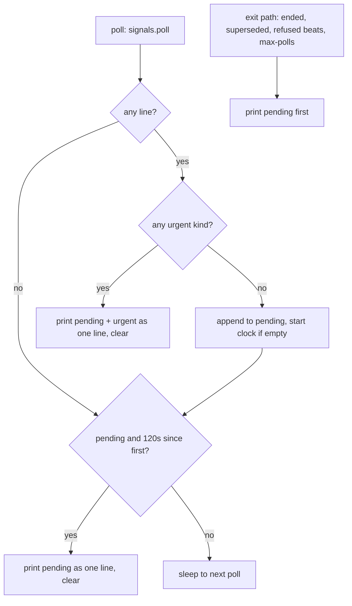

# Quiet Remit Watcher - Plan

## Goal Capsule

- **Objective:** the programme PM wakes only when something needs it. A worker editing its plan or moving its task list no longer costs a PM turn. A burst of changes costs one turn, and a watcher expiry costs one short re-arm turn with no sweep.
- **Means:** the remit watcher drops plan-edit and task-count lines, holds non-urgent lines for a 2-minute collapse window while sending urgent ones at once (KTD1, KTD2), and the PM docs make an expiry wake a single re-arm (KTD3).
- **Product authority:** Shawn, settled through pickers on 2026-10-28.
- **Open blockers:** none.
- **Execution profile:** Standard, two units: U1, then U2.
- **Finishes and ships:** one PR to `main`, squash-merged pinned to the reviewed head, published as auto 0.16.4 and installed on the MacBook and the Mac Studio.

---

## Product Contract

### Summary

The remit watcher prints a line only for changes the PM must act on, and merges non-urgent lines that arrive within 2 minutes into one. Claims, due waits, source outages and exit lines still arrive at once. A Monitor expiry is handled with one re-arm command and nothing else.

### Problem Frame

Each line the remit watcher (`lib/programme-watch.py`, remit mode) prints wakes the PM for a full turn. A live PM pane on 2026-10-27 showed the cost: "Monitor stream ended … The extended-clips plan changed again, with nothing to act on. The watcher is running again." `plans-changed ~<path>` fires on every save of a worker's plan file, and `tasks-changed` on every move of a worker's task counts. Claude Code ends each Monitor after 30 minutes, and the PM treats that wake like any other. Shawn: "This is another frustrating token burner".

### Requirements

**What wakes the PM**

- R1. The remit watcher prints `plans-changed` only for added plans (`+`). An edited plan (`~`) prints nothing.
- R2. The remit watcher prints no `tasks-changed` line. The tasks source still reports outage and recovery.
- R3. These lines still print: `remit-changed`, `claim`, `wait-due`, `tracker-changed`, `plans-changed +`, `source-unavailable`, `source-available` and `remit-watcher-exit`.

**Collapsing bursts**

- R4. Non-urgent lines (`remit-changed`, `tracker-changed`, `plans-changed +`) are held, and every non-urgent line produced within 2 minutes of the first held one goes out as one printed line.
- R5. Urgent lines (`claim`, `wait-due`, `source-unavailable`, `source-available`, `remit-watcher-exit`) print in the poll that finds them, together with any held lines and after them. A held line is never dropped when the watcher exits, whether on its own or when its Monitor stops it. Changes made while no watcher runs, between an expiry and the re-arm, are not reported. The re-armed watcher starts from a fresh baseline, and the PM's next sweep reads them.

**Expiry**

- R6. When the remit watcher's Monitor stream ends with no `remit-watcher-exit` line, the PM re-arms it with the one arm command and records the Monitor. It runs no sweep or status read, and sends no message.

### Key Decisions

- **Only what needs the PM wakes it.** (session-settled: user-directed — chosen over keeping task-count changes and over only collapsing bursts: plan edits and task counts are worker progress the PM sees on its next sweep.) Governs R1, R2, R3.
- **Bursts within 2 minutes collapse into one line.** (session-settled: user-directed — chosen over printing each change at once: a burst should cost one PM turn.) Governs R4, R5.
- **An expiry re-arms with one command and no sweep.** (session-settled: user-directed — chosen over sweeping on expiry: an expiry carries no news.) Governs R6.

### Scope Boundaries

- Item watchers (`--item`) and the cron fallback are unchanged.
- The 30-minute Monitor limit belongs to Claude Code. This plan makes the expiry wake cheap. It does not remove that wake.

---

## Planning Contract

### Key Technical Decisions

- KTD1. **Filter at the diff, keep the baselines.**
  - `_plans_changes` keeps only `+` parts.
  - `_tasks_changes` returns no lines.
  - Both sources keep polling and updating their baselines, so their outage and recovery lines and the agreement's source toggles are unchanged.
  - An edited plan therefore never prints, and a plan added later still prints `+`.
- KTD2. **A pending buffer in the remit loop, flushed by time or by an urgent line.**
  - `RemitSignals.poll` returns lines as today. The loop sorts each line by its kind prefix.
  - Non-urgent lines join a pending list, and the first one records a monotonic start time.
  - Pending lines print as one `"; "`-joined line when 120 seconds (`COLLAPSE_SECONDS`) have passed since that start, or immediately whenever the same poll found an urgent line, or before any exit return.
  - Duplicate lines collapse to one.
  - A test-only `CLAUDE_AUTO_WATCH_COLLAPSE_SECONDS` override follows the existing `CLAUDE_AUTO_WATCH_INTERVAL_SECONDS` pattern. It changes only timing, never what is reported, so it restrains nothing the PM could abuse.
  - Urgency is decided by an explicit allowlist of urgent kinds. An unknown future kind is treated as urgent, so a new line type can never be held silently.
  - Every remit line goes through the buffer. Today some lines print directly from helpers:
    - `Source.poll` prints `source-unavailable`. It now returns the line instead.
    - `_ended` and `_superseded` print `remit-watcher-exit`. They flush the buffer first.
    - `_remit_mode` prints `crashed`. Its handler also flushes the buffer first.
  - The remit loop installs a SIGTERM/SIGHUP handler that flushes the buffer and exits, so a Monitor stopping the watcher at expiry loses no held line. This mirrors `_item_mode`'s handler.
- KTD3. **Expiry handling is a docs change.** The PM's behaviour on a stream end lives in `skills/programme-sweep/SKILL.md` step 16 and `references/waits-and-watchers.md`. Both say: on a stream end without an exit line, run the arm command and `watcher-beat`, then stop. `docs/contracts/agent-tool-surface.md` drops `tasks-changed` from the wake list and describes the collapse window.

### High-Level Technical Design

### Sequencing and Parallelism

U1, then U2. U2 documents the behaviour U1 builds, so the two run in order.

---

## Implementation Units

### U1. Drop worker-progress lines and collapse bursts in the remit watcher

- **Goal:** the remit watcher prints only R3's lines, holds non-urgent lines for the collapse window, and sends urgent lines at once.
- **Requirements:** R1–R5. Implements KTD1, KTD2.
- **Dependencies:** none.
- **Files:**
  - `plugins/auto/lib/programme-watch.py`
  - `plugins/auto/tests/unit/programme-watch.test.sh`
- **Approach:**
  1. Restrict `_plans_changes` to added paths, and make `_tasks_changes` emit nothing. Keep both sources in `RemitSignals`.
  2. Add the urgent-kind allowlist and a small pending helper (add, due, flush). Use it in `_remit_loop`'s first poll, in each later poll, and on every exit return.
  3. Make `Source.poll` return its `source-unavailable` line rather than print it. Have `_ended`, `_superseded` and the crash handler flush the buffer before printing their exit line.
  4. Install a SIGTERM/SIGHUP handler in the remit loop that flushes and exits.
  5. Add `COLLAPSE_SECONDS = 120` with the test override. Set the override in every existing test that asserts on a remit line.
- **Patterns to follow:** `_interval()` for the env override. `_listed` for the line shape.
- **Test scenarios:**
  - A plan file added in a remit repo: `plans-changed +repo/docs/plans/new.md` prints after the collapse window. The test uses a short override.
  - The same plan file edited afterwards: nothing prints over several polls.
  - A worker's task counts move: no `tasks-changed` line prints. The tasks source outage still prints `source-unavailable tasks …`.
  - Two non-urgent changes in successive polls inside the window print as one line holding both.
  - A pending non-urgent change, then a new claim in a later poll: one line prints at once with both the claim and the held change, before the window ends.
  - A claim alone prints in the poll that finds it, without waiting.
  - A held line, then `--max-polls` reached: the held line prints before exit.
  - A held line, then the programme ends: the held line prints, then `remit-watcher-exit ended`.
  - A held line, then a source goes down: one line prints with the held change first, then `source-unavailable`.
  - A held line, then the watcher process gets SIGTERM: the held line prints before the process exits.
  - The existing remit-changed, tracker, source outage and superseded cases keep their outcomes, with the window shortened where they assert timing.
- **Verification:** `programme-watch.test.sh` passes when run alone, three runs in a row (it is known intermittent in full runs).

### U2. Make an expiry a one-command re-arm, and document the quieter lines

- **Goal:** the PM's docs match U1. An expiry is a single re-arm with no sweep.
- **Requirements:** R6, plus the docs for R1–R5. Implements KTD3.
- **Dependencies:** U1.
- **Files:**
  - `plugins/auto/skills/programme-sweep/SKILL.md`
  - `plugins/auto/skills/programme-sweep/references/waits-and-watchers.md`
  - `plugins/auto/docs/contracts/agent-tool-surface.md`
  - `plugins/auto/commands/programme.md`, `programme-takeover.md` or `programme-resume.md`, where they describe watcher lines
  - Tests: `plugins/auto/tests/unit/doc-fence-agent-tool-surface.test.sh` and any doc test that greps the line table
- **Approach:**
  1. In the line table, remove the `tasks-changed` row and limit `plans-changed` to `+`.
  2. Add a sentence saying non-urgent lines arrive merged, up to 2 minutes after the first change.
  3. Rewrite the expiry rule: on a stream end with no exit line, run the arm command and `watcher-beat` and stop, with no status, sweep or message.
- **Also rewrite:**
  - `agent-tool-surface.md`: the wake list at about line 737, and the "always watched" sentence about tasks and plans.
  - `SKILL.md` step 16: "Tasks and plans are always watched".
  - `waits-and-watchers.md`: tighten the "An expiry wake is quiet" sentence.
  - Each doc: state that changes made between an expiry and the re-arm are not reported.
- **Test expectation:** none, because this unit is docs only. The doc-fence tests do not grep these lines.
- **Verification:** grep the docs directly:
  - no doc lists `tasks-changed` or plan edits as a wake line;
  - every doc describing expiry says to re-arm only.

---

## Verification Contract

| Gate | Command | Applies to |
|---|---|---|
| Watcher tests | `bash plugins/auto/tests/unit/programme-watch.test.sh`, three runs alone | U1 |
| Unit suite | `bash plugins/auto/tests/run.sh unit` | all |
| Integration suite | `bash plugins/auto/tests/run.sh integration` | all |
| Known failures | `vocabulary-audit` fails on `main`. `programme-watch` and `programme-flow` are intermittent in full runs; count runs | reporting |

## Definition of Done

- R1–R6 hold, and each U1 scenario has a passing test.
- The suites pass apart from the known failures.
- No doc lists `tasks-changed` or plan edits as wake lines.
- auto 0.16.4 is published and installed on both Macs.
