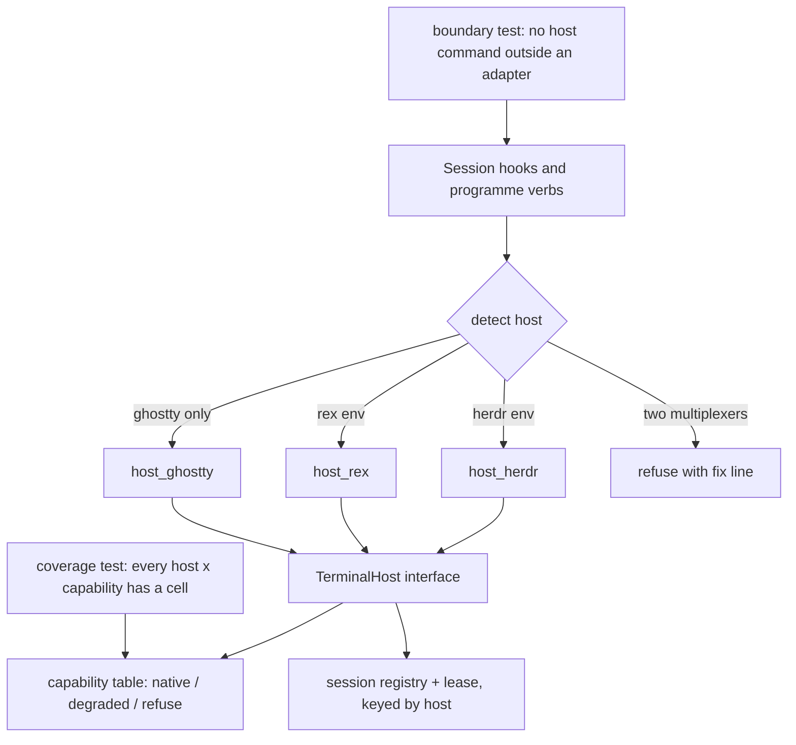
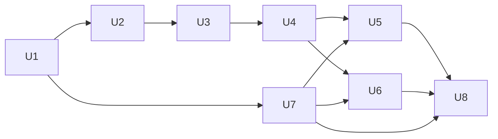

## Goal Capsule

- **Objective:** An auto programme runs, is found, is prompted and is watched in herdr, Rex or Ghostty, and no future terminal-touching feature ships without a declared answer for each of them.
- **Means:** One terminal host interface, host adapters behind it, and a capability table enforced by a failing test.
- **Product authority:** Shawn decides scope and the Ghostty floor. Trust rules for takeover, the send-guard and the space gate do not weaken.
- **Open blockers:** None.

---

## Product Contract

### Summary

Auto's programme layer runs on three terminal hosts (herdr, Rex, Ghostty) through one interface.
A host only starts panes, types into them and locates them.
Identity comes from Claude session IDs; presence comes from the host where it can answer, and session-to-session messages and message-log search are leads for activity.
A space is its session IDs plus tab space names.
A test fails the build when any host lacks a declared answer for any capability: native, degraded with how, or refuse with a fix line.

### Problem Frame

Auto's programme layer assumes herdr in 17 files under `plugins/auto/lib`, `hooks` and `commands`, about 124 references in all.
A session finds its space and pane from `HERDR_*` variables, the remit watcher polls `herdr api snapshot`, presence reads `herdr agent list`, and the send-guard parses `herdr` commands.
No module isolates these calls.
Without herdr, `programme.sh start` refuses with "this session is not in a herdr space".
Shawn also runs Rex and Ghostty, and wants auto to work in both.

### Actors

- A1. Shawn, who starts programmes, picks takeovers and answers pickers.
- A2. The PM session, which drives workers.
- A3. Worker sessions, which report claims and receive prompts.
- A4. The terminal host (herdr, Rex or Ghostty), which holds the panes.

### Key Decisions

- **Name: "terminal host".** (session-settled: user-directed — chosen over "pane host" and "terminal driver": `CONCEPTS.md` already uses "backend" for the CE/native toolchain.) Governs R20.
- **Mechanism: shrink the host's job, then enforce a capability table.** (session-settled: user-directed — chosen over a table alone and per-host copies of programme logic: it makes Ghostty's missing screen reads and change feed matter less.) Governs R1, R4, R10.
- **Space = Claude session IDs plus tab space names.** (session-settled: user-directed — chosen over an auto-owned name, the Ghostty window and the repo folder: session IDs are stable on every host, and tab names group the panes.) Governs R8, R9.
- **Chat on Ghostty uses Claude Code's own session messages.** (session-settled: user-directed — chosen over the programme inbox and journal alone: closer to live chat.) Governs R10.
- **Ghostty floor is all four:** start a programme, start and prompt workers, detect a gone PM and take over, and wake the PM from the remit watcher. (session-settled: user-directed — chosen over a narrower floor.) Governs R14, R15, R16, R17.
- **herdr moves behind the interface in this work.** (session-settled: user-directed — chosen over adding hosts beside untouched herdr code and over a staged seam: the rule needs herdr covered too.) Governs R1, R19.
- **Enforcement is a test that fails on any gap.** (session-settled: user-directed — chosen over a review checklist, alone or added.) Governs R4, R5, R6.
- **Start refuses when the host cannot identify the PM's pane.** (session-settled: user-directed — chosen over starting with a warning that the guard is off: the send-guard must hold on every host.) Governs R12, R21.
- **The auto publish step runs the suite.** (session-settled: user-directed — chosen over a GitHub Actions workflow, and over both: smallest change that guards a release.) Governs R6.
- **Rex requires the `rex` CLI on PATH.** (session-settled: user-directed — chosen over probing the Rex app bundle for the binary.) Governs R18.
- **Messages and tab names are leads, never proof.** (session-settled: user-approved — proposed with the trade-off that takeover, the send-guard and "gone" calls then need host evidence.) Governs R9, R10.
- **One host per space.** (session-settled: user-approved — proposed with the trade-off that a PM in Rex cannot have workers in Ghostty.) Governs R3.

### Requirements

**Terminal host interface**

- R1. Auto reaches a terminal host only through one interface, and no herdr, Rex or Ghostty command is called outside that host's adapter.
- R2. A session's host is detected from its environment, a host that announced itself wins, and Ghostty is chosen only when no multiplexer announced itself.
- R3. A space has one host, recorded on its lease, and a session from another host that tries to act on it is refused with a fix line.

**Capability rule**

- R4. For every capability auto uses (find own pane, start a pane, confirm a worker started, send a prompt, list panes, presence, change signal, notify), each host declares one answer: native, degraded with how, or refuse with a fix line.
- R5. A test fails when any host lacks an answer for any capability, and when code outside an adapter calls a host command.
- R6. The coverage test is part of the default suite, `bash plugins/auto/tests/run.sh all`, and the auto publish step runs that suite and stops on a failure.
- R7. Each host has a fake the suite uses, so every degraded and refuse path runs without the real app.

**Identity, space and presence**

- R8. The SessionStart hook records each session's ID, host pane or terminal id, and tab space name in the session registry on every host.
- R9. Tab space names group and label panes only, and never serve as evidence for takeover, the send-guard, or present/gone.
- R10. Worker activity is read from session IDs, session-to-session messages and message-log search, presence comes from the host (R13, R16), and a message or log hit never alone marks a session gone or an item done.
- R11. On Ghostty, a session's pane is found by matching its tty to a Ghostty terminal, and a tty Ghostty does not own means no pane is found.

**Safety**

- R12. The send-guard blocks any session from typing into the PM's pane on every host, identifying that pane by the host's own id (herdr pane or terminal id, Rex block id, Ghostty terminal id or tty).
- R21. `programme.sh start` and `become-pm` refuse, with a fix line, when the host cannot identify the session's own pane.
- R13. A typed takeover moves the lease at once only when host evidence shows the PM gone, and an exact-label pick from the session's transcript still works when evidence is unknown.

**Ghostty floor**

- R14. `programme.sh start` succeeds from a Ghostty session and records the space.
- R15. The PM starts worker panes in Ghostty and types prompts into them.
- R16. On Ghostty, the PM counts as gone only when its recorded tty is no longer a Ghostty terminal or that terminal's foreground process is not the PM's session, and is unknown otherwise.
- R17. The remit watcher wakes the PM on Ghostty by polling the terminal list and reading session messages.

**Rex host**

- R18. The Rex host requires `rex` on PATH, refuses with the install step when it is missing, and is native for start, prompt, locate, presence and change signal.

**Compatibility and wording**

- R19. herdr behaviour is unchanged after the refactor, and the existing herdr tests pass with no change to their expected results beyond the "space" wording.
- R20. User-facing text and `plugins/auto/CONCEPTS.md` use "terminal host" and "space" instead of "herdr space", with host-neutral definitions of remit, lease and session registry.

### Acceptance Examples

- AE1. **Covers R4, R5.** Given a new capability with no answer for Rex, when the suite runs, then the coverage test fails and names Rex and the capability.
- AE2. **Covers R9, R10.** Given a worker on Ghostty sends a message saying its item is done, when the PM sweeps, then the item stays open until the evidence check confirms it.
- AE3. **Covers R13, R16.** Given a Ghostty PM whose tty is no longer a Ghostty terminal, when a session types a takeover, then the lease moves. Given the tty is present but the terminal cannot be read, then the typed takeover refuses and the exact-label pick still works.
- AE4. **Covers R18.** Given a Rex session with no `rex` on PATH, when it runs `programme.sh start`, then it refuses and the message names the install step.
- AE5. **Covers R3.** Given a programme whose PM runs in Rex, when a Ghostty session starts a worker in that space, then the start is refused with a fix line.
- AE7. **Covers R21.** Given a Ghostty session whose tty matches no Ghostty terminal, when it runs `programme.sh start`, then it refuses and the message names the fix.
- AE6. **Covers R12.** Given a session on Rex that types `rex send` into the PM's block, when the command runs, then the guard blocks it and journals the attempt.

### Success Criteria

- Shawn runs a programme from start through takeover on Rex, and on Ghostty, on this machine, as a live check in each app.
- The existing herdr suite passes unchanged (R19).
- The coverage test is shown able to fail: removing one host's answer for one capability turns it red.

### Scope Boundaries

**Deferred for later**

- Other hosts such as cmux.
- Screen-reading features on Ghostty, which has no read verb.
- Rex's agent-status signal (OSC 7501), until it is verified that Claude emits it.
- Programmes whose PM and workers run on different hosts.

**Outside this work**

- Changing the programme's trust rules: takeover needs an exact-label pick, the space gate uses session-registry rows, and no session types into the PM's pane.

### Dependencies / Assumptions

- Ghostty's AppleScript needs macOS Automation permission, and a denial must produce a refusal with the Settings path as the fix line.
- Ghostty's `GHOSTTY_SURFACE_ID` does not match a terminal's `id`, so lookup uses tty.
- Rex is beta (version `0.0.1792697926-gbd4573`), and its API may change.
- Assumption, unverified: Claude Code session-to-session messages reach sessions running in any host, and survive a pane move.
- `spinoff` still launches workers, but auto's parse of its `herdr agent pane:` line does not generalise: only spinoff's herdr path prints that line (`plugins/spinoff/skills/spinoff/scripts/spinoff.sh:864`), Ghostty prints `agent tab: <id>`, cmux prints surface lines, and spinoff has no Rex backend. Spinoff therefore changes in this work (KTD7).

### Outstanding Questions

**Resolve Before Planning**

- None.

**Deferred to Planning**

- Non-blocking, settled inside U6: whether Claude Code session messages reach sessions on every host. If the probe fails, chat is `degraded` to the programme inbox.
- Precedence, item ids and the publish step are decided in the Planning Contract (KTD2, KTD5, KTD9).

### Sources / Research

- `docs/handoff.md`, the brief for this worktree.
- Herdr call-site map by capability: `plugins/auto/lib/session_registry.py`, `programme_sources.py`, `programme-watch.py`, `programme_lifecycle.py`, `on-pretooluse-action.py`, and the fake herdr in `plugins/auto/tests/helpers/dispatch-fixture.sh`.
- Vocabulary: `plugins/auto/CONCEPTS.md`.
- Ghostty AppleScript dictionary: `/Applications/Ghostty.app/Contents/Resources/Ghostty.sdef`; spinoff's Ghostty notes in its `SKILL.md`.
- Rex: `rex api list`, `rex __internal skill`, and the docs at superlogical.com/rex/docs.
- Learnings applied: host environment variables select an adapter and are never safety evidence (named in `docs/handoff.md`; that file is not at `docs/solutions/` in this worktree, so U4 locates it before relying on it), plus the false-green and default-deny learnings cited in U2 and U4.

Product Contract preservation: IDs and meaning kept. Four clarifications: Dependencies / Assumptions (the spinoff assumption, falsified by reading `spinoff.sh`), Outstanding Questions (answered below), the Summary and R10 (presence comes from the host; messages and logs are leads for activity), and R4 (adds the capability "confirm a worker started").

---

## Planning Contract

### Key Technical Decisions

- KTD1. **Interface shape: a small `TerminalHost` class per adapter in `plugins/auto/lib/terminal_host.py` plus one adapter module per host (`host_herdr.py`, `host_rex.py`, `host_ghostty.py`).** The interface has nine methods: `own_pane`, `list_panes`, `start_pane`, `confirm_started`, `send_prompt`, `presence`, `change_token`, `notify`, `is_host_command`. Every method returns a result that carries an explicit `native | degraded | refuse` status plus a `why` or fix line, never a bare None. Governs R1, R4. Pattern source: `programme_sources._herdr()` and its `bounded` wrapper in `programme_exec.py`, which the herdr adapter absorbs.
- KTD2. **Detection: first announced multiplexer wins; two announced multiplexers refuse.** herdr (`HERDR_PANE_ID`) and Rex (`REX_SESSION`) are multiplexers. Ghostty is chosen only when neither is set and `TERM_PROGRAM=ghostty`. Detection follows spinoff's order (herdr, then cmux, then a live herdr server with no `HERDR_ENV`, then Ghostty) so auto and spinoff never pick different hosts: `CMUX_WORKSPACE_ID` is refused as an unsupported multiplexer, and the herdr-server-up arm resolves to herdr. A session that announces both herdr and Rex refuses with a fix line instead of picking, because a wrong pick types into the wrong host. Rex inside Ghostty resolves to Rex. Detection selects an adapter only; the adapter then proves the pane from its own host (KTD3). Governs R2.
- KTD3. **Host variables select; host queries prove.** The send-guard, the space gate and presence read the registry rows and the host's own answers, never `HERDR_*`, `REX_*` or `GHOSTTY_*` values from the session environment. A test sets fake variables and shows the guard does not weaken. Governs R9, R12, R13.
- KTD4. **Capability table is data, in `plugins/auto/lib/terminal_host_capabilities.json`.** Rows are capabilities (the eight in R4), columns are hosts, each cell is `{status, how | fix}`. Adapters read their own cell to word refusals, so the table and the code cannot disagree about a fix line. The coverage test reads the same file and maps each interface method to a row; `is_host_command` is exempt from rows and instead has a required per-host test in U4. Governs R4, R5.
- KTD5. **Space key and ids.** The lease and registry key becomes `<host>.<server-or-session>.<workspace-or-window>`. Existing herdr files keep their names (`<server>.<workspace>.jsonl`, `<server>.<workspace>.json`), and a record with no `host` field reads as herdr. Rex and Ghostty files carry the host prefix. Item ids keep `herdr:<ws>/<pane>` for herdr and add `rex:<session>/<block>` and `ghostty:<window>/<terminal-id>`; `ISSUELESS_SOURCE` in `programme_record.py` becomes the set of host prefixes. No migration. The key is host plus a host-unique id; session IDs identify members and tab space names only label them (R9). For Rex the id is the session id; for Ghostty it is the window id (a UUID). Non-herdr files are named `<host>--<id>--<id>` and every segment passes `check_segment`, so a tty path never appears in a file name and a herdr server named `rex` cannot collide. A remit lists such a space as `{host, server, workspace}` with host defaulting to herdr, and the watcher counts a terminal as in the remit through registry rows for that key, never through tab names. Governs R3, R8, R19.
- KTD6. **Ghostty presence reads tty plus the foreground process, not `GHOSTTY_SURFACE_ID`.** The SessionStart hook records the session's tty; presence asks AppleScript for terminals, matches by `tty`, and compares the terminal's foreground `pid` with the process chain of the recorded session. Gone (R16) means the recorded tty is no longer a Ghostty terminal, or the terminal's foreground process belongs to another session; everything else is `unknown`. Governs R11, R16.
- KTD7. **Spinoff gains a Rex launcher and a host-neutral pane line; auto reads both forms.** `spinoff.sh` prints `agent pane: <host> <id>` on every backend and keeps the old `herdr agent pane:` line for herdr so older auto still parses it. Auto's parser accepts the old line and the new line. Spinoff ships as its own version. This reverses the earlier assumption that the parse generalises. (session-settled: user-approved — chosen over auto launching workers itself: spinoff already owns the Ghostty AppleScript and tab-launch patterns, and the PM owns this technical choice.) Governs R15, R18.
- KTD8. **Default-deny send-guard.** `on-pretooluse-action.py` stays default-deny on the PM's pane id: it blocks any command that names that pane id from the registry together with a send-class host verb, after unwrapping `bash -c`, `eval`, heredocs and `$(...)`. Only `bash -c` unwrapping exists today, so the other three are new work in U4. The verb lists move into each adapter's `is_host_command`; the guard calls the adapter, never a hard-coded list. The PM's and spinoff's own sends to other panes stay allowed. The guard reads no `*_WORKSPACE_ID` from the environment (KTD3). Governs R12. Learning: an enumerated allow list never closes a defect class.
- KTD9. **The publish step is `scripts/publish-plugin.sh <plugin> <old> <new>`.** It runs `scripts/check-version-bumped.sh`, then `bash plugins/<plugin>/tests/run.sh all` through a verdict check that fails on a missing `TOTAL:` line, then makes the `publish: <plugin> <old> → <new>` commit touching only `.claude-plugin/marketplace.json` and `plugins/<plugin>/.claude-plugin/plugin.json`. The procedure exists today only in a memory note; the script makes it repo-owned. Governs R6. (session-settled: user-directed — chosen over a GitHub Actions workflow: the repo has no CI and a script is the smallest change that guards a release.)
- KTD10. **Fakes are seeded from captured real output.** Each host fake replays recorded stdout and stderr from fixture files under `plugins/auto/tests/fixtures/hosts/<host>/`, including the refusals (Ghostty Automation denied, `rex` not found, herdr socket missing). A fake that no fixture backs fails the coverage test. Governs R7.
- KTD12. **The tty is found by walking the process chain.** A hook has no controlling tty, so the SessionStart hook walks parent pids to the Claude process and records that process's tty. Probing this on Ghostty is the first task of U6; if the chain cannot reach a tty, Ghostty `own_pane` is `refuse` and R21 stops the start. Governs R8, R11, R21.
- KTD11. **Rewire order protects R19.** The herdr adapter lands first with every caller rewired and the whole existing suite green before any new host code is written. Governs R19.

### Assumptions

- Hook budget: the SessionStart hook has a 5s timeout and each host call a 1.0s timeout (`programme_exec.bounded`). Ghostty AppleScript launches in under 1s on this machine; if a probe in U6 shows otherwise, the hook records tty only and defers the terminal lookup to first use.
- Rex's `session.view` `revision` rises on every change and so stands in for herdr's `state_change_seq`. Verified on Rex `0.0.1792697926-gbd4573`; the version is recorded in the capability row so a drift shows in review.
- Claude Code session messages reach sessions on any host. Unverified; U6 probes it and, if it fails, the chat capability for Ghostty is declared `degraded` with the programme inbox as the path.

### High-Level Technical Design

*Directional sketch for review, not an implementation specification.*

Capability matrix (what the coverage test enforces; Rex and Ghostty rows from the probes already run):

| Capability | herdr | Rex | Ghostty |
|---|---|---|---|
| find own pane | native (env + `pane get`) | native (`REX_BLOCK`, `session inspect`) | degraded (tty match to terminal) |
| start a pane | native (via spinoff) | native (`rex run` / `split`, via spinoff) | native (AppleScript tab, via spinoff) |
| confirm a worker started | native (agent row) | degraded (poll registry for the worker's session ID) | degraded (poll registry for the worker's session ID) |
| send a prompt | native (`agent prompt`) | native (`rex send`) | native (`input text`) |
| list panes | native | native (`session.view`) | native (terminal list) |
| presence | native (agent list) | native (`terminal.process`) | degraded (tty + foreground pid; else unknown) |
| change signal | native (`state_change_seq`) | native (`revision`) | degraded (poll terminal list + session messages) |
| notify | native | degraded (no verb; journal line) | degraded (no verb; journal line) |

Sequencing:

### System-Wide Impact

- **Safety surface.** The send-guard, the space gate and takeover each move from herdr facts to adapter facts (KTD3, KTD8). A mistake here weakens a trust rule, so U4 carries the strongest tests and a cross-model read of its diff.
- **Stored data.** Registry rows gain fields and lease files gain a host key. Old files stay readable and are never rewritten (KTD5), so a downgrade to the previous auto version still reads herdr state.
- **Two plugins.** Spinoff and auto release separately. Auto must read both pane-line forms so release order does not matter (KTD7).
- **Parallel work.** The 0.16.4 quieter remit watcher edits `programme-watch.py` in `worktrees/quiet-remit-watcher`. Rebase conflicts in U1 and U6 are expected and handled after that release; this work does not touch that worktree.

### Risks & Dependencies

| Risk | Mitigation |
|---|---|
| Ghostty or Rex changes its CLI or dictionary (Rex is beta) | Version recorded per capability row; fixtures replay real output; live checks in U8 |
| A refactor weakens a trust rule | KTD3 env-fake test, KTD8 default-deny, mutation-proven coverage test, cross-model review of U4 |
| Hook timeout on Ghostty (AppleScript latency) | Assumption above; hook falls back to tty-only record |
| Rebase against the 0.16.4 watcher change | U1 keeps `programme-watch.py` edits to the single snapshot call site |
| `rex` is not installed on this machine | U5 starts with the install step and fixture capture; R18 refuses until then |
| Automation permission denied on first Ghostty use | Refusal names System Settings > Privacy & Security > Automation as the fix line; fixture captured |

### Documentation / Operational Notes

- `plugins/auto/CONCEPTS.md` gains "terminal host" and host-neutral definitions of remit, lease and session registry (R20). It already exists, so the gap-fill rule applies.
- Replace "herdr space" with "space" in `plugins/auto/commands/programme*.md`, `plugins/auto/README.md`, `plugins/auto/skills/programme-remit` and the refusal strings in `programme_lifecycle.py`; `vocabulary-audit.test.sh` already guards vocabulary and gains the new term.
- `docs/handoff.md` standing rule on backend support stays; the coverage test is the mechanism it asked for.
- Release order: spinoff first (new line is additive), then auto, each through `scripts/publish-plugin.sh`.

---

## Implementation Units

### U1. Terminal host interface and herdr adapter

- **Goal:** Put every herdr call behind `TerminalHost` with no behaviour change.
- **Requirements:** R1, R19
- **Dependencies:** None
- **Files:** `plugins/auto/lib/terminal_host.py` (new), `plugins/auto/lib/host_herdr.py` (new), `plugins/auto/lib/terminal_host_capabilities.json` (new, herdr column), `plugins/auto/lib/programme_sources.py`, `plugins/auto/lib/session_registry.py`, `plugins/auto/lib/programme-watch.py`, `plugins/auto/lib/programme_record.py`, `plugins/auto/lib/programme_permission.py`, `plugins/auto/lib/programme_context.py`, `plugins/auto/lib/programme_archive.py`, `plugins/auto/lib/programme_recovery.py`, `plugins/auto/lib/programme_permission_settle.py`, `plugins/auto/lib/programme_lifecycle.py`, `plugins/auto/lib/on-user-prompt.py`, `plugins/auto/lib/programme_home.py`, `plugins/auto/lib/programme_fixes.py`, `plugins/auto/lib/programme_proposals.py`, `plugins/auto/lib/on-pretooluse-askuser.py`, `plugins/auto/lib/on-posttooluse-askuser.py`, `plugins/auto/lib/programme-watch.sh`, `plugins/auto/.claude/hooks/on-session-start.sh`. The programme-view mod (`mods/programme-view/actions.ts`) is TypeScript outside the scanner; its wording changes in U8 and it is excluded from the boundary scan by name.
- **Approach:** Move `_herdr()` and the direct `herdr`/`shutil.which` calls into `host_herdr.py` unchanged in behaviour. Callers ask `terminal_host.current()` and call interface methods. Absence of herdr maps to a `refuse` result carrying today's message. The `programme-watch.py:219` snapshot becomes `change_token()`; edit only that call site (rebase risk).
- **Patterns to follow:** `programme_exec.bounded` for timeouts; `driver_presence` return shape (present | gone | unknown with `why`) in `session_registry.py:285`.
- **Execution note:** Characterization first. Run the full suite green before the first move and after each caller moves.
- **Test scenarios:**
  - Happy path: with fake herdr, `programme.sh start` records the same lease and registry rows as before (golden comparison).
  - Edge: herdr binary absent → refusal text equals today's string.
  - Edge: snapshot unavailable → presence stays `unknown`, never `gone` (existing behaviour kept).
  - Integration: the remit watcher still wakes on `state_change_seq` change through `change_token()`.
- **Verification:** `bash plugins/auto/tests/run.sh all` reports the same pass count as before the change; no herdr test file edited beyond host-neutral wording.

### U2. Coverage and boundary tests, fake harness

- **Goal:** Make a missing host answer, or a host command outside an adapter, fail the build.
- **Requirements:** R4, R5, R6, R7
- **Dependencies:** U1
- **Files:** `plugins/auto/tests/unit/terminal-host-coverage.test.sh` (new), `plugins/auto/tests/unit/terminal-host-boundary.test.sh` (new), `plugins/auto/tests/helpers/host-fakes.sh` (new), `plugins/auto/tests/fixtures/hosts/` (new), `plugins/auto/tests/helpers/dispatch-fixture.sh` (host-neutral helpers only; no expected-result changes, R19)
- **Approach:** The host set is an enum in `terminal_host.py`; until U5 and U6 land, Rex and Ghostty carry explicit `refuse: not yet implemented` cells, so the AE1 red-proof runs from U2 onward. Coverage test reads `terminal_host_capabilities.json` and fails on any empty cell, any `degraded` without `how`, any `refuse` without a fix line, and any adapter method with no row. Boundary test scans auto's own `lib`, `hooks` and `commands` (spinoff is a separate plugin, outside the scan) for `herdr`, `rex`, `osascript` command invocations outside `host_*.py` and the allow-listed docs. `host-fakes.sh` builds a PATH-first fake per host from fixture files. Model the tests on `import-topology.test.sh` and `vocabulary-audit.test.sh`.
- **Execution note:** Prove each test red before green: remove one cell, plant one stray `herdr` call in a temp tree, and assert the failure names it.
- **Test scenarios:**
  - Error path (AE1): delete the Rex `notify` cell → coverage test fails naming Rex and notify.
  - Error path: plant `subprocess.run(["rex", ...])` in a synthetic `lib` file → boundary test fails naming the file.
  - Anti-vacuity: the scanner asserts it saw N files and fails on 0; a planted positive control must be found.
  - Spy: a production path (`programme.sh start`) reaches the host only through the interface (spy records the call).
  - Fixture check: a fake without a backing fixture fails.
- **Verification:** Both tests appear in `tests/run.sh` totals with 0 failed, and the red demonstrations above are recorded in the commit message.

### U3. Host-keyed registry, leases and space identity

- **Goal:** Record host, tty and tab space name on every session and key leases by host.
- **Requirements:** R2, R3, R8, R9, R19
- **Dependencies:** U1, U2
- **Files:** `plugins/auto/lib/session_registry.py`, `plugins/auto/lib/programme_store.py`, `plugins/auto/lib/programme_record.py`, `plugins/auto/lib/programme_lifecycle.py`, `plugins/auto/lib/format_compat.py`, `plugins/auto/.claude/hooks/on-session-start.sh`
- **Approach:** SessionStart hook gate moves from `HERDR_PANE_ID` to host detection (KTD2). Rows gain `host`, `tty`, `tab_space_name`; `resolved` gains host values. Lease path is host-qualified for non-herdr hosts (KTD5); a host mismatch on an existing lease refuses (R3). `ISSUELESS_SOURCE` becomes a host-prefix set. An empty host id is never exported.
- **Test scenarios:**
  - Happy path: a stub-host session (U2 harness) records a row with its host and a host-qualified lease path; herdr paths unchanged.
  - Edge: old record without `host` reads as herdr.
  - Edge: two sessions share a tab space name on different tty → two separate spaces.
  - Error path (AE5): Ghostty session acts on a Rex lease → refused with a fix line.
  - Error path: two multiplexers announced → hook records nothing and start refuses with a fix line.
  - Safety: tab space name alone never satisfies the space gate (R9).
- **Verification:** `programme-items`, `programme-store` and `programme-remit` suites pass unchanged; new cases pass.

### U4. Safety rules on the interface

- **Goal:** Carry the send-guard, start gate and takeover evidence across hosts, failing closed.
- **Requirements:** R12, R13, R21
- **Dependencies:** U3
- **Files:** `plugins/auto/lib/on-pretooluse-action.py`, `plugins/auto/lib/programme_lifecycle.py`, `plugins/auto/lib/session_registry.py`, `plugins/auto/lib/terminal_host.py`, new guard cases in new test files; existing guard suites keep their expected results
- **Approach:** Rewrite `_HERDR_SEND_VERBS`, `_herdr_sends` and `_names_pane` as default-deny through each adapter's `is_host_command` (KTD8). `start` and `become-pm` call `own_pane()` and refuse when it is `refuse` or empty (R21). `driver_presence` calls the adapter; typed takeover requires `gone`, the exact-label pick works on `unknown` (R13). Recheck PM-gone under the lease lock. The label function stays host-neutral.
- **Test scenarios:**
  - Error path (AE6): a stub-host session sends into the PM pane → blocked and journaled; the real `rex send` form repeats in U5.
  - Wrapper forms: `bash -c`, `eval`, heredoc and `$(...)` around a host send are all blocked, per host.
  - Adversarial: fake `HERDR_*`, `REX_*`, `GHOSTTY_*` values do not weaken the guard (KTD3).
  - Error path (AE7): a stub-host session whose `own_pane` is `refuse` → `start` refuses naming the fix; the Ghostty no-tty-match form repeats in U6.
  - Takeover (AE3): fake returns present, gone, unknown → typed takeover refuses, moves, refuses; the exact-label pick works in all three.
  - Race: PM gone evidence is rechecked under the lease lock; a PM that reappears blocks the move.
- **Verification:** Guard and lifecycle suites pass; a mutation (remove the pane-id match) turns a named test red. Cross-model review (`mcp__codex__codex` or `codex:rescue`) of this unit's diff before merge.

### U5. Rex host

- **Goal:** Programmes run, are found, prompted and watched in Rex.
- **Requirements:** R10, R12, R15, R18
- **Dependencies:** U2, U4, U7
- **Files:** `plugins/auto/lib/host_rex.py` (new), `plugins/auto/lib/terminal_host_capabilities.json`, `plugins/auto/tests/unit/host-rex.test.sh` (new), `plugins/auto/tests/fixtures/hosts/rex/`
- **Approach:** `rex` is not installed on this machine, so the first task is the install step (or `rex skill setup`) and capturing real fixtures, including `REX_SESSION` and `REX_BLOCK` values; the live check waits for it. Shell out to `rex` only, never the app bundle path (R18). Find own pane from `REX_SESSION` / `REX_BLOCK` then confirm with `rex session inspect`. Presence from the `terminal.process` API method; change token from `session.view` `revision`. `notify` is `degraded` to a journal line. Block id and terminal id are the registry ids the guard matches.
- **Test scenarios:**
  - Activity (R10): a worker message claiming done leaves the item open on Rex too.
  - Error path (AE4): `rex` not on PATH → refusal names the install step.
  - Error path (AE6): `rex send` into the PM block is blocked and journaled.
  - Happy path: start, prompt, locate and presence against the fake, from captured output.
  - Edge: server running with 0 sessions → locate returns not found, presence `unknown`.
  - Edge: `revision` unchanged between polls → no wake.
  - Integration: remit watcher wake on a revision change.
- **Verification:** `host-rex.test.sh` and coverage test green; U8 live check on this machine.

### U6. Ghostty host

- **Goal:** The Ghostty floor: start, prompt workers, detect a gone PM, wake the PM.
- **Requirements:** R10, R11, R14, R15, R16, R17
- **Dependencies:** U2, U4, U7
- **Files:** `plugins/auto/lib/host_ghostty.py` (new), `plugins/auto/lib/programme-watch.py`, `plugins/auto/lib/terminal_host_capabilities.json`, `plugins/auto/tests/unit/host-ghostty.test.sh` (new), `plugins/auto/tests/fixtures/hosts/ghostty/`
- **Approach:** First probe how the hook reaches the Claude process's tty (KTD12). Spinoff owns pane launch on every host (KTD7); `start_pane` calls it with the host named. The adapter's AppleScript covers locate, list, send and presence. Pass AppleScript as argv, never interpolate user text into the script. Wrap `command:` as `sh -lc '…'`. Locate by `tty` (KTD6). Watcher polls the terminal list on the existing interval and reads session messages for wakes (R17). Probe the session-message primitive across hosts first; record the result on the capability row and fall back to the inbox if it fails (Assumptions). Automation denial maps to a refusal with the Settings path.
- **Test scenarios:**
  - Happy path: start, prompt and locate against the fake osascript fixture.
  - Error path: Automation denied → refusal names System Settings > Privacy & Security > Automation.
  - Presence (AE3): tty absent from the terminal list → `gone`; tty present but foreground unreadable → `unknown`; foreground pid is another session → `gone`.
  - Edge: `working directory` reads empty after `command:`; code does not depend on it.
  - Error path (AE7): no tty match → `start` refuses.
  - Safety (AE2): a worker message claiming "done" leaves the item open until the evidence check.
  - Edge: a tty not owned by Ghostty (3 of 22 measured) → no pane found, `start` refuses (AE7).
- **Verification:** `host-ghostty.test.sh` and coverage test green; U8 live check.

### U7. Spinoff: Rex launcher and host-neutral pane line

- **Goal:** Workers start on Rex and report a pane id auto can parse on every host.
- **Requirements:** R15, R18
- **Dependencies:** U1
- **Files:** `plugins/spinoff/skills/spinoff/scripts/spinoff.sh`, `plugins/spinoff/skills/spinoff/SKILL.md`, `plugins/spinoff/.claude-plugin/plugin.json`, `.claude-plugin/marketplace.json`, `plugins/auto/lib/programme_sources.py`, spinoff tests (`spinoff.bats`, `session-id-passthrough.test.sh`, `cli-drift.test.sh`)
- **Approach:** Add a Rex backend using `rex run` / `split` with `--json`; print `agent pane: <host> <id>` on all backends and keep `herdr agent pane: <id>` for herdr. Auto's parser (`programme_sources.py:55` and the parse at `:520`) accepts both. Detection order mirrors KTD2. Bump the spinoff version and ship it first.
- **Test scenarios:**
  - Happy path: each backend prints the new line; the herdr path still prints the old line.
  - Integration: auto parses old-only and new-only output.
  - Error path: Rex announced but `rex` missing → spinoff exits non-zero with the install step and never falls through to Ghostty.
  - Drift: `cli-drift.test.sh` covers the new flag usage.
- **Verification:** Spinoff test suite and auto `programme-sources.test.sh` green.

### U8. Publish script, wording, live checks

- **Goal:** Guard releases with the suite, finish the vocabulary, and prove the hosts live.
- **Requirements:** R6, R20, and the Success Criteria
- **Dependencies:** U5, U6, U7
- **Files:** `scripts/publish-plugin.sh` (new), `plugins/auto/CONCEPTS.md`, `plugins/auto/README.md`, `plugins/auto/commands/programme*.md`, `plugins/auto/skills/programme-remit/`, `plugins/auto/lib/programme_lifecycle.py`, `plugins/auto/tests/unit/vocabulary-audit.test.sh`, `plugins/auto/.claude-plugin/plugin.json`, `.claude-plugin/marketplace.json`
- **Approach:** `publish-plugin.sh` per KTD9, with a verdict check that fails when `TOTAL:` is absent or any file fails. Rename user-facing "herdr space" to "space" and add "terminal host" to the audit's required terms. Live checks are manual: a programme from start through takeover in Rex and in Ghostty on this machine, with the Automation prompt accepted once.
- **Test scenarios:**
  - Error path: a failing unit test makes the script exit non-zero and no commit is made.
  - Error path: a missing version bump makes the script stop at `check-version-bumped.sh`.
  - Happy path: a bumped, green plugin produces a commit touching only the two manifest files.
  - Vocabulary: `vocabulary-audit.test.sh` flags a remaining "herdr space" in user-facing text.
- **Verification:** Script run in a scratch clone; live checks recorded as claims on the programme.

---

## Verification Contract

| Gate | Command or action | Applies to |
|---|---|---|
| Whole auto suite | `bash ~/.claude/tools/honest-run/run.sh --expect "TOTAL: [0-9]+ passed, 0 failed" -- bash plugins/auto/tests/run.sh all` | every unit |
| Version gate | `bash scripts/check-version-bumped.sh` | U7, U8 |
| Spinoff suite | spinoff's own test runner (`spinoff.bats`, `session-id-passthrough.test.sh`, `cli-drift.test.sh`) | U7 |
| Red proofs | remove one capability cell; plant one stray host call; remove the pane-id match; each turns a named test red | U2, U4 |
| Cross-model read | Codex review of the U4 diff and the guard tests | U4 |
| Code review loop | `/ce-code-review` until no P0-P2, then `/thermo-nuclear-code-quality-review` on the final head | whole branch |
| Live check, Rex | programme start → worker prompt → takeover in Rex Beta | U5 |
| Live check, Ghostty | same sequence in Ghostty, Automation permission accepted | U6 |

## Definition of Done

- A programme starts, finds, prompts and watches workers in herdr, Rex and Ghostty, shown by suite runs for herdr and live checks for Rex and Ghostty.
- The pre-change herdr tests pass with no expected-result edits beyond "space" wording (R19).
- The coverage and boundary tests are in the default suite and shown red by mutation (R5, R6).
- `scripts/publish-plugin.sh` exists, runs the suite, and stops on a failure (R6).
- No trust rule weakened: takeover pick, space gate and send-guard have per-host tests, including the faked-environment test (R12, R13, R21).
- `CONCEPTS.md` and user-facing text use "terminal host" and "space" (R20).
- Dead-end and experimental code from abandoned attempts is removed from the diff.
- Spinoff and auto each have a bumped version, spinoff released first.

## Parallelism

- Sequential spine: U1 → U2 → U3 → U4.
- U7 can start after U1 in parallel (separate plugin), but it also edits `programme_sources.py`, so rebase it after U1.
- After U2 and U4: U5 and U6 run in parallel (separate adapter files; both touch the capability JSON and the shared files `session_registry.py` and `on-session-start.sh` only through U3, so merge the JSON rows by hand and expect worktree conflicts).
- U8 last; its script and wording parts can start alongside U5 and U6 but the live checks wait for them.
