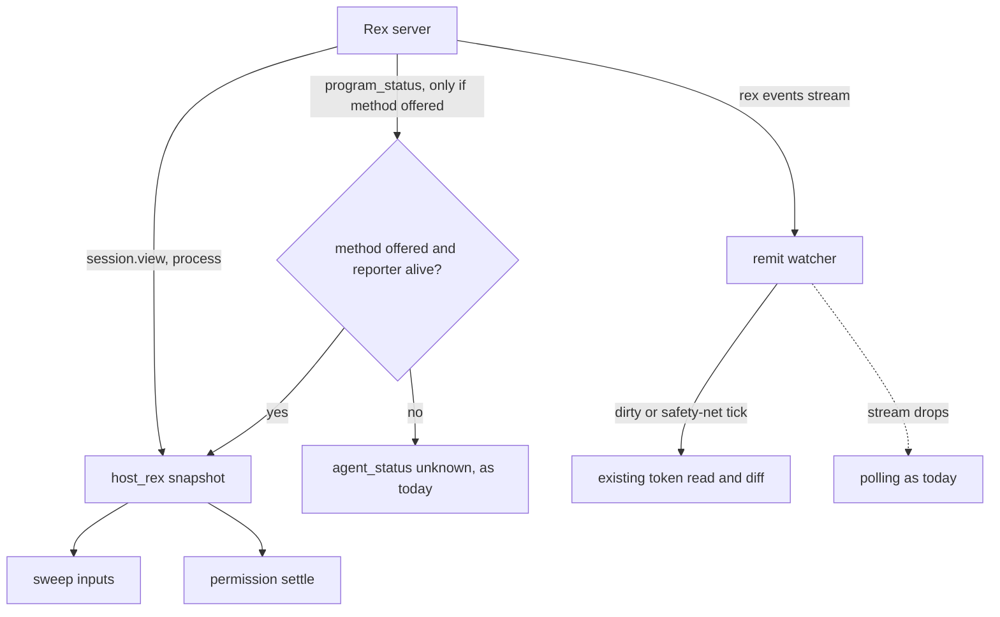

# Rex Program Status and Events - Plan

**Target repo:** shrimpshack. All paths are relative to the repo root; the code lives in `plugins/auto`.

---

## Goal Capsule

- **Objective:** When a programme runs in Rex, the PM can tell a worker that waits for Shawn from one that works or has finished, and it learns about changes without reading every Rex session on a timer.
- **Means:** Read the status that programs report to Rex, and Rex's event stream, behind the existing terminal host seam. Use each only when the connected server offers it (KTD1, KTD2, KTD4).
- **Authority:** Product Contract, then Key Technical Decisions. The safety rules of the merged terminal-host work stay in force: only host proof moves a lease or counts as an own-pane proof.
- **Stop conditions:** Stop before U3 if no program in a Rex block reports a status and the report path (U5) does not look buildable: reading an empty status delivers nothing. U2 and U4 do not depend on a reporter and go ahead on any U1 result. If U5 is buildable but no worker-side reporter exists, U3 and U5 still go ahead, and worker panes keep reading "unknown"; the worker-state outcome is then not met and the handoff says so.
- **Execution profile:** Code. U1 runs against a separate throwaway Rex server started from the installed CLI (revision 8), so Shawn's running server is never touched.

---

## Product Contract

### Summary

Make the Rex terminal host use three things the newest Rex CLI offers and auto ignores today: the status a program reports (working, blocked, done), the live event stream, and a per-server check for each. An older Rex server keeps today's behaviour. Last, and gated on a first proof run (U1), the PM's own Rex block reports "blocked" while an ask waits for Shawn.

### Problem Frame

The installed Rex CLI is API revision 8 (built Oct 30). Shawn's running Rex server is revision 6, and the merged terminal-host work recorded revision 7. The Rex rows in the capability table show what auto gave up for lack of these APIs.

- **Worker state.** The sweep reads `agent_status` per pane. herdr supplies it. Rex does not, so every Rex pane reads "unknown". The permission-settle check treats only "idle" and "gone" as settled, so on Rex a retried worker stays "pending" forever.
- **Waiting on Shawn.** A worker blocked on a permission, a question or a login is invisible to the PM on Rex. Rex lets a program report exactly that, with the kind of wait.
- **Change signal.** The remit watcher reads the session list, then every session's view, each interval (up to 32 calls). Rex has an event stream built for this.
- **Version drift.** Several Rex versions run on one machine. The CLI can be newer than the server it talks to, so a feature cannot be assumed from the CLI's version.

The status method answered a read-only call on the revision 6 server (it returned no records), and the event commands are confirmed from the CLI's help. Which methods revisions 7 and 8 added, and whether anything reports a status, is not known yet; U1 finds out on a throwaway server of the installed revision.

### Requirements

**Worker state**
- R1. On a Rex server that offers the status method, each pane in the host snapshot carries an `agent_status` in the vocabulary the sweep already reads.
- R2. A reported status counts only while the program that reported it still runs in that block. Otherwise the pane reads "unknown".
- R3. Text a program reports is untrusted. It is sanitized before it reaches a prompt, the journal or a tracker. A status never moves a lease, grants a permission or proves an own pane.

**Waking and reading**
- R4. The remit watcher wakes from Rex events rather than reading every session each interval. It keeps its output unchanged and falls back to its current polling when the stream is unavailable or drops.
- R5. What wakes the PM stays as it is: a block joining or leaving. A status change alone does not wake it.

**Older servers**
- R6. A server that lacks a method gets today's behaviour for that feature: the same snapshot, the same feature calls, no new refusal, plus one cached probe call per process.
- R7. Each Rex capability row says what an older server gives and the revision on which the new path was verified.

**Asking Shawn (gated on U1)**
- R8. When a hand-off needs Shawn, the PM's own Rex block reports "blocked" with the kind of wait. The Rex app is not switched to the PM's session and no label is changed.

### Acceptance Examples

- AE1. Covers R1, R2. Given a server with the status method and a worker block whose reporter is still running and reports "blocked" for a permission, when the sweep reads panes, then that pane's `agent_status` is "blocked".
- AE2. Covers R2. Given a record whose reporting process has exited, when the sweep reads panes, then the pane reads "unknown".
- AE3. Covers R6. Given a server without the status method, when the sweep reads panes, then the snapshot equals today's and the calls equal today's plus the one cached probe call.
- AE4. Covers R4. Given a healthy stream, a block joins a session: the watcher prints its usual change line. Given the stream drops, the watcher keeps polling and prints the same lines.
- AE5. Covers R3. Given a record whose message holds control characters and a long line, when the sweep reads panes, then no prompt or journal line carries it unsanitized.

### Key Decisions

- **Older Rex keeps today's behaviour.** Use the new APIs when the server has them; do not refuse below revision 8. Governs R6, R7. (session-settled: user-approved — chosen over refusing below revision 8: the running server is on revision 6.)
- **Reading comes first, reporting last.** Governs R1, R8.
- **Wake rules do not change.** A blocked worker does not wake the PM by itself, because the PM is meant to stay quiet unless Shawn must decide. Governs R5.

### Scope Boundaries

- Outside this plan: herdr and Ghostty behaviour, a new host, restarting Shawn's running Rex server.
- Considered and dropped: `rex wait` for a block's exit. The existing process check already reads `last_exit`, so it adds nothing.

#### Deferred to Follow-Up Work

- Wake the PM when a worker turns "blocked". Needs a decision on noise.
- Name Rex sessions and blocks after the programme item, as Rex's agent guide suggests.
- Switch the Rex app to the PM's session. Declined for now; revisit if marking proves too quiet.

---

## Planning Contract

### Key Technical Decisions

- KTD1. **Probe by method, not by version.** Before using a new method, ask the connected server whether it offers it (`rex api describe`, or the method list). Cache the answer for the life of the process. A CLI newer than its server then fails safe. The exact probe is chosen in U2 after U1 shows what is cheap and reliable. Realises R6, R7. (session-settled: user-approved — chosen over a version floor of revision 8.)
- KTD2. **One status per block, worst state wins.** A block's records (a root and optional children) reduce to one state in the order blocked, error, working, done, idle. A state the host does not know reads as idle, as Rex's own schema says. States pass through under Rex's names: idle, working, blocked and done match the sweep's vocabulary, and "error" reaches it as a status the sweep treats as neither idle nor gone. Realises R1.
- KTD3. **A report counts only while its reporter lives.** Compare the record's owner (pid and name; Rex warns the system reuses pids) with the block's foreground process, child and ancestors from the existing process call. No match reads "unknown". Only blocks that have a record cost the extra call. Realises R2.
- KTD4. **Events wake the watcher; the watcher's contract stays.** A reader of the event stream marks the watcher dirty. Dirty, or the safety-net interval elapsed, triggers the existing snapshot read and diff, so its printed lines stay identical. Events that arrive within a minimum gap of the last read coalesce into one read, because busy and idle changes also raise events and a naive wake could read more often than today's 30-second poll. The gap and the longer safety-net interval are measured in U4, not guessed here. Realises R4, R5.
- KTD5. **Reporting never writes to a device path from registry data.** The report is a new host method (report and clear) called wherever auto already asks the host to notify. The emitting process is the programme verb the PM runs from a Bash call, not a hook, so U1 must prove that process can reach the block's own terminal. The send-guard keeps denying tty-device writes. Realises R8.
- KTD6. **Mark by status, not by label or focus.** A block label is the identity the exact-label takeover pick uses, so renaming the PM's block would break takeover. Switching the app steals Shawn's focus. A reported "blocked" does neither. Realises R8. (session-settled: user-approved — chosen over switching the Rex app to the PM's session.)

### High-Level Technical Design

The gate is evaluated per block. Status feeds only the pane snapshot the sweep reads. The watcher's change token stays status-free, which keeps R5.

### Assumptions

- Claude Code may not report a status by itself. U1 settles this; the plan does not assume either answer.
- The report grammar (the escape sequence a program writes) is not documented in what was read. The CLI shows only the query form and the state and kind names. U1 captures the real grammar before U5.

### Risks & Dependencies

| Risk | Mitigation |
|---|---|
| Nothing in a Rex block reports a status, so U2 to U4 deliver nothing | U1 gates them (stop condition); U5 is the path to a real reporter |
| A stale or spoofed "working" or "idle" changes what the sweep does | KTD3 liveness check; R3; the status only feeds the sweep's "pending or retry" choice and never a lease or a permission |
| Test fixtures replay recorded output, and revisions 7 and 8 cannot be recorded from the running server | Record on the throwaway server in U1; label any hand-written fixture as built from the schema |
| `rex api call` on a block is classed as a send by the send-guard | Leave the guard as it is; the host runs its calls from Python, not from a Bash command, and a test pins the guard's class |
| The stream process leaks or hangs the watcher | Own the child's lifetime in U4; test the drop and the watcher's exit |

---

## Implementation Units

### U1. Prove the status and event paths on a current Rex server

**Goal:** Turn the open questions into recorded facts, and decide whether U2 to U5 go ahead.

**Requirements:** All; gates R1 to R8.

**Dependencies:** None.

**Files:** `plugins/auto/tests/fixtures/hosts/rex/` (new scenarios), this plan's Assumptions and Open Questions (resolve in place).

**Approach:**
1. Start a separate foreground server from the installed CLI on its own socket and state directory, with no restore and exit-when-empty (`rex server run --listen`, `--state-dir`, `--restore=false`, `--exit-empty`), and point every call at it with `--server`. Never stop or restart Shawn's running server.
2. Start Claude in a block of that server, and read `com.superlogical.terminal.program_status` for the block while it works, waits on a permission and sits idle.
3. Capture real output of the status method, of `rex events --json` while a block opens and closes, and of the method list. Diff the list against the revision 6 list to learn what revisions 7 and 8 added.
4. Record the grammar a program writes to report a status, and check that a process started the way the programme verbs are (from a Bash call) can reach a block's terminal to write it.
5. Write the gate decision. A reporter exists: build U2, U3, U4, then U5. No reporter but U5 is buildable: build U2, U4, U3, then U5; worker panes read "unknown" until a worker-side reporter exists. Neither: build U2 and U4 only and stop.

**Execution note:** Runtime probing, so it happens at execution, not in this plan. Label each fixture as recorded from a revision or built from the schema.

**Test expectation:** none -- this unit records facts and a decision; the fixtures it adds are exercised by U2 to U4.

**Verification:** Fixtures exist with their revision labelled, and the plan states which of the four questions are now answered.

### U2. Per-server method probe and honest capability rows

**Goal:** One cached answer to "does this server offer method M", used by every new path, and capability rows that say what each server gives.

**Requirements:** R6, R7.

**Dependencies:** U1.

**Files:** `plugins/auto/lib/host_rex.py`, `plugins/auto/lib/terminal_host_capabilities.json`, `plugins/auto/tests/unit/host-rex.test.sh`, `plugins/auto/tests/unit/terminal-host-coverage.test.sh`.

**Approach:**
1. Add the probe in the Rex module only (KTD1). Calls stay inside the module; the boundary test already enforces that.
2. Update the presence, change-signal and notify rows with an older-server answer and the verified revision.
3. A failed probe means "not offered".

**Patterns to follow:** The `_rex_json` call helper and the `NO_AUTOSTART` flag in `plugins/auto/lib/host_rex.py`. A poll must never start a Rex server.

**Test scenarios:**
- Server lists the method: probe says offered and the module makes the new call.
- Server lacks the method: probe says not offered, and the calls made equal today's list plus the one probe call (Covers AE3).
- Probe call fails or times out: treated as not offered, no refusal, no crash.
- Probe runs once per process: a second use makes no extra call.
- Coverage test fails if a row loses its older-server answer.

**Verification:** `host-rex` and `terminal-host-coverage` pass; the call list for an old server equals main's plus the probe call.

### U3. Worker status in the Rex pane snapshot

**Goal:** Give each Rex pane an `agent_status`, so retried workers settle and blocked workers show.

**Requirements:** R1, R2, R3; AE1, AE2, AE5.

**Dependencies:** U2, and a U1 decision that is not "neither".

**Files:** `plugins/auto/lib/host_rex.py`, `plugins/auto/tests/unit/host-rex.test.sh`, `plugins/auto/tests/unit/programme-permission.test.sh`, `plugins/auto/tests/unit/programme-sources.test.sh`, `plugins/auto/tests/fixtures/hosts/rex/`.

**Approach:**
1. In the list-panes path only, read the status of each block in the programme's remit when the probe offers the method, with a fixed cap on blocks read per snapshot (KTD2). The change-token path stays status-free (R5).
2. Reduce a block's records to one state (KTD2), then check the reporter against the process call (KTD3).
3. Sanitize any text with `programme_sanitize` before it leaves the module (R3).

**Patterns to follow:** The herdr snapshot shape the sweep reads (`agents[].agent_status`), and `_probe` in `plugins/auto/lib/host_rex.py` for process matching.

**Test scenarios:**
- Covers AE1. Reporter alive, state blocked with kind permission: pane reads "blocked".
- Covers AE2. Record present, reporter's pid gone: pane reads "unknown".
- Reporter pid reused by another program with a different name: pane reads "unknown".
- A root record "working" and a child "blocked": block reads "blocked".
- State name the host does not know: pane reads "idle".
- Covers AE5. Message with control characters and 10,000 characters: sanitized and bounded wherever it is shown.
- Block with no records: pane reads "unknown" and makes no process call.
- More blocks than the cap: only the capped number are read, and the call count stays bounded.
- Permission settle on a Rex pane reading "idle": the retry-unobserved result fires, as for herdr.
- A "blocked" status alone never changes a lease or a permission decision (Integration).

**Verification:** The sweep and permission-settle suites pass with Rex fixtures, and a test shows a lease and a permission decision unchanged by any status value.

### U4. Wake the remit watcher from the event stream

**Goal:** Stop reading every session each interval while the stream is healthy.

**Requirements:** R4, R5; AE4.

**Dependencies:** U2. Runs on any U1 result: it reads events, not statuses.

**Files:** `plugins/auto/lib/host_rex.py`, `plugins/auto/lib/terminal_host.py`, `plugins/auto/lib/programme-watch.py`, `plugins/auto/tests/unit/host-rex.test.sh`, `plugins/auto/tests/unit/programme-watch.test.sh`.

**Approach:**
1. Give the host an optional wake source (a child that reads the event stream) beside `change_token`. Hosts without one behave as today.
2. The watcher marks itself dirty on an event and keeps its diff and output as they are (KTD4).
3. Coalesce events inside a minimum gap into one read, and on a healthy stream lengthen the safety-net interval; measure both values against the call count before and after on U1's server.
4. The host owns the child's lifetime: the watcher's exit and a stream drop both end it, and a drop returns to plain polling.

**Execution note:** `programme-watch` is a known timing flake under load; judge new tests by rerunning them alone, and count the runs before calling one flaky.

**Test scenarios:**
- Covers AE4. A block joins while the stream is healthy: the watcher prints its usual line within one event, with fewer view reads than today.
- Stream drops mid-run: the watcher keeps polling and prints the same lines (Covers AE4).
- A busy/idle revision change with no block joining or leaving: nothing is printed (Covers R5).
- A burst of events on a busy server: reads per minute do not exceed today's poll.
- Server lacks the stream command: the watcher polls exactly as today.
- Watcher exits: no event child remains.
- Many sessions: the safety-net read still covers up to the existing session cap.

**Verification:** The watcher suite passes alone and in the full run; a recorded call count shows the reduction on a healthy stream.

### U5. Report "blocked" for the PM's own asks (gated)

**Goal:** When a hand-off needs Shawn, the PM's Rex block says so in Rex, without focus or label changes.

**Requirements:** R8, R3.

**Dependencies:** U1 (grammar, and proof that the emitting process reaches the block's terminal), U3 (so the same status reads back).

**Files:** `plugins/auto/lib/host_rex.py`, `plugins/auto/lib/terminal_host.py`, `plugins/auto/lib/terminal_host_capabilities.json`, `plugins/auto/lib/programme_record.py`, `plugins/auto/tests/unit/host-rex.test.sh`, `plugins/auto/tests/unit/terminal-host-coverage.test.sh`, `plugins/auto/tests/unit/send-guard-hosts.test.sh`, `plugins/auto/tests/fixtures/hosts/rex/`.

**Approach:**
1. Add a host method (report and clear), with a capability row, that reports "blocked" and the kind of wait on the PM's own block (KTD5, KTD6). Hosts without it keep today's notify answer.
2. Call it from every place auto asks the host to notify: a handed ask regardless of the tracker result (today the host is notified only when the tracker write fails), a permission proposal, and a safety pause.
3. Clear the report in the verb that records the answer; U5 names that verb when it reads the code.
4. Keep the journal and tracker route as the durable record; the report is an addition.

**Execution note:** Do not start until U1 has the report grammar. If U1 shows Claude Code already reports its own state, check that auto's report does not fight it.

**Test scenarios:**
- Ask handed: the block's status reads "blocked" with the right kind (read back through U3).
- Ask answered: the status returns to idle or working.
- Not inside a Rex block, or `rex` missing: no write, the journal route runs, no failure.
- The send-guard still denies a tty-device write built from registry data (Covers KTD5).
- The report text is bounded and carries no ask text beyond a short label (R3).

**Verification:** A live check in Rex shows the PM block marked while an ask is open and cleared after.

---

## Verification Contract

| Gate | Command (from `plugins/auto`) | Applies to |
|---|---|---|
| Targeted | `bash tests/unit/host-rex.test.sh`, `bash tests/unit/terminal-host-coverage.test.sh`, `bash tests/unit/terminal-host-boundary.test.sh` | U2 to U5 |
| Consumers | `bash tests/unit/programme-permission.test.sh`, `bash tests/unit/programme-sources.test.sh` | U3 |
| Send-guard | `bash tests/unit/send-guard-hosts.test.sh` | U5 |
| Watcher | `bash tests/unit/programme-watch.test.sh`, run alone | U4 |
| Full suite | `~/.claude/tools/honest-run/run.sh --expect "TOTAL: [0-9]+ passed" -- bash tests/run.sh all` | Every unit; never run two at once |
| Manual, live | On the throwaway server from U1: a worker blocked on a permission reads "blocked" in the sweep; a stream drop leaves the watcher working | U3, U4, U5 |

No version bump in the PR; `scripts/publish-plugin.sh` does that.

## Definition of Done

- A Rex pane carries a real `agent_status` where the server offers it, and today's snapshot where it does not.
- The watcher wakes from events and falls back to polling; its printed lines are unchanged.
- The Rex capability rows name the older-server answer and the verified revision.
- No status value moves a lease, grants a permission or proves an own pane.
- The full suite passes with no new failure, and a live Rex check is recorded.
- No abandoned-attempt code is left in the diff.
- Each unit that the U1 decision routes to meets its own done check: U1 the recorded facts and the gate decision, U2 to U4 their verification lines, and U5 the live mark and clear when U1 routes to it.

## Open Questions

### Deferred to implementation

- Does Claude Code report a status in a Rex block by itself? (U1)
- What do API revisions 7 and 8 add over 6, and which of them matter here? (U1)
- What is the exact report grammar? (U1, before U5)
- Which probe is cheapest and most reliable for "does the server offer this method"? (U2)
- How much can the safety-net interval grow on a healthy stream? (U4, measured)

## Sources & Research

- Rex CLI at `Contents/Helpers/Rex Server.rex/Contents/MacOS/rex` inside the Rex Beta app: version output (API revision 8, build of Oct 30), `rex events`, `rex wait`, `rex api list` and `describe`, and the agent guide from `rex __internal skill`.
- Read-only calls to the running revision 6 server: `session.view`, the method list, and `program_status` on the one open block, which returned no records.
- `plugins/auto/lib/host_rex.py`, `plugins/auto/lib/terminal_host.py`, `plugins/auto/lib/terminal_host_capabilities.json`: the seam and rows being changed.
- `plugins/auto/lib/programme_permission_settle.py` and `plugins/auto/lib/programme_sweep_inputs.py`: where `agent_status` is read.
- `plugins/auto/lib/programme-watch.py`: the watcher loop and its interval.
- `docs/plans/2026-10-28-1142-feat-auto-terminal-hosts-plan.md`: the merged plan this extends (terminal host interface, host-proof safety rules).
