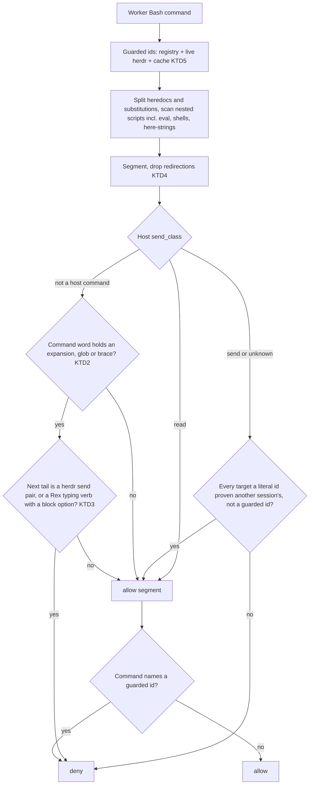

# Send-guard precision and live driver pane - Plan

## Goal Capsule

- **Objective:** A programme worker can run ordinary commands (browser checks, credential logins, `rex` session management, help and read commands) without a denial, while no session other than the person can still type into the PM's real pane, including after the PM's pane moved.
- **Means:** Narrow what the send-guard counts as a runtime-built host command, classify Rex verbs precisely, remove redirections before classification, and add the PM's live pane id from herdr to the guarded ids at check time (KTD2 to KTD6).
- **Authority:** This plan, then issue shawnroos/shrimpshack#146 ("auto: driver-pane guard denies harmless worker commands"), then the PM's confirmation of the moved-pane cause (2026-10-31).
- **Stop conditions:** Stop and report to the PM if any fix requires weakening the default-deny for a host send whose target cannot be resolved, or if a live-pane lookup cannot stay under the hook's time budget.
- **Execution profile:** Test-first. Every false positive below is first written as a failing `allowed` case. Every real block, including the bypass shapes found in review, is pinned as a `denied` case before the classifier changes.
- **Who ships:** This worker opens the PR on shawnroos/shrimpshack and reports it to the PM ("PM AI EDITOR"). It does not merge or publish.

---

## Product Contract

### Summary

The send-guard in `plugins/auto/lib/send_guard.py` should deny a worker's command only when it can reach the programme driver's pane. Today it also denies harmless commands, and it guards a pane id that herdr retired when the PM's pane moved. This plan fixes four false-positive shapes and the stale-pane hole, and adds tests for each one.

### Problem Frame

Workers in programme `prog-20261029-122819-86a88d` lose time to denials on commands that never touch a terminal host. Headless browser checks are part of the definition of done for UI work, so blocking `agent-browser eval` blocks acceptance recordings. Workers then rewrite JavaScript without arrow functions or hide commands in script files, which also hides the real command from review.

The guard also protects the wrong pane. The PM (session `7d9664d0`) started in herdr pane `w2:p9T`, then moved with `herdr pane move`, and herdr gave the pane the new id `w2:pAG`. The registry still records `w2:p9T` from the start-time `HERDR_PANE_ID`. As a result, a worker's `herdr pane send-text w2:pAG …` passes as "a pane another session ran in", because other sessions have registry rows in `w2:pAG`. That is a hole in the guard, not only a wrong name in its messages.

Reproduced on auto 0.16.11 against the live registry. Each of these was denied:

| Command shape | Verdict reported | Cause in code |
|---|---|---|
| `agent-browser eval '… a => a.click()'` | runtime-built command | `eval` opens a nested script even as an argument. Inside it, a token holding `>` or `(` counts as a runtime-built command word, and the Rex classifier calls any tail a send |
| `EMAIL=$(grep … ~/.secrets …); agent-browser fill …` | runtime-built command | The assignment token `EMAIL=$` counts as a runtime-built command word. Its tail starts with `(`, which is not a list break |
| `rex session rename "$REX_SESSION" label` | send … cannot prove | Rex `send_class` returns `send` for every verb that is not a read, and `rename` is not a read sub-verb |
| `rex --help 2>&1 \| head` | send … cannot prove | The lexer splits `2>&1` into `2`, `>&`, `1`, and the guard reads `2` as the Rex verb |
| `cat $R/file` after `R=…;`, `grep -nE '…'`, a read-only `python3 -c` with `$(…)` | runtime-built command | Same runtime-word path, exact token to be confirmed in U1 |

### Requirements

**Precision (false positives)**
- R1. A command whose only host-like text is inside a quoted argument of a non-host program (for example JavaScript `=>`, `>=`, `(`) is allowed.
- R2. A variable or command substitution that does not become a host command word or a host target is allowed. This covers the `$(…)` credential pattern, `"$PY" script.py`, `"$UV" run pytest` and `"$GIT" checkout -b feat`.
- R3. Rex commands that cannot type into a block are allowed when they do not name the driver's block. This includes `session rename`, `window rename` and `block rename`.
- R4. Shell redirections (`2>&1`, `2>/dev/null`, `>/dev/null`, `<file`) are not read as host verbs or targets.

**Protection (no weakening)**
- R5. Every block that the current tests in `tests/unit/review-fixes-hosts.test.sh` and `tests/integration/programme-hooks.test.sh` assert stays a block. So does every shape that is denied today and that a send could hide behind: a shell behind a wrapper (`timeout`, `env -i`, `sudo -u`), a here-string, `eval` behind a brace group, a redirect or an assignment, and a host command word built from a glob or brace expansion.
- R6. A host send with a target that cannot be resolved stays denied for a session that is not the PM.

**Live driver pane**
- R7. After the PM's herdr pane moves, the guard protects the pane id herdr reports now, and the denial message names that id.
- R8. A worker's send to the PM's current pane id is denied even when other sessions have registry rows in that pane, and stays denied when a later herdr lookup fails.
- R9. When the live host cannot be read within the time budget, the guard still guards every id it knows for the driver.

### Scope Boundaries

- The guard keeps its default-deny posture for unknown verbs on a direct host call (`rex frobnicate`, `herdr agent frobnicate`).
- The PM's own allowances (`the PM keeps today's behaviour` tests) do not change.
- No change to how programmes take over or move leases. The lease is correct (PM confirmed). Only the pane id is stale.

#### Deferred to Follow-Up Work

- Rewriting the registry row when a pane moves (record-time repair in `HerdrHost.own_pane`). The check-time lookup in KTD5 closes the hole without it. A record-time fix would also correct the sweep's presence text, so file it as its own issue.
- Live-pane lookup for Rex and Ghostty drivers. Rex block ids and Ghostty terminal ids are not known to change on a move. Revisit if a move ever changes them.
- A PM on a different herdr server than the worker. The snapshot only reads the worker's own server, so such a driver keeps its registry and cached ids only.
- `_names_pane` matching the short forms of a driver id (a Rex block-id tail or a bare herdr pane suffix). This is a pre-existing gap and this plan does not widen it.
- The version bump. This repo bumps `plugins/auto/.claude-plugin/plugin.json` and `.claude-plugin/marketplace.json` in a separate `publish: auto X → Y` commit on main after merge. The next publish is 0.16.11 → 0.16.12. This worker does not publish.

---

## Planning Contract

### Key Technical Decisions

- KTD2. **A runtime-built command word holds an expansion, glob or brace character.** A command word counts as runtime-built only when it contains `$`, a backtick, `*`, `?`, `[`, `{` or `\`, the characters that let the shell produce a different word when it runs. `>`, `<`, `(`, `)`, `|`, `;`, `&`, `~` and `@` no longer count. The lexer already splits the shell operators among them, and `~` and `@` cannot turn a word into a host binary (`~/bin/herdr` is already caught by its basename). A plain assignment (`NAME=value` or `NAME=$(…)`) is a prefix, not a command word, and the word after it is the command word. Governs R1, R2, R5.
- KTD3. **The runtime-word probe reads one tail and needs an unmistakable send.** The probe reads the words that directly follow the runtime command word. When that word opens a `$( … )` or backtick group, the tail starts after the group closes. The probe no longer tries every later suffix. A tail counts as a send only when it is a herdr `SEND_VERBS` pair or `agent start`, or a Rex typing verb (`send`, `send-key`, `run`, `split`, `api call`) that carries a block option (`-b`, `--block`, `--block=`). Direct host calls keep today's rule: Rex `send_class` returns `send` for those typing verbs, `read` for reads, and `unknown` for everything else, and the guard denies `unknown`. The rejected alternative, denying every runtime command word, is what produces today's false positives. Residual risk: `$R send go` with no block option passes the probe. Without a block option, Rex types into the caller's own block, so it cannot reach the PM. Governs R2, R3, R5.
- KTD4. **Redirections are removed before host classification.** Segment building drops each redirection operator together with its file-descriptor digit and its operand: `N>`, `N>>`, `N>&M`, `N<`, `&>`, `>`, `>>`, `<`, `<>`. The lexer splits `2>&1` into `2`, `>&`, `1`, so the digit must go as well, or it stays as a verb. `_tty_write` keeps reading the raw text, so tty-write detection does not change. Governs R4, R5.
- KTD5. **The guard adds the driver's live and last-seen pane ids at check time.** For a herdr driver on the worker's own herdr server, the guard reads one `herdr api snapshot` through `host_named("herdr")`, not through the caller's own host. It uses a new helper with a 1 s timeout, one call per hook invocation, shared across drivers. It finds the pane where herdr reports the driver's session, falling back to the registry `terminal_id`, with the matching rules of `HerdrHost.presence`. On success it adds the live `pane_id` and `terminal_id` to the driver's guarded ids and writes them to a small per-lease cache. On timeout, error or a malformed snapshot, it uses the registry ids plus the cached ids, so a pane the guard has seen once stays guarded (R8). The live id is the one named in the denial and the journal row, and `_proven_other` subtracts every guarded id. PM direction, 2026-10-31: resolve the pane from live herdr at check time, not from the start-time environment. Governs R7, R8, R9.
- KTD6. **Rex `rename` is a manage verb, classified as read.** Add `rename` to `READ_SUBVERBS` in `plugins/auto/lib/host_rex.py`. A rename changes a label and cannot type into a block. A rename that names the driver's block is still denied by the existing rule that a worker may not name the driver's pane in any command. Governs R3.

`eval`, shell binaries and `<<<` keep opening a nested script wherever they appear. Gating them on command position would let `timeout 5 bash -c`, `env -i bash -c`, `{ eval …; }` and every here-string through. KTD2 and KTD3 already remove the `agent-browser eval` false positive.

### High-Level Technical Design

How a worker's command is judged after this change. The changed points are KTD2 to KTD5.

### Assumptions

- The PM's pane-move account is accurate: herdr reports the PM session in `w2:pAG` while the env var still holds `w2:p9T`.
- A `herdr api snapshot` call completes well under 1 s on this machine. U4 measures it, and KTD5 falls back to the registry and cached ids when it does not.
- Rex's typing verbs are `send`, `send-key`, `run`, `split` and `api call`, as the existing tests assume. This session cannot run `rex --help`, because the guard blocks it. U3 confirms the verb list from a session the guard allows, or from Rex's own documentation.

### Sources

- `plugins/auto/lib/send_guard.py`: `_scan`, `_unproven`, `_is_command_word`, `_lex`, `_names_pane`, `_proven_other`, `denial`.
- `plugins/auto/lib/host_rex.py`: `send_class`, `READ_SUBVERBS`, `_verb_words`.
- `plugins/auto/lib/host_herdr.py`: `presence` (finds the hosting pane by reported session and by `terminal_id`), `SEND_VERBS`, `list_panes` (two calls at 5 s each, too slow for the hook), `own_pane` (has a comment saying a moved pane keeps a stale `HERDR_PANE_ID`).
- `plugins/auto/lib/programme_sources.py`: `read_herdr` uses the caller's own host, so the guard cannot reuse it.
- `plugins/auto/lib/session_registry.py`: `driver_panes`, `known_panes`.
- `plugins/auto/.claude/hooks/hooks.json`: the action hook's timeout is 10 s, and a hook error fails open.

---

## Implementation Units

### U1. Pin the false positives and real blocks as tests

- **Goal:** Turn every command this session saw denied into a failing `allowed` case, and pin the real blocks and the bypass shapes the fix must keep denied.
- **Requirements:** R1 to R6.
- **Dependencies:** none.
- **Files:** `plugins/auto/tests/unit/send-guard-precision.test.sh` (new), reusing the `allowed`/`denied`/`row`/`programme`/`hook` helpers that `plugins/auto/tests/unit/review-fixes-hosts.test.sh` uses.
- **Approach:**
  1. Copy the denied commands from this session's transcript verbatim into the cases.
  2. For each one, record which token triggered the denial. The table in the Problem Frame lists the known causes, and the last row needs this step.
- **Execution note:** Start here. The `allowed` cases must fail on the current code, and the `denied` cases must pass on it, before any classifier changes.
- **Test scenarios:**
  - Allowed: `agent-browser eval 'document.querySelectorAll("a").forEach(a => a.click())'`.
  - Allowed: `agent-browser eval 'window.x >= 3 && f(1)'`.
  - Allowed: `EMAIL=$(grep SLATE_STAGE_USER_EMAIL ~/.secrets | cut -d= -f2); agent-browser fill @e1 "$EMAIL"`.
  - Allowed: `"$PY" "$SKILL_DIR/scripts/x.py"`, `PY=python3; "$PY" -c 'print(1)'`, `"$UV" run pytest`, `"$GIT" checkout -b feat`.
  - Allowed: `rex session rename "$REX_SESSION" auto-hook-146`, `rex window rename w1 x`.
  - Allowed: `rex --help 2>&1 | head -60`, `herdr pane list 2>/dev/null`.
  - Allowed: `R=/tmp/x; cat $R/a.md`, `grep -nE '^\s*(rex|send)' file`.
  - Denied (pins): `herdr pane send-text <driver-pane> hi`, `herdr agent prompt $P go`, `$H agent prompt w2:p77 go`, `$(command -v herdr) agent prompt w2:p77 go`, `$R send -b rex-blk-O1 go`, `rex frobnicate`, `rex send go`, `herdr pane send-text w2:p77 hi > /dev/null`, `echo hi 2>&1 > /dev/ttys016`.
  - Denied (bypass shapes from review): `timeout 5 bash -c '$H agent prompt w2:p77 go'`, `env -i bash -c '…'`, `sudo -u me bash -c '…'`, `bash <<< '$H agent prompt w2:p77 go'`, `x=$(true); eval "$H agent prompt w2:p77 go"`, `{ eval "$H agent prompt w2:p77 go"; }`, `>/dev/null eval "$H agent prompt w2:p77 go"`, `/usr/local/bin/herd? agent prompt w2:p77 go`, `{herdr,} agent prompt w2:p77 go`.
- **Verification:** The new file runs under `bash plugins/auto/tests/run.sh unit`. Its `allowed` cases fail and its `denied` cases pass on the unchanged code.

### U2. Narrow the runtime-word test, probe one tail, and remove redirections

- **Goal:** Make `_unproven` and segment building follow KTD2, KTD3 and KTD4.
- **Requirements:** R1, R2, R4, R5, R6.
- **Dependencies:** U1.
- **Files:** `plugins/auto/lib/send_guard.py`, `plugins/auto/tests/unit/send-guard-precision.test.sh`.
- **Approach:**
  1. Replace the `_RUNTIME.search(tokens[start])` command-word test in `_unproven` with the KTD2 character set. Keep `_RUNTIME` for target checks, where it is correct.
  2. Treat an assignment-only token as a prefix, so the word after it is the command word.
  3. Replace the every-suffix probe with the KTD3 single tail, starting after a closed `$( … )` or backtick group. Count a send only on the KTD3 shapes.
  4. Remove redirection operators, their descriptor digits and their operands when building a segment for host classification (KTD4). Leave `_tty_write` on the raw text.
  5. Leave the `eval`, shell-binary and `<<<` openers in `_scan` unchanged.
- **Patterns to follow:** `_is_command_word` and `_COMMAND_PREFIX` already model command position. Reuse them instead of adding a second notion of it.
- **Test scenarios:** The U1 cases for R1, R2 and R4 now pass. Every `denied` pin and bypass shape still passes. The hostile-input test in `review-fixes-hosts.test.sh` ("odd and hostile command text … without an exception") still passes.
- **Verification:** `review-fixes-hosts.test.sh`, `programme-hooks.test.sh` and `send-guard-precision.test.sh` are all green.

### U3. Rex verb classes

- **Goal:** Rex `send_class` returns `send` only for typing verbs, `unknown` for unlisted verbs, and `read` for reads and renames (KTD3, KTD6).
- **Requirements:** R3, R5.
- **Dependencies:** U1. U2 and U3 both add tests to the same new file, so run them in sequence in one worktree.
- **Files:** `plugins/auto/lib/host_rex.py`, `plugins/auto/tests/unit/host-rex.test.sh`, `plugins/auto/tests/unit/send-guard-precision.test.sh`.
- **Approach:**
  1. Add a `SEND_VERBS` set in `plugins/auto/lib/host_rex.py`. Return `send` for those verbs.
  2. Return `unknown` for every other verb that is not a read.
  3. Add `rename` to `READ_SUBVERBS`.
  4. Expose whether the call carries a block option, so the KTD3 probe can require one.
  5. Confirm the typing-verb list against Rex's own help text from a session the guard allows. If that cannot be done, record it as a deferred check in the PR body.
- **Test scenarios:**
  - `rex session rename "$REX_SESSION" x` → allowed.
  - `rex block rename <driver-block> x` → denied, because the command names the driver's block.
  - `rex frobnicate` → denied (unknown verb on a direct call).
  - `$R frobnicate -b rex-blk-O1` → allowed (unknown verb behind a runtime word).
  - `$R send -b rex-blk-O1 go` → denied.
  - `rex send -b rex-blk-X9 go` → denied.
  - Every existing Rex case in `review-fixes-hosts.test.sh` keeps its verdict.
- **Verification:** `host-rex.test.sh` and the Rex section of `review-fixes-hosts.test.sh` are green.

### U4. Live driver pane at check time

- **Goal:** The guard protects the herdr pane the PM is in now, and keeps protecting it when herdr cannot be read (KTD5).
- **Requirements:** R7, R8, R9.
- **Dependencies:** none in code. Run it after U2, because both edit `send_guard.py`.
- **Files:** `plugins/auto/lib/send_guard.py`, `plugins/auto/lib/host_herdr.py` (bounded single-snapshot helper), `plugins/auto/tests/unit/send-guard-precision.test.sh`, `plugins/auto/tests/helpers/host-fakes.sh` (fake herdr snapshot).
- **Approach:**
  1. Add a herdr helper that runs one `api snapshot` with a 1 s timeout and returns the snapshot or nothing.
  2. In `denial`, call it once, only when a herdr driver on the worker's own server exists.
  3. Match each herdr driver's hosting pane with the `HerdrHost.presence` rules.
  4. Add the live ids to the driver's guarded ids and write them to the per-lease cache. Read the cache on every call.
  5. Use the live pane id in the denial reason and the journal row.
  6. Make `_proven_other` subtract every guarded id.
  7. Catch every error from the snapshot path, so a failure means "no live ids", never a hook exception that fails open.
  8. Make the hook test helpers put a fake `herdr` first on `PATH`, so no existing suite reaches the real herdr server.
- **Execution note:** Measure the snapshot call's wall time in the hook once on this machine and record the number in the PR body.
- **Test scenarios:**
  - Moved pane. The registry row for the PM says `w2:p9T`, and the fake herdr snapshot reports the PM session in `w2:pAG`. A worker's `herdr pane send-text w2:pAG hi` → denied. The message names `w2:pAG`.
  - Moved pane, peer row. Another session has a registry row in `w2:pAG`. The same send → still denied.
  - Moved pane, old id. `herdr pane send-text w2:p9T hi` → denied.
  - Cache after failure. One call sees `w2:pAG` live. The next call's snapshot fails. `herdr pane send-text w2:pAG hi` → still denied.
  - Malformed snapshot. The fake returns invalid JSON or the wrong shape → no exception, registry and cached ids still denied.
  - Herdr hangs past the timeout → the hook returns inside its budget with the fallback ids guarded.
  - A worker's send to a real peer pane `w2:p77` → allowed while the live lookup runs.
  - The PM's own session sending to a worker pane → allowed (no regression).
- **Verification:** The moved-pane cases pass. The full `bash plugins/auto/tests/run.sh all` is green with no call to the real herdr.

### U5. PR

- **Goal:** Open the PR and report it to the PM.
- **Requirements:** all.
- **Dependencies:** U1 to U4, then `ce-code-review` clean.
- **Files:** none beyond the above. The version is not bumped (Scope Boundaries).
- **Approach:** The PR body names issue #146, the four false-positive shapes, the stale-pane hole, the snapshot timing, and the deferred items. Stage files by name.
- **Test expectation:** none. This is a release step.
- **Verification:** The PR is open on shawnroos/shrimpshack, its CI state is read, and the PM has the link.

---

## Verification Contract

| Gate | Command | Proves |
|---|---|---|
| Unit suite | `bash plugins/auto/tests/run.sh unit` | U1 to U4 classifier and live-pane cases |
| Integration suite | `bash plugins/auto/tests/run.sh integration` | Hook wiring through `on-pretooluse-action.py` |
| Full suite | `bash plugins/auto/tests/run.sh all` | No regression, `$HOME` isolation intact |
| Lint | `lint-router` on changed files | Repo lint routing for Python and shell |
| Live probe | Run the scratch probe from this session against the worktree `lib/` | The original denied commands are allowed against the live registry, and a send to `w2:pAG` is denied |

Run long suites through `~/.claude/tools/honest-run/run.sh` and read its verdict line.

## Definition of Done

- Every `allowed` case in U1 passes, and every `denied` pin and bypass shape passes.
- The moved-pane, cache and malformed-snapshot cases in U4 pass.
- The full auto test suite passes.
- `ce-code-review` has no P0, P1 or P2 findings left.
- The live probe confirms the fix against the real registry.
- Abandoned-attempt code is removed from the diff, and comments are why-only.
- The PR is open and the PM has its link. Nothing is merged or published.
