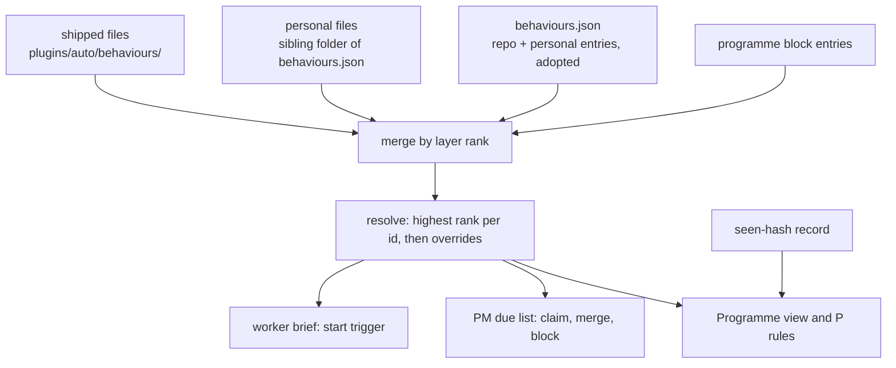
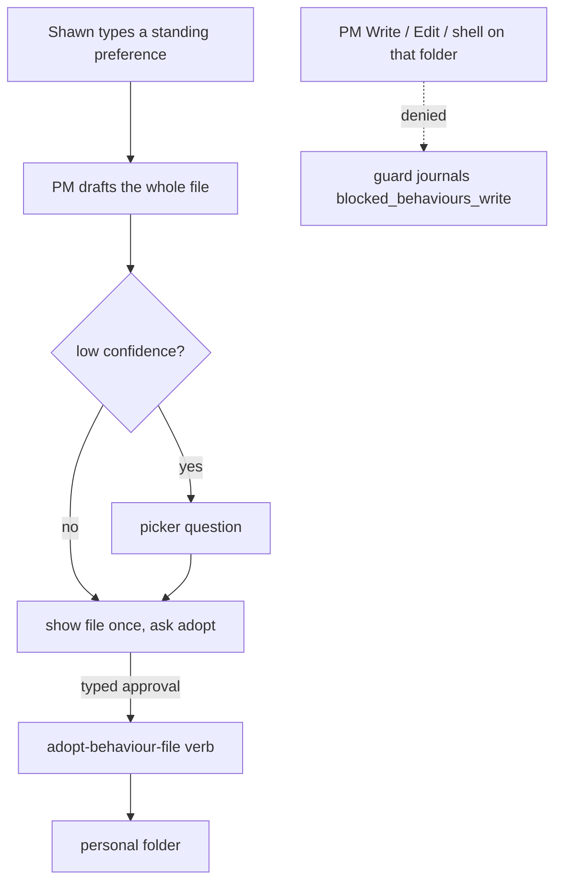

# Default Behaviour Files - Plan

**Target repo:** shrimpshack, plugin `plugins/auto`. All paths below are repo-relative.

## Goal Capsule

- **Objective:** Shawn can read, change or replace the standing rules the PM and workers follow by editing a text file, and the next PM ask shows a PM-rule change and the next worker start shows a worker-rule change, with no code change and no restart.
- **Means:** Behaviours become one markdown file each, loaded as an extra layer under the existing ones (KTD1).
- **Authority:** The Product Contract wins on product behaviour. The KTDs win on mechanism. Shawn's typed words alone change Shawn's behaviours.
- **Stop conditions:** Stop and report if a shipped default would need to name a protected escalation, if a unit cannot keep an old rule working exactly as before, or if, after rebasing onto a merged sweep-rework branch, the lines this plan edits in `plugins/auto/lib/programme_behaviours.py`, `plugins/auto/lib/programme_view.py` or the programme-sweep skill cannot be reconciled without changing this plan's design. A clean rebase with passing tests continues.
- **Finishes and ships:** The executor implements, verifies and opens a pull request. Shawn merges.

---

## Product Contract

### Summary

The plugin ships a default set of behaviours as markdown files. Shawn edits a copy in his personal folder, and his copy wins. The PM walks him through writing or changing one. Rules that protect data or a trust boundary stay in code. The first slice converts the one hard-coded rule that fits today's triggers and is not already code-enforced. Standing PM rules, and rules that need `before-merge` or `always`, convert after the sweep-rework branch merges.

### Problem Frame

Many rules the PM and workers follow live in skill text, prompt strings and hooks. Shawn cannot see, edit or replace them. He makes small changes to them often. Today each change is a code change.

### Key Decisions

- KD1. **One markdown file per behaviour.** Governs R1, R2. (session-settled: user-directed — chosen over named packs and over files grouped into packs: the single file is the edit unit and no grouping layer exists.)
- KD2. **Your copy wins, and an update to the shipped default is flagged.** Governs R5, R6. (session-settled: user-directed — chosen over silent updates and over in-place edit with three-way merge: nothing is overwritten silently.)
- KD3. **A rule with a code guard keeps both the guard and its explanatory sentence in code.** Governs R8. (session-settled: user-directed — chosen over converting the sentence while the guard stays, and over guards that read the file: safety never depends on a file.)
- KD4. **Only `before-merge` and a standing `always` are added as triggers, and they land after sweep-rework merges.** Governs R14. (session-settled: user-directed — chosen over the full event set and over only today's four triggers.) Other events become findings.
- KD5. **Shipped defaults count by install. Files in Shawn's personal folder count by location.** Governs R7. (session-settled: user-directed — chosen over typed-prompt adoption for every file and over per-file hashes: plain text-file editing must stay possible.)

### Requirements

**File layer**

- R1. A behaviour is one markdown file. The filename is its id. Frontmatter holds trigger, audience and checks. The body holds the do and don't guidance.
- R2. The plugin ships default files. Shawn's personal folder holds his own. Both load alongside the existing stored behaviours, which keep working unchanged.
- R3. Precedence from weakest to strongest is shipped, personal files, repo, programme. A file with the same id replaces the layer below it. The existing `overrides` field still replaces a rule under a different id.
- R4. A malformed file is skipped. The shipped default with the same id takes over. The PM tells Shawn once and names the file. One bad file never disables the others.

**Editing and updates**

- R5. Editing a shipped default copies it into the personal folder under the same id. The copy wins.
- R6. When a shipped default changes and Shawn holds a copy, the PM shows the difference once and records that it did. Shawn chooses keep mine, take theirs, or merge. Nothing is overwritten silently.

**Trust**

- R7. Programme agents cannot write the personal behaviours folder or the stored `behaviours.json` directly. A new file reaches the folder only through a verb that checks Shawn's typed approval. Shawn's own edits made outside a programme session are unaffected.
- R8. Rules that protect data or cross a trust boundary stay in code, with their explanatory sentences. A default file never names a protected escalation.
- R11. A shipped default never replaces a behaviour Shawn recorded: a stored repo, personal or programme entry with the same id wins and the file is reported as shadowed.

**Delivery**

- R9. A converted rule reaches its audience as the old sentence did. Worker rules arrive in the start brief. PM rules arrive through the due list.
- R10. The worker brief renders the `skills`, `formats` and `comms` fields.

**Visibility and guidance**

- R12. The Programme view and `P rules` show shipped defaults as ordinary rows labelled `shipped`, `yours (replaces shipped)`, or `update available`.
- R13. The PM offers a guided flow when Shawn types a standing preference or asks to change a default. After two corrections for the same thing it may suggest a behaviour, as a proposal only. It drafts the whole file, asks through the picker only at low confidence, shows the file once, and writes only after Shawn's typed approval. The same flow handles editing a default and update notices.

**First slice**

- R14. Slice 1 converts "record before any long background wait" (a `start` rule for workers). An old sentence is deleted only where its file is delivered and a test proves delivery. Slice 2 follows the sweep-rework merge and needs the new triggers.

### Acceptance Examples

- AE1. **Covers R1, R3, R9.** Given the shipped default "record before any long background wait", when Shawn copies it to his personal folder and changes one line, then the next worker started with a handoff brief shows the changed line, with no restart.
- AE2. **Covers R4.** Given a personal file with a misspelled key, when the PM next loads behaviours, then the shipped default with that id is in force and the PM names the broken file once.
- AE3. **Covers R6.** Given Shawn holds a copy and the plugin updates the shipped default, when the PM next sweeps, then it shows the difference once and offers keep, take or merge. A second sweep does not repeat it.
- AE4. **Covers R7.** Given a programme PM session, when it runs Write, Edit or a shell redirect on the personal folder or `behaviours.json`, then the call is denied and journalled.
- AE5. **Covers R11.** Given a stored personal entry and a personal file with the same id, then the stored entry is in force and the file is listed as shadowed.

### Scope Boundaries

**Deferred to Follow-Up Work**

- Slice 2 conversions that need the new triggers: "one owner, no empty messages" and tracker comment hygiene (standing PM rules; a `claim` trigger would add a due row per claimed item, capped at 20), reporting rules, pre-merge questions 1, 2, 3 and 5, the fault noise policy, the Next-line rule, and "never adopt an unstaffed issue by itself".
- The `before-merge` and `always` triggers (KD4), after the sweep-rework branch merges.
- Moving existing `behaviours.json` entries into files.
- Triggers for sweep start, resume, permission refusal, PR opened and composing an ask. These are findings only.
- The two-sessions message shape rule: its source text was not found in the repo (see Open Questions).

**Outside this work**

- Any change to the merge gate, `--pin`, proof rules, permission-denial and no-reroute rules, send-guard, destructive-action hook, preserve-before-cleanup, approval citing the typed prompt, or the `pgrep`/`ps` secrets rule.
- Editing the `feature/sweep-rework` branch.

### Open Questions

**Deferred**

- Where is the source text for the two-sessions message shape? The brief named it, but grep finds no match in `plugins/auto`. It joins slice 1 once Shawn supplies it.
- Does any board component need a behaviour row? `plugins/auto/mods` renders no behaviours today, and they reach the view only as text lines. This plan assumes no board change.

---

## Planning Contract

### Key Technical Decisions

- KTD1. **Files load through a separate loader, never into `behaviours.json`.** The loader lives in a new module and validates each file through the existing `verdict(entry, allow_adoption=False)`. The JSON schema gains no keys, so older plugin versions keep reading the store. Instantiates KD1.
- KTD2. **Layer rank decides precedence in `resolve`.** Today `resolve` concatenates programme, repo and personal candidates and relies on `overrides` alone. Add a rank (shipped 0, personal 1, repo 2, programme 3) and keep the highest-ranked entry per id, then apply `overrides`. Shipped entries carry layer `shipped`. Personal files carry layer `personal` and a `source` of `file`. Instantiates KD1; implements R3.
- KTD3. **A file entry's `at` is the file's modification time.** `timing()` returns remind-only when an entry has no `at` and no history, so without this file entries could never be sent back. Editing a file restarts its `since`, which keeps send-back honest. Risk: a git checkout touches mtime (see Risks).
- KTD4. **On an id collision between a personal file and a stored personal entry, the stored entry wins.** The file is rejected as `shadowed` with a notice. Implements R11.
- KTD5. **The write guard is a sibling module.** It reuses `scope()` from `plugins/auto/lib/programme_settings_guard.py` so it fires only for a programme driver or an owner of an unfinished item, and Shawn's own session passes. It matches Write, Edit, MultiEdit and Bash text against the personal folder and `behaviours.json`, journals a new kind `blocked_behaviours_write`, and wires into `plugins/auto/lib/on-pretooluse-action.py` beside the settings guard. It is best-effort, as the settings guard is. Instantiates KD5; implements R7.
- KTD6. **Writes reach the personal folder only through new verbs, each gated by Shawn's typed approval.** `adopt-behaviour-file` and `settle-default-update --as merge` compute the content hash of the validated entry, and require an approval keyed to that hash in the typed prompt's approved list, using the same semantics as `_verify_adoption` in `plugins/auto/lib/programme_protocol.py` and the driving-session check. A file whose content differs from what Shawn approved is refused, so a PM cannot show one draft and write another. `copy-default` and `settle-default-update --as keep|take` require a typed prompt from the driving session that names the behaviour id and, for settle, the chosen mode. `settle-default-update --as shown` records that the PM displayed a difference; it changes no content and needs no approval. The verbs write from inside Python, so the guard's text match does not block them. Each approved write journals `rule_adopted` with `how: file`. Instantiates KD5; implements R7.
- KTD7. **Update tracking uses a seen-hash record.** `behaviours-seen.json`, beside `behaviours.json`, maps each id to two hashes: `seen`, the shipped hash Shawn last settled, and `shown`, the shipped hash the PM last displayed. `copy-default` writes `seen`. `settle-default-update --as shown` writes `shown`; `keep`, `take` and `merge` write `seen`. The view's `update available` label reads `seen` against the current shipped hash and stays until settled. The PM raises the prompt only when `shown` differs from the current shipped hash, so a second sweep does not repeat it. The loader and view never write. A copy placed by hand has no record and gets no update notice; update notices cover copies made with `copy-default`. Instantiates KD2; implements R6.
- KTD8. **Frontmatter parsing is stdlib only.** Runtime Python is `/usr/bin/python3` and a YAML library is not guaranteed. The parser reads flat scalars, lists of strings, and `checks` as list items prefixed `pm:` or `agent:`. The accepted keys are `when` (required scalar, fills `when.text`), `trigger`, `applies_to`, `checks`, `overrides`, `skills`, `tools`, `agents`, `formats`, `comms`, `evidence`, `stop` and `why`. The body supplies `do` and `dont`. `examples` is not supported in files. Any other key rejects the file with `unknown_key`, matching `_check_extras`. For file-layer entries only, the loader also runs the protected-escalation scan over `formats` and `comms`, because U3 renders them into worker briefs and shipped and personal files carry no adoption hash. Implements R1, R4, R8.
- KTD9. **Slice 1 is one rule: "record before any long background wait".** The brief also named four others. "Debug blockers at runtime" is already enforced in code (`plugins/auto/protocol/defaults.json` `shared_blocker` requires `debugged`, and `plugins/auto/lib/on-stop.py` has `undebugged_blocker`), so a file would duplicate it. The two-sessions message shape has no source text. "One owner, no empty messages" and tracker comment hygiene are standing PM rules, not per-claim actions, so a `claim` file would add one due row per claimed item against the 20-row cap, and the existing code already treats untriggered PM rules as outside the due list; they wait for `always` in slice 2. Proceeding with one rule is workable; the narrowing is recorded here for Shawn. Implements R14.
- KTD12. **A shipped worker rule rides along only when a handoff brief exists.** `start-worker` refuses to start without `--handoff` whenever a behaviour is in force (`plugins/auto/lib/programme_sources.py`, in `_read_brief`), so a shipped rule that counted would break every plain call. Shipped entries are appended to the brief when a handoff is given and do not by themselves require one. Stored, personal-file, repo and programme behaviours keep their current effect. Implements R9, R2.
- KTD10. **Three new modules keep the size budget.** `plugins/auto/lib/programme_behaviours.py` is 948 of 1000 lines and `plugins/auto/lib/programme.py` is 967. New logic goes in `programme_behaviour_files.py`, `programme_behaviour_guard.py` and `programme_behaviour_file_verbs.py`. The existing modules take hook lines only.
- KTD11. **The view change is text only.** `behaviours_view` and `_behaviour_text` in `plugins/auto/lib/programme_view.py` gain the new labels. `plugins/auto/mods` gets no change. Implements R12.

### High-Level Technical Design

Directional sketch of the load order, not an implementation.

Write path:

### Assumptions

- The personal folder is `behaviours/`, a sibling of `behaviours.json` under `~/.claude/shared/auto/`, with an env override `CLAUDE_AUTO_BEHAVIOURS_DIR` for tests. The research found this directory holds only `behaviours.json` and `protocol.json` today.
- The shipped folder is `plugins/auto/behaviours/`, with an env override `CLAUDE_AUTO_SHIPPED_BEHAVIOURS_DIR` that tests point at an empty directory so the existing suites run with both folders empty.
- A file's `applies_to` defaults to `both` only when absent. `trigger` defaults to `claim`, as in the existing schema.

### Risks and Dependencies

- **Sweep-rework collision.** The unmerged `feature/sweep-rework` branch adds `domain` to `TRIGGERS` in `plugins/auto/lib/programme_behaviours.py:47`, edits `plugins/auto/lib/programme_view.py` near the model and `rows()`, and edits the behaviour table in `plugins/auto/skills/programme-sweep/SKILL.md`. Our hooks are small and adjacent, so a textual merge is likely. Rebase after it merges and re-run the tests. Do not edit that branch.
- **mtime drift.** A git checkout or plugin reinstall changes file mtime and restarts `since` for shipped files. The effect is later send-back, never a wrong one. Accepted.
- **Best-effort guard.** An evasive shell command can bypass the text match. Shawn accepted this under KD5.
- **Frontmatter is a new parser.** A bug could mis-read a rule silently. Mitigation: round-trip tests per shipped file.

---

## Implementation Units

| U-ID | Title | Key files | Depends on |
|---|---|---|---|
| U1 | File format and loader | `plugins/auto/lib/programme_behaviour_files.py` | none |
| U2 | Merge and precedence in resolve | `plugins/auto/lib/programme_behaviours.py` | U1 |
| U3 | Delivery parity | `plugins/auto/lib/programme_behaviours.py`, `plugins/auto/lib/programme_sources.py` | U2 |
| U4 | Write guard | `plugins/auto/lib/programme_behaviour_guard.py` | none |
| U5 | Adopt, copy and update verbs | `plugins/auto/lib/programme_behaviour_file_verbs.py` | U1, U4 |
| U6 | View labels | `plugins/auto/lib/programme_view.py` | U2, U5 |
| U7 | Slice-1 default file | `plugins/auto/behaviours/record-before-long-wait.md` | U2, U3 |
| U8 | PM guided flow and contract | `plugins/auto/skills/programme-sweep/references/behaviours.md` | U5, U6 |

### U1. File format and loader

- **Goal:** Read shipped and personal behaviour files into validated entries, and report bad files.
- **Requirements:** R1, R2, R4, R8.
- **Dependencies:** none.
- **Files:** create `plugins/auto/lib/programme_behaviour_files.py`; create `plugins/auto/tests/unit/programme-behaviour-files.test.sh`.
- **Approach:**
  1. Resolve the shipped folder from the plugin root and the personal folder from `CLAUDE_AUTO_BEHAVIOURS_DIR`, else the sibling of the store path (KTD8 parser, Assumptions).
  2. Parse frontmatter with the stdlib parser and take the body as the do/dont text, split by `Do:` and `Don't:` headings.
  3. Build each entry with layer, `source: file`, and `at` from mtime (KTD3), then validate through `verdict(entry, allow_adoption=False)`.
  4. Return entries plus `rejected` rows `{id, layer, reason}` using the existing reason names.
- **Patterns to follow:** `_stored_reason` and `_admit` in `plugins/auto/lib/programme_behaviours.py` for rejection shape.
- **Test scenarios:**
  - Happy path: a file with frontmatter `trigger: start`, `applies_to: workers` and a body with Do and Don't loads as an entry whose `do` and `dont` match the body.
  - Edge case: a file with no `trigger` loads with trigger `claim`.
  - Edge case: an empty personal folder, and a missing personal folder, both load with no error.
  - Error path: an unknown key rejects that file with `unknown_key`; a second valid file in the same folder still loads.
  - Error path: a `do` line naming a protected escalation (production deploy) rejects with `protected_escalation`.
  - Error path: a `comms` or `formats` line naming a protected escalation rejects a file-layer entry with `protected_escalation`.
  - Error path: a file with no `when:` key rejects with `missing_field`; a file using `examples` rejects with `unknown_key`.
  - Error path: a file whose name is not a valid id rejects with the id-pattern reason.
  - Integration: loading every file in `plugins/auto/behaviours/` returns zero rejections.
- **Verification:** The loader returns the same entry for a file as `verdict` accepts for the equivalent dict, and a bad file never raises.

### U2. Merge and precedence in resolve

- **Goal:** Put file entries into `resolve` with layer-rank precedence, without changing behaviour for existing entries.
- **Requirements:** R2, R3, R11.
- **Dependencies:** U1.
- **Files:** modify `plugins/auto/lib/programme_behaviours.py` (hook lines in `load_store` and `resolve`); add `shipped` to `LAYERS`; modify `plugins/auto/tests/unit/programme-behaviours.test.sh`.
- **Approach:**
  1. In `load_store`, attach loader output under new keys, and add loader rejections to `rejected` and notices.
  2. In `resolve`, build candidates in rank order, keep the highest-ranked entry per id (KTD2), then apply `overrides`, then audience filtering as today.
  3. Reject a personal file whose id matches a stored personal entry as `shadowed` (KTD4).
  4. Keep the added lines under the file's remaining 52-line headroom, moving any helper into `programme_behaviour_files.py`.
- **Execution note:** Add characterization tests that pin current `resolve` output for programme, repo and personal entries before changing it.
- **Test scenarios:**
  - Covers AE1. A personal file with the same id as a shipped file is in force and the shipped one is not.
  - A repo entry with the same id as a personal file wins over it.
  - A programme entry with the same id wins over all.
  - Covers AE5. A stored personal entry and a personal file with one id leave the stored entry in force and list the file as `shadowed`.
  - `overrides` naming a shipped id from a personal file removes the shipped entry.
  - With both folders empty (shipped override set), existing behaviours produce byte-identical `in_force` output to the pre-change run.
  - Covers AE2. A broken personal file yields the shipped default plus one notice naming the file.
- **Verification:** The whole existing `programme-behaviours.test.sh` passes unchanged, and `tests/unit/size-budget.test.sh` passes.

### U3. Delivery parity

- **Goal:** Make file entries reach workers and the PM the way stored entries do, and render the three fields the worker brief drops.
- **Requirements:** R9, R10.
- **Dependencies:** U2.
- **Files:** modify `plugins/auto/lib/programme_behaviours.py` (`_short`, `brief_lines`); verify `plugins/auto/lib/programme_behaviours_due.py` and `plugins/auto/lib/programme_sources.py`; modify `plugins/auto/tests/unit/programme-behaviours-due.test.sh` and `plugins/auto/tests/unit/programme-sources.test.sh`.
- **Approach:**
  1. Extend `_short` to append `skills`, `formats` and `comms` when present.
  2. Confirm `due` and `brief_entries` need no change because both read `in_force`; if a path reads the store directly, route it through `resolve`.
  3. Confirm `timing()` returns `send_back` for a file entry with an mtime earlier than the trigger.
  4. Apply KTD12 in `plugins/auto/lib/programme_sources.py`: shipped entries join the brief only when a handoff exists and do not make a handoff mandatory.
- **Test scenarios:**
  - A start-trigger worker file appears in the `start-worker` brief block when `--handoff` is given.
  - A plain `start-worker` call with no `--handoff` still starts when the only behaviour in force is a shipped one; a personal-file or stored behaviour in force still requires `--handoff`.
  - A fixture claim-trigger PM file appears in `behaviours_due` after the first claim and clears after `skip-behaviour --applied`.
  - A file entry created before its trigger times as `send_back`; one created after times as `remind_only`.
  - A file with `skills: [slate-editor-testing]` renders that skill in the brief line.
  - A PM-check-only file joins the worker brief only when named with `--behaviour`.
- **Verification:** The slice-1 file from U7 is briefed in the tests, and PM-side file delivery is proved with fixture files, which is the delivery proof R14 needs.

### U4. Write guard

- **Goal:** Deny programme agents direct writes to the personal behaviours folder and `behaviours.json`.
- **Requirements:** R7.
- **Dependencies:** none.
- **Files:** create `plugins/auto/lib/programme_behaviour_guard.py`; modify `plugins/auto/lib/on-pretooluse-action.py` (wire beside the settings guard), `plugins/auto/lib/programme_journal.py` (kind list), `plugins/auto/lib/programme_view.py` (`HOOK_KINDS`), `plugins/auto/.claude/hooks/hooks.json` (description), `plugins/auto/tests/unit/import-topology.test.sh`, `plugins/auto/tests/integration/programme-hooks.test.sh`, `plugins/auto/docs/contracts/agent-tool-surface.md` (guard paragraph), `plugins/auto/docs/contracts/run-record-schema.md` (journal kind `blocked_behaviours_write` and payload), `plugins/auto/docs/contracts/programme-permission-proposals.md` if it lists guarded hooks. The doc-fence tests bind these contracts to code, so the edits land in this unit.
- **Approach:**
  1. Reuse `scope()` so only a driver session or an unfinished-item owner is guarded.
  2. Resolve the folder and store paths at call time, case-folded and real-pathed as `_target` does.
  3. Add the cheap pre-filter on `behaviours` in the tool input before any file reads.
  4. Journal `blocked_behaviours_write` with tool, path and item ids.
- **Patterns to follow:** `plugins/auto/lib/programme_settings_guard.py` and its integration cases at `plugins/auto/tests/integration/programme-hooks.test.sh` lines 625 to 810.
- **Test scenarios:**
  - Covers AE4. Edit, MultiEdit and Write by a driver session on the personal folder and on `behaviours.json` are denied and journalled.
  - A Bash `echo >` and `tee` to the same targets are denied.
  - A case variant of the path is denied.
  - A session that drives no programme and owns no item is allowed.
  - A write to an unrelated file and to a `behaviours.json.bak`-style neighbour is allowed.
  - A malformed hook payload fails open with exit 0.
- **Verification:** The new journal kind passes the journal allow-list and the import-topology test.

### U5. Adopt, copy and update verbs

- **Goal:** Give the PM sanctioned ways to write a personal file, copy a default and settle an update.
- **Requirements:** R5, R6, R7.
- **Dependencies:** U1, U4.
- **Files:** create `plugins/auto/lib/programme_behaviour_file_verbs.py`; modify `plugins/auto/lib/programme.py` (one registration line near 908); modify `plugins/auto/lib/programme_fixes.py` (a `FIXES` entry per new verb, using the typed-approval text); modify `plugins/auto/tests/unit/programme-verbs.test.sh` (verb list, line 97); modify `plugins/auto/docs/contracts/agent-tool-surface.md` (the three verb entries, which `doc-fence-agent-tool-surface.test.sh` requires); create `plugins/auto/tests/unit/programme-behaviour-file-verbs.test.sh`.
- **Approach:** (the approval rules are KTD6, the seen record is KTD7)
  1. `adopt-behaviour-file`: take the drafted file content and `--prompt <id>`, validate through U1, compute the content hash, verify the approval keyed to it, then write under a lock with a temp file and rename.
  2. `copy-default`: verify a typed prompt naming the behaviour, copy a shipped file into the personal folder, and write `seen` in `behaviours-seen.json`.
  3. `settle-default-update <id> --as shown|keep|take|merge`: `shown` records the displayed hash with no approval; `keep` writes `seen`; `take` removes the personal file; `merge` writes content under the same hash-keyed approval as adopt. `keep`, `take` and `merge` need a typed prompt naming the id and mode.
  4. Journal each approved write as `rule_adopted` with `how: file`.
- **Test scenarios:**
  - `adopt-behaviour-file` with a prompt that does not name the behaviour refuses and writes nothing.
  - Approve draft A, call the verb with draft B: refused and nothing written.
  - A file that fails validation is refused and not written.
  - Two concurrent adopts for different ids both land; for the same id the second is refused.
  - `copy-default` without a naming prompt refuses and writes nothing; on an unknown id refuses; on a shipped id with a naming prompt writes the file and `seen`.
  - Covers AE3. After the shipped hash changes, the view shows `update available`; `--as shown` records `shown` and a second check does not re-raise the prompt while the label stays; `--as keep` with a naming prompt records `seen` and clears the label.
  - `take` without a matching prompt leaves the personal file in place; with one it removes the file and the shipped default is in force again.
  - `merge` with content that differs from the approved content is refused.
  - A file written by the verb loads cleanly through U1.
- **Verification:** The verb list test, the verb fix-table test and the size-budget test pass, and the guard test shows the verb's write is not denied.

### U6. View labels

- **Goal:** Show shipped and file-based behaviours, and the update flag, in the Programme view and `P rules`.
- **Requirements:** R12.
- **Dependencies:** U2, U5.
- **Files:** modify `plugins/auto/lib/programme_view.py` (`behaviours_view`, `_behaviour_row`, `_behaviour_text`); modify `plugins/auto/tests/unit/programme-view.test.sh`.
- **Approach:**
  1. Add shipped entries and personal-file entries to the rows `behaviours_view` builds.
  2. Label `shipped`; label a personal file that shadows a shipped id `yours (replaces shipped)`; add `update available` from the seen-hash record.
  3. Surface `shadowed` rows and loader notices through the existing `rejected_behaviours` and `behaviour_notices` paths.
- **Test scenarios:**
  - A shipped default shows layer `shipped` and in force.
  - A copied default shows `yours (replaces shipped)` and the shipped row shows overridden by it.
  - Covers AE3. A changed shipped hash adds `update available` to the copy's row.
  - A broken file appears under rejected behaviours with its file name.
  - With both folders empty, a programme renders exactly as before.
- **Verification:** Run `P rules` against a fixture programme and read the text rows; no board change is expected (KTD11).

### U7. Slice-1 default file

- **Goal:** Ship the one slice-1 rule and move its old sentence to where the file does not reach.
- **Requirements:** R9, R14.
- **Dependencies:** U2, U3.
- **Files:** create `plugins/auto/behaviours/record-before-long-wait.md`; modify `plugins/auto/skills/programme-sweep/SKILL.md` (the worker-clause list around line 377); create `plugins/auto/tests/unit/programme-default-behaviours.test.sh`.
- **Approach:**
  1. Write the file from the current sentence, same wording, with trigger `start` and audience workers (KTD9).
  2. Delete the sentence from the start-brief clause list only after the delivery test passes. `prompt-item` builds its tail without behaviours, so later prompts to a running worker lose the rule; keep one `prompt-item`-scoped line in the skill until a later slice delivers behaviours there.
- **Execution note:** Prove delivery first: write the test that asserts the file reaches the start brief, watch it pass, then delete the sentence.
- **Test scenarios:**
  - The start brief for a worker given `--handoff` contains the record-before-long-wait guidance.
  - The start-brief clause list no longer contains the sentence; the `prompt-item` line does.
  - The shipped file loads with zero rejections and contains no protected escalation.
  - Mutation check: remove the shipped file and confirm the delivery test fails.
- **Verification:** Old and new start-brief delivery produce the same guidance text, compared in the test.

### U8. PM guided flow and contract

- **Goal:** Teach the PM to guide Shawn through writing, editing and updating behaviours, and amend the format contract.
- **Requirements:** R13, R3, R7, R12.
- **Dependencies:** U5, U6.
- **Files:** modify `plugins/auto/skills/programme-sweep/references/behaviours.md`; modify `plugins/auto/skills/programme-sweep/SKILL.md` (verb table lines 168 to 190); modify `plugins/auto/docs/contracts/programme-behaviours-format.md` (sections 1, 3, 5, 6, 8, 9). The guard and verb contract entries land in U4 and U5.
- **Approach:**
  1. Write the guided flow as a rubric the PM follows: when to offer, how to draft the whole file, which low-confidence cases use the picker (scope layer, trigger), show once, adopt on typed approval.
  2. Add the edit-a-default flow and the update-notice flow with keep, take and merge.
  3. Add the new verbs to the SKILL table.
  4. Amend the contract: file layers and precedence, exemption from the adoption block for shipped and personal files with the reason, the file format, delivery timing from mtime, and the new rejection reasons.
- **Test scenarios:**
  - The sweep skill test asserts the new verbs appear in the verb table.
  - A doc-parity check passes for the amended contract files.
  - The reference states that nothing is written before a typed approval.
- **Verification:** Read the rubric against R13 line by line, and run the existing doc-fence tests.

---

## Sequencing and Parallelism

- U1 and U4 have no dependencies and can run in parallel, each in its own worktree.
- U2 follows U1. U5 follows U1 and U4.
- U3 and U6 follow U2 (U6 also needs U5) and can run in parallel.
- U7 follows U2 and U3. U8 follows U5 and U6.
- Shared files force a serial merge order for `plugins/auto/lib/programme_behaviours.py` (U2, U3) and `plugins/auto/lib/programme_view.py` (U4, U6): land U2 before U3, and U4 before U6.

---

## Verification Contract

| Gate | Command | Applies to |
|---|---|---|
| Unit suite | `bash plugins/auto/tests/run.sh unit` | all units |
| Integration suite | `bash plugins/auto/tests/run.sh integration` | U4 |
| Size budget | `bash plugins/auto/tests/unit/size-budget.test.sh` | U2, U5 |
| Long checks | Run through `~/.claude/tools/honest-run/run.sh` with `--expect` set to the marker the runner prints | all |
| Lint | `/lint-router:lint-router` | all |
| Comment bar | `~/.claude/tools/comment-bloat/run.sh` | all |
| Guard denial | A driver-session fixture's Write to the personal folder returns a deny | U4 |
| Mutation check | Delete one shipped file and one guard line; the matching test fails | U4, U7 |

## Definition of Done

- Every R has a unit and a passing test, and AE1 to AE5 each have a test.
- The existing behaviour tests pass unchanged with both folders empty (shipped override set), and a plain `start-worker` call still starts with only the shipped rule in force.
- The size-budget test passes with no new `ALLOWED_FILES` entry.
- The guard denies the listed writes, and Shawn's own session still edits the folder.
- The slice-1 sentence is gone from the start-brief clause list and the delivery test proves the file replaces it.
- Abandoned-attempt code and unused helpers are removed from the diff.
- Slice 2, the two new triggers, the narrowing of slice 1 to one rule, and the two-sessions rule are listed in the pull request as deferred, with the sweep-rework dependency named.
