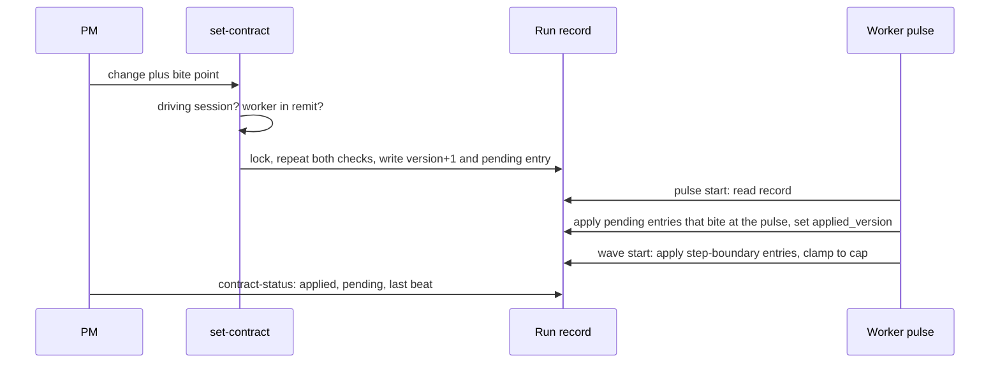
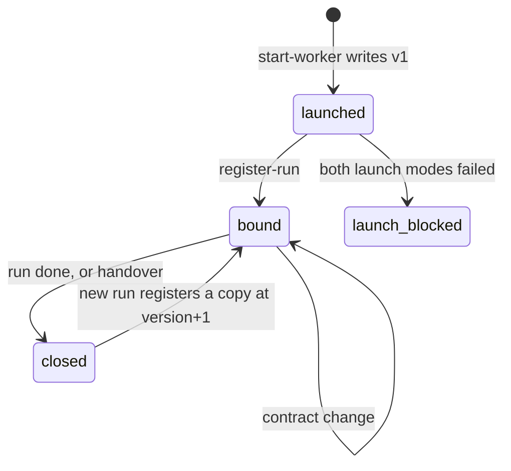
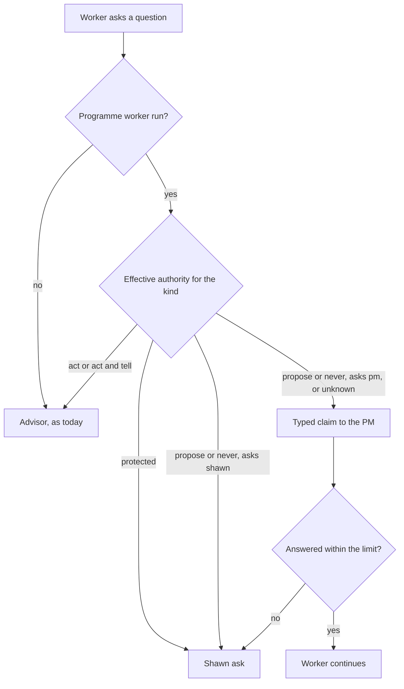

# PM-Set Contracts for Auto Workers - Plan

## Goal Capsule

- **Objective:** An Auto-run programme worker always knows what it may decide, what "done" means, how to work, and how wide it may fan out, and the PM can see and change all four without typing into the worker's pane.
- **Means:** A worker can start as an Auto run, and its run record carries a contract that only the PM writes. Auto changes to support this.
- **Product authority:** Shawn owns the product shape. The PM and workers choose technical details. Protected decision kinds stay with Shawn.
- **Open blockers:** None for product scope. Planning must first prove that a worker can start as an Auto run (see Outstanding Questions).

## Product Contract

### Summary

A worker can start as an Auto run with its own pulse and works to a contract the PM sets and updates. The contract holds authority per decision kind, a done bar, a workflow, and a fan-out cap. Auto grows what that needs: contract fields in the run record, a PM-only write path, a worker-side read on each pulse, and a start path that makes a worker an Auto run. For each change, the PM chooses whether it takes effect at the next pulse or the next step boundary. It is built in two slices: the contract first, then PM-generated goal docs and workflow design on top of it.

### Problem Frame

Today the PM shapes a worker only by typing text into its pane: the launch brief, `prompt-item`, and behaviour reminders. Workers learn what the PM owns, what they must ask, and what goes to Shawn from that text alone. The result fails in four ways: workers ask Shawn for decisions the PM owns, workers settle decisions that are Shawn's, workers ignore the PM's prompts, and workers do not know whom to ask.

Auto already has the parts of a contract: a workflow, an exit predicate, a pulse and a dispatcher. They sit inside one session and the programme never links to them. The programme item stores only the worker's session and pane. Programme hooks inject context into the PM's session only. A PM cannot read a worker's step state, set its done bar, or change what it may decide.

### Actors

- A1. The PM session: the only writer of a worker's contract.
- A2. A worker: an Auto run that reads its contract on each pulse and works to it.
- A3. Shawn: owns product shape and every protected decision kind.

### Key Decisions

- **Auto changes to serve the PM.** The run record, start path and hooks may change; Auto's core is not fixed. (session-settled: user-directed — chosen over keeping Auto's core fixed and wrapping it: Auto now exists in service of the PM.) Governs R5, R8, R9.
- **The contract lives in the Auto run, not in a separate PM record.** The run record is the contract. (session-settled: user-directed — chosen over a PM-side record the worker looks up, and over enforcement-first: the contract plus the worker's own pulse is how Auto already works.) Governs R1, R2, R3, R4, R12.
- **One plan, built in two slices.** Slice A is the contract, start path, version, PM-only write and progress read. Slice B is goal-doc and workflow generation, which sits on slice A. (session-settled: user-approved — chosen over one undivided build and over two separate plans: slice B depends on A's contract and on the `/goal` binding probe.) Governs R16, R17.
- **The contract follows the item across runs.** The run record stays the contract's only home; a handover copies it into the new run. (session-settled: user-approved — chosen over a contract that ends with the worker's run: the item outlives any one run.) Governs R18.
- **Whether the PM must ask Shawn first to amend a goal doc or change a workflow is set by the programme's Authority table.** Each of the two acts is a decision kind there, with the same act, act-and-tell and propose tiers as every other kind, and defaults to act-and-tell. (session-settled: user-directed — chosen over a blanket rule that the PM never needs approval and over Shawn approving each design: the programme contract already says when the PM needs permission and when it may act and tell.) Governs R16, R17.
- **The goal doc is the done bar rendered for the worker, a living file the PM amends in place.** A goal changes without being set and cleared. (session-settled: user-directed — chosen over a new goal doc bound for each change: iterating on a goal must not need set and unset.) Governs R16.
- **The contract carries four parts in v1:** authority, done bar, workflow, fan-out cap. (session-settled: user-directed — all four chosen when offered as a set.) Governs R1, R2, R3, R4.
- **The PM chooses, per change, whether it bites at the next pulse or the next step boundary.** (session-settled: user-directed — chosen over always-at-pulse, always-at-step, and worker-acknowledges-first.) Governs R9.
- **The success rule is zero protected-kind breaches and at most 2 out-of-authority decisions across the first 10 items.** (session-settled: user-approved — chosen over zero tolerance for any out-of-authority decision, and over measuring a baseline first.) Governs SC1.
- **The PM-only write guard is a refusal in the contract-write verb, limited to workers in the PM's remit.** (session-settled: user-directed — chosen over verb refusal plus tamper check and over tamper check only; the in-remit limit was added by the user.) Governs R8.
- **Authority is stated to the worker in v1; hooks do not yet block out-of-authority actions. The one hook change in v1 routes the worker's questions by authority (R21).** (session-settled: user-approved — enforcement was shown as the later follow-on; the user chose the contract-first direction.) Governs R1.
- **The worker keeps its own pulse.** The PM steers it only through contract changes and pause. (session-settled: user-approved — chosen over a PM-driven tick through herdr or rex and over a PM-set cadence in the contract: a PM tick types into the worker's pane, and `/loop` is the same wake-up mechanism the pulse already uses.) Governs R10, R13.

### Requirements

**Contract content**

Requirements R1 to R15, R18 to R21 are slice A. R16 and R17 are slice B, built after slice A.

- R1. A worker's contract states, per decision kind, whether the worker acts, acts and tells, proposes, or never decides, and who it asks when unsure. The PM can narrow authority freely and widen it only up to the programme's Authority table and active Rulings; a protected kind never moves.
- R2. The contract states a done bar, and that done bar is the worker's exit predicate.
- R3. The contract names the workflow the worker follows, such as plan, build, review, fix, or a variant like thermo-nuclear once. A workflow change replaces the run's remaining steps at a step boundary and keeps the same run and its history.
- R4. The contract sets a fan-out cap as a ceiling. The dispatcher clamps each wave to it. The programme's focus budget counts the PM's panes and points, and does not apply to a worker's own waves.

**Start and identity**

- R5. A programme can start a worker as an Auto run bound to a contract before its first step, read on its first pulse.
- R19. If the launch cannot make a worker run `/auto` as its first turn, v1 falls back once to a brief that tells the worker to run `/auto` as its first action. If that also fails, the PM pauses and returns the choice to Shawn.
- R6. The programme item records the Auto run id and the repo or worktree path that holds its run record, so the PM resolves the record from that pair without scanning panes or repos.
- R7. One item is one Auto run.
- R18. The contract belongs to the item. When the PM hands the item to another worker, the old run closes and the new run starts from a copy of the old run's contract with the version bumped.

**Writing and updating**

- R8. Only the PM session can write or change a worker's contract, and only for a worker whose session is in the programme's remit. Write authority follows the programme's current PM: handover or takeover moves it and revokes the former PM's. The contract-write verb refuses any other caller or target. Direct edits to the run-record file are outside v1 enforcement.
- R9. Each contract change carries a bite point chosen by the PM: next pulse or next step boundary. When the PM chooses none, narrowing authority binds at the next pulse and every other change at the next step boundary. The worker is bound by the change from that point on.
- R10. On each pulse, and again at each step boundary before the next step starts, the worker reads its current contract and works to it, whatever the host terminal.
- R21. For a programme worker run, a question the worker would put to a user is checked against the contract's authority. A "propose" or "never decides" question goes to the PM as a claim, not to the advisor that would answer it.
- R15. Each contract change gets a version. The worker records the version it has applied on each pulse, and the PM reads that version from the run record to confirm a change has landed.

**Reading progress**

- R11. The PM reads a worker's step state, exit predicate and last pulse from its run record. Pane scraping is not needed for Auto-run workers.

**Guards and compatibility**

- R12. A worker's claim is never evidence. The PM or a checker verifies the done bar against evidence outside the worker's run record, such as PR state and CI, before an item counts as done.
- R13. A sweep that finds no contract change and no new progress costs the PM no extra turn.
- R14. `/auto <plan>` run outside a programme works as it does today. Contract fields are optional and absent there.
- R20. An item with no contract and a hand-driven worker keep working as today, and `start-worker` is unchanged for them. Such an item has no contract-based authority, done or progress read.

**Goal docs and workflow design (slice B)**

- R16. The PM can generate a goal doc from a worker's done bar (R2) and its plan, and amend it in place afterwards, so a goal changes without being set and cleared. The goal doc states the same done condition as the exit predicate: no stricter criterion, and no step the agent cannot complete itself. The worker binds it once, at start. An amendment takes effect at the bite point R9 gives it, and a done-bar change amends the goal doc and the exit predicate together. Whether the PM must ask Shawn first, or may act and tell, to amend a goal doc is a decision kind in the programme's Authority table (default: act and tell). An amendment waiting on Shawn leaves the goal doc unchanged.
- R17. The PM can design a workflow for a worker from a plain-language description with the workflow design tool, and name it in the contract (R3). The tool validates the workflow before the contract may name it, and produces the matching goal doc (R16) in the same step. Changing a workflow follows the same Authority-table rule as R16, and a workflow cannot grant authority beyond the contract.

### Key Flows

- F1. Start a worker with a contract
  - **Trigger:** The PM starts a worker for an item.
  - **Actors:** A1, A2
  - **Steps:** The PM states the contract. The programme starts the worker as an Auto run bound to it and records the run on the item. The worker's first pulse reads the contract.
  - **Outcome:** The worker works to a contract from its first step, and the PM can read its progress.
  - **Covered by:** R1, R2, R3, R4, R5, R6, R10
- F2. Change a contract mid-run
  - **Trigger:** The PM narrows authority, raises the done bar, or changes the workflow.
  - **Actors:** A1, A2
  - **Steps:** The PM writes the change and picks its bite point. The worker reads it at the next pulse or step boundary and works to it.
  - **Outcome:** The change binds the worker at the chosen point, and the PM can confirm from the run record which contract the worker is under.
  - **Covered by:** R2, R3, R8, R9, R10, R11, R15, R16

### Acceptance Examples

- AE1. **Covers R9, R1.** Given a worker running a build step, when the PM narrows its authority on product scope and picks "next pulse", then the worker's next pulse reads the narrower contract before any further step.
- AE2. **Covers R9, R3.** Given a worker mid-step, when the PM changes the workflow and picks "next step boundary", then the worker finishes the current step and follows the new workflow from the next one.
- AE3. **Covers R12, R2.** Given a worker that claims its item is finished, or whose recorded verdicts show its exit predicate met, when the evidence outside its run record does not show the done bar met, then the item does not count as done.
- AE4. **Covers R8.** Given a worker or a subagent that calls the contract-write verb on its own contract, the call is refused and the contract is unchanged.
- AE8. **Covers R21, R1.** Given a worker under a contract that marks product scope as "never decides", when the worker would ask a user a product-scope question, then the question reaches the PM as a claim and the advisor does not answer it.
- AE7. **Covers R16.** Given a done bar that includes a step only a human can do, when the PM generates the goal doc, then generation refuses and names the step, because a goal containing it could never be met.
- AE6. **Covers R8.** Given the PM session that calls the contract-write verb for a worker whose session is outside the programme's remit, the call is refused and the contract is unchanged.
- AE5. **Covers R14.** Given a developer who runs `/auto <plan>` with no programme, the run behaves as it does today.
- AE9. **Covers R16.** Given an Authority table that marks goal-doc amendment "propose", when the PM amends a worker's goal doc, then the amendment waits for Shawn's answer and the goal doc stays as it was. Given the same table marking it "act and tell", the amendment lands in place and the PM's next report to Shawn names it.

### Success Criteria

- SC1. Across the first 10 items run under contracts, no worker settles a protected decision kind, and no more than 2 decisions in total are made outside a contract's authority. A protected-kind breach, or a third out-of-authority decision, starts the hook-enforcement follow-on. Counts come from the PM's decision log and sweep, not from worker claims.
- SC2. Across the same 10 items, the count of asks that reach Shawn for decisions the contract gives the PM is tracked and reported. It does not gate the follow-on.
- SC3. The PM reads each Auto-run worker's progress, done check and applied contract version without prompting its pane.

### Scope Boundaries

- Hook enforcement that blocks out-of-authority worker actions (question routing in R21 is the exception), and enforcement against direct edits of the run-record file. These are the follow-on; the worker-side read in R10 is where they would attach.
- Workers that are not Auto runs. A hand-driven pane worker has no contract.
- Redefining the Authority table or its protected kinds. v1 delivers them to workers and changes nothing in them, except that it adds two kinds for the PM's own acts: amending a goal doc and changing a workflow (R16, R17).
- A PM-driven tick, and a PM-set pulse cadence in the contract.
- One run covering several items.

### Dependencies / Assumptions

- Assumed: a worker can be started as an Auto run from its first turn. Unverified: the worker launcher takes only a brief file as the first turn, and whether a brief beginning with `/auto <plan>` runs as a command is untested.
- Assumed: one item is one Auto run (R7), and plain `/auto` stays unchanged (R14). The user confirmed the scope that carries both.
- Verified: no run-record verb or resume verb checks who is calling. The PM-only write in R8 is therefore new work, not an inherited guard.
- Verified: programme hooks inject context into the PM's session only. Workers have no per-turn read of PM-written state today.

### Outstanding Questions

**Resolve Before Planning**

- None.

**Deferred to Planning**

- Does a brief that begins `/auto <plan>` run as a command? The first implementation unit probes it; the answer picks between the launch in R5 and the fallback in R19.
- Does a worker session's bound `/goal <file>` pick up edits to the file? Auto cannot arm a native `/goal` itself, and whether `/goal <file>` in a launch brief runs as a command is also untested. The same probe settles whether R16 binds once or needs a rebind per amendment.

### Sources / Research

- `plugins/auto/docs/concepts/README.md`, which names every object in both layers.
- `plugins/auto/docs/contracts/run-record-schema.md`: run record fields and the programme-record exception.
- `plugins/auto/lib/dispatcher.py`: the per-call fan-out cap.
- `plugins/auto/lib/auto-resume.py` and `plugins/auto/lib/run_record_steering.py`: no caller check on pause, abort, retry, skip or steering.
- `plugins/auto/lib/programme_sources.py`: the item owner holds session, pane, terminal and session name only; `start-worker` and `prompt-item`.
- `plugins/auto/lib/on-session-start.py`, `plugins/auto/lib/on-user-prompt.py`: programme context reaches the PM session only.
- `plugins/auto/skills/auto-design/SKILL.md` and `plugins/auto/skills/auto-author-workflow/SKILL.md`: the design tool compiles a validated workflow and a goal doc by calling the two authoring skills.
- `plugins/auto/skills/auto-author-goal/SKILL.md`: goal docs track the exit predicate, must be agent-completable, and are bound by the session, never by Auto.
- `plugins/auto/CONCEPTS.md`: Authority, protected kinds, Rulings, behaviours.

---

## Planning Contract

Product Contract changes made while planning, all user-directed: R16 and R17 now follow the Authority table, R16 amends the goal doc in place, AE9 and two Key Decisions were added, the pulse decision was recorded, and four Outstanding Questions became KTD3 (done-bar form), KTD4 and KTD12 (PM identity), KTD11 (cap and focus budget) and KTD13 (workflow tier). Every other R, A, F and AE ID keeps its meaning.

### Key Technical Decisions

- KTD1. **The contract is one block in the run record.** Key `contract` holds `version`, `set_at`, `set_by`, an `authority` map keyed by decision kind, `done_bar`, `workflow` and `fan_out_cap`. One record write carries the contract and its version, so a crash never leaves a contract with no version. The authority map has runtime-chosen keys, so `format_compat._OPAQUE_KEY_CONTAINERS` lists it. A record with no `contract` key behaves as today. (session-settled: user-directed — chosen over a PM-side record the worker looks up: the run record is already the worker's source of truth. Governs R1, R2, R3, R4.)
- KTD2. **Authority reuses the programme's closed decision-kind list.** Each entry is a mode (`act`, `act_and_tell`, `propose`, `never`) plus `asks: pm|shawn`, because "propose" means Shawn in the programme layer and the PM in a worker contract. Unknown kinds refuse at write. The effective authority is computed at read time by clamping the contract against the Authority table and active Rulings, so a Ruling made after the contract still binds. Protected kinds always read as `never` with `asks: shawn`.
- KTD3. **The done bar is a selection from what the exit predicate already computes.** The contract picks among the predicate's existing inputs (steps terminal, gaps closed, phase reached) and names the external evidence kinds the PM verifies (PR merged, CI green). The engine never stores an arbitrary predicate, so the cached exit predicate stays computed, never set. A step marked human-only makes goal-doc generation refuse (AE7).
- KTD4. **The contract-write guard is the programme's driving-session check, repeated inside the run-record lock.** The verb lives in a new module, stays out of `READ_VERBS` and `PICK_VERBS`, and checks that the target worker's session is in the remit. A subagent inherits the session id, so the subagent hook's default-deny is the guard against subagents, not the session id. (session-settled: user-directed — chosen over verb refusal plus a tamper check and over a tamper check alone. Governs R8.)
- KTD5. **The PM seeds version 1 on the item; the worker registers its run.** `start-worker` writes the contract onto the item. The worker's `register-run` verb, callable only by the item's owner session, records the run id and the repo path on the item and pulls the contract into the run record in the same write. The item is `launched` until then and `bound` after. The brief never carries authority text, so a worker cannot write its own authority. While the item is `launched`, the item's seed contract is the only copy, and `set-contract` edits it and bumps its version. `register-run` copies the current seed into the run record, then marks the item `bound`; the run-record write is the commit point, so a crash between the two re-runs the copy without harm. `register-run` also binds a hand-started `/auto` run to an item.
- KTD6. **The engine records which contract version has bitten.** The PM's write verb appends each change to `pending_versions`. Inside the pulse, the engine writes `applied_version` and removes applied entries; the worker writes neither. A change that bites at the pulse is applied on the first record read of the next pulse. A change that bites at a step boundary is applied on the per-wave read in `dispatch_batch` and in `build_dispatch_prompt`. With a cap above 1, a step finishing inside a wave is not a boundary; the change applies at the next wave. The applied version proves the contract was read, not obeyed, so R12 still decides done.
- KTD7. **A change never recalls running work.** Steps already dispatched finish under the old cap or workflow; only new dispatch follows the change. A contract write on a `done` run is refused, and the PM starts a follow-up run from a copy (R18).
- KTD8. **A workflow change re-bakes the remaining steps in one locked closure.** Pending old steps are skipped with reason `workflow replaced v<N>`. New step ids carry the contract version. The record carries `workflow.baked_from_contract_version`. A re-bake is due only when that version is behind the last applied contract version, so a crash leaves a detectable "needs re-bake" state that the next pulse completes, and a change still waiting for its step boundary is never re-baked early. (session-settled: user-approved — chosen over starting a new run for each workflow change: the run and its history stay. Governs R3.)
- KTD9. **Question routing is non-blocking and typed.** A programme worker's question is checked against the effective authority. A `propose` or `never` kind goes where the entry's `asks` says: `pm` gives a typed claim to the PM (a new typed journal kind, reusing the claim and inbox machinery), and `shawn` gives a Shawn ask. An unknown kind goes to the PM. The hook classifies the question's decision kind deterministically from the question text. A kind the worker supplies is untrusted and can only move a question toward the PM or Shawn; the advisor answers only when the classifier itself confirms an `act` or `act_and_tell` kind, and anything else goes to the PM as unknown. On a `never` kind or an `asks: shawn` question, the worker parks only the dependent step and continues steps that do not depend on the answer. A reversible safe default is allowed only for a `propose` kind with `asks: pm`. The PM sweep is the timer: it reads open typed questions with the inbox and raises the Shawn ask once an entry passes the time limit. The PM's answer returns to the worker as a pending contract entry carrying the answer text, applied at the next pulse. Worker text passes `programme_sanitize` and a length cap, and a PM answer is never a Shawn approval. (session-settled: user-approved — chosen over leaving the advisor to answer every worker question. Governs R21.)
- KTD10. **The goal doc is a Markdown file amended in place.** It lives at `<repo>/.claude/auto/goals/<run-slug>.md` with a version header. Run-record sweeps treat every `*.json` under `.claude/auto/` as a run record, so neither goal docs nor any sidecar may be `.json`. The programme's decision-kind list gains `goal_amend` and `workflow_change`, both defaulting to `act_and_tell`. The engine records `goal_bound_version`, and a goal doc older than its contract version reads as `goal-stale`, computed at read time. When the goal and the exit predicate disagree, the exit predicate wins. (Inherits the Key Decisions on goal docs and the Authority table. Governs R16, R17.)
- KTD11. **The dispatcher clamps to the contract cap and ignores the focus budget.** The cap is a per-worker ceiling on subagent waves. The focus budget counts the PM's panes and points, and a worker's subagents are not panes. A clamp helper sits outside `dispatch_batch`, which is already on a 140-line allowance.
- KTD12. **A PM session is identified by the programme lease.** Write authority follows the current PM, so a handover or takeover revokes the former PM's. The lease is re-checked inside the lock, so a takeover between the first check and the write is refused.
- KTD13. **A PM-designed workflow lives in the worker's repo.** It is stored with the repo's other workflows and validated by the existing workflow validator before the contract may name it. A global tier would let one item's workflow change another's. The repo tier lets other items in the same repo reuse it by name. Workflow JSON that carries authority keys is rejected, so a workflow cannot grant authority.
- KTD14. **The launch fallback persists its attempt count.** The `starts[]` entry records the launch `mode`, so a restarted PM never launches a third time. After two failed modes the item reads `launch-blocked` and the choice returns to Shawn. (session-settled: user-approved — chosen over retrying until it works. Governs R5, R19.)
- KTD15. **New code goes in new modules.** `programme_home.py` sits at the 1000-line file budget, and `programme.py`, `programme_record.py` and `programme_evidence.py` are near it. Each verb group gets its own module, registered through `build_verbs(host)`. Only the registration lines touch shared files.

### Assumptions

- The launch needs only the brief file. Spinoff has no prompt flag, and both launch modes in R5 and R19 are brief content, so spinoff does not change.
- A contract-capable run is stamped at creation. A run without the stamp refuses `set-contract` with "run predates contracts".
- The sweep skip for R13 compares contract version, last beat, record mtime and open worker questions. A change in any of them wakes the PM.
- The scenarios below assume the probe finds that a brief beginning `/auto` runs as a command. If it does not, R19 applies and only the brief content in the start unit changes.

### High-Level Technical Design

The contract block, in the shape the record carries:

```text
contract:
  version: 4
  set_at / set_by
  authority:  <decision kind>: { mode, asks }      # runtime-keyed
  done_bar:   { internal: [steps_terminal, gaps_closed, ...], external: [pr_merged, ci_green] }
  workflow:   <name>  (baked_from_contract_version on the workflow block)
  fan_out_cap: 3
  pending_versions: [ {version, bite: pulse|step} ]
  applied_version: 3          # written by the engine, never the worker
```

A contract change from the PM to the worker:



An item through the launch and handover lifecycle:



A worker question under a contract:



### System-Wide Impact

- The run-record format gains one optional block, so older readers must keep reading older records. KTD1 and the compatibility unit cover this.
- The programme's decision-kind list gains two kinds, so existing Authority tables need a default for them. KTD10 sets act-and-tell.
- The advisor gate in the question hook changes behaviour for programme worker runs only (R14).
- Two doc fences change: `plugins/auto/docs/contracts/run-record-schema.md` and `plugins/auto/docs/contracts/agent-tool-surface.md`.

### Risks & Dependencies

- The probe may show neither launch mode runs `/auto`. Mitigation: R19 pauses and returns the choice to Shawn, and `register-run` still binds hand-started `/auto` runs, so the read, write and progress paths still ship.
- The probe may show a bound goal does not re-read its file. Mitigation: the bind unit falls back to one rebind per amendment, done by the worker at a step boundary, and the exit predicate wins on a failed rebind.
- The advisor gate fails open, so a question can slip past routing. Accepted for v1; SC1 counts such decisions.
- Routing everything the classifier cannot confirm to the PM may raise the PM's question load. SC2 tracks the asks that reach Shawn, and the load on the PM is read from the first 10 items.
- A PM write and a worker pulse can race for the record. Mitigation: both go through the same locked write, tested with a lock-held scenario.

### Deferred to Follow-Up Work

- Hook enforcement of authority, and a tamper check on direct run-record edits (already out of scope in the Product Contract).
- A PM-set pulse cadence in the contract.

---

## Implementation Units

| ID | Unit | Key files | Depends on |
|---|---|---|---|
| U1 | Runtime probe of launch and goal binding | `plugins/auto/docs/research/` | none |
| U2 | Contract block, validation and effective authority | `plugins/auto/lib/worker_contract.py` | none |
| U3 | Start path and run registration | `plugins/auto/lib/worker_register.py` | U1, U2 |
| U4 | PM-only contract write | `plugins/auto/lib/worker_contract_write.py` | U2, U3 |
| U5 | Worker-side read and dispatcher clamp | `plugins/auto/lib/pulse.py`, `dispatcher.py` | U2 |
| U6 | Workflow re-bake | `plugins/auto/lib/worker_rebake.py` | U4, U5 |
| U7 | Question routing | `plugins/auto/lib/worker_question.py` | U2 |
| U8 | PM progress read and quiet sweep | `plugins/auto/lib/worker_contract_status.py` | U3, U5 |
| U9 | Handover copy | `plugins/auto/lib/worker_handover.py` | U3, U4 |
| U10 | Compatibility sweep and doc fences | `plugins/auto/docs/contracts/` | U2 to U9 |
| U11 | Goal doc generation and amendment | `plugins/auto/lib/goal_doc.py` | U1, U2, U4 |
| U12 | Goal binding path | `plugins/auto/lib/pulse_guidance.py` | U1, U11 |
| U13 | Workflow design for the PM | `plugins/auto/skills/auto-design/SKILL.md` | U6, U11 |

**Parallelism.** Slice A is U1 to U10, slice B is U11 to U13.

| Wave | Units | Why it runs together |
|---|---|---|
| 0 | U1, U2 | The probe touches docs only; U2 is a new module. |
| 1 | U3, U5, U7 | Each needs only U2 (U3 also U1) and sits in its own module. |
| 2 | U4, U8, U11 | U4 and U8 need U3; U11 needs U4's guard helper, so it starts once U4's guard lands. |
| 3 | U6, U9, U12 | U6 needs U4 and U5; U9 needs U3 and U4; U12 needs U11. |
| 4 | U10, U13 | U10 sweeps everything in slice A; U13 needs U6 and U11. |

Sequential constraints: U4 follows U3 because it resolves a worker's record from the item. U6 follows U5 because both edit pulse code. The `build_verbs` registration lines in `plugins/auto/lib/programme.py` are a shared edit, so units in one wave add them one at a time.

### Slice A: the contract path

### U1. Runtime probe of launch and goal binding

- **Goal:** Learn three runtime facts before any design depends on them.
- **Requirements:** R5, R19, R16.
- **Dependencies:** none.
- **Files:** `plugins/auto/docs/research/2026-11-02-launch-command-probe.md` (the result note).
- **Approach:**
  1. Launch a throwaway session in a scratch repo the way `start-worker` launches one. Never touch the live programme's panes.
  2. Probe 1: a brief whose first line is `/auto <tiny plan>`. Record whether it runs as a command.
  3. Probe 2: a brief that tells the worker to run `/auto` as its first action. Record whether it does.
  4. Probe 3: bind `/goal <file>`, edit the file, and record whether the next goal check reads the new text.
  5. Write the three outcomes and the exact briefs used into the note.
- **Execution note:** Runtime probe, not code. The outcomes pick the launch mode in U3 and the binding path in U12.
- **Test scenarios:** Test expectation: none -- a probe; the note is the evidence.
- **Verification:** The note records an observed result and the brief text for each of the three probes.

### U2. Contract block, validation and effective authority

- **Goal:** Define the contract block and the rules that read and check it.
- **Requirements:** R1, R2, R3, R4, R14, R15, R20; KTD1, KTD2, KTD3.
- **Dependencies:** none.
- **Files:** `plugins/auto/lib/worker_contract.py` (new), `plugins/auto/lib/format_compat.py`, `plugins/auto/lib/programme_terms.py` (add `goal_amend` and `workflow_change`), `plugins/auto/tests/unit/worker-contract.test.sh` (new), `plugins/auto/tests/unit/format-compat.test.sh`.
- **Approach:**
  1. Add the block shape, a validator, the effective-authority function and a read-time staleness function to the new module.
  2. List the authority map in `_OPAQUE_KEY_CONTAINERS`.
  3. Add the two decision kinds to the programme's closed list with an `act_and_tell` default.
  4. Add one shared guard helper: driving-session check, lease check and remit check, callable inside or outside the run-record lock. U3, U4, U11 and U13 all call it, so no unit builds a second guard.
- **Patterns to follow:** the closed decision-kind list from the earlier operating-contract plan (`docs/plans/2026-10-19-0854-feat-pm-operating-contract-plan.md`, KTD2), and `docs/solutions/logic-errors/a-test-can-pass-because-it-cannot-fail.md` for refusal assertions.
- **Test scenarios:**
  - A contract with all four parts validates; the same contract with an unknown decision kind is refused, and the refusal text names the kind.
  - A worker authority of `act` on `prod_deploy` reads back as `never` with `asks: shawn`.
  - A Ruling that tightens a kind after the contract was written changes the effective authority at the next read, with no rewrite.
  - A done bar naming an input the exit predicate does not compute is refused.
  - A fan-out cap below 1 is refused.
  - The shared guard helper refuses a caller that is not the driving session, and refuses a worker outside the remit, each with its own named message.
  - A record with no `contract` key reads as "no contract", and an empty authority map reads differently. The test asserts key presence, not just the value.
  - A format upgrade then downgrade keeps authority keys such as `product_scope` verbatim.
  - A contract at version 4 with `applied_version` 2 reads stale at read time, and no stale flag is stored.
- **Verification:** The new unit test and the format-compat test pass, and a mutation that removes the opaque-container entry makes the key-conversion scenario fail.

### U3. Start path and run registration

- **Goal:** Start a worker as an Auto run and record the run on the item.
- **Requirements:** R5, R6, R7, R19, R20; KTD5, KTD14.
- **Dependencies:** U1, U2.
- **Files:** `plugins/auto/lib/programme_sources.py`, `plugins/auto/lib/worker_register.py` (new), `plugins/auto/lib/run_record_core.py`, `plugins/auto/lib/programme.py` (registration line), `plugins/auto/tests/unit/worker-register.test.sh` (new).
- **Approach:**
  1. `start-worker` accepts a contract, writes it to the item as version 1 through the PM-only guard, and builds the brief for the launch mode U1 chose.
  2. `register-run` refuses unless the run record's own session id equals the item's owner session, the record path lies inside a repo in the programme's remit, and the run id is not bound to another item. It then copies the contract into the run record and records the run id and path on the item (KTD5 sets the order).
  3. The run record is stamped contract-capable at creation.
  4. Record the launch mode in `starts[]`. After two failed modes, set `launch-blocked` and stop.
- **Test scenarios:**
  - `start-worker` with a contract by the PM stores version 1 on the item; the brief text contains no authority wording.
  - `register-run` by the item's owner session sets the run id and path and the state `bound`; the same call from another session is refused with a named message and changes nothing.
  - Registration puts the contract in the run record in the same write, and the first pulse reads it (F1).
  - When the first launch mode produces no registration within the window, the PM restarts once with the fallback brief; after a PM restart, the persisted count prevents a third launch.
  - A second `register-run` for an item that already has a bound run is refused (R7).
  - `register-run` is refused when the record's session id differs from the item's owner session, when the path is outside the remit's repos, and when the run id is already bound to another item; each refusal has its own message and changes nothing.
  - A crash after the run-record copy and before the item is marked `bound` leaves the item `launched`; running `register-run` again completes it with no duplicate.
  - `start-worker` with no contract produces the same output as before (golden comparison).
- **Verification:** The new test passes, and the item states `launched`, `bound` and `launch-blocked` each appear in at least one scenario.

### U4. PM-only contract write

- **Goal:** Give the PM one verb that changes a worker's contract safely.
- **Requirements:** R1, R8, R9, R15; KTD4, KTD7, KTD12.
- **Dependencies:** U2, U3.
- **Files:** `plugins/auto/lib/worker_contract_write.py` (new), `plugins/auto/lib/programme.py` (registration line), the programme write path's refusal catch, `plugins/auto/tests/unit/worker-contract-write.test.sh` (new), `plugins/auto/tests/unit/pretooluse-subagent.test.sh`.
- **Approach:**
  1. Resolve the worker's record from the item's run id and path. While the item is `launched`, edit the item's seed contract instead (KTD5).
  2. Check driving session and remit before the lock, and repeat both inside `_with_locked_run_record`. Write the contract, the version bump and the `pending_versions` entry in one closure.
  3. Default bite point: narrowing authority at the pulse, everything else at the step boundary.
  4. Add the new contract error to the refusal catch so every refusal logs once.
- **Patterns to follow:** `docs/solutions/logic-errors/a-routing-decision-made-before-the-lock-must-be-rechecked-under-it.md` and `docs/solutions/best-practices/a-refusal-log-and-a-writes-nothing-test-must-be-reconciled-not-picked.md`.
- **Test scenarios:**
  - The PM narrows authority with bite "pulse": the version rises by one, one `pending_versions` entry exists, and one journal row is written.
  - A worker session calls the verb: refused with the named text, record bytes unchanged, one refusal row (AE4).
  - A subagent call (with `agent_id` present) is denied by the hook, and a mutation that adds the verb to `READ_VERBS` makes this test fail.
  - The PM targets a worker outside the remit: refused, record unchanged (AE6).
  - The lease changes between the first check and the lock: refused inside the lock.
  - Widening beyond the Authority table is refused; widening up to it is accepted; narrowing is accepted.
  - A write on a `done` run is refused and names the follow-up run.
  - A run without the contract-capable stamp refuses a contract write with "run predates contracts".
  - A change made while the item is `launched` edits the item's seed and bumps its version; `register-run` then copies that version into the run record.
  - The verb is not in `PICK_VERBS`; a picker answer cannot approve it.
  - With no bite point given, narrowing binds at the pulse and a workflow change at the step boundary.
- **Verification:** The new test and the subagent hook test pass; each guard branch has a mutation that fails a named scenario.

### U5. Worker-side read and dispatcher clamp

- **Goal:** Make the worker read its contract each pulse and each step boundary, and clamp each wave to the cap.
- **Requirements:** R4, R9, R10, R15, R14; KTD6, KTD7, KTD11.
- **Dependencies:** U2.
- **Files:** `plugins/auto/lib/pulse.py`, `plugins/auto/lib/pulse_advance.py`, `plugins/auto/lib/dispatcher.py`, `plugins/auto/lib/pulse_guidance.py`, `plugins/auto/lib/worker_contract.py` (clamp helper), `plugins/auto/tests/unit/worker-contract-pulse.test.sh` (new).
- **Approach:**
  1. At pulse start, read the contract, write `applied_version` and trim `pending_versions` for entries that bite at the pulse.
  2. At each wave and each `build_dispatch_prompt`, apply step-boundary entries.
  3. Call the clamp helper from `dispatch_batch` with one line; the logic stays in the helper.
  4. Put the effective authority and done bar into the pulse guidance text the worker reads.
  5. Keep the stop hook's existing rule that an absent session id never drops a hold; the new per-step read must not treat a missing session id as unbound.
- **Test scenarios:**
  - Covers AE1. The PM narrows authority with bite "pulse" mid-step; the next pulse writes `applied_version` before any further dispatch.
  - A step-boundary entry is not applied at the next pulse and is applied at the next wave.
  - A cap of 2 with five ready steps dispatches two; an agent-chosen wave size of 4 is clamped to 2.
  - Lowering the cap to 1 leaves two in-flight steps running; only the next wave is clamped.
  - A record with no contract dispatches exactly as before.
  - A stop, and a step-boundary read, with no session id still hold.
  - `dispatch_batch` stays within its size allowance (the size-budget test passes).
- **Verification:** The new test, the existing dispatcher tests and the size-budget test pass.

### U6. Workflow re-bake

- **Goal:** Replace a run's remaining steps with a new workflow without losing the run.
- **Requirements:** R3, R9; KTD8.
- **Dependencies:** U4, U5.
- **Files:** `plugins/auto/lib/worker_rebake.py` (new), `plugins/auto/lib/programme.py` (registration line), `plugins/auto/tests/unit/worker-rebake.test.sh` (new).
- **Approach:**
  1. In one locked closure, skip pending old steps with reason `workflow replaced v<N>`, add the new workflow's steps with ids carrying the contract version, and set `workflow.baked_from_contract_version`.
  2. The pulse completes any re-bake whose baked version is behind the last applied contract version (KTD8).
- **Test scenarios:**
  - Covers AE2. A step is mid-run when the PM changes the workflow at "step boundary"; the step finishes and the next step comes from the new workflow.
  - Pending old steps read skipped with the reason; dispatched steps and recorded findings are untouched.
  - A simulated crash after the contract write but before the re-bake leaves `baked_from_contract_version` behind; the next pulse completes it once.
  - An unknown workflow name is refused; a workflow the validator rejects is refused.
  - Two workflow changes before the next boundary coalesce into the latest.
- **Verification:** The new test passes, and the crash scenario fails if the baked-version stamp is removed.

### U7. Question routing

- **Goal:** Send a programme worker's PM-owned questions to the PM, not the advisor.
- **Requirements:** R21, R1, R14; KTD9.
- **Dependencies:** U2.
- **Files:** `plugins/auto/lib/on-pretooluse-askuser.py`, `plugins/auto/lib/worker_question.py` (new), `plugins/auto/lib/programme_asks.py`, `plugins/auto/lib/programme_sanitize.py` (use), `plugins/auto/skills/programme-sweep/SKILL.md`, `plugins/auto/tests/unit/worker-question-routing.test.sh` (new).
- **Approach:**
  1. In the hook, find the run's contract, classify the question's decision kind with the deterministic classifier (KTD9), then route per the flowchart.
  2. Write a typed journal entry; the sweep reads it with the inbox.
  3. The PM sweep reads open typed questions with the inbox and raises the Shawn ask once when one passes the time limit.
  4. Return the PM's answer as a pending contract entry carrying the answer text, applied at the worker's next pulse.
  5. Sanitise and cap the worker's text before it reaches the PM.
- **Test scenarios:**
  - Covers AE8. A "never" kind question becomes a typed claim, and the advisor does not run.
  - An `act` kind question goes to the advisor as today.
  - An unknown kind goes to the PM, never the advisor.
  - A protected kind goes to Shawn directly.
  - A non-protected `propose` kind with `asks: shawn` becomes a Shawn ask, not a PM claim.
  - A question the worker labels `act` whose text the classifier does not confirm goes to the PM, not the advisor.
  - On a `never` question the worker's dependent step parks and an independent step still runs.
  - A PM answer is read by the parked worker's next pulse.
  - An unanswered question past the limit wakes the sweep even when the contract version, beat and mtime are unchanged.
  - A run outside a programme keeps today's advisor behaviour (R14).
  - Worker text with an injected instruction is stripped and capped before the PM sees it.
  - A PM answer is stored as a PM answer and is not accepted as a Shawn approval by the approval check.
  - With no answer inside the limit, exactly one Shawn ask appears; the hook returns without waiting for the PM.
- **Verification:** The new test and the existing question-gate tests pass.

### U8. PM progress read and quiet sweep

- **Goal:** Let the PM read progress and the applied contract version without prompting a pane, at no extra turn.
- **Requirements:** R11, R12, R13, SC3.
- **Dependencies:** U3, U5.
- **Files:** `plugins/auto/lib/worker_contract_status.py` (new), `plugins/auto/lib/programme.py` (registration line), `plugins/auto/skills/programme-sweep/SKILL.md`, `plugins/auto/tests/unit/worker-contract-status.test.sh` (new).
- **Approach:**
  1. Add a read verb that resolves the record from the item and returns step counts, the cached exit predicate, the last beat, applied and pending versions, stale state and the evidence kinds still unverified.
  2. Add the verb to the read-verb list on purpose.
  3. The sweep skips an item whose version, last beat, record mtime and open-question count and oldest age are unchanged.
- **Test scenarios:**
  - Status returns the cached exit predicate; it does not recompute it.
  - Covers AE3. A worker claims done and its verdicts show the predicate met, but the PR is unmerged; status lists the missing evidence kind and the item does not count as done.
  - A sweep with no change in version, beat or mtime adds no turn.
  - A missing or moved record reads "unresolvable" and does not trigger a pane scrape.
  - A contract-less item reads "no contract", not an error.
- **Verification:** The new test passes, and the sweep-skill tests still pass.

### U9. Handover copy

- **Goal:** Carry the contract across a handover.
- **Requirements:** R18; KTD1.
- **Dependencies:** U3, U4.
- **Files:** `plugins/auto/lib/worker_handover.py` (new), `plugins/auto/lib/programme.py` (registration line), `plugins/auto/tests/unit/worker-handover.test.sh` (new).
- **Approach:** In one write, close the old run, create the new run from a copy of the latest contract with the version bumped, and move the item's run pointer. Every pending change binds at the new run's first pulse.
- **Test scenarios:**
  - The new run starts at the old version plus one with the same authority, done bar, workflow and cap.
  - The old run refuses contract writes after closing.
  - A change pending on the old run binds at the new run's first pulse.
  - The close, copy and pointer move are one write; the test shows no state with two open runs for one item.
- **Verification:** The new test passes.

### U10. Compatibility sweep and doc fences

- **Goal:** Prove old records, plain `/auto` and hand-driven workers still work, and update the docs the fence tests watch.
- **Requirements:** R14, R20.
- **Dependencies:** U2 to U9.
- **Files:** `plugins/auto/docs/contracts/run-record-schema.md`, `plugins/auto/docs/contracts/agent-tool-surface.md`, `plugins/auto/tests/unit/import-topology.test.sh`, `plugins/auto/tests/unit/vocabulary-audit.test.sh`, `plugins/auto/tests/unit/size-budget.test.sh`, `plugins/auto/tests/fixtures/` (pre-contract records).
- **Approach:** Document the `contract` block, `applied_version`, `pending_versions` and the new verbs. Register the new modules in the import-topology test and add the new terms to the vocabulary audit.
- **Test scenarios:**
  - Covers AE5. `/auto <plan>` with no programme produces the same output as before.
  - Every changed reader loads a checked-in pre-contract run record without error.
  - A hand-driven pane worker item shows no contract, and `start-worker` behaves as before (R20).
  - The doc-fence tests pass against the updated docs.
  - No new file under `.claude/auto/` has a `.json` extension.
  - No new module breaks the 1000-line file budget or the 120-line function budget.
- **Verification:** The whole unit suite passes through the honest-run wrapper.

### Slice B: goal docs and workflow design

### U11. Goal doc generation and amendment

- **Goal:** Let the PM generate a goal doc from the done bar and amend it in place.
- **Requirements:** R16, AE7, AE9; KTD10.
- **Dependencies:** U1, U2, U4.
- **Files:** `plugins/auto/lib/goal_doc.py` (new), `plugins/auto/lib/programme.py` (registration line), `plugins/auto/lib/programme_asks.py`, `plugins/auto/skills/auto-author-goal/SKILL.md`, `plugins/auto/tests/unit/goal-doc.test.sh` (new).
- **Approach:**
  1. A write verb with the same PM-only guard as U4 renders the goal doc from the done bar and plan, using the goal-authoring skill's rules.
  2. It refuses when the done bar includes a step only a human can do, and names the step.
  3. An amendment edits the file in place and bumps the goal version. It first checks the `goal_amend` authority: `act_and_tell` writes and journals a tell, `propose` records a Shawn ask and writes nothing, `never` refuses.
  4. A done-bar change amends the contract and the goal doc together.
- **Test scenarios:**
  - Covers AE7. A done bar with a human-only step makes generation refuse and name the step.
  - Covers AE9. With `goal_amend` as `propose`, the amendment waits and the file is byte-identical; with `act_and_tell`, the file changes and the next report names it.
  - A done-bar change moves the goal doc and the exit predicate input in one contract version.
  - A worker or subagent call is refused; an out-of-remit target is refused.
  - The goal doc is a `.md` file under `goals/` and no run-record sweep reads it.
  - A goal doc whose version is behind the contract version reads `goal-stale` at read time.
- **Verification:** The new test passes; a mutation that skips the authority check makes the AE9 scenario fail.

### U12. Goal binding path

- **Goal:** Get the goal bound at start and keep it current through amendments.
- **Requirements:** R16, R5, R10.
- **Dependencies:** U1, U11.
- **Files:** `plugins/auto/lib/pulse_guidance.py`, `plugins/auto/lib/auto.py`, `plugins/auto/skills/auto/SKILL.md`, `plugins/auto/tests/unit/goal-bind.test.sh` (new).
- **Approach:** Per the probe, the first pulse's guidance tells the worker to bind `/goal <doc>` once. If the probe showed a bound goal does not re-read its file, an amendment sets a rebind flag and the guidance asks the worker to re-run `/goal <doc>` at the next step boundary. A failed rebind leaves the exit predicate in charge.
- **Test scenarios:**
  - The first pulse for a contract with a goal doc includes the bind instruction; a contract without one does not.
  - When the bound goal re-reads its file, an amendment adds no rebind instruction.
  - When it does not, an amendment adds exactly one rebind instruction at the next step boundary.
  - With the goal unbound or stale, the stop hook still holds on the exit predicate.
- **Verification:** The new test passes under the probe outcome recorded by U1.

### U13. Workflow design for the PM

- **Goal:** Let the PM design a workflow and name it in the contract.
- **Requirements:** R17, R3; KTD13.
- **Dependencies:** U6, U11.
- **Files:** `plugins/auto/skills/auto-design/SKILL.md`, `plugins/auto/skills/auto-author-workflow/SKILL.md`, `plugins/auto/lib/worker_contract.py` (workflow check), `plugins/auto/tests/unit/worker-workflow-design.test.sh` (new).
- **Approach:** The PM calls the design tool, which validates the workflow and writes it to the repo tier along with the matching goal doc. The contract may name a workflow only after validation. The workflow-change authority applies as in U11.
- **Test scenarios:**
  - A contract that names an unvalidated workflow is refused.
  - A validated repo-tier workflow is named, and the run re-bakes onto it at the step boundary.
  - Workflow JSON with an authority key is rejected.
  - With `workflow_change` as `propose`, the change waits for Shawn and the contract is unchanged.
  - A second item in the same repo names the same workflow and resolves it.
  - The matching goal doc is created through the U11 path, not a second writer.
- **Verification:** The new test passes.

---

## Verification Contract

| Gate | Command | Proves |
|---|---|---|
| Unit suite | `bash ~/.claude/tools/honest-run/run.sh --expect "<runner pass-summary line, confirmed on a first run>" -- bash plugins/auto/tests/run.sh unit` | Every new and existing unit test passes and the run finished. |
| Integration suite | `bash ~/.claude/tools/honest-run/run.sh --expect "<runner pass-summary line>" -- bash plugins/auto/tests/run.sh integration` | The contract path works across pulse, dispatcher and programme. |
| Mechanical lints | `plugins/auto/tests/unit/import-topology.test.sh`, `vocabulary-audit.test.sh`, `size-budget.test.sh`, `doc-fence-run-record-schema.test.sh`, `doc-fence-agent-tool-surface.test.sh`, `format-compat.test.sh`, `pretooluse-subagent.test.sh` | Module layout, terms, size budgets, docs and guards hold. |
| Mutation checks | Remove the guard line, the opaque-container entry, the `READ_VERBS` exclusion and the baked-version stamp in turn | Each named scenario fails when its branch is removed. |
| Manual run | In a scratch programme, start a contracted worker, change the contract at a pulse and at a step boundary, amend a goal doc under `act_and_tell` and `propose`, and ask a `never` question | The behaviour holds in a real session, not only in tests. |

Do not run `ng test` or any long check outside the honest-run wrapper.

---

## Definition of Done

- Every unit U1 to U13 is complete, with U1's probe note present and the launch and binding paths matching it.
- Each acceptance example AE1 to AE9 is enforced by a named passing test.
- Every guard branch in U4 and U11 has a mutation that fails a named scenario.
- Pre-contract run records, plain `/auto` and hand-driven workers pass the compatibility sweep (U10).
- Both doc fences are updated and their tests pass.
- The manual scratch-programme run is recorded.
- Abandoned-attempt code and probe scaffolding are removed from the diff.
