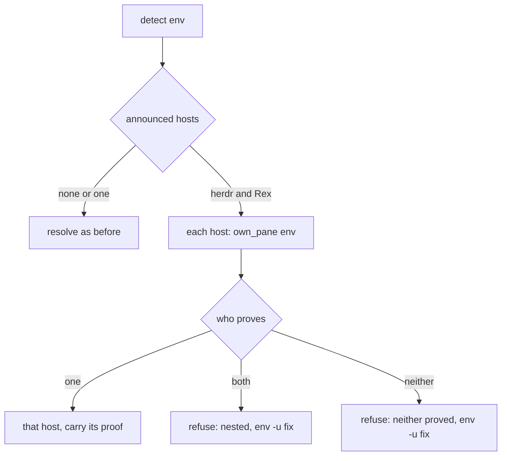

# A session with both herdr and Rex settings still gets a host - Plan

## Goal Capsule

- **Objective:** A PM or worker session that inherited both herdr and Rex settings can still read its panes and send prompts to workers, without a restart, and is refused only when auto cannot tell which host holds the session.
- **Means:** When both hosts are announced, each announced host proves the session's pane from its own host, and the one that proves it is used (KTD1).
- **Authority:** The Product Contract below, then the code and tests in `plugins/auto`. The handoff in `docs/handoff.md` is direction, not spec.
- **Stop conditions:** Stop and ask if a fix would need the send-guard or the "only the person types into a driver pane" rule to change, or if the SessionStart hook cannot fit its 5 second budget (KTD3).
- **Ships:** Open the PR and say ready. The PM merges. Nothing is published without Shawn's pick.

## Product Contract

### Summary

`terminal_host.detect()` stops refusing every session that announces both herdr and Rex. It asks each announced host to prove the pane and picks the one that does. It refuses only when both prove or neither proves, and the refusal gives a command the session can run from inside itself.

### Problem Frame

Since auto 0.16.10 (PR #143 "run programmes in herdr, Rex or Ghostty through one terminal host interface"), `detect()` reads only environment variables. A session started from a Rex terminal that later ran herdr, or the other way round, keeps both sets of settings. `detect()` then returns no host, and every host call answers `refuse`. The PM of programme prog-20261029-122819-86a88d on the Mac Studio hit this after updating to auto 0.16.13: it marked herdr unavailable and could not read panes or use `prompt-item`, while its direct herdr checks, worker messages and worker progress still worked. This blocks a programme with live workers.

The environment cannot say which host holds the pane. The host can: the code already states that settings only select a host module and the module proves the pane (KTD3 of the terminal-hosts plan).

### Requirements

- R1. A session that announces both herdr and Rex gets the host that proves this session's pane from its own host.
- R2. herdr proves a pane only when herdr itself answers for the pane id. An answer that falls back to the environment is not proof.
- R3. Rex proves a pane only when `rex session inspect` lists the session's block.
- R4. When both hosts prove the pane, or neither does, auto refuses. The refusal says which of the two happened and names a command the session can run from inside itself.
- R5. The send-guard, `is_host_command`, and the rule that only the person types into a programme driver's pane do not change.
- R6. The SessionStart hook still finishes inside its 5 second budget in a both-settings session, and records the session's row for the proven host.
- R7. Sessions that announce one host, or none, resolve exactly as before, with no new process calls.

### Scope Boundaries

- Not in scope: repairing a moved herdr pane's stored pane id and terminal id (issue #149 "repair a moved herdr pane's id and terminal id at record time"). R2 does not depend on the environment pane id alone, so #149 stays a separate fix.
- Not in scope: picking a host by priority when both prove. Typing into the wrong pane is worse than a refusal with a fix.
- Not in scope: publishing or version bumps.

#### Deferred to Follow-Up Work

- Process-ancestry or tty proof to tell nested multiplexers apart (the case R4 refuses).
- A durable per-session cache of the chosen host. The environment of a running session never changes, so only host liveness changes; a per-process memo is enough for now (KTD2).

## Planning Contract

### Key Technical Decisions

- KTD1. **Proof by the host's own `own_pane`, not a new probe.** `detect()` calls `host_named(name).own_pane(env)` for each announced host and counts those that prove (R2, R3). This reuses the proof `_require_own_pane` and `record_session` already trust. herdr's `own_pane` returns `resolved: "env"` when `herdr pane get` fails, so `detect()` must require `resolved == "herdr"`. (session-settled: user-directed — chosen over trusting the environment alone: a moved pane keeps a stale `HERDR_PANE_ID`.)
- KTD2. **Memoise per process, keyed on the announcing variables.** A both-settings call costs up to two process calls. `detect()` already memoises the Ghostty server probe in `_server_probe`; the proof result follows the same pattern. Each CLI call is its own process, so the memo mainly spares the long-running watcher (`programme-watch.py`) from re-probing on every tick. Only a result that resolved to a host is memoised. A refusal is never memoised, so the next call re-probes after a transient timeout; a refused `Detection` returns `RefusedHost`, which never reaches a host module, so a memoised refusal would last the watcher's whole life. A dead host after resolution is reported by that host's own errors.
- KTD3. **`Detection` carries the proof so the hook probes once.** `record_session` calls `detect()` and then `own_pane()` again. With proof inside `detect()`, that is two herdr calls (1.0 s cap) and two Rex calls (2.0 s cap), about 6 s worst case against a 5 s hook timeout. `Detection` carries the proven `own_pane` result and `record_session` uses it instead of probing again.
- KTD4. **Ambiguous means refuse, with an in-session fix.** Each Bash call is a fresh shell that inherits Claude's environment, so the fix is a per-command prefix: `env -u REX_SESSION -u REX_BLOCK <command>` to use herdr, or `env -u HERDR_PANE_ID -u HERDR_ENV <command>` to use Rex. The restart advice (`unset` before starting Claude) stays as the fix for the SessionStart hook, which a prefix cannot reach. (session-settled: user-directed — chosen over picking a host by priority: a wrong pick types into the wrong pane.)
- KTD5. **No registry tiebreak.** A running session's environment is fixed, so a registry row written earlier by the same session was written under the same two announcements. It cannot break a tie that proof could not.

### High-Level Technical Design

### Assumptions

- The Studio session's both-settings state matches the code reading: `REX_SESSION` is set and one of the two hosts is dead or absent for that pane. The plan's tests build that state with fake `herdr` and `rex` commands on `PATH`. U1 starts by reading the Studio session's variable names (never values) to learn which case the incident is: one host dead (this plan fixes it) or both hosts live and nested (this plan still refuses it, with a working `env -u` command). If it is the nested case, stop and ask Shawn whether the refusal is enough or process-ancestry proof moves into scope.
- `env -u NAME command` is allowed by the send-guard when the command is not a host command. U3 checks this against `send-guard-hosts.test.sh` rather than assuming it.
- The SessionStart hook timeout stays 5 seconds.

### Sources

- `plugins/auto/lib/terminal_host.py` (`detect`, `Detection`, `current`, `_server_probe`)
- `plugins/auto/lib/host_herdr.py` (`own_pane`, `PANE_GET_TIMEOUT`) and `plugins/auto/lib/host_rex.py` (`own_pane`, `INSPECT_TIMEOUT`)
- `plugins/auto/lib/session_registry.py` (`record_session`) and `plugins/auto/lib/programme_lifecycle.py` (`_session_host`, `_require_own_pane`)
- `plugins/auto/tests/unit/terminal-host-detect.test.sh` and `plugins/auto/tests/unit/host-rex.test.sh` (fake `rex` on `PATH`)
- `docs/plans/2026-10-28-1142-feat-auto-terminal-hosts-plan.md` (origin of KTD3 and the detect contract)

## Implementation Units

### U1. Pin the failure and the new behaviour as tests

**Goal:** Reproduce the regression first, then pin every outcome of R1 to R4.

**Requirements:** R1, R2, R3, R4, R7

**Dependencies:** none

**Files:** `plugins/auto/tests/unit/terminal-host-detect.test.sh`

**Approach:**
- Add fake `herdr` and `rex` commands in the test's temp dir, as the file already does for `herdr status server`. Each fake can answer proof, answer failure, or be absent.
- Replace the two tests that expect a refusal for any both-settings session (plain, and inside Ghostty) with the cases below.

**Execution note:** Read the Studio session's variable names first (see Assumptions). Then write these tests and watch the "one host proves" cases fail on current main.

**Test scenarios:**
- Happy path: both announced, herdr answers `pane get`, Rex inspect fails. Result is `herdr`.
- Happy path: both announced, Rex inspect lists the block, herdr `pane get` fails. Result is `rex`.
- Happy path: both announced inside Ghostty resolves by proof, not by the Ghostty rule.
- Edge case: both announced, herdr command missing from `PATH`, Rex proves. Result is `rex`.
- Edge case: herdr `pane get` fails so `own_pane` falls back to the environment pane id. herdr does not count as proof; with Rex failing too the result is a refusal (R2).
- Error path: both prove. Result is a refusal whose text says both hosts hold a pane, and whose fix contains `env -u`.
- Error path: neither proves. Result is a refusal whose text says neither proved, and whose fix contains `env -u`.
- Regression: one host announced, or none, makes zero calls to the fake commands (R7). The fakes write a marker file when called.
- Memo: two `detect()` calls in one process with the same environment call the fakes once when a host resolved (KTD2).
- Memo: a refusal is not memoised. The first call has the herdr fake failing, the second has it answering, and the second returns `herdr`.

**Verification:** The new cases fail on main for the right reason and pass after U2.

### U2. Prove the host inside `detect()`

**Goal:** Implement KTD1, KTD2, KTD4 and the `Detection` change from KTD3.

**Requirements:** R1, R2, R3, R4, R5, R7

**Dependencies:** U1

**Files:** `plugins/auto/lib/terminal_host.py`, `plugins/auto/tests/unit/terminal-host-detect.test.sh`, `plugins/auto/tests/unit/host-keyed-registry.test.sh`

**Approach:**
- Replace the `len(announced) == 2` refusal with a proof step over the two announced hosts.
- A host proves when its `own_pane` is ok; for herdr it also needs `resolved == "herdr"`.
- One proves: return that host. Both or neither: refuse, with a separate `why` for each and a fix line built from KTD4.
- Add a `proof` slot to `Detection` holding the proven `own_pane` result, `None` everywhere else.
- Memoise by the values of `HERDR_PANE_ID`, `HERDR_ENV`, `REX_SESSION`, `REX_BLOCK`, `HERDR_SOCKET_PATH`.
- Remove `_FIX_BOTH`. Update the one other test that quotes the both-hosts refusal: the "start refuses when the environment announces two multiplexers" case in `host-keyed-registry.test.sh`, which now lands on the neither-proves refusal.

**Patterns to follow:** `_server_probe` and `_herdr_server_up` in the same file for the memo; `Detection` already uses `__slots__`.

**Test scenarios:** Covered by U1. Add a wording test: the refusal fix text is one line and contains no `unset` for the in-session case.

**Verification:** `terminal-host-detect.test.sh` passes; `bash plugins/auto/tests/run.sh unit` shows no host-wording or coverage regressions.

### U3. Single probe in the SessionStart path, and the fix text works

**Goal:** Meet R6 and confirm the KTD4 fix runs under the send-guard.

**Requirements:** R5, R6

**Dependencies:** U2

**Files:** `plugins/auto/lib/session_registry.py`, `plugins/auto/tests/unit/terminal-host-detect.test.sh`, `plugins/auto/tests/unit/send-guard-hosts.test.sh`

**Approach:**
- `record_session` reads the proof from the `Detection` and skips its own `own_pane` call when a proof exists.
- Add a send-guard case: `env -u REX_SESSION <programme command>` is allowed, and `env -u REX_SESSION herdr pane send-text <driver pane>` is still blocked.

**Test scenarios:**
- Integration: the hook, run with both settings and a fake herdr that proves, records one row with host `herdr` and calls the fake `pane get` once. The fakes sleep 0.9 s (herdr) and 1.9 s (Rex) to show the hook finishes under 5 s.
- Integration: both prove, so the hook records nothing and does not fail (matches the existing "two multiplexers announced: the hook records nothing" case).
- Guard: the two send-guard cases above.

**Verification:** The existing hook tests still pass; the guard cases pass.

### U4. Run it against a real both-settings session, then open the PR

**Goal:** Measure on real hosts before calling it done, as the handoff asks.

**Requirements:** R1, R4, R6

**Dependencies:** U3

**Files:** none new

**Approach:**
- On a Mac with both a live herdr pane and a Rex session, set both variables and run a read such as `programme.sh sweep`. Expect the host that holds the pane, not a refusal.
- Read the Studio session's variable names (names only, never values, and never `ps -E` or `pgrep -fl`) and compare to the assumption above.
- Run the unit and integration suites through `honest-run`. Run the lint-router check, `ce-simplify-code`, `ce-code-review` (fix P0 to P2), then `thermo-nuclear-code-quality-review` once.
- Open the PR against `main` with a short plain-language body.

**Test expectation:** none -- this unit is a manual check and the PR.

**Verification:** The real run shows no refusal. The PR is open with the checks and the manual result listed.

## Verification Contract

| Check | Command | Applies to |
|---|---|---|
| Detection cases | `bash plugins/auto/tests/unit/terminal-host-detect.test.sh` | U1, U2, U3 |
| Registry refusal wording | `bash plugins/auto/tests/unit/host-keyed-registry.test.sh` | U2 |
| Host wording and coverage (must stay green) | `bash plugins/auto/tests/unit/host-wording.test.sh`, `terminal-host-boundary.test.sh`, `terminal-host-coverage.test.sh` | U2 |
| Send-guard | `bash plugins/auto/tests/unit/send-guard-hosts.test.sh` | U3 |
| Full suite | `bash plugins/auto/tests/run.sh all </dev/null`, run through `~/.claude/tools/honest-run/run.sh --expect "<the runner's summary line>"` | all |
| Lint | `/lint-router:lint-router` | all |

shrimpshack has no CI, so the local suite is the evidence. A run with no verdict line did not finish.

## Definition of Done

- A both-settings session resolves to the host that proves the pane, and a real run shows it (U4).
- Both-prove and neither-prove refuse with different text and a working in-session fix.
- The SessionStart hook probes once and fits its 5 second budget in a both-settings session.
- Single-host and no-host sessions make no new process calls.
- The send-guard tests are unchanged except for the two added cases.
- No abandoned experiment code is left in the diff.
