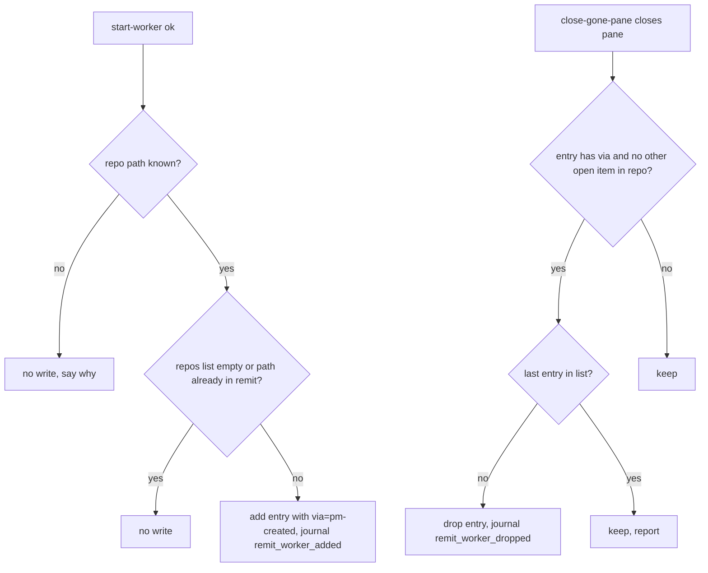

# PM Owns Its Remit - Plan

## Goal Capsule

- **Objective:** Shawn never types "add repo … worktree … to the remit" for a worker the PM started itself, and the sweep tracks that worker from its first minute.
- **Means:** The PM's own start and retire actions edit the remit, recorded as PM-created (KTD1).
- **Authority:** Shawn's rule of 2026-11-02 and the Product Contract below. Where code and this plan disagree, the code wins and the plan gets corrected.
- **Stop conditions:** Stop and ask Shawn if the work needs any way for a worker's text, a claim or a pane to add to the remit.
- **Finish:** `ce-work`, then `ce-simplify-code`, `ce-code-review` (fix P0 to P2), `thermo-nuclear-code-quality-review` once. Open the PR and say ready. The PM merges and asks Shawn about publishing.

---

## Product Contract

### Summary

A worker session the PM starts joins the remit with no typed line, and leaves it when the PM retires the worker. A typed line stays required for any other growth. A stale worktree path stops blocking later remit changes.

### Problem Frame

Today `set-remit` after an accepted agreement needs a typed `--prompt` naming each repo added or removed. `start-worker` never touches the remit. Five workers in two days (sweep-rework, default-behaviours, pm-drives-auto-core, host-both-settings, rituals) sat outside the sweep as `repo_out_of_remit` until Shawn typed the line, so the PM could neither prompt nor check them.

The same friction runs the other way. A retired worker's worktree stays in the remit list, and once the folder is gone `set-remit` rejects the whole list ("repo path must be an absolute directory").

### Key Decisions

- **Provenance decides.** A session the PM created through `start-worker` needs no typed line; anything else keeps it. Handover and takeover move the whole programme store to the new PM, so the remit and its PM-created marks arrive with it and no extra write happens. Governs R1, R2, R5. (session-settled: user-directed — chosen over a general bypass of the typed line: Shawn's rule of 2026-11-02 limits the exemption to sessions the PM created or received.)
- **Peers cannot grant escalation.** A worker's text, claim or pane never adds to the remit. Governs R5. (session-settled: user-directed — chosen over letting a worker request its own addition: stated in Shawn's brief for this work.)

### Requirements

**Joining**
- R1. When `start-worker` starts a worker, the worker's repo (its worktree) joins the remit with no typed prompt, unless R6 applies, the repo is already in the remit, the worktree cannot be confirmed (KTD3), or the repo cap is reached; the start payload says which.
- R2. The remit entry records that the PM created it, with the item and session, and the journal records the write as PM-created, distinct from a Shawn-typed change.

**Leaving**
- R3. When the PM retires a worker (the `close-gone-pane` close), the repo entry the PM created for it leaves the remit, unless R6 applies or another open item still works in that repo.
- R4. A stale or retired worktree path never makes `set-remit` reject the whole list.

**Limits**
- R5. Nothing but a successful PM-run `start-worker` can add an entry without a typed prompt. A worker's text, a claim, a pane, or `set-remit` stdin never adds one.
- R6. Auto changes never widen the remit. An empty repo list means "no limit", so the PM adds no entry to an empty list and never removes the last entry.

### Scope Boundaries

- Direct spinoff runs by the PM do not auto-join the remit. The PM goes through `start-worker`; a direct run keeps the typed line.
- Spaces and the tracker scope (teams, projects, initiatives) are unchanged.
- Publishing a new `auto` version is out of scope; Shawn picks that.

#### Deferred to Follow-Up Work

- A sweep step that drops PM-created entries whose folder vanished without a `close-gone-pane`.
- A worker adopted after a crash between launch and settle (the reconcile path has no worktree path) stays outside the remit until a typed line.
- A sweep step that drops PM-created entries when the repo cap (20) blocks an add.
- Treating a worktree with local edits differently on retire (the retire already requires folder gone, PR merged, agent idle, so this cannot arise today).

### Success Criteria

- Start a worker with `start-worker` in a throwaway programme: the next sweep lists its pane as tracked, not under `skipped` as `repo_out_of_remit`, with zero typed lines.
- After the worker's pane closes via `close-gone-pane`, the remit no longer lists its path and a later `set-remit` succeeds without naming it.

---

## Planning Contract

### Key Technical Decisions

- KTD1. **Provenance rides on the remit repo entry as an optional `via` field** (`pm-created`, item key, session id, time). A separate ledger would need a join on every sweep. The entry already travels with the programme store through takeover and handover. Serves R2, R5.
- KTD2. **The add runs inside `start-worker`'s settle step** (the `assign` callback in `lib/programme_sources.py`), so the item owner and the remit entry commit together. It runs only when the start succeeded. It never runs from `set-remit`.
- KTD3. **The repo comes from what the PM launched, not from what the worker later does.** The add uses the worktree path the spinoff run reports for this start, resolved to a repo root, and only when the confirmed pane's folder resolves to that same root (realpaths compared). A pane's live folder alone is never trusted, because the worker can change it. If spinoff does not report its worktree path, U2 adds that to its output. If the path is unknown or the roots differ, nothing is added, the start payload says why, and the typed line remains the way in. Serves R5.
- KTD4. **An existing entry is never rewritten.** If the repo is already in the remit (typed or not), the add is a no-op, so a Shawn-typed entry is never relabelled PM-created and later auto-removed. Every remit path comparison (this dedupe, KTD6 preservation, KTD5 lookup) compares realpaths, so a symlink spelling of a typed entry cannot create a second, auto-removable one.
- KTD5. **Removal is tied to the retire, and only removes `via` entries.** The folder is already gone when `close-gone-pane` closes a pane, so the entry is found by its `via` item key, never by resolving the pane's folder. The verb gains a store write after the close and re-checks on the fresh record that no other open item recorded the same repo (each started item records its repo, U2). `set-remit` keeps its typed rule for explicit removals.
- KTD6. **`set-remit` preserves `via` for unchanged entries by matching path against the stored remit, and ignores any `via` in stdin.** This is what stops stdin from forging provenance (R5) and stops a full-list replace from erasing it.
- KTD7. **`set-remit` drops a path that is already in the stored remit but no longer a directory, with a notice, instead of rejecting.** A brand-new missing path still rejects. These drops are exempt from the "must name each removal" rule because they only narrow. The R6 last-entry guard applies.
- KTD8. **The agreement term is not touched by auto changes.** `remit_set` with `set_by` and the typed quote describes Shawn's approval; auto changes write their own journal kinds instead.

### High-Level Technical Design

### Assumptions

- The remit repo entries round-trip an extra `via` key through the store (`normalize_programme` and the carry-over code in `lib/programme_home.py`, `lib/programme_carryover.py`). U1 proves this first; if a normalizer strips it, U2 widens that normalizer.
- Nothing re-validates the stored remit against the agreement term's hash. U2 confirms before writing.
- The sweep's `folder_gone` rows carry the item key (`gone_entry` in `lib/programme_domain.py`), which KTD5's lookup needs.

---

## Implementation Units

### U1. Failing tests and the measurement

**Goal:** Reproduce the friction and pin every requirement with a failing test before any change.
**Requirements:** R1–R6
**Dependencies:** none
**Files:** `plugins/auto/tests/unit/programme-remit.test.sh`, `plugins/auto/tests/unit/programme-sources.test.sh`, `plugins/auto/tests/unit/programme-gone-panes.test.sh`
**Execution note:** Test-first. Before writing code, count Shawn's typed remit lines against `worker_started` rows in a real journal and put both numbers in the PR body.
**Approach:**
1. Use the stub host (`lib/host_stub.py`) and the fake `herdr` snapshot pattern already in `programme-remit.test.sh`.
2. Write the cases below; confirm each fails for the stated reason.
**Test scenarios:**
- Happy path: after an accepted agreement with one repo in the remit, `start-worker` into a second worktree leaves the remit with both repos, the new one marked `via` pm-created, and the next sweep does not list the pane as `repo_out_of_remit`.
- Edge: the worker's repo is already in the remit (typed): no write, entry keeps no `via`.
- Edge: the remit repo list is empty: no entry added, list still empty.
- Error: the launched pane's folder is unknown: no write, payload carries the reason.
- Error: `start-worker` fails (spinoff exit non-zero): no write.
- Integration: after `takeover` by another session, the PM-created entry is still in the remit with its mark.
- Covers R5. `set-remit` with a `via` key in stdin: the key is dropped; a new repo still needs the typed prompt.
- Covers R5. The stub pane row reports a different folder than the worktree spinoff created: no entry is added.
- Edge: the worker's repo is a symlink spelling of a typed entry: no second entry.
- Integration: a `via` entry does not change `AuthorityLevels` levels, ruling conflict reports, or carry-over keys for the programme.
- Edge: two items start in the same repo; retiring the first keeps the entry until the second retires.
**Verification:** Every new case fails before U2–U4 and passes after.

### U2. `start-worker` joins the remit

**Goal:** A successful start adds the worker's repo as a PM-created entry.
**Requirements:** R1, R2, R5, R6
**Dependencies:** U1
**Files:** `plugins/auto/lib/programme_sources.py`, `plugins/auto/lib/programme_journal.py`, `plugins/auto/lib/programme_lifecycle.py`, `plugins/auto/lib/programme_rulings.py`, `plugins/auto/lib/programme_carryover.py`, `plugins/auto/lib/programme_protocol.py`, and the spinoff script under `plugins/spinoff/` only if it does not already report its worktree path
**Execution note:** First check whether spinoff already reports the worktree path; the answer decides whether the spinoff plugin changes.
**Approach:**
1. `launch_worker` returns the worktree path spinoff reported and the confirmed pane's folder; the add proceeds only under KTD3.
2. In `_launch_assign`, on `ok`, apply KTD4, R6 and the `REMIT_CAPS` repo cap, append the entry with `via`, and record the repo on the item's start entry (U3 reads it).
3. Register the two journal kinds beside `remit_set`. The assign callback notes in a closure whether it added an entry; append `remit_worker_added` after `_settled` returns only when it did, and put the added path in the `worker_started` payload so the atomic row carries it too.
4. Own the `via` handling in `_repo_entry` / `parse_remit` per KTD6 (U4 builds on it).
5. Make `repos_for`, `repo_keys` and the protocol load skip entries with `via`, so a PM-created entry changes only the sweep scope and PM-side PR checks, never authority levels or ruling grants that a worker can influence by editing files in its worktree.
**Patterns to follow:** the existing `assign` callback shape; `_move_leases` for effects kept outside the store lock.
**Test scenarios:** the U1 joining cases pass; add: repo cap reached → no write and the payload says so.
**Verification:** Sweep after `start-worker` tracks the pane with no typed line.

### U3. Retire drops the entry

**Goal:** `close-gone-pane` removes the PM-created entry it made.
**Requirements:** R3, R6
**Dependencies:** U2
**Files:** `plugins/auto/lib/programme_gone_panes.py`, `plugins/auto/tests/unit/programme-gone-panes.test.sh`
**Approach:**
1. `close-gone-pane` is read-only today. After `status == "closed"`, add a `host._write` change that finds the `via` entry by the closed pane's item key (KTD5), then re-checks on the fresh record: not the last entry, and no other open item recorded the same repo.
2. Remove it and emit `remit_worker_dropped`; report the outcome in the verb's output.
**Test scenarios:**
- Happy path: closed pane with a `via` entry → entry removed, journal row written.
- Edge: the pane's folder is already deleted (always true at retire) → entry still found and removed.
- Edge: a Shawn-typed entry for the same repo → kept.
- Edge: a second open item shares the repo → kept.
- Edge: last entry in the list → kept and reported.
- Error: the close itself fails (`reported` status) → entry kept.
**Verification:** After retire, a later `set-remit` that omits the path needs no naming.

### U4. `set-remit` tolerates stale paths

**Goal:** A vanished worktree never blocks a remit change.
**Requirements:** R4, R5
**Dependencies:** U1, U2 (U2 owns the `via` handling in `_repo_entry` / `parse_remit`; U4 builds on it)
**Files:** `plugins/auto/lib/programme_lifecycle.py`, `plugins/auto/tests/unit/programme-remit.test.sh`
**Approach:**
1. Pass the stored repo list into `_repo_entry`; a path found there but missing on disk is dropped with a notice in the output, not an error.
2. Build the naming requirement from changes minus these pruned drops; keep the R6 guard.
**Test scenarios:**
- Edge: stored list holds a deleted path, caller resubmits the full list including it → success, notice names the dropped path, no typed line needed for it.
- Error: caller submits a path that is not stored and not a directory → still rejected.
- Edge: dropping would empty the list → kept, with a notice.
- Error: pruned path plus an unrelated new repo without a typed prompt → still refused for the new repo.
**Verification:** The existing `programme-remit.test.sh` cases still pass unchanged.

### U5. Documentation

**Goal:** The docs tell the new rule where readers look.
**Requirements:** R1–R6
**Dependencies:** U2–U4
**Files:** `plugins/auto/docs/concepts/programme/remit.md`, `plugins/auto/skills/programme-remit/SKILL.md`, `plugins/auto/skills/programme-sweep/SKILL.md`
**Approach:** Replace "Changing the remit needs a typed line…" with the provenance rule. Tell the PM to start workers with `start-worker` and to expect the add and the drop in the journal. Run the doc-fence and vocabulary tests.
**Test expectation:** none -- prose only; the existing doc-fence and vocabulary-audit tests guard it.
**Verification:** `vocabulary-audit.test.sh` and the doc-fence tests pass.

---

## Verification Contract

| Gate | Command | Applies |
|---|---|---|
| Remit | `bash plugins/auto/tests/unit/programme-remit.test.sh` | U1, U2, U4 |
| Gone panes | `bash plugins/auto/tests/unit/programme-gone-panes.test.sh` | U3 |
| Sources and start-worker | `bash plugins/auto/tests/unit/programme-sources.test.sh` | U2 |
| Whole unit suite | every `plugins/auto/tests/unit/*.test.sh` | before PR |
| Integration | `plugins/auto/tests/integration/programme-dispatch-recovery.test.sh` and `programme-durability.test.sh` | before PR |

Run each through `~/.claude/tools/honest-run/run.sh`, with `--expect "[0-9]+ passed, 0 failed"` (each file prints that summary line). A run with no verdict line did not finish.

## Definition of Done

- All five units' scenarios pass, and each new test failed before its change (checked by mutation, not by reading).
- Whole unit suite and the two integration tests pass.
- No code path outside `start-worker` adds a repo without a typed prompt (R5), shown by a test.
- Abandoned-attempt code and scratch files are gone from the diff.
- PR opened and stated ready, with the measured typed-lines versus workers-started counts in the body. Publishing waits for Shawn.

## Risks & Dependencies

- **Silent widening.** An empty repo list means "no limit"; adding to it would narrow, removing the last entry would widen. R6 and its tests cover both directions.
- **Provenance forgery.** If `via` survived a stdin round trip, a typed-looking list could mark entries PM-created. KTD6 and the U1 stdin test cover it.
- **Normalizer strips `via`.** Caught first by U1's takeover test.
- **Retire races a second worker in the same repo.** KTD5's other-owner check covers it.
- **Worker steers the folder.** KTD3 anchors the repo to the worktree spinoff reported; a mismatch adds nothing.
- **Spinoff does not report its worktree path.** U2 then touches the spinoff plugin, the one change outside `plugins/auto`.
