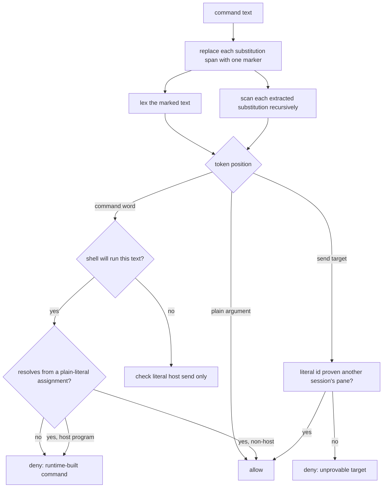

# Send-guard substitution precision and live driver pane - Plan

## Goal Capsule

- **Objective:** A programme worker finishes its work without the guard stopping it — heredoc scripts, substitution-built paths and CI watch loops all run — while the person stays the only one who types into the PM's pane.
- **Means:** Classify every word by the position it occupies, not by the arguments around it (KTD1, KTD2, KTD3).
- **Authority:** This plan, then Shawn's picks of 2026-11-02 (literal-set variables resolve; no version bump in the fix PR), then the measured corpus in `.guard-evidence/`, then the 2026-10-31 plan `docs/plans/2026-10-31-1105-fix-send-guard-precision-plan.md`.
- **Stop conditions:** Stop and report to the PM if closing a false positive requires allowing a host send whose target cannot be resolved, if the live-pane lookup cannot stay inside the hook's time budget, or if the corpus replay shows a command that is denied today becoming allowed outside the classes named in R1 to R5.
- **Execution profile:** Test-first. Every fixture below is written as a failing `allowed` case or a passing `denied` case before the classifier changes.
- **Who ships:** This worker opens the PR on `shawnroos/shrimpshack` and reports the PR number and head SHA to the PM ("PM AI EDITOR"). It does not merge and does not publish.

---

## Product Contract

### Summary

The send-guard in `plugins/auto/lib/send_guard.py` denies a command when it cannot prove the command will not type into the programme driver's pane. It is too broad in one direction and too narrow in another. Harmless commands are denied as `runtime-built command` whenever shell text appears anywhere the guard decided to scan, including inside heredoc bodies and quoted code that no shell will ever run. Separately, the guard protects a pane the PM left, because the only mechanism that follows a pane move cannot fire. This plan closes both, adds the regression fixtures from the real denials, and leaves the default-deny posture for host sends untouched.

### Problem Frame

Workers in programme `prog-20261029-122819-86a88d` lose commands to the guard every day. The journal holds 282 distinct commands denied with the verdict `runtime-built command`. Replaying them through current main shows 153 already pass after #148 and #154, and **129 still deny**. Among them are a TypeScript schema probe, a Python edit script, a CI watch loop and the directory setup that starts `ce-code-review` — four commands from one worker on PR 497, which is what prompted this work. Workers respond by rewriting commands to hide them from the guard, which also hides them from review.

The pane fault costs differently. The guard names `w2:p9T` in every denial, and that pane closed days ago. The PM now works in `w2:pAG`. A denial that names a dead pane tells the worker nothing it can act on, and a worker reading the message cannot tell whether the guard is protecting anything at all.

### Key Decisions

- **A run-time program name resolves only from a plain literal set earlier in the same command.** (session-settled: user-directed — chosen over keeping every runtime-built command word denied: Shawn's pick of 2026-11-02, taken with the cost in view that this partly reverses the 2026-10-31 plan's KTD3, which had accepted `"$PY" script.py` staying denied.) A variable set from a substitution, set outside the command, or resolving to a terminal-host program stays denied. Governs R5, R8.
- **The fix PR carries no version bump.** (session-settled: user-directed — chosen over bumping inside the PR: Shawn's pick of 2026-11-02, following how #148 and #154 shipped.) The PM bumps `plugins/auto/.claude-plugin/plugin.json` and `.claude-plugin/marketplace.json` in a separate `publish:` commit on main. Governs R13.

### Requirements

**Precision — commands that must stop being denied**

- R1. Text that no shell will run is not scanned for runtime-built command words. A heredoc body consumed by a program other than a shell, a string literal inside inline code of another language, and the speculative scan of quoted text for a shell invoked without `-c` are all such text.
- R2. A literal host send inside that same text is still denied, at every nesting depth.
- R3. The glue the lexer produces between two adjacent substitutions is not read as a program. `RUN_ID=$(date +%s)-$(head -c4 /dev/urandom)` yields no command word of its own.
- R4. An arithmetic or parameter expansion inside a quoted argument is not read as a program. `echo "deadline=$(( 1200 + 10 ))"` is allowed.
- R5. A command word spelled `$NAME` or `${NAME}` is allowed when the same command text sets `NAME` to a plain literal beforehand and that literal is not a terminal-host program.

**Protection — what must not weaken**

- R6. Every command the current suites deny stays denied: `plugins/auto/tests/unit/send-guard-precision.test.sh`, `plugins/auto/tests/unit/send-guard-hosts.test.sh` and `plugins/auto/tests/integration/programme-hooks.test.sh`.
- R7. A host send whose target is built at run time stays denied for a session that does not drive the programme.
- R8. A command word spelled `$NAME` stays denied when `NAME` is set from a substitution, is set outside the command text being scanned, is never set, or resolves to a terminal-host program.
- R9. The guard keeps denying a command that names the driver's pane, and keeps denying a write to a tty device.

**Live driver pane**

- R10. When the environment's pane and the live pane differ, the guard protects the live pane and the denial names it.
- R11. When herdr proves the recorded pane closed and no live pane can be identified, the guard keeps guarding the ids it knows rather than guarding nothing.
- R12. When the guarded pane comes from a row herdr never confirmed and herdr reports that pane closed, the denial says the id is one auto could not confirm instead of asserting it is the driver's pane.

**Release**

- R13. The PR changes no version file.

### Scope Boundaries

- The default-deny posture for a direct host call with an unknown verb does not change.
- The PM's own allowances do not change.
- No change to how programmes take over or move leases.

#### Found open, not regressions

Both verified identical on `a9fd6b9`, so neither is introduced here. Each deserves its own issue.

- An interpreter's inline code is only scanned for string literals containing a space, so a host name split across adjacent literals is never reassembled: `python3 -c 'os.system("herdr"+" pane send-text <pane> hi")'` is allowed on both versions.
- `MAX_DEPTH` bounds the scan at four nestings, so a literal send at five `bash -c` layers is never classified. The scan catches a literal send at every depth it reaches, which is not every depth.

#### Deferred for later

- Repairing a registry row herdr never confirmed. The row for session `7d9664d0` is repaired only when that session next starts in a pane `herdr pane get` can resolve, or when the programme is taken over. Dropping the guard for such a row would leave the PM's real pane unguarded, which is worse than the false positives this plan removes.
- Teaching auto to find a session's pane when the session's `HERDR_PANE_ID` is inherited and wrong. herdr reports no `agent_session` on any pane or agent row, so the pane is not identifiable from herdr at all. Worth its own issue against herdr, not a change here.
- Resolving `PY="$(for c in python3 python py; …)"`, the form `ce-code-review` actually uses. R5 covers the plain-literal form only, so `ce-code-review`'s spine stays denied in a worker. Named in the PR so the limit is visible.
- Live-pane lookup for Rex and Ghostty drivers, unchanged from the 2026-10-31 plan.

### Sources

- `.guard-evidence/FINDINGS.md` — the measured chain for both faults.
- `.guard-evidence/blocked-fixtures.json` — 282 journaled commands with the word the guard flags in each; replayable.
- `docs/plans/2026-10-31-1105-fix-send-guard-precision-plan.md` — the predecessor plan, whose KTD3 this plan partly reverses under R5.
- `plugins/auto/lib/send_guard.py:_scan`, `:_unproven`, `:_command_positions`, `:_split_heredocs`, `:_with_live_ids`.
- `plugins/auto/lib/host_herdr.py:presence`, `:guard_snapshot`, `:own_pane`.

---

## Planning Contract

### Key Technical Decisions

- KTD1. **A runtime-built command word is denied only in text a shell will run.** `_scan` carries a `shell` flag. It is true at depth 0, inside `$(…)` and backtick substitutions, inside a `-c` script, inside an `eval` segment, inside a here-string fed to a shell binary, and inside a heredoc body whose consuming command is a shell binary, `source` or `.`. It is false for a heredoc body consumed by anything else, for string literals scanned out of inline code of another language, and for the speculative quoted-text scan done when a shell binary appears with no `-c`. `host.send_class` still runs at every depth whatever the flag says, so a literal send hidden in a heredoc stays denied. `_split_heredocs` currently discards the consuming command and must return it. Governs R1, R2.
- KTD2. **Each substitution span becomes one opaque marker before lexing.** `_scan` replaces every `$( … )`, `<( … )`, `>( … )` and backtick span in the main text with a single marker character, lexes that, and scans the extracted contents recursively as it does now. The marker joins `_RUNTIME_WORD`, so a substitution standing in command position is still a runtime-built word and a substitution standing in a send target is still an unresolvable target. This removes the `-$` and `peer-deadline-secs=$` artifacts, which exist only because `shlex` splits a substitution into pieces and the closing `)` restores command position. Governs R3, R4, R7.
- KTD3. **A `$NAME` command word resolves from a plain-literal assignment in the same scan text.** (session-settled: user-directed — chosen over leaving every runtime-built command word denied: Shawn's pick of 2026-11-02; this partly reverses the 2026-10-31 plan's KTD3, which accepted `"$PY" script.py` staying denied.) The resolution accepts only `NAME=<word>` where the word holds no character in `_RUNTIME_WORD` and the assignment is lexed earlier in the same text. Anything else — a substitution-valued assignment, concatenation, pattern substitution, an assignment in another scan text, or no assignment at all — leaves the word unresolvable and denied. When the resolved literal is a terminal-host program, the word is denied rather than classified, so `H=herdr; $H agent prompt <driver pane> go` stays denied and `H=herdr; $H agent prompt <worker pane> go` stays denied with it. Governs R5, R8.
- KTD4. **An unconfirmable driver pane is named as unconfirmed, not fixed.** The registry already stores `terminal_id` whenever `herdr pane get` succeeds, and `presence` already follows a moved pane by that terminal, so the ordinary move is handled. The live programme's PM is not the ordinary case: all 23 of its registry rows read `resolved: "env"` with `terminal_id: null`, the first written at `source: "fork"` naming a different stale pane again (`w2:p9N`), because a forked session inherits `HERDR_PANE_ID` from its parent. herdr never confirmed a pane for that session, so there is no terminal to follow and no earlier confirmed row to carry forward. The session-keyed branch in `presence` cannot help: no pane row and no `herdr agent list` row carries `agent_session`, so `programme_sources.session_of` returns `None` for every agent. The guard therefore keeps guarding the id it has, and the denial stops asserting that id is the driver's pane. Governs R10, R12.
- KTD5. **A gone pane keeps its guard.** When `presence` reports `state: gone` and no live id is found, `_with_live_ids` leaves the registry and last-seen ids in place. Guarding a closed pane costs a wrong name in a denial message; dropping it would leave the PM's live pane unguarded whenever the lookup cannot identify it. Governs R11.
- KTD7. **A name resolves only when every assignment to it is unconditional.** Two independent review passes each found that judging the gap between an assignment and its use lets an attacker write one unreachable assignment: `H=herdr; false && H=cat; $H …` ran `herdr` while the last assignment written said `cat`, and flipping the order hid it the other way. A name is resolvable only when every assignment to it stands before the first control word, group or pipeline in the text, and the resolved literal is compared casefolded because this filesystem finds `heRdr` on PATH. Governs R5, R8.
- KTD8. **A scan that cannot finish fails closed, and the scan is cheap enough not to reach that.** Nested arithmetic recursion is bounded like the main scan, because 1200 levels raised a `RecursionError` the hook swallows into an allow, and past the bound the text is scanned rather than dropped. Building the marked text appends instead of copying the list per character, because the quadratic form took 31 s on an 80 KB argument through a hook with a 10 s budget. Governs R6, R9.
- KTD9. **A heredoc body is judged by every program on its line, and by whether the shell would read the operator at all.** The body goes to the whole pipeline, so `cat <<'EOF' | ksh` and `| $S` read it as a script; a `<<WORD` inside a comment or quotes is not a heredoc, and reading one as a heredoc took the real commands after it out of the scanned text. The shell list covers the shells a developer machine has, not only the four whose `-c` grammar the guard models. Governs R1, R2.
- KTD6. **The corpus replay is an acceptance step, not a committed test.** `.guard-evidence/blocked-fixtures.json` holds real commands with absolute paths from several repositories, so it stays git-excluded. At most twelve curated fixtures go into the suites; the full 129-command replay runs locally and its numbers go in the PR body. Governs R1 to R5.

### High-Level Technical Design

The guard already walks a command, splits it into scan texts, and asks of each word whether it is a host call. The change is to give that walk two facts it does not carry: whether the text it is walking will be run by a shell, and which span of the original text each token came from.

Position decides the verdict. Three positions, three rules:

| Position of the word | Rule | Requirement |
|---|---|---|
| Command word, in text a shell runs | Runtime-built means denied, unless a plain-literal assignment in the same text resolves it to a non-host program | R5, R8 |
| Command word, in text no shell runs | Not a command word at all; only a literal host send is checked | R1, R2 |
| Plain argument | Never a program, whatever it holds | R3, R4 |
| Send target | Must be a literal id the registry proves is another session's pane | R7 |

**Why this differs from the three rounds that failed.** Those rounds used a suffix scan: after a runtime-built command word, read the arguments that follow to decide whether the call is a send. The journal holds the findings that broke it (session `bbf5713f`, `adversarial.json` and `testing.json`). Holding the verb in a variable bypassed it — `$H pane ${V/x/x} ${P/x/x} hi` passed because `${V/x/x}` contains a slash and read as path-like. A second finding showed ordinary commands would deny, because `$TASK do build` and `$GIT log --grep send` contain words the Rex host treats as typing verbs.

The position approach never reads the arguments after a runtime word. It asks only where the word sits, whether the text around it is shell, and whether the word itself resolves from a literal set in the same text. `$H pane ${V/x/x} ${P/x/x} hi` still denies under KTD3, because `H=herdr` resolves to a host program and a host program in command position is denied outright; the arguments are never consulted.

### Assumptions

- herdr keeps returning `terminal_id` from `pane get`. The fake herdr in `plugins/auto/tests/unit/send-guard-precision.test.sh` already models this.
- A heredoc delimiter is matched unambiguously enough to attribute a body to its consuming command. `_split_heredocs` already finds bodies; it needs only to report the command word it found them under.

### Sequencing

U1 and U2 both change tokenization in `_scan`, so U1 lands first and U2 builds on its marker positions. U3 depends on the token stream U1 produces. U4 is independent of all three and can proceed in parallel. U5 depends on U1 to U4.

---

## Implementation Units

### U1. Substitution spans become single tokens

- **Goal:** The lexer stops inventing command words out of the glue between substitutions.
- **Requirements:** R3, R4, R7
- **Files:** `plugins/auto/lib/send_guard.py`, `plugins/auto/tests/unit/send-guard-precision.test.sh`
- **Approach:** In `_scan`, extract substitution spans and their positions in one pass, replace each span in the main text with one marker character, then lex. Keep scanning the extracted contents recursively exactly as `_substitutions` does now. Add the marker to `_RUNTIME_WORD` so a marker in command position stays denied and a marker in a target stays unresolvable.
- **Test Scenarios:**
  - `RUN_ID=$(date +%Y%m%d-%H%M%S)-$(head -c4 /dev/urandom | od -An -tx1 | tr -d ' ')` is allowed, where today it denies on `-$`.
  - `echo "peer-deadline-secs=$(( 1200 + 10 ))"` is allowed.
  - `$(echo her)dr pane send-text <driver pane> hi` stays denied: the marker is the command word.
  - `herdr pane send-text "$(echo <driver pane>)" hi` stays denied: the target is a marker.
  - A substitution containing a real send, `echo $(herdr pane send-text <driver pane> hi)`, stays denied through the recursive scan.
- **Verification:** `bash plugins/auto/tests/unit/send-guard-precision.test.sh`

### U2. Only shell text yields runtime-built command words

- **Goal:** A heredoc of TypeScript and a quoted blob of JavaScript stop producing command words.
- **Requirements:** R1, R2
- **Files:** `plugins/auto/lib/send_guard.py`, `plugins/auto/tests/unit/send-guard-precision.test.sh`
- **Approach:** Change `_split_heredocs` to return each body with the command word that consumes it. Thread a `shell` flag through `_scan` and into `_unproven`, set per KTD1. Gate only the runtime-built-word branch of `_unproven` on it; leave the `send_class` branch ungated.
- **Test Scenarios:**
  - `cat > probe.mjs <<'EOF'` with a TypeScript body containing `${r.success}` and `[kind=sport,` is allowed.
  - `python3 - <<'PY'` with a Python body containing string literals is allowed.
  - `agent-browser --session s eval '[...document.querySelectorAll("input[type=file]")]…'` is allowed.
  - `bash ~/.claude/tools/honest-run/run.sh --expect "[0-9]+ passed" -- pytest` is allowed.
  - `bash -s <<< 'herdr pane run <driver pane> ls'` stays denied — a shell consumes the here-string.
  - `cat <<'EOF' | bash` with `herdr pane send-text <driver pane> hi` in the body stays denied — a shell consumes the body.
  - `python3 -c "import os; os.system('herdr pane send-text <driver pane> hi')"` stays denied through `send_class` at depth, with the `shell` flag false.
- **Verification:** `bash plugins/auto/tests/unit/send-guard-precision.test.sh`

### U3. A literal-set program name resolves

- **Goal:** `PY=python3; "$PY" script.py` runs; everything looser stays denied.
- **Requirements:** R5, R8
- **Files:** `plugins/auto/lib/send_guard.py`, `plugins/auto/tests/unit/send-guard-precision.test.sh`
- **Approach:** `_command_positions` already marks assignments. Collect `NAME=<literal>` pairs in the same scan text where the value holds no `_RUNTIME_WORD` character. In `_unproven`, when a denied command word is exactly `$NAME`, `${NAME}` or a quoted form of either, and `NAME` is in that map, deny if the literal is a host program and allow otherwise. Resolution never looks outside the current scan text.
- **Test Scenarios:**
  - `PY=python3; "$PY" peer-job-runner.py start --skill ce-code-review` is allowed.
  - `PY="$(for c in python3 python py; do command -v "$c"; done)"; "$PY" x.py` stays denied — the assignment is substitution-valued.
  - `H=herdr; $H agent prompt <driver pane> go` stays denied — resolves to a host program.
  - `H=herdr; $H agent prompt <worker pane> go` stays denied — same reason; the existing case at `programme-hooks.test.sh` keeps its current expectation.
  - `$PY x.py` with no assignment stays denied.
  - `PY=python3; bash -c '"$PY" x.py'` stays denied — the assignment is in another scan text.
- **Verification:** `bash plugins/auto/tests/unit/send-guard-precision.test.sh`

### U4. An unconfirmed driver pane says so

- **Goal:** A worker reading a denial can tell whether the guard is holding a pane herdr confirmed or one it never could.
- **Requirements:** R10, R11, R12
- **Files:** `plugins/auto/lib/send_guard.py`, `plugins/auto/tests/unit/send-guard-precision.test.sh`, `plugins/auto/tests/integration/programme-hooks.test.sh`
- **Approach:** `_with_live_ids` already knows the `presence` verdict. Carry whether the guarded pane was herdr-confirmed onto the driver, and when it was not and `presence` reports `state: gone`, word the denial as a pane auto could not confirm. No change to which ids are guarded, per KTD5. Add the test harness gap found while baselining: `programme-hooks.test.sh` unsets `HERDR_*` but not `REX_*` or `GHOSTTY_*`, so it fails 25 cases when run from a Rex terminal; `send-guard-precision.test.sh` already unsets all three.
- **Test Scenarios:**
  - A driver whose pane id changed but whose terminal id is unchanged is guarded at its new pane id, and the denial names the new id. (Already covered at `send-guard-precision.test.sh`; kept as a regression.)
  - A driver whose row resolved from the environment and whose pane herdr reports closed is still guarded, and the denial calls the id unconfirmed.
  - A driver whose pane herdr confirms keeps the existing wording.
  - The integration suite passes when `REX_SERVER`, `REX_SESSION` and `REX_BLOCK` are set in the environment.
- **Verification:** `bash plugins/auto/tests/unit/send-guard-precision.test.sh` and `bash plugins/auto/tests/integration/programme-hooks.test.sh`

### U5. Corpus replay and curated fixtures

- **Goal:** The numbers that justify the change are measured, and the fixtures that pin it live in the suites.
- **Requirements:** R1 to R9
- **Files:** `plugins/auto/tests/unit/send-guard-precision.test.sh`, `plugins/auto/tests/integration/programme-hooks.test.sh`
- **Dependencies:** U1, U2, U3, U4
- **Approach:** Curate at most twelve fixtures — the four PR 497 commands, two per remaining class, and the four must-deny forms — into the suites as `allowed` and `denied` cases. Replay all 129 still-denied corpus commands through the fixed guard locally and record how many still deny and why each remainder does.
- **Test Scenarios:** Covered by the fixtures in U1 to U4; this unit adds the replay count and the full-suite run.
- **Verification:** `bash plugins/auto/tests/run.sh`, plus the corpus replay count recorded for the PR body.

---

## Verification Contract

| Command | Applies to | Gate |
|---|---|---|
| `bash plugins/auto/tests/unit/send-guard-precision.test.sh` | U1, U2, U3, U4, U5 | No failures |
| `bash plugins/auto/tests/unit/send-guard-hosts.test.sh` | U1, U2, U3 | No failures; pins R6 |
| `bash plugins/auto/tests/integration/programme-hooks.test.sh` | U4, U5 | No failures; pins R6 |
| `bash plugins/auto/tests/run.sh` | U5 | Whole auto suite green |
| Corpus replay of `.guard-evidence/blocked-fixtures.json` | U5 | Count of still-denied reported, each remainder explained |

Read the verdict line, never the absence of output: run long checks through `~/.claude/tools/honest-run/run.sh` where a silent pass is possible.

---

## Definition of Done

**Global**

- All five suites above run and pass.
- The corpus replay count and the full deny-matrix result are both in the PR body.
- The PR body names the `ce-code-review` limit plainly: its spine uses a substitution-valued assignment and stays denied in a worker.
- No version file changed.
- No abandoned experimental code left in the diff.
- `ce-code-review` run to no remaining P0, P1 or P2 findings.
- PR opened on `shawnroos/shrimpshack`; PR number and head SHA reported to the PM. Not merged, not published.

**Per unit**

| Unit | Done when |
|---|---|
| U1 | The four substitution-glue scenarios behave as listed and no existing deny regresses |
| U2 | The seven heredoc and literal scenarios behave as listed |
| U3 | All six resolution scenarios behave as listed |
| U4 | A pane move is followed in the fake-herdr test and the denial names the live pane |
| U5 | Twelve or fewer fixtures committed; replay numbers recorded |
