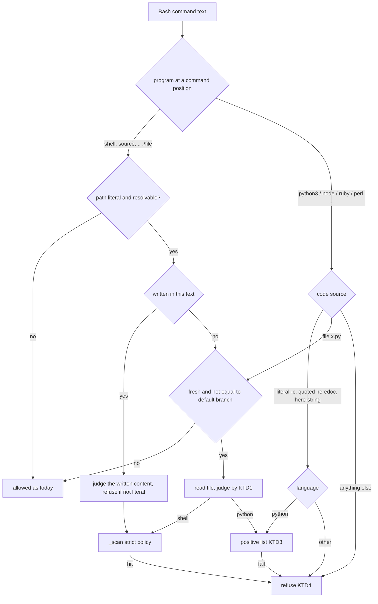

# Send-guard computed names in written scripts and inline interpreters - Plan

## Goal Capsule

- **Objective:** A programme worker that builds a send to another session's pane at run time, in a script it wrote or in inline interpreter code, is stopped with a fix it can act on, and ordinary worker commands still run.
- **Means:** Judge code a worker authored by the rule the worker's own typed commands already get, and allow inline Python only when a positive list shows it cannot open a socket or load code by string, and any process it starts has a command line written out as literal strings that is judged like a typed command (KTD1, KTD2, KTD3).
- **Authority:** This plan, then the brief `docs/handoff.md`, then the PM's go of 2026-11-02, then `docs/solutions/security-issues/narrowing-a-shell-command-guard-needs-default-deny-and-a-differential.md`.
- **Stop conditions:** Stop and report if a rule needs a deny-by-enumeration list to stay closed, if a new rule refuses more than 5% of the measured worker commands, or if the hook cannot answer inside its 10 s limit.
- **Execution profile:** Test-first. Every hole probe becomes a failing test before any rule changes. Every new rule gets a mutation check.
- **Who ships:** This worker opens the PR on `shawnroos/shrimpshack` and reports the head SHA and counts to the PM. It does not merge and does not publish.

---

## Product Contract

### Summary

The send-guard (`plugins/auto/lib/send_guard.py`) refuses a worker command that cannot be shown to avoid typing into the programme driver's pane. It reads the command text. It does not read a script file the command runs, and it reads inline interpreter code only for literal strings. Issue #184 "a script written to a file and then run is read only for literal sends" and issue #185 "quoted inline python can call a host binary through a computed name" name the gaps. This plan closes them for the shapes workers use, measures the cost first, and says plainly what stays open.

Reading code is a guard rail, not a sandbox. A worker acting with intent can still plant a file in one command and run it in another, or race a file between the read and the run. This plan raises that cost and removes the accidental routes. The only fix that closes the class is a runtime one: the host binaries and the herdr socket refuse any session that is not the driver. That is a product choice for the PM and is logged as a follow-up (Scope Boundaries).

### Problem Frame

Every row was reproduced on 2026-11-02 against the guard's strict policy (the policy for a session that drives no programme). Each is a command that reaches `herdr pane send-text` through a computed name.

| Shape | Verdict today |
|---|---|
| Quoted heredoc written to `x.sh`, then `bash x.sh` in the same command | allowed |
| `bash x.sh` where an earlier command or the editor wrote `x.sh` | allowed |
| `python3 -c` building `'her'+'dr'` and calling `subprocess.run` | allowed |
| Python heredoc using `import os as o; o.system(...)` | allowed |
| `node -e` with `require('child_'+'process')` | allowed |
| `perl -e` with backticks, `ruby -e` with `system` | allowed |
| `python3 x.py` where `x.py` computes the name | allowed |
| The same computed name typed as a plain shell command | denied |

A second route needs no process. `host_herdr.py` reads `HERDR_SOCKET_PATH`, so herdr has a Unix socket API, and inline Python that imports `socket` can send to a pane without starting `herdr`. Rex has no socket: it is a command-line tool only.

The guard's journal holds 229 `blocked_driver_send` rows, 204 of them `runtime-built command`. Workers already meet the existing rule often, so a much wider rule costs real work.

### Measured cost

Counts come from 339 transcripts touched in the last 30 days: 22,648 Bash commands from every project, not only programme workers. The 947 runs of scripts lost to the 2026-10-28 reboot (`/tmp` wiped) are left out of every rate. Regex counts overlap and are approximate; the plan uses them to choose between rules, not to promise a number. U3 and U4 re-measure with the final rules and stop at 5%.

| Measurement | Count | Reading |
|---|---|---|
| Runs of `bash`, `sh`, `source`, `.` or `./file` | 4,214 (19% of commands) | too common to refuse |
| Readable scripts the **existing command rule** would refuse | 2,032 of 2,256 (90%) | the command rule is tuned for one-liners; real scripts hold `$VAR` command words |
| Scripts the session wrote with the editor, then ran | 222 | |
| Of those, refused by the existing command rule | 99 (45%) = 0.44% of all commands | affordable |
| Scripts written and run in one command | 247 (1.1% of commands) | refusal share not yet measured; U1 measures it |
| Inline interpreter commands by language | python 2,993; perl 27; php/lua/other 5; node 1 | non-Python is 0.15% of commands |
| A first design that refused file writes and `pathlib` | 15.1% of all commands refused | too costly; file writes are now allowed and judged by what happens to the file next |
| Final design, replayed through the old and new guard (23,562 commands) | 4.3% newly refused; 5.7% if 350 runs of scripts that no longer exist are counted; 3.4% leaving out script-file refusals too | see the note below; nothing the old guard denied is allowed |

Reading every script under the command rule is the wrong tool. Reading only files the session itself wrote costs about 1% of commands. The replay is an ad hoc measurement, not a committed tool: it replays today's files and clock against old sessions, so scripts modified since then read as fresh and deleted ones read as missing. The largest parts of the 4.3% are by design: a process started from a command line that is not written out as literal strings (1.0%), and a command that writes a file and runs it in the same breath (0.9%). A broader rule that refused any Python that writes files in a command that also runs a script measured 6.9% and was replaced by matching the written names, with literal concatenations folded (`'x' + '.sh'`); names built from variables are a named residual. The PM can redirect either rule in review.

### Key Decisions

- **The brief's constraints are fixed.** (session-settled: user-directed — chosen over relaxing any of them for convenience: Shawn's brief of 2026-11-02 and the PM's go.) Both fixes keep denying a real send to a driver's pane through any shell, `eval`, written scripts and inline interpreters; no publish; the PM merges; review is adversarial and cross-model if available; P0 to P2 findings are fixed and each P3 becomes its own GitHub issue. Governs R1 to R10.
- **Inline code that spawns a process goes to the PM for acceptance.** The brief routes "refuse inline interpreter code that spawns a process" to the PM. This plan builds the recommended rule at its measured cost and puts the numbers in the PR; the PM accepts it by merging or sends it back. Governs R5 to R7.

### Requirements

**Written scripts (#184)**

- R1. A path that the same command text writes and then runs is judged as shell text (or as Python under R5 when it is a Python file) whatever the heredoc quoting, the redirect position, or the writer, and refused when the content cannot be read literally.
- R2. A script file that the sender session wrote or changed, run in a later command, is read before it runs and judged by the rule the sender's own typed commands get.
- R3. A tracked file identical to the default branch, and a file older than the sender's session, are not read: repo scripts and installed tools keep running.
- R4. A relative script path resolves against every directory the command may be in: a `cd` may fail, sit in a subshell or follow `&&`/`||`, so the directory before it stays possible. A literal script path that exists in none of them is refused (it may be created by a command the guard cannot read). A path that cannot be resolved (`bash "$f"`) stays allowed, as today, and is a named residual.

**Inline interpreters (#185)**

- R5. Inline Python is allowed only when its source is one piece the guard can read (a `-c` operand, a heredoc, or a here-string; `$NAME` expansions are replaced by values set from literal words in the same command, or by the harness variables `HOME`, `PWD`, `USER`, `TMPDIR` and similar when the command does not assign them), has no encoding cookie, and uses only imports, attributes and names on a published positive list. Everything else is refused.
- R6. The positive list contains no module or call that opens a socket, loads code by string, reaches another module by attribute or underscore name, or changes `os.environ` or the working directory. A call that starts a process passes only with a command line written out as literal strings, no `cwd=`, `env=`, `executable=` or `input=`, and no shell or interpreter reading its program from stdin; the command line is then judged like a typed command. File reads and writes pass; a device path under `/dev` other than the null and random devices is refused.
- R7. Inline code in any other scripting language is refused outright, except `osascript`, which keeps its existing rule.
- R8. A Python file run by name is judged by R5 and R6 when R2 says the file is read; a fresh file in another language, or with an unknown shebang, is refused. A file that imports a module shadowed by a file in the directories Python searches first (the working directory, the script's directory, a directory the code names) is refused.
- R9. A setting in the text that makes a program load code the guard cannot read is refused when the text runs a shell, interpreter or path: `PYTHON*`, `BASH_ENV`, `ENV`, `ZDOTDIR`, `LD_*`, `DYLD_*`, `SHELLOPTS`, `BASHOPTS`, `PS4`, `PROMPT_COMMAND`, whether set as a prefix or exported earlier. A `PATH` setting with a relative or empty component is refused whatever the command. `python -i`, `--rcfile`, `--init-file` and `env -S` are refused. A shell that reads its script from a pipe or a process substitution is refused.

**Refusals and safety**

- R10. Every new refusal names the cause and a fix the session can do from inside itself. Any exception, timeout or oversized input in the new checks refuses instead of allowing.

### Success Criteria

- Every hole row of the Problem Frame table is denied, the last row stays denied, and benign controls (`python3 -c "import json…"`, `bash plugins/auto/tests/run.sh`) stay allowed.
- Replaying the measured corpus through the old and new guard, every command the old guard allowed and the new one refuses is in a named class with a count, and the total is under 5%.
- The unit suite passes.

### Scope Boundaries

**Deferred to follow-up work (each logged as a P3 issue in `shawnroos/shrimpshack`):**

- The runtime closure: host binaries and the herdr socket refuse a non-driver session. It is the only fix that closes the class.
- Programs that start processes from their own arguments: `awk 'BEGIN{system(...)}'`, `find -exec`, `xargs`, `sed` with the `e` flag, `git -c` hooks, `make`.
- `python3 -m <module>`, including `-m timeit` with inline code, and code a read file imports or sources (transitive code, such as a fresh test file under `bash tests/run.sh`).
- Interpreters not on the name list (`lua5.4`, `ipython`, `awk`), wrappers not in KTD8 (`watch`, `script`, `parallel`), and `osascript` `do shell script` with a computed name.
- Races: a file swapped between the hook's read and the shell's run by a background job started in an earlier command.
- A worker moving the default-branch ref (`git update-ref`) to make its own script look identical to main.
- An operand the guard cannot resolve (`bash "$f"`, a non-literal `cd` leaves the earlier directory possible but adds none), which is 23% of file runs and stays allowed as today.
- Device paths spelled in pieces (`'/de' + 'v/tty'`), and startup files in Python site directories.
- A `$` inside a single-quoted `-c` operand is read as an expansion, because the lexer drops the quote kind.

**Outside this plan:** Changing what the guard does for the driver session, and the driver-pane id lookup.

### Sources

- Issues #184 and #185, brief `docs/handoff.md`.
- Hole probe and corpus counts: scripts run with `/usr/bin/python3 -I` on 2026-11-02.
- `plugins/auto/lib/send_guard.py`: `_scan`, `_split_heredocs`, `_heredoc_reader_is_shell`, `_unproven`, `_UNPROVEN_VERBS`, `_FIXES`, `denial`; `plugins/auto/lib/on-pretooluse-action.py` (`driver_send_denial`); `plugins/auto/lib/session_registry.py` (`lookup`, row field `at`).
- Prior plans `docs/plans/2026-10-31-1105-fix-send-guard-precision-plan.md`, `docs/plans/2026-11-02-1114-fix-send-guard-substitution-plan.md`.
- Plan review findings (feasibility and adversarial) of 2026-11-02, folded into the requirements and units below.

---

## Planning Contract

### Key Technical Decisions

- KTD1. **A script the session wrote is judged by the rule its typed commands get.** Cost is 0.44% of commands for editor-written scripts, against 90% for all scripts. Authorship, not content, separates the two.
- KTD2. **Freshness decides authorship.** A file is the session's when `max(mtime, ctime)` from `lstat` and `stat` is at or after the sender's session start, and it is not a tracked file whose `git hash-object --no-filters` blob equals the default branch's. ctime defeats `touch -d`. The session start is the **earliest** `at` in the registry rows for the session id, because SessionStart also fires on resume and compact and `lookup()` returns the latest. Git runs with the file's directory as cwd, a 2 s timeout, and any git error means read the file.
- KTD3. **Inline Python is default-deny by a positive list.** A public attribute of an allowed module passes only when its value is not itself a module (computed from the module at check time), a module never stands as a bare value, aliases resolve to the module, and an underscore-leading name or attribute, a star import, a frame attribute, and any name that loads or reaches code by string (`__import__`, `getattr`, `eval`, `exec`, `compile`, `globals`, `locals`, `vars`, `breakpoint`) are refused. The module list is in `MODULES` in `send_guard_inline.py` and the docs: the data and text modules (`json`, `re`, `collections`, `itertools`, `math`, `datetime`, `time`, `textwrap`, `string` without `Formatter`, `csv`, `hashlib`, `base64`, `urllib.parse`, `statistics`, `random`, `fnmatch`, `difflib`, `html`, `decimal`, `fractions`, `heapq`, `bisect`, `copy`, `pprint`, `unicodedata`, `binascii`, `struct`, `calendar`, `shlex`, `glob`, `io` for `StringIO` and `BytesIO`, `ast`, `hmac`, `contextlib`, `functools`), the file modules (`pathlib`, `tempfile`, `shutil`, `zlib`, `gzip`, `bz2`, `zipfile`, `tarfile`, `sqlite3` without extension loading), `sys` and `os` with named attributes, and `subprocess` under KTD10. `socket`, `ssl`, `http`, `urllib.request`, `asyncio`, `ctypes`, `pty`, `pickle`, `marshal`, `runpy`, `code`, `pdb`, `pkgutil`, `timeit`, `importlib`, `operator`, `typing`, `dataclasses` and `argparse` are not on it. The list grows only by adding a name with a test. A positive list was chosen over a refused-name list because of the repo learning on enumeration. The first design also refused file writes and `pathlib`; the 30-day replay showed that refused 15% of all commands, so a file write is allowed and judged by what happens to the file next (R2, R8, the device-path rule).
- KTD4. **Code is read as the shell passes it.** A `-c` operand, heredoc or here-string is read as text; a `$NAME` in it is replaced by a value set from literal words in the same command and both the raw and the expanded text must pass. An encoding cookie, a pipe from another command, `/dev/stdin`, a process substitution, or an unquoted heredoc holding a backslash escape the shell rewrites is refused. The lexer loses the quote kind, so a `$` inside single quotes is read as an expansion; that is a known false refusal with the quoted-heredoc fix.
- KTD5. **Non-Python inline code is refused outright.** Use was 33 commands in 30 days and no parser exists for them here.
- KTD6. **Two modules hold the new checks.** `send_guard_inline.py` has the Python check, the language flags, and file reading; `send_guard_runners.py` finds what each shell and interpreter in a command runs, and takes the `send_guard` module as an argument because `_scan` and the lexer live there. `send_guard.py` grows only by the heredoc body record, the `ctx` argument and the call (827 to 868 lines), which keeps it under the 1000-line budget.
- KTD7. **Fail closed inside a deadline.** The entry point catches `Exception` and refuses, which covers `RecursionError` and `MemoryError`. It has a per-command deadline checked between programs and between git calls, a cap of 8 files and 256 KB each, and a node cap; a non-regular file refuses. `ast.parse` runs inside the same guard.
- KTD8. **One "what runs a file" set.** Shells in `_SHELL_NAMES`, `source`, `.`, `./path`, absolute, `~` and `../` paths, the interpreter list, `exec`, `env`, `setsid`, `arch`, `xcrun`, `coproc`, `timeout`, `gtimeout` and `uv`/`poetry`/`pipx`/`pipenv`/`rye`/`conda`/`hatch run`. The judge is chosen by interpreter name, falling back to the shebang for `./f`; an unknown shebang is refused. Wrappers not in this list (`watch`, `script`, `parallel`) are a named residual.
- KTD9. **Loader settings are refused by name.** The set in R9 is small and each name has a documented effect ("load code the guard did not read"), so a name list is correct here; it is not a list of program names.
- KTD10. **A literal spawn is judged as a typed command.** `subprocess.run`, `call`, `check_call`, `check_output`, `Popen`, `getoutput`, `getstatusoutput` and `os.system`/`os.popen` pass only when called directly with one literal string or a list of literal strings, and only the keywords `stdout`, `stderr`, `stdin`, `text`, `capture_output`, `check`, `timeout`, `universal_newlines`, `encoding`, `errors` and `shell`. The command line is scanned as if typed, so a send to a driver's pane stays denied and a send to a proven worker pane stays allowed. This is the fix direction written in issue #185. Chosen over refusing all inline code that starts a process because the existing integration test `programme-hooks.test.sh` pins that a literal send to a worker pane from inline Python is allowed; the PM can redirect this in review.

### High-Level Technical Design

### Assumptions

- The registry row's `at` field (ISO UTC, written at SessionStart) is the session start; confirmed in `session_registry._store`.
- Hook JSON carries `cwd`; U4 passes it through `driver_send_denial` and `denial`.
- The default branch ref is `origin/main` or `main`; with neither, every tracked file counts as differing, which is the stricter direction.

### Risks

| Risk | Mitigation |
|---|---|
| The positive list leaks through a module reachable from an allowed one | Positive pairs, underscore names refused, mutation-check `shlex.os`, `collections.sys`, `os.path.os`, `string.Formatter`; the list is public and grows only with a test |
| `git checkout` or rebase freshens repo scripts | Exempt tracked files identical to the default branch |
| The refusal share exceeds 5% | Measured on every design change; the first design measured 15% and was loosened; the final design measures 5.0% to 6.3% depending on replay artifacts, which the PM judges |
| Worker forges the default-branch ref or races a file | Documented residuals with a runtime-closure follow-up |
| A hook exception allows the command | KTD7: the new code catches `Exception` and refuses; a fuzz of about 92,000 commands found no crash outside it |
| Each review round finds more bypasses | Stop at three rounds with the same P0 or P1 and hand back (brief); the runtime closure is the real fix |

---

## Implementation Units

### U1. Same-command written files are judged

- **Goal:** R1.
- **Requirements:** R1, R10
- **Dependencies:** none
- **Files:** `plugins/auto/lib/send_guard.py`, `plugins/auto/lib/send_guard_runners.py` (new), `plugins/auto/tests/unit/send-guard-computed-names.test.sh` (new)
- **Approach:**
  1. Record each heredoc's redirect target and reader programs in `_split_heredocs` (`_Body`).
  2. Collect write destinations in the text: `>`, `>>`, `&>`, `tee`, `cp`, `mv`, `sed -i`, `curl -o`, `install`, `ln`, `dd of=`, and a literal `printf` or `echo`; collect run targets with the KTD8 set.
  3. After the token loop, `_scan` calls `send_guard_runners.judge_runners`. A body whose destination matches any spelling of a run target (as written, and resolved against each directory the command may be in) is scanned as shell, or as Python for a Python runner.
  4. A destination that is also a run target but whose content is not a literal heredoc or literal `printf` is refused with cause `script`. A literal run target that exists nowhere is refused too, which covers writers the guard does not model (`tar`, `unzip`, `git checkout`).
- **Execution note:** Write the failing tests from the probe table first; measure the refusal share of the 247 same-command runs against the old guard before closing the unit.
- **Patterns to follow:** `_heredoc_reader_is_shell`, the `quoted` handling in `_split_heredocs`.
- **Test scenarios:**
  - Quoted-delimiter heredoc to `x.sh` holding `H=$(printf 'her%s' dr); $H pane send-text w1:p9 hi`, then `bash x.sh`, is denied.
  - `cat <<'EOF' > x.sh` (redirect after the heredoc operator) is denied the same way.
  - The same body with only `echo ok` is allowed.
  - A body redirected to `x.sh` and never run stays data, so existing heredoc-data cases stay allowed.
  - `printf '%s' "$X" > f.sh; bash f.sh` and `cp "$SRC" f.sh; bash f.sh` are refused with the `script` fix text.
  - A Python file written by heredoc and run as `python3 x.py` is judged by U3.
  - `source x.sh`, `. x.sh`, `./x.sh`, absolute and `~` paths, `ksh x.sh`.
  - Error path: 1,000 chained writes finish inside the time bound.

### U2. Inline interpreter extraction

- **Goal:** Find the code an interpreter will run so U3 can judge it.
- **Requirements:** R5, R7, R9
- **Dependencies:** U1 (both edit the `_scan` region; serial)
- **Files:** `plugins/auto/lib/send_guard.py`, `plugins/auto/lib/send_guard_runners.py`, `plugins/auto/lib/send_guard_inline.py` (new)
- **Approach:**
  1. Keep the existing literal-string scan for every interpreter so nothing regresses; the new judgement runs after it.
  2. `plan()` in `send_guard_inline.py` returns the code operand, stdin, file or module from the words after an interpreter, skipping the options that take a value (`node -r f`, `perl -I d`, `deno run`).
  3. Read a heredoc body when its reader line names the interpreter, a here-string as text, and a `$NAME` by KTD4; refuse a pipe, `/dev/stdin` and a process substitution.
  4. Resolve the wrappers in KTD8 to the program they run, and refuse the loader settings in R9.
- **Test scenarios:**
  - `python3 -c '...'`, `python3 -Ic '...'`, `python3.12 - <<'EOF'`, `python3 <<<'...'` yield the code.
  - `python3 -c "$CODE"`, `python3 -c "x='$A'"`, `curl … | python3 -`, `python3 /dev/stdin`, `python3 <(…)` are refused; an unquoted heredoc with no escape that the shell rewrites is read.
  - `cat data.json | python3 -c '...'` judges the `-c` code only.
  - `PYTHONBREAKPOINT=os.system python3 -c '...'`, `PYTHONSTARTUP=f python3 -i`, `BASH_ENV=f bash -c 'true'`, `PATH=./bin:$PATH python3 -c '...'` are refused.

### U3. Python positive list and non-Python refusal

- **Goal:** R5, R6, R7.
- **Requirements:** R5, R6, R7, R10
- **Dependencies:** U2
- **Files:** `plugins/auto/lib/send_guard_inline.py`, `plugins/auto/lib/send_guard.py` (`_FIXES`, `_UNPROVEN_VERBS`, hit tuple), `plugins/auto/tests/unit/import-topology.test.sh` (add the new module's edges), `plugins/auto/tests/unit/send-guard-computed-names.test.sh`
- **Approach:**
  1. Parse with a wrapped `ast.parse`; refuse a coding cookie; walk iteratively with a node cap.
  2. Apply KTD3 as a positive list of pairs; resolve aliases; refuse underscore names, star imports and listed names.
  3. Return cause `inline` or `script` with the first offending import, name or attribute. The existing verb `runtime-built command` carries them, so `_UNPROVEN_VERBS` is unchanged; `_FIXES` gains `inline` and `script` entries whose `{detail}` is filled by `_fix`.
  4. Re-measure the 30-day corpus with the final list; if the refused share is over 5%, stop and report.
- **Technical design:** a pure function `analyse(code) -> (reason | None, literal command lines)`.
- **Test scenarios:**
  - Allowed: `import json, sys; print(json.dumps({'a': 1}))`, `os.path.join`, `re`, `collections`, `datetime`, `open('f')`, `open('f','w')`, `pathlib.Path(...).write_text`, `os.makedirs`, `shutil.copy`, `os.system('echo hi')`, `subprocess.run(['git', 'status'])`, and a literal `herdr pane send-text` to a proven worker pane.
  - Denied: a computed command line, `cwd=`, `env=`, `executable=`, `input=`, a shell or interpreter with no script, `import os as o; o.system(cmd)`, `o.posix_spawn`, `import socket`, `urllib.request`, `__import__('sub'+'process')`, `getattr`, `shlex.os.system`, `collections._sys`, `collections.sys.modules`, `os.path.os.system`, `sys._getframe`, `string.Formatter().get_field(...)`, `().__class__.__bases__[0].__subclasses__()`, `eval`, `exec`, `compile`, `breakpoint()`, `open('x', mode_var)`, `os.environ['X'] = ...`, `os.chdir`, a `/dev/tty` path in any spelling, `from shlex import os as o`, `from x import *`, a literal send to a driver's pane.
  - Denied: a `# coding: utf-7` cookie; `node -e`, `ruby -e`, `perl -e` with backticks, `deno eval`, `bun -e`, `php -r`, `lua -e`; allowed: `osascript -e 'tell …'` under its existing rule.
  - Error path: a 200 KB code string, 5,000 nested expressions and a syntax error each answer inside 10 s and refuse.
  - Differential: every command in the probe set that the old guard denied is still denied.

### U4. Fresh script files are read before they run

- **Goal:** R2, R3, R4, R8.
- **Requirements:** R2, R3, R4, R8, R10
- **Dependencies:** U3 (and the cwd plumbing in this unit)
- **Files:** `plugins/auto/lib/on-pretooluse-action.py` (pass `cwd` from the hook JSON), `plugins/auto/lib/send_guard.py` (`denial` takes `cwd`), `plugins/auto/lib/send_guard_runners.py`, `plugins/auto/lib/send_guard_inline.py`, `plugins/auto/lib/session_registry.py` (`session_start`), `plugins/auto/tests/unit/send-guard-computed-names.test.sh`
- **Approach:**
  1. Pass the hook's `cwd` to `denial`; track `cd` as a set of possible directories (R4).
  2. For each KTD8 run target with a literal operand, apply KTD2 freshness in each possible directory; skip files that are not fresh or are identical to the default branch.
  3. Read under KTD7 limits. Shell files go to `_scan` under the strict policy; Python files go to U3; a fresh file in another language or with an unknown shebang, a FIFO, an unreadable file and a file over 256 KB are refused with the fix. Only a compiled program (ELF, Mach-O, PE magic) is allowed unread; a NUL byte does not make a file binary.
  4. `session_registry.session_start` returns the earliest `at` for the session id; the fallback is six hours before now when the row is missing.
- **Execution note:** Check the registry rows after a resume and a compact before writing the start helper.
- **Test scenarios:**
  - A fresh file that computes `herdr`, then `bash f` in a later command, is denied.
  - The same file after `touch -d '2020-01-01'` is still denied through ctime.
  - A resume or compact row later than the file does not exempt it (earliest `at`).
  - A tracked script identical to the default branch, freshened by checkout, is allowed.
  - A script committed on the feature branch but absent from the default branch is read.
  - An old untracked installed tool is allowed.
  - A fresh file over 256 KB, a FIFO, a directory and a symlink to a fresh file are refused or resolved by real path.
  - `cd sub && bash f.sh` resolves `f.sh` under `sub` and under the directory before the `cd`; `cd "$D" && bash f.sh` reads `f.sh` where it exists and stays allowed when it exists nowhere.
  - Fresh `x.py` holding `subprocess` is denied; holding only `json` is allowed.
  - A command that runs more than 8 fresh scripts is refused (the file cap), so a worker cannot use many script words to push the hook past its time limit.

### U5. Corpus replay, differential, mutation checks and docs

- **Goal:** Prove the narrowing and record the rules and residuals.
- **Requirements:** all
- **Dependencies:** U1 to U4
- **Files:** `docs/solutions/security-issues/narrowing-a-shell-command-guard-needs-default-deny-and-a-differential.md` (update), `plugins/auto/tests/unit/send-guard-computed-names.test.sh`
- **Approach:**
  1. Replay the 30-day corpus through the pre-branch module and the new module out of process; list every old-allow, new-refuse command by class with counts, and count Python-version SyntaxError refusals on their own.
  2. Mutate each new rule (drop a list check, the ctime term, alias resolution, the node cap, the earliest-`at` choice, the env refusals) and confirm a test fails for each.
  3. Update the docs with the rules, the published list and the residuals.
- **Test scenarios:**
  - Test expectation: the replay and mutation runs are evidence for the PR, not committed fixtures; the committed tests cover each class.

---

## Verification Contract

| Check | Command | Applies to |
|---|---|---|
| Unit suite | `bash plugins/auto/tests/run.sh unit`, run through `~/.claude/tools/honest-run/run.sh` with the marker the suite's own summary line prints (read it first) | all units |
| New tests alone | the new test file under `honest-run` | U1 to U4 |
| Out-of-process differential | import both module versions with `/usr/bin/python3 -I` and compare verdicts on the probe and corpus sets | U5 |
| Hook time bound | timed deny on adversarial input inside the test file | U1, U3, U4 |

The installed guard (`auto` 0.16.14) gates this session's shell and predates #180, so `ce-code-review`'s launcher and its cross-model peer may be refused. Review inputs are written as files and run with `/usr/bin/python3 -I`. The PR states whether the cross-model pass ran.

## Definition of Done

- All five units are implemented and every test scenario has a test.
- The unit suite passes, shown by a verdict line from `honest-run`.
- The differential lists no unexplained old-deny, new-allow command, and the old-allow, new-refuse total is under 5%.
- Each new rule has a mutation that makes a test fail.
- `ce-code-review` and one `thermo-nuclear-code-quality-review` pass are clean of P0 to P2; each P3 and each residual is a GitHub issue.
- Abandoned probe code is not in the diff.
- The PR is open with head SHA, counts, the measured-cost table, the residuals and the cross-model status. It is not merged and not published.
