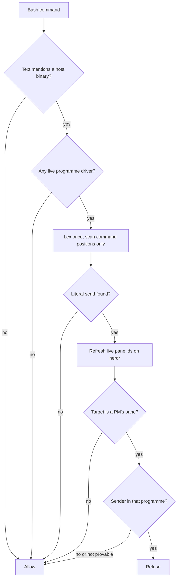
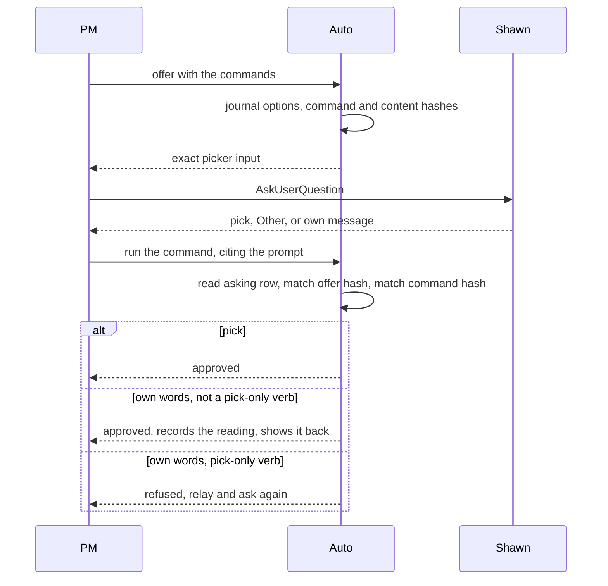
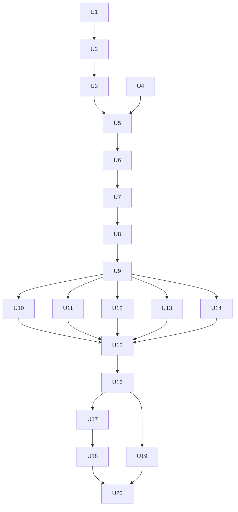

# Auto Permissive by Default - Plan

## Goal Capsule

- **Objective:** A worker can do anything Claude Code lets it do, a PM can change how Auto's hooks behave, and Shawn never has to type or paste exact text. Auto limits a worker only when Shawn and the PM have explicitly agreed that limit.
- **Means:** Three sequential PRs in `plugins/auto`: Removal, Approvals, then Agreed limits with PM settings (KTD1).
- **Authority:** Requirements win on product behaviour. KTDs win on mechanism inside the cited requirements. Units override neither. Code and tests beat any claim here about them.
- **Stop conditions:**
  - Stop and ask Shawn if evidence shows a labeled Key Decision cannot work.
  - Stop if the same P0 or P1 review finding returns across 3 consecutive fix rounds.
  - Stop before merging PR 2 or PR 3: both need Shawn's approval.
- **Execution profile:** Sequential PRs. Parallelism inside each PR is in Parallelism Analysis.
- **Who finishes and ships:** The implementing session merges and publishes PR 1 without another stop once review is clean and tests pass (R31). Shawn approves merges of PR 2 and PR 3.

---

## Product Contract

### Summary

PR 1 deletes the send-guard's strict check and the worker-facing refusals, leaving a refusal of a literal send into a PM's pane, and tells PMs how to change hook code. PR 2 replaces every typed approval with a picker answer or Shawn's own words, with Auto writing the picker text. PR 3 adds one on/off setting per named check, in the programme record, which also carries agreed limits on workers.

### Problem Frame

Auto's guards have started to stop workers doing normal work. The journals hold 477 send-guard refusals across 48 sessions. Of those, 462 are "cannot prove it" refusals from `_strict_hit` in `plugins/auto/lib/send_guard.py`, which runs for any session that is not a PM once any programme is live on the machine. The one row labelled a literal send was a false positive: test cases in a heredoc. The sampled rows were ordinary work such as `git show` and `rex session rename`. This is a sample of the 477, not a full audit.

Each round of narrowing has added code and found new bypasses. The guard is now 827 lines, and open PR #212 (read scripts a worker wrote and inline interpreter code) would refuse a further 5.2% of past worker commands.

Separately, Auto asks Shawn to type exact words: 14 typed-only commands, worker ask replies, a setup "Type this:" step and hand-applied permission rules. That costs him time on every approval, and the wording of each check is a refusal he has to work around.

### Key Decisions

- **Default is permissive; a limit exists only by explicit agreement.** Governs R1, R2, R4, R5. (session-settled: user-directed — chosen over keeping today's guards and tuning them: Shawn offered removal as the alternative to a change.)
- **Delete the strict check outright.** Governs R1. (session-settled: user-approved — chosen over another round of narrowing, and over a setting to restore it: a computed send into a PM's pane now gets through.)
- **Keep a literal refusal for the PM's pane, for the programme's own sessions.** Governs R3. (session-settled: user-approved — chosen over removing the guard entirely: cheap, and it almost never fires on real work.)
- **Advisor redirect, pre-filled answer refusal, PM-only limits and PM-only contract writes stay.** Governs R6. (session-settled: user-approved — chosen over removing them: they govern who answers and who proves, not what a worker can do.)
- **PM controls hooks by settings and by code.** Governs R7, R8, R23, R24. (session-settled: user-directed — chosen over settings only and over code only: Shawn accepts the risk.)
- **The PM loosens alone; Shawn's picker answer tightens.** Governs R24. (session-settled: user-approved — chosen over needing Shawn's answer both ways: a PM can lift a limit he agreed without asking.)
- **Two checks have no off setting.** Governs R25. (session-settled: user-approved — chosen over making everything switchable: these keep his answer and proof from being forged.)
- **No exact text anywhere in Auto.** Governs R13, R14, R21. (session-settled: user-directed — chosen over keeping typed lines for sensitive verbs.)
- **High-stakes approvals need a pick; own words count elsewhere.** Governs R15. (session-settled: user-approved — chosen over own words everywhere: earlier versions approved on "No" and "Skip r1".)
- **Slash commands stay as one way to start end, handover and takeover.** Governs R20. (session-settled: user-approved — chosen over pickers only: typing one is his own act, not an approval reply.)
- **Picking allow makes Auto write the permission rule.** Governs R19. (session-settled: user-approved — chosen over Shawn applying it by hand: rules come only from a closed read-only catalog.)
- **Close PR #212 and its issues.** Governs R10. (session-settled: user-approved — chosen over merging or rescuing it: it tightens the path that produced 462 refusals.)

### Requirements

**Removal (PR 1)**

- R1. The send-guard's strict check and every "cannot prove it" refusal are gone, with no setting to restore them.
- R2. Outside a programme, Auto refuses nothing. The advisor redirect and the Stop block still reach a standalone self-driven `/auto` run.
- R3. A literal send into a PM's pane from one of that programme's own sessions is refused, on herdr, Rex and Ghostty. A command that only names the pane, reads it, or computes its target is allowed.
- R4. Destructive commands are not refused and do not pause a run, unless a limit is agreed (R27).
- R5. Workers may write `settings.local.json` and the behaviours files. The refusal stays for the PM.
- R6. These stay as they are: advisor redirect, pre-filled answer refusal, Linear checks on the PM, sub-agent refusals, and PM-only contract writes when PR #161 (let the PM set and change a worker's contract) lands.
- R7. A PM may change hook code by PR and publish, even when shrimpshack is outside its remit. This covers hook code only, and merging still needs Shawn.
- R8. A PM may patch the installed copy when a hook blocks work now. In the same sweep it journals the patch, tells Shawn and opens a PR.
- R9. Auto refuses neither code route. Claude Code's own permissions still apply and are not bypassed.
- R10. PR #212 closes unmerged with its branch kept. Issues #184 and #185 (computed sends), #213 (only a runtime check closes the class) and the follow-ups #214 to #223 and #242 close as not planned.
- R11. `denied-command-stop` applies only to a refusal of an Auto limit, so a Claude Code denial is handled as it normally would be. The same wording in `plugins/auto/skills/programme-sweep/SKILL.md` follows.
- R12. Replaying the 477 journaled commands refuses only true literal sends, and any refused row is listed for review.

**Approvals (PR 2)**

- R13. Every approval is a picker answer or, where R15 allows, Shawn's own words. No command, ask or setup step needs exact words, and named-word checks stop refusing.
- R14. Auto writes the picker's text from the command and stores the link, so the PM cannot word an option one way and run another.
- R15. Accepting an agreement, a takeover, widening authority or remit, and allowing a permission need a pick. Own words on those are relayed and the PM asks again.
- R16. Own words on any other approval count as the answer to the question just asked. Auto records how the PM read them and shows that reading back to Shawn.
- R17. A pick left by idle timeout never approves. A pick with a note counts as own words.
- R18. The PM drafts Rulings and remit changes, the picker shows the draft, and Shawn approves it or rewrites it through Other. The record says whose wording it is.
- R19. Picking allow on a permission proposal makes Auto write that proposal's rules to its `settings.local.json`.
- R20. `/auto:programme-end`, `/auto:programme-handover` and `/auto:programme-takeover` still work when typed. Auto never tells Shawn to type one, and offers a picker for each.
- R21. A test fails if Auto's instructions, commands, fix lines or pane ask for exact text again. The PM's instructions state the rule.
- R22. The pre-filled answer refusal and the transcript check stay.

**Agreed limits and PM settings (PR 3)**

- R23. A PM can turn each named check on or off for the whole programme or a named item. This covers Auto's refusal checks and the Stop hook's block. Hooks that only report or reload stay outside this.
- R24. Turning a check off or lifting a limit is the PM's call, journaled and shown in `/auto:programme-status`. Turning on a check that limits a worker needs Shawn's pick.
- R25. The pre-filled answer refusal and the Linear done, cancelled and root-cause rule have no off setting.
- R26. An agreed limit is a named check, recorded on one list in the programme record. A contract term and a behaviour can both add to that list, subject to R24. Free text stays as instructions only.
- R27. The first named limits are `no-destructive-commands` and `no-settings-writes`.
- R28. A limit refuses one call and journals it, with no pause. It applies on the next tool call, and running work is not recalled.
- R29. A limit follows the item: every attached session, sub-agents and attached takeover sessions, until the item finishes or the programme ends.
- R30. A limited worker cannot write the programme's files directly. An unlimited worker has no such check. Limits show in the start brief, in status and in each refusal. If settings cannot be read, each check uses its default and Auto journals the failure.

**Shipping**

- R31. PR 1 merges and publishes without another stop once review is clean and tests pass.
- R32. The order is Removal, Approvals, then Agreed limits.
- R33. After publishing, a worker in a programme on the MacBook runs commands the old guard refused, and a PM edits hook code. Refused edits are reported, not worked around.

### Acceptance Examples

- AE1. **Covers R3.** Given a worker in the programme, when it runs `herdr pane run <PM pane> ls`, it is refused. When it runs `echo herdr pane run <PM pane>`, `git grep osascript tmux`, or `P=<PM pane>; herdr pane run $P`, it is allowed.
- AE2. **Covers R2, R3.** Given a session in no programme, when it runs a literal send into a PM's pane, it is allowed.
- AE3. **Covers R15, R16.** Given a picker for `drop-item`, when Shawn types "No, keep it", the PM records no drop. When he types "yes drop it", the PM runs the drop with its reading, and Auto shows that reading back.
- AE4. **Covers R15.** Given an accept picker, when Shawn answers through Other with "ask the PM about repos", no acceptance happens, and the PM relays it and asks again.
- AE5. **Covers R24, R25.** Given a live programme, the PM can turn off the literal send check alone. It cannot turn on `no-destructive-commands` without Shawn's pick, and it cannot turn off the pre-filled answer refusal at all.

### Success Criteria

- Across the replayed journal, refusals fall from 477 to only true literal sends (R12).
- After PR 2, a search of Auto's instructions, fix lines and pane finds no request for exact text, and that search can fail (R21).

### Scope Boundaries

- A runtime check in the host binaries or the herdr socket is out: issue #213 closes (R10).
- Limits on sessions outside a programme are out, including an opt-in for standalone `/auto` (R2).
- `plugins/auto/mods/programme-view` still does not post prompts. A pane proposal waits for the PM's next sweep.

#### Deferred to Follow-Up Work

- A wake for pane proposals, so Shawn does not wait for the next sweep.
- Named limits beyond the first two, added when Shawn first wants one.
- The cause of the field row where a typed "ship AI-1475" came through unverified.

### Sources

- `docs/solutions/architecture-patterns/a-picker-answer-is-approval-only-after-the-transcript-check.md` shapes KTD9 and KTD10. PR 2 updates its item 6, which says the option text is the label.
- `docs/solutions/security-issues/narrowing-a-shell-command-guard-needs-default-deny-and-a-differential.md` shapes KTD3 and U5. PR 1 marks it superseded for this guard, because its default-deny advice is what this work reverses.
- `docs/solutions/best-practices/a-switch-that-restrains-an-agent-cannot-read-the-agents-environment.md` shapes KTD15.
- `docs/solutions/best-practices/a-dispatched-sub-agent-inherits-the-session-id-a-guard-trusts.md` explains why R29 covers sub-agents through the session id.

---

## Planning Contract

### Key Technical Decisions

- KTD1. **Three sequential PRs.** Removal ships first because it needs no new mechanism and stops live pain. Approvals comes before limits so tightening uses the new picker from the start. (session-settled: user-approved — chosen over one PR or limits first: Shawn agreed this order knowing it delays limits by one PR.)
- KTD2. **Keep `send_guard.py`, but keep only literal forms.** It keeps direct, precommand, compound, `bash -c`, `eval`, `$( )`, backtick and shell-heredoc forms, since the shell runs each as written. That is about 425 of today's 827 lines, and it keeps the `every_form` tests in `tests/unit/send-guard-hosts.test.sh`, `tests/unit/host-rex.test.sh` and `tests/unit/host-ghostty.test.sh`. The narrower option, about 290 lines, would drop 4 of 10 literal forms.
- KTD3. **Delete the inline interpreter block too.** `_INTERPRETERS` and `_STRING_LITERAL` fire outside the strict path, so removing `_unproven` does not remove them. A literal send inside `python3 -c` then passes, which is consistent with accepting computed sends.
- KTD4. **Scan only at command position, and skip non-shell heredoc bodies.** Deleting `_strict_hit` alone still refuses `echo herdr pane run <id>`, `grep ...` and `cat <<EOF` bodies, because `_scan` tries every token. Each command is lexed once, which removes the per-word cost that PR #212's time-limit fix was treating.
- KTD5. **Narrow Rex and Ghostty `is_host_command`.** Both match on a name today, which refuses `rex frob -b <id>` and `osascript -e 'return "<id>"'`. Require a typing verb and the pane as the target. herdr is already literal.
- KTD6. **Check order keeps ordinary commands cheap.** Text test, then driver panes, then scan, then live pane lookup on a hit, then target match, then membership. The 1 s herdr snapshot and the record read then run only when a command is close to a real send. The High-Level Technical Design shows this flow.
- KTD7. **Membership is a new helper.** Nothing today answers "is this session in this programme": `programme_settings_guard.scope` misses workers in other spaces. The helper checks the driver, then the lease at `session_registry.space_of_session`, then item `programme_home.session_ids`. The first two need no record read. If only the item check could prove membership and the record cannot be read, the send is allowed, because R2 frees any session not shown to be in the programme and a computed send gets through anyway.
- KTD8. **Keep `decide()` dormant behind one gate rather than deleting it.** PR 1's gate is always off outside a fenced test hatch, and PR 3 replaces its body with a setting read. This keeps about 42 tests working as the safety net for U18. The shim's start gate becomes lease-only.
- KTD9. **Stored offers, hashing the whole questions array.** A new `approval_offered` journal row holds the options, each command's hash and a content hash. At approval, Auto reads the asking row from the transcript and matches the hash. Hashing only the label would leave the question and descriptions free for the PM to word. This stops a PM's mistake or misleading wording, not a PM that rewrites journal rows: each command hash lives in a row the PM can write, so a rewritten row can rebind an option to another command.
- KTD10. **Harden pick verification before relying on it.** `programme_pick_source.verify` refuses a row with `afkTimeoutMs`, treats `annotations[q].notes` as own words, and counts questions asked, not just answered. `queued` prompts count as human under the same transcript check, or own words fail whenever Shawn answers during a sweep. Compare the raw answer from the transcript, since the captured map is redacted.
- KTD11. **A pure renderer for takeover only.** `_guard` refuses a non-driver, so takeover cannot write an offer row. Its option text is a function of the current driver, compared under the leases lock on session id, not pane name.
- KTD12. **Renderers state what the named checks forced into view.** `delta.words` and `_widen_word` were display requirements in disguise. A widening option must say it widens, or removing the check removes the protection. A label must let Shawn tell two commands apart, and must not contain `", "`, because multi-select joins labels with that. Every question carries a decline option with no command, which approves nothing. On authority moves the decline comes first, so Enter on the focused option approves nothing.
- KTD13. **Large content binds by hash and unbounded lists split.** A 64 KB behaviour draft will not fit a readable picker, so it shows in chat and is bound by stored `content_hash`. `carry-rulings` and `keep-*` split across pickers, because a question holds 2 to 4 options, and the decline option leaves room for 3 commands.
- KTD14. **The record gains `wording` and an approval reference.** `quote` holds the approved text and `wording` is `shawn` or `pm_draft`. A legacy row with no `wording` reads as `shawn`. The views stop saying `Shawn: "..."` for a draft. The closed key checks in `programme_behaviours.py` and `programme_rituals.py` must accept the new key.
- KTD15. **Settings live in a new `check_settings` field, outside `agreement.terms`.** Terms feed `terms_digest`, so each toggle would invalidate an accept. No `format_compat` change or format bump is needed. A setting is read only from the record, so no environment variable a worker can set opens or closes a check.
- KTD16. **Limit lookup walks held leases.** `scope` misses workers in other spaces (KTD7), so PR 3 walks `programme_home.iter_leases`, one store wait per run, gated by the shim's text prefilter.
- KTD17. **`no-destructive-commands` refuses with no task run.** `decide()` acts only when a run in the repo's `.claude/auto` owns the session, so a plain worker would slip through. PR 3 moves the refusal to the limit check and drops the pause (R28).
- KTD18. **Journal one row per unreadable episode.** `programme_journal.append_row` uses the store a hold blocks, and a per-call row would repeat on every Bash call. Dedupe by writing later, once the store is free.
- KTD19. **New code goes in new modules.** `tests/unit/size-budget.test.sh` fails above 1000 lines, and its fix is to decompose. `programme_home.py` and `programme_behaviours.py` are at 1000, `programme.py` and `programme_lifecycle.py` at 996, and `programme_sources.py` at 992. Verbs go in `programme_offers.py` and `programme_checks.py`, the `check_settings` read function and defaults go in `programme_checks.py`, and a unit touching one of these files offsets every line it adds there.

### High-Level Technical Design

Literal send check after PR 1 (KTD6):

Approval flow after PR 2 (KTD9, KTD10):

Who may approve what (R15, R16, KTD12):

| Class | Commands | Pick | Other or chat words |
|---|---|---|---|
| Authority moves | `accept-agreement`, takeover, `adopt-autonomy --widening`, remit widening, permission allow, `record-ruling` and `accept-context` when `delta.wider` is true, `close-ruling` on a restrict Ruling | Approves | Relay and ask again |
| Content | Other `record-ruling` and `close-ruling`, `edit-project-term`, `record-behaviour`, remit narrowing | Approves the draft | His words become the content, `wording: shawn` |
| Everything else | `drop-item`, `reopen-item`, `answer-handed`, `lift-pause`, and other approval verbs | Approves | Approves, with the PM's reading recorded and shown back |
| Never approves | Accepted suggestion, peer, system, cron | | The model wrote the text or it did not come from Shawn |

Check settings after PR 3 (R23 to R25):

| Check | Default | PM may turn off | Turning on needs |
|---|---|---|---|
| `no-destructive-commands` | off | yes | Shawn's pick |
| `no-settings-writes` for workers | off | yes | Shawn's pick |
| PM settings and behaviours writes | on | yes | PM alone |
| Literal send into the PM's pane | on | yes | Shawn's pick |
| Linear writes outside the remit | on | yes | PM alone |
| Advisor redirect, programme task runs only | on | yes | Shawn's pick |
| Sub-agent refusals | on | yes | PM alone |
| Stop block, programme runs only | on | yes | Shawn's pick for a worker's run, PM alone for its own |
| Linear done, cancelled, root cause | on | no | n/a |
| Pre-filled answer refusal | on | no | n/a |

### Parallelism Analysis

| PR | Must be sequential | Parallel-safe |
|---|---|---|
| PR 1 | U1, U2 and U3 in order: all edit `tests/integration/programme-hooks.test.sh` and touch `_cli` | U4 alongside any of them. U5 and U6 come last |
| PR 2 | U7, then U8, then U9 first. U15 last: its test fails until the rewrite is done | U10, U11, U12, U13 and U14 after U9, each owning most of its files. Expect small merge conflicts in `programme_fixes.py` and `programme_journal.py` (all), `programme_lifecycle.py` (U10, U14) and `mods/programme-view/contract.tsx` (U10, U13) |
| PR 3 | U16, then U17, then U18 | U19 alongside U18 once U16 lands |

PRs run sequentially (KTD1). Hold fan-out to two heavy agents at a time.

### Assumptions

Agent bets that Shawn has not confirmed:

- A worker can now close another worker's pane. `send_class` is deleted, and it was what stopped a peer closing a pane. Only a literal close of a PM's pane stays refused.
- A task-run sub-agent's prompt loses clause (ii) in `plugins/auto/skills/auto/SKILL.md` section 4.6, which tells it not to run the destructive set. It is an instruction rather than a refusal, but it restricts workers the same way.
- Ghostty's `_names` match stays as it is, so text typed to another terminal that quotes a PM's id still refuses. Only herdr is exact.
- `feedback_no_publish_without_an_eval_run` covers the package registry, not this marketplace, so PR 1 publishes with no eval run.
- An accepted suggestion never binds an offer, including where it could approve a pick verb today.
- A pane proposal says "the PM will ask you" and waits for the next sweep.

### Risks

| Risk | Mitigation |
|---|---|
| A computed send puts text in a PM's pane that reads as Shawn's typing. Own words now count as approval, R20 lets typed slash text start end, handover and takeover, and `send-keys` may answer an open picker, which the pick check cannot tell from his key press | Shawn accepted computed sends. R15's pick requirement and a decline-first picker (KTD12) raise the bar but do not close this. U7 measures the picker case |
| Between the PR 1 and PR 2 publishes, a computed send naming the right words passes as a typed approval, including for typed-only verbs, because R15 arrives in PR 2 | U6 tells PMs to confirm a typed widening or Ruling with Shawn by picker until PR 2 ships |
| R14 and R25 stop a PM's mistakes and setting changes, not a PM patching installed code or writing the journal directly | Shawn accepted this with the code route (R8). U4 requires the notice to name any patched file that implements R14, R15 or R25 |
| The PM misreads own words, since Auto no longer checks them | Read-back line, a recorded reading, and tests over the three known declines (U9) |
| A PM patch breaks hooks for every programme on that machine | R8's journal, notice and PR in the same sweep. Shawn accepted this risk |
| PR #161 (let the PM set and change a worker's contract), still open and about 9,200 lines, collides with this work | Re-fetch before each unit. U9 stays out of `on-pretooluse-askuser.decide`, which #161 rewrites. PR 3 follows #161 |
| A new verb arrives with typed text, as PR #238 (rituals can ship inside a repo) did | U15's enrolment check fails for any `--prompt` verb with no renderer |
| A lost update when Auto and Claude Code both write `settings.local.json` | Read, merge and replace narrows it. Verifying after the write catches a lost rule, which stays open |
| Deleted transcripts turn old adoptions unverified | Not new, but approvals lean on it more. U7 adds one test |
| Reviewing a guard under its own installed copy | The Studio's send check is patched off. On any other machine, write probes as files and name the missing review coverage in the PR |

---

## Implementation Units

| U-ID | Title | Key files | Depends on |
|---|---|---|---|
| U1 | Literal send check | `lib/send_guard.py`, `lib/host_*.py`, `lib/session_registry.py` | none |
| U2 | Destructive check off | `lib/on-pretooluse-action.py`, `.claude/hooks/on-pretooluse-action.sh` | U1 |
| U3 | Free workers' settings writes | `lib/programme_settings_guard.py`, `lib/programme_behaviour_guard.py` | U2 |
| U4 | PM code route and narrowed clause | `lib/programme_checks.py`, `skills/programme-sweep/references/checks.md`, `behaviours/denied-command-stop.md` | none |
| U5 | Replay acceptance | `tests/unit/send-guard-replay.test.sh` | U1 to U4 |
| U6 | Ship Removal | `plugin.json`, `marketplace.json` | U5 |
| U7 | Harden pick verification | `lib/programme_pick_source.py`, `lib/programme_prompt_source.py` | U6 |
| U8 | Stored offers | `lib/programme_offers.py`, `lib/programme_approval.py` | U7 |
| U9 | Own-words binding | `lib/programme_approval.py`, `lib/programme_rulings.py` | U8 |
| U10 | Rulings and remit drafts | `lib/programme_rulings.py`, `lib/programme_lifecycle.py`, views | U9 |
| U11 | Behaviours, rituals, carry-over | `lib/programme_behaviours.py`, `lib/programme_rituals.py`, `lib/programme_carryover.py` | U9 |
| U12 | Permission allow writes the rule | `lib/programme_permission*.py` | U9 |
| U13 | Asks, setup and pane | `lib/programme_asks.py`, `lib/programme_view_setup.py`, `mods/programme-view/*` | U9 |
| U14 | End, handover and takeover pickers | `lib/programme_lifecycle.py` | U9 |
| U15 | Remove refusals, rewrite, ban test | `lib/programme_naming.py`, `lib/programme_fixes.py`, skills, commands | U10 to U14 |
| U16 | Check registry and lookup | `lib/programme_checks.py`, `lib/programme_home.py` | U15 |
| U17 | `set-check` verb and status | `lib/programme_checks.py`, `lib/programme_view.py` | U16 |
| U18 | Hooks read settings | `lib/on-*.py`, guards | U17 |
| U19 | Protect limited workers' list, show limits | `lib/on-pretooluse-action.py`, skills | U16 |
| U20 | Ship limits | manifests | U18, U19 |

Paths in the table and below sit under `plugins/auto/` unless they start with `docs/`, `scripts/` or `.claude-plugin/`.

### Phase 1: PR 1, Removal

### U1. Literal send check

**Goal:** The send-guard refuses only a literal send into a PM's pane from that programme's own sessions.

**Requirements:** R1, R2, R3, AE1, AE2. KTD2 to KTD7.

**Dependencies:** none

**Files:**
- Modify: `lib/send_guard.py`, `lib/session_registry.py`, `lib/host_rex.py`, `lib/host_ghostty.py`, `lib/host_herdr.py`, `lib/host_stub.py`, `lib/terminal_host.py`, `docs/solutions/security-issues/narrowing-a-shell-command-guard-needs-default-deny-and-a-differential.md`
- Delete: `lib/send_guard_values.py`, `tests/unit/send-guard-substitution.test.sh`
- Rename and trim: `tests/unit/send-guard-precision.test.sh` to `tests/unit/send-guard-literal.test.sh`
- Trim: `tests/unit/send-guard-hosts.test.sh`, `tests/unit/review-fixes-hosts.test.sh`, `tests/unit/host-rex.test.sh`, `tests/unit/host-ghostty.test.sh`, `tests/unit/host-herdr-close.test.sh`, `tests/unit/terminal-host-coverage.test.sh`, `tests/integration/programme-hooks.test.sh`

**Approach:**
1. Delete from `send_guard.py`: `_unproven`, `_strict_hit`, `_proven_other`, `_tty_write`, `_literal_vars`, `_loop_vars`, `_harmless`, `_resolver`, `_names_pane`, `_lookup_names`, `_FIXES`, and the `proven`, `shell`, `expands` and `loops_ok` parameters.
2. Delete the interpreter block (KTD3), `session_registry.known_panes` and every host's `send_class`.
3. Scan at command position only and drop the double heredoc scan (KTD4).
4. Add the membership helper (KTD7) and the check order (KTD6).
5. Narrow Rex and Ghostty (KTD5), and teach Rex's `_blocks_of` the glued `-b<id>` form that `host-rex.test.sh` pins.
6. Rewrite the refusal text: drop "may not name it in any command" and keep the inbox route.
7. Add a note to the superseded solutions doc.

**Patterns to follow:** `_command_positions` for position questions. `tests/unit/send-guard-hosts.test.sh` `every_form` for the wrapper matrix.

**Execution note:** Add the table in Test scenarios as failing cases first, then delete code. A differential against the old module lists what changed.

**Test scenarios:**
- Literal `herdr agent prompt`, `herdr pane run`, `env -u X herdr ...`, `$HERDR_BIN_PATH pane run`, `ls && herdr ...`, `bash -c`, `eval`, `$( )`, backtick and `bash <<EOF` forms at the PM's pane from a worker: refused.
- `H=herdr; $H pane run <pane>`, `P=<pane>; herdr pane run $P`, `herdr pane run w2:p$N`: allowed.
- `echo herdr pane run <pane>`, `grep -rn herdr pane run <pane> lib`, `cat <<'EOF' > notes.md` with a send in its body, `python3 -c` holding a send: allowed.
- `git grep osascript tmux`, `git commit -m` naming a send, `herdr pane get <pane>`, `echo <pane>`: allowed.
- Rex: `rex send -b <id> hi` and `rex api call` with the block id refused, `rex frob -b <id>` allowed.
- Ghostty: `input text` to the terminal id refused. `osascript -e 'return "<id>"'`, `keystroke "x"` with no terminal named, and a broadcast send naming no pane allowed.
- A session in no programme sends literally: allowed. A worker whose session is in another space but on an item: refused.
- Store held during the membership read: a driver or a session in a leased space is refused, and a session only an item could prove is allowed.
- A PM sending into its own pane: refused.
- A moved pane: the live id is refused and the old id stays guarded.
- Malformed input and 20,000 prefixes: no raise, and the existing timing bound holds, which confirms PR #212's time-limit fix is not needed.

**Verification:** The listed test files pass, and a differential over reviewer probes lists only intended changes.

### U2. Destructive check off

**Goal:** Destructive commands are not refused and no longer pause a run.

**Requirements:** R4, KTD8

**Dependencies:** U1

**Files:**
- Modify: `lib/on-pretooluse-action.py`, `.claude/hooks/on-pretooluse-action.sh`, `.claude/hooks/hooks.json`, `skills/auto/SKILL.md`, `commands/auto.md`, `docs/contracts/driver-reference.md`, `docs/contracts/run-record-schema.md`
- Test: `tests/integration/advisor-gate.test.sh`, `tests/integration/tree-ownership.test.sh`, `tests/integration/programme-hooks.test.sh`, `tests/unit/advisor-audit.test.sh`

**Approach:**
1. Gate `decide()` in `_cli` behind one function, off except under a fenced test hatch.
2. Make the shim's start gate lease-only, keeping `__cd_find_repo` to pass `repo_root`.
3. Add the hatch to the two test helpers.
4. Reword the docs, and cut SKILL section 4.6 clause (ii), keeping the `register-session` and "FIRST line" strings that `tests/unit/tree-dispatch.test.sh` pins.

**Test scenarios:**
- A destructive command on a live owned run with no hatch: no deny, and the run's driver stays `self`.
- With the hatch: today's 34 action cases still pass.
- A repo with `.claude/auto` and no lease: no Python starts.
- A run paused by the backstop before upgrade: stays paused until `/auto-resume continue`.

**Verification:** `git push --force` from a live run proceeds in the hook test harness.

### U3. Free workers' settings writes

**Goal:** Only the PM is refused writes to `settings.local.json` and the behaviours files.

**Requirements:** R5

**Dependencies:** U2

**Files:**
- Modify: `lib/programme_settings_guard.py`, `lib/programme_behaviour_guard.py`, `docs/contracts/agent-tool-surface.md`, `docs/contracts/programme-permission-proposals.md`, `docs/contracts/run-record-schema.md`, `docs/contracts/programme-behaviours-format.md`
- Test: `tests/integration/programme-hooks.test.sh`

**Approach:** `scope` loses `_space_run`, `_item_ids` and the `env` parameter, and returns driven runs only. The journal payload drops `item_ids`.

**Test scenarios:**
- The PM's Edit, MultiEdit, Write and `echo >` to the settings file: refused and journaled.
- An item owner or listed session doing the same: allowed.
- Store held: the driver is refused. An owner and an idle space session are allowed.
- Behaviours folder and `behaviours.json`: refused for the driver, allowed for an owner.

**Verification:** No worker path through either guard refuses.

### U4. PM code route and narrowed clause

**Goal:** A PM knows how to change hook code, Auto does not refuse it, and the `denied-command-stop` clause covers only refusals of an Auto limit, with Claude Code denials left to Claude Code's normal handling.

**Requirements:** R7, R8, R9, R11

**Dependencies:** none

**Files:**
- Create: `lib/programme_checks.py`, `skills/programme-sweep/references/checks.md`, `tests/unit/programme-checks.test.sh`
- Modify: `lib/programme.py` (one registration line), `lib/programme_journal.py`, `lib/programme_fixes.py`, `behaviours/denied-command-stop.md`, `skills/programme-sweep/SKILL.md`, `docs/contracts/agent-tool-surface.md`
- Test: `tests/unit/programme-verbs.test.sh`, `tests/integration/programme-hooks.test.sh`

**Approach:**
1. Add a driver-only verb that records a hook patch (file, why, PR) in a new journal kind, so the view lists it. The notice to Shawn names any patched file that implements R14, R15 or R25.
2. `checks.md` states both routes: a setting first once PR 3 lands, then code. It also says hooks run from the installed cache, so a change reaches workers only after publish and reload.
3. Reword `denied-command-stop` and the matching SKILL lines (R11). PR #241 (worker clauses come from shipped behaviour files) has merged, so this is a change on main.

**Test scenarios:**
- The PM's Edit to `lib/on-pretooluse-action.py` in a repo and in a cache path: no Auto refusal.
- The verb from a non-driver: refused. From the driver: a row appears and the view shows it.
- The PM's sub-agent running the verb: refused by the sub-agent guard.
- The clause text mentions an Auto limit, and no longer tells a worker to stop on any denial.

**Verification:** A sweep skill reader can find the route from `SKILL.md`, and `tests/unit/programme-sweep-skill.test.sh` passes.

### U5. Replay acceptance

**Goal:** Prove R12 with the real refusals.

**Requirements:** R12, success criterion 1

**Dependencies:** U1 to U4

**Files:**
- Create: `tests/unit/send-guard-replay.test.sh`, a gitignored local fixture for the real rows, and hand-written synthetic rows for the seeded and truncated cases

**Approach:** Copy the journaled commands into a gitignored local file, because this repo is public and the commands hold private work detail that `programme_journal.redact` does not remove. Replay each through the new guard from a non-driver session in the programme, and list every refused row. The test reports NOT RUN when the local file is absent. Journal rows are cut at 2000 characters, which leaves quotes unbalanced and triggers the lexer's fallback, so mark truncated rows and judge them apart.

**Test scenarios:**
- The fixture's non-send rows: all allowed.
- Rows that are true literal sends: refused, and named in the test.
- A seeded literal send: refused, proving the test can fail.
- A truncated row: reported, not silently passed.

**Verification:** The PR carries counts and a reason per refused row, with command text masked.

### U6. Ship Removal

**Goal:** PR 1 reaches workers.

**Requirements:** R10, R31, R32, R33

**Dependencies:** U5

**Files:**
- Modify: `plugins/auto/.claude-plugin/plugin.json`, `.claude-plugin/marketplace.json`

**Approach:**
1. Run review per the Verification Contract, then merge pinned to the reviewed head.
2. Publish with `scripts/publish-plugin.sh`, and push.
3. Close PR #212 and the R10 issues with one line pointing at this PR.
4. Tell PM Auto: PR #212 is closed, the guard is gone, and `denied-command-stop` changed. Until PR 2 ships, a PM confirms a typed widening or Ruling with Shawn by picker before citing the prompt.
5. Retire the memory `auto send check patched studio` once the new version is on the Studio.
6. Run the R33 live check, or hand Shawn a short command list if the MacBook is out of reach.

**Test expectation:** none -- this unit ships and checks U1 to U5.

**Verification:** The installed version on both machines is the published one, and a worker runs `rex split --help`, the `git grep` with `osascript`, and a heredoc edit with no refusal.

### Phase 2: PR 2, Approvals

### U7. Harden pick verification

**Goal:** Close today's gaps in what counts as a human answer.

**Requirements:** R17, R22, KTD10

**Dependencies:** U6

**Files:**
- Modify: `lib/programme_pick_source.py`, `lib/programme_prompt_source.py`, `lib/programme_rulings.py` (`check_newest`), `docs/contracts/programme-prompt-source.md`
- Test: `tests/unit/programme-prompt-source.test.sh`, `tests/unit/programme-setup.test.sh`, `tests/unit/programme-focus.test.sh`

**Approach:** Add the refusals in KTD10, and make `check_newest` count picks and `queued` prompts.

**Execution note:** Confirm `tool_response.annotations` and `tool_input` with one real hook capture, covering Other and a chat reply as well, since `capture` records nothing unless `answers` is a non-empty map. Run one live probe that sends keys and text with Enter into a pane holding an open picker, and record what the transcript row shows.

**Test scenarios:**
- A row with `afkTimeoutMs`: `unknown`, approves nothing.
- A pick with a note, or the literal `(notes only)`: treated as own words.
- One answer of a two-question picker: refused for approval.
- A `queued` row with human origin and matching text: resolves as human. `system`, `sdk`, `peer`: still unknown.
- A later pick voids an older prompt in `check_newest`.
- A deleted transcript: the adoption reads as unverified, with no crash.

**Verification:** These gaps fail before the change and pass after.

### U8. Stored offers

**Goal:** Auto writes the picker text and binds each option to its command.

**Requirements:** R14, R22, KTD9, KTD11, KTD12

**Dependencies:** U7

**Files:**
- Create: `lib/programme_offers.py`, `tests/unit/programme-offers.test.sh`
- Modify: `lib/programme_approval.py`, `lib/programme_journal.py` (`KINDS`), `lib/programme.py` (one line), `lib/programme_fixes.py`, `lib/on-posttooluse-askuser.py`, `docs/contracts/agent-tool-surface.md`

**Approach:**
1. Add the `offer` verb, taking one or more commands and a question key, writing `approval_offered`, and printing the exact `AskUserQuestion` input.
2. Add a default-deny renderer table, one entry per approval verb.
3. Replace `_picked_answer`'s comparison with the KTD9 match, keeping `pick_use`.
4. Keep `approval-label` as an alias until U15. The terms digest is the accept offer's subject, and takeover uses the pure renderer (KTD11).

**Technical design:** Directional: `offer = newest approval_offered row before the pick with asked_hash == hash(transcript questions)`, then `option = option whose label == answer`, then `option.argv_hash == hash(normal form of the running command)`, then `option.content_hash == hash(stdin or --file)` when set, then the subject is still current.

**Test scenarios:**
- Pick of an offered option running its command: approved.
- The PM changes a description, question or label from what Auto printed: refused.
- The PM offers `drop-item a` and runs `drop-item b`: refused.
- Stdin differs from the offered remit change: refused.
- A pick spent once, then cited again: refused.
- Facts changed since the offer, such as an item renamed or a proposal changed: refused and re-offer named.
- A session restart with the same session id: still binds. A new driver: refused.
- Label text holds no `--` flag, no "Approve <verb>" and no placeholder. A widening says it widens.
- A one-command offer prints 2 options. A pick of the decline runs nothing and spends the pick.
- On an authority move, the decline option comes first.
- Takeover: plain option text, compared on session id, under the lock.

**Verification:** Every pick verb has a renderer, and every existing pick test passes through `offer`.

### U9. Own-words binding

**Goal:** Shawn's words answer the question just asked, except where R15 requires a pick.

**Requirements:** R13, R15, R16, AE3, AE4

**Dependencies:** U8

**Files:**
- Modify: `lib/programme_approval.py`, `lib/programme_offers.py`, `lib/programme_journal.py`, `lib/programme.py`, `lib/programme_record.py`, `lib/on-posttooluse-askuser.py`, `lib/on-user-prompt.py`, `skills/programme-sweep/SKILL.md`
- Test: `tests/unit/programme-offers.test.sh`, `tests/integration/programme-flow.test.sh`

**Approach:**
1. Bind by the five conditions: an open offer, a later `typed` or `queued` prompt, `check_newest`, the subject still current, the prompt unused. Own words are also a verified pick row on the offer's question whose answer matches no option label or which carries a note. That row binds through `asked_hash`, spends the pick and follows the same table.
2. Add `--reads-as <option>` and record `read_as`, `read_by: pm`, the offer and the quote.
3. Show a one-line read-back to Shawn after an own-words approval.
4. Apply the who-may-approve table in the High-Level Technical Design by verb. Stay out of `on-pretooluse-askuser.decide`.
5. An approval bound to an offer skips the named-word checks, including `require_named` and `_require_item_named`. U10 to U14 remove the direct checks of the verbs they move, and U15 deletes the dead helpers.

**Test scenarios:**
- Covers AE3. "yes drop it" with `--reads-as` the drop option: approved, and the reading is recorded and shown.
- Covers AE4. Other text on an accept picker: refused, and the fix says relay and ask again.
- Takeover, widening and permission allow with own words: refused.
- Other text "yes drop it" on a `drop-item` picker: approved through the pick row. A pick with a note: treated the same way.
- An accepted suggestion on an open offer: never approves.
- A message with no open offer: approves nothing.
- A message typed before the offer: approves nothing.
- A message that came through as a queued prompt: binds.
- PM instructions tell it not to act on "No", "Skip r1" or "Keep item-x" for a drop, pinned by a text test.

**Verification:** Own words approve only the classes the table allows.

### U10. Rulings and remit drafts

**Goal:** Rulings and remit changes need one picker showing the draft, and the record says whose wording it is.

**Requirements:** R18, KTD14

**Dependencies:** U9

**Files:**
- Modify: `lib/programme_rulings.py`, `lib/programme_context.py`, `lib/programme_lifecycle.py` (`set-remit`), `lib/programme_terms.py`, `lib/programme_view_agreement.py`, `lib/programme_view_work.py`, `lib/programme_view.py`, `lib/programme_recovery.py`, `lib/programme_decisions.py`, `skills/programme-remit/SKILL.md`, `skills/programme-sweep/references/rulings.md`, `mods/programme-view/contract.tsx`
- Test: `tests/unit/programme-rulings.test.sh`, `tests/unit/programme-context.test.sh`, `tests/unit/programme-terms.test.sh`, `tests/unit/programme-remit.test.sh`

**Approach:**
1. Move `record-ruling`, `close-ruling`, `accept-context`, `define-requirement`, `edit-project-term`, `set-remit`, `amend-term`, `adopt-rule`, `adopt-autonomy`, `adopt-check`, `lift-pause` and `dispose-action` onto offers.
2. Other on a Content-class draft records his text with `wording: shawn`, with no second picker, and is checked against the 500-character cap in `programme_sanitize.clean`. Authority-move verbs take no Other text: the PM relays it and asks again.
3. A remit offer shows `remit_changes`, not the whole document.
4. Readers stop showing `Shawn: "..."` for `pm_draft`. A pick's `why` uses the option text rather than `picked: q -> a`.

**Test scenarios:**
- Draft picked: the Ruling binds with `wording: pm_draft`, and the view does not attribute the words to Shawn.
- Other on a draft: `scope` is his text, `wording: shawn`.
- Long Other text: not silently cut.
- Legacy row with no `wording`: reads as `shawn`.
- Remit widening by own words: refused. Remit narrowing by own words: approved with a reading.
- A widening grant Ruling by own words or Other: refused, and the PM asks again by pick with an option that says it widens.
- Other on an accept or `adopt-autonomy --widening` picker: relayed, never recorded as content.
- `RULING_KEYS` compare: the new fields do not make an unchanged Ruling look changed.
- `carried` Rulings keep their wording mark.

**Verification:** No Ruling or remit path asks Shawn to name anything.

### U11. Behaviours, rituals, carry-over

**Goal:** Behaviour, ritual and carry-over approvals use offers, with large content bound by hash.

**Requirements:** R13, R18, KTD13, KTD14

**Dependencies:** U9

**Files:**
- Modify: `lib/programme_behaviours.py`, `lib/programme_behaviour_file_verbs.py`, `lib/programme_rituals.py`, `lib/programme_ritual_file_verbs.py` (`adopt-ritual-file`, `decline-ritual-file`, merged in PR #238), `lib/programme_ritual_run.py`, `lib/programme_carryover.py`, `skills/programme-sweep/references/behaviours.md`, `skills/programme-sweep/references/rituals.md`, `skills/programme-ritual/SKILL.md`
- Test: `tests/unit/programme-behaviours.test.sh`, `tests/unit/programme-behaviour-file-verbs.test.sh`, `tests/unit/programme-rituals.test.sh`, `tests/unit/programme-carryover.test.sh`

**Approach:** Offers replace the content hash Shawn was asked to type. The closed key checks accept `wording`. `carry-rulings` and `keep-*` split across pickers, and a set no option offered means ask again.

**Execution note:** Try one large `preview` in the real terminal before deciding how much of a draft to show there.

**Test scenarios:**
- A behaviour draft of 64 KB: shown in chat, bound by hash, and a changed draft is refused.
- 12 Rulings to carry: split across pickers, each spending one pick.
- `settle-default-update` keep, take, merge: each an option.
- Older synced store rows with no `wording`: still load.
- `skip-ritual` and a missed `start-ritual`: approved by pick or own words.

**Verification:** `references/behaviours.md` no longer asks Shawn to carry a hash.

### U12. Permission allow writes the rule

**Goal:** Picking allow makes Auto write the proposal's rules.

**Requirements:** R19, R15

**Dependencies:** U9

**Files:**
- Modify: `lib/programme_permission.py`, `lib/programme_permission_settle.py`, `lib/programme_permission_state.py`, `lib/programme_settings_guard.py`, `docs/contracts/programme-permission-proposals.md`
- Test: `tests/unit/programme-permission.test.sh`, `tests/integration/programme-permission.test.sh`

**Approach:**
1. Add an `allow` event. Keep `applied` for a rule Shawn added by hand.
2. Re-render the rules from the closed catalog rather than trusting stored text, and recompute the destination.
3. Verify first: covered means no write, and blocked elsewhere means ineffective.
4. Merge into the parsed file, keeping every other key, order and the file's mode. Resolve symlinks, and refuse a file that cannot be parsed.
5. Verify again, and journal the rules written and both hashes.
6. Show the rule, file, reach and exclusions in the option. All the proposal's rules are approved together, since an open proposal merges operations and a change makes the offer stale.
7. Rewrite the guard's message to say only this verb writes after his pick. The PM stays refused a direct edit (R5).

**Test scenarios:**
- File absent: created with the allow list.
- File with other keys: kept, in order, and only new rules appended.
- Unparseable file: refused with why, and left unchanged.
- Already covered: no write.
- A deny rule blocks it: ineffective, no write.
- Own words on allow: refused.
- The proposal changed after the offer: refused.
- A tracked `settings.local.json`: refused with the file named, and no write.
- A second run of the same answer: idempotent.

**Verification:** After a pick, the settings file holds the rule and the proposal moves on through the existing states.

### U13. Asks, setup and pane

**Goal:** Worker asks and setup no longer show text to type.

**Requirements:** R13, R21

**Dependencies:** U9

**Files:**
- Modify: `lib/programme_asks.py`, `lib/programme_record.py`, `lib/programme_naming.py`, `lib/programme_focus.py`, `lib/programme_view_setup.py`, `lib/programme_setup.py`, `mods/programme-view/setup.tsx`, `mods/programme-view/contract.tsx`, `mods/programme-view/actions.ts`, `mods/programme-view/view.ts`, `commands/programme.md`, `agents/programme-status-reader.md`
- Test: `tests/unit/programme-asks.test.sh`, `tests/unit/programme-items.test.sh`, `tests/unit/programme-setup.test.sh`, `tests/unit/programme-view-setup.test.sh`, `mods/programme-view/actions.test.ts`, `mods/programme-view/setup.test.ts`, `mods/programme-view/contract.test.ts`

**Approach:** `answer-handed`, `drop-item`, `reopen-item`, `swap-item` and `override-focus` move to offers. `reply`, `replies` and `needs_typed` leave status and the view. The pane says the PM will ask, and `no-prompt.test.ts` stays as it is. Remove `setup.tsx`'s decision branch only if a check shows no Python writes it.

**Test scenarios:**
- A worker ask: the PM posts a picker, and the ship or decline pick records through `answer-handed`.
- Facts changed since the offer: refused.
- `status --json` and setup output hold none of the removed keys.
- The pane shows no "Type this:" and still posts no prompt.
- Setup Rulings and shared steps complete by picker.

**Verification:** A full setup and one worker ask run with no typed line.

### U14. End, handover and takeover pickers

**Goal:** Auto never tells Shawn to type these slash commands and offers a picker for each.

**Requirements:** R20, R15, KTD11

**Dependencies:** U9

**Files:**
- Modify: `lib/programme_lifecycle.py`, `lib/programme_archive.py`, `lib/programme_fixes.py`, `commands/programme-end.md`, `commands/programme-handover.md`, `commands/programme-takeover.md`
- Test: `tests/integration/programme-takeover.test.sh`, `tests/integration/programme-closure.test.sh`, `tests/integration/programme-become-pm.test.sh`

**Approach:** Add a pick route for `end` and `handover`, keeping typed slash requests valid in `_requests`. Rewrite the "To replace it, type:" text and the `end` and `handover` fix lines to point at the picker.

**Test scenarios:**
- A typed `/auto:programme-end`: still works.
- An end picker from the PM: ends the programme.
- A handover picker naming the target: works, and a pick with the wrong target is refused.
- A non-driver offered takeover: approved only by a pick of the rendered option. Own words are refused.
- No refusal text asks Shawn to type a command.

**Verification:** All three flows work both ways.

### U15. Remove refusals, rewrite instructions, ban test

**Goal:** Named-word checks are gone and exact text cannot come back unnoticed.

**Requirements:** R13, R21, success criterion 2

**Dependencies:** U10 to U14

**Files:**
- Create: `tests/unit/no-exact-text.test.sh`
- Modify: `lib/programme.py` (`require_named`, `require_sources_named`, `_widen_word`), `lib/programme_naming.py`, `lib/programme_approval.py`, `lib/programme_fixes.py`, `lib/programme_rituals.py`, `lib/on-user-prompt.py`, `skills/programme-sweep/SKILL.md` and its references, `commands/programme.md`, `README.md`, `CONCEPTS.md`, `docs/contracts/*.md`, `docs/programme-overview.md`, `docs/concepts/programme/*.md`, `docs/solutions/architecture-patterns/a-picker-answer-is-approval-only-after-the-transcript-check.md`
- Test: `tests/unit/refusal-fixes.test.sh`, `tests/unit/programme-naming.test.sh`, `tests/unit/programme-sweep-skill.test.sh`, `tests/unit/programme-ritual-skill.test.sh`, `tests/unit/programme-command-shape.test.sh`, `tests/unit/doc-fence-agent-tool-surface.test.sh`

**Approach:**
1. Remove the named-word refusals and `approval-label`. `programme_naming` keeps `name_words` and the display helpers.
2. Rewrite every exact-text instruction, and add the rule to `SKILL.md`. Keep the cron prompt, the worker retry text, and the stored title, which are not asks of Shawn.
3. Add the ban test, scanning by glob so new files enrol themselves. Each allowed line carries a reason.

**Test scenarios:**
- Each `fix_for(verb)` holds no forbidden phrase.
- Every verb taking `--prompt` has a renderer, so a new verb without one fails.
- Status and setup hold no removed key.
- Every rendered option holds no flag or placeholder.
- A forbidden line seeded into a temp copy of the scan set: the test fails.
- `SKILL.md` carries the rule.

**Verification:** The whole suite passes, and a manual run through setup, a Ruling, an accept and a worker ask needs no exact words.

### Phase 3: PR 3, Agreed limits and PM settings

### U16. Check registry and lookup

**Goal:** One registry of named checks and one way to read their state for a session.

**Requirements:** R23, R26, R27, R29, R30, KTD15, KTD16, KTD18

**Dependencies:** U15

**Files:**
- Modify: `lib/programme_checks.py`, `lib/programme_home.py` (`PROGRAMME_FIELDS`, `new_programme_block`, `ITEM_FIELDS`), `CONCEPTS.md`
- Test: `tests/unit/programme-checks.test.sh`, `tests/unit/programme-home.test.sh`

**Approach:**
1. The registry holds each row in the check settings table.
2. Add the `check_settings` field to the programme and to items.
3. Add a read function for hooks: walk held leases, match the session to a programme and item, return each check's state. Item setting beats programme setting beats default.
4. Unreadable gives defaults and one deduped journal row.

**Test scenarios:**
- Default state with no field: the table's defaults, on an old record.
- Programme setting on, item setting off: off for that item's sessions only.
- A worker in another space: found.
- Finished item: its settings stop applying.
- Store held: defaults, within the hook's time limit, with one row after the store frees across many calls.
- A setting value of the wrong shape: treated as the default.
- No environment variable changes a result.

**Verification:** Hooks can read a session's checks in under the existing 3 s multi-space bound.

### U17. `set-check` verb and status

**Goal:** The PM changes a check, under the approval rule, and everyone can see it.

**Requirements:** R23, R24, R25, R26, AE5

**Dependencies:** U16

**Files:**
- Modify: `lib/programme_checks.py`, `lib/programme_offers.py`, `lib/programme_fixes.py`, `lib/programme_journal.py`, `lib/programme_view.py`, `lib/programme_view_agreement.py`, `docs/contracts/agent-tool-surface.md`, `docs/contracts/run-record-schema.md`, `skills/programme-sweep/references/checks.md`, `lib/programme_behaviours.py`
- Test: `tests/unit/programme-checks.test.sh`, `tests/unit/programme-verbs.test.sh`, `tests/unit/programme-view.test.sh`

**Approach:**
1. `set-check <name> <on|off> [--item <id>]` is driver-only. Turning on a limit needs a pick (R15's class), and turning off needs nothing.
2. A contract term and a behaviour naming a limit each route through this verb. PR #161's contract block carries the name, and the behaviour file format gains an optional limit field that adds no authority of its own. If PR #161 has not merged when PR 3 is ready, `set-check` and the behaviour route ship, and the contract route follows once it lands.
3. Status and `rules` output list settings, outside `agreement_lines` so the accept digest does not change.

**Test scenarios:**
- Covers AE5. Literal send off by the PM alone: works, journaled, shown in status.
- `no-destructive-commands` on with no prompt: refused. With a pick of the offer: on.
- Own words to turn on a limit: refused.
- `--item` on an unknown item: refused.
- Pre-filled answer refusal or Linear proof off: refused, with the reason named.
- Unknown check name: refused.
- A worker running the verb: refused. A PM's sub-agent: refused.
- A toggle does not change `terms_digest`.
- A behaviour naming a limit, adopted with no pick: the limit stays off.

**Verification:** Every row of the check settings table is settable as stated.

### U18. Hooks read settings

**Goal:** Each check honours its setting.

**Requirements:** R23, R25, R27, R28, KTD8, KTD17

**Dependencies:** U17

**Files:**
- Modify: `lib/on-pretooluse-action.py`, `lib/on-pretooluse-askuser.py`, `lib/on-pretooluse-subagent.py`, `lib/on-stop.py`, `lib/send_guard.py`, `lib/programme_settings_guard.py`, `lib/programme_behaviour_guard.py`
- Test: `tests/integration/programme-hooks.test.sh`, `tests/integration/advisor-gate.test.sh`, `tests/integration/tree-ownership.test.sh`, `tests/integration/tracker-guard.test.sh`

**Approach:**
1. Replace the dormant gate with the limit check (KTD17), keep the pattern list and rm path-scoping, and delete the pause path if nothing else needs it. The shim in `.claude/hooks/on-pretooluse-action.sh` also gates on any lease and on a text prefilter, so check that a limited worker's command reaches Python through the shell hook.
2. `no-settings-writes` checks a limited worker with the settings guard's any-file mode (`destinations=None`) plus the behaviours targets, whatever the proposals list holds.
3. `tracker_write_denial` gates only `_remit_write`, never `_proof_write`.
4. `on-stop` filters programme runs by setting, and adds `bound_waits` and `cache_reads`. Standalone runs are untouched (R2).

**Test scenarios:**
- A limited worker with no task run running `rm -rf ~/x`: refused, journaled, no pause.
- A worker under `no-settings-writes` in a programme with no proposals writing `.claude/settings.local.json`: refused.
- The same worker on `/tmp/x`: allowed, by the existing path-scoping.
- An unlimited worker: allowed.
- A limit added mid-run: applies on the next call.
- Literal send check off: the send is allowed.
- Linear remit check off: an out-of-remit write is allowed, and a done state is still refused.
- Stop block off: a programme's PM stops. A standalone run's block is unchanged.
- Store held: limits off, kept checks on, nothing hangs past the hook limit.

**Verification:** A matrix test runs every check on and off.

### U19. Protect limited workers' list, show limits

**Goal:** A limited worker cannot change its limits directly and always knows them.

**Requirements:** R28, R29, R30

**Dependencies:** U16

**Files:**
- Modify: `lib/on-pretooluse-action.py`, `.claude/hooks/on-pretooluse-action.sh`, `lib/programme_sources.py`, `skills/programme-sweep/references/checks.md`, `docs/contracts/agent-tool-surface.md`
- Test: `tests/integration/programme-hooks.test.sh`, `tests/unit/programme-sources.test.sh`

**Approach:**
1. Copy `on-pretooluse-subagent.write_refusal`'s path logic against `programmes_dir`, and match Bash by text, including `CLAUDE_AUTO_DATA_DIR`.
2. Widen the shim's prefilter when a lease exists, so Edit, MultiEdit and Write calls naming these targets reach Python. Today it exits first for anything not naming `settings.local.json` or `behaviours`.
3. Also refuse a limited worker's writes to the installed plugin cache, and writes that set `disableAllHooks` or `allowManagedHooksOnly` in `settings.local.json`. Either one would switch off the hook enforcing its limit. Other settings writes stay allowed unless `no-settings-writes` is on.
4. Add limits to the start brief. Each refusal names the limit and says to ask the PM. `checks.md` says a limit is a best-effort text and path check.

**Test scenarios:**
- A limited worker's Edit and Bash write to the programme's files: refused, sent through the shell hook and not directly to the Python file.
- A limited worker's Edit to the installed `lib/on-pretooluse-action.py`, and a write setting `disableAllHooks`: refused. Another settings key: allowed.
- An unlimited worker doing the same: allowed.
- Reading those files: allowed.
- A takeover session attached to the item: limited. A launched session not attached: unlimited, pinned as the accepted gap.
- A worker started with a limit: the brief names it.
- A refusal: names the limit and the route to lift it.

**Verification:** The start brief, status and refusals name the same limit.

### U20. Ship limits

**Goal:** PR 3 reaches workers after Shawn approves it.

**Requirements:** R32

**Dependencies:** U18, U19

**Files:**
- Modify: `plugins/auto/.claude-plugin/plugin.json`, `.claude-plugin/marketplace.json`

**Test expectation:** none -- this unit ships U16 to U19.

**Verification:** After publishing, a live programme agrees a limit by pick, a worker is refused, and the PM lifts the limit alone.

---

## Verification Contract

| Check | How | When |
|---|---|---|
| One test file | `bash plugins/auto/tests/unit/<name>.test.sh` | During a unit |
| Whole suite | `PATH="/opt/homebrew/bin:$PATH" ~/.claude/tools/agent-slot/slot.sh heavy "bash ~/.claude/tools/honest-run/run.sh --expect '^TOTAL: [1-9]' -- bash plugins/auto/tests/run.sh all"` | Before each PR opens, with Homebrew bash first. Shrimpshack has no CI, so this is the check. Read the verdict line, not the log. The command is untested, so fix the marker if it reports DID-NOT-COMPLETE |
| Pane tests | The mod kit's test run for `mods/programme-view/*.test.ts` | U10, U13 |
| Version bump | `scripts/check-version-bumped.sh` | Before a publish PR |
| Publish | `scripts/publish-plugin.sh auto <from> <to>` through the slot | U6, U20 |
| Lint | `/lint-router:lint-router` on changed JS and TS | PR 2 pane changes |
| Comment bar | `~/.claude/tools/comment-bloat/run.sh` | Each PR, advisory |
| Review | `/ce-code-review`, re-reviewing fix diffs with `base:<last reviewed head>`. `/thermo-nuclear-code-quality-review` once on PR 2 and once on PR 3, after `/ce-code-review` is clean. PR 1 gets it only if it grows beyond deletion and the small verb | Each PR |
| Replay | `tests/unit/send-guard-replay.test.sh` | PR 1 |
| Live check | R33 on the MacBook after publishing | U6, U20 |

Known baseline: `format-v1-compat` and `programme-sweep-noop-chain` were recorded as failing on main at `acf3f19a`. Re-measure on the new base and report them apart from this work's results.

## Definition of Done

**Global**
- Every requirement of the shipped PR is true on the published plugin, checked in a live programme and not only in tests.
- Whole-suite verdict is a pass with real counts, apart from any baseline failures named in the PR.
- Abandoned-attempt code is removed from the diff. Comments meet the why-only bar.
- PR bodies name what was not run or could not be checked.

**Per PR**

| PR | Done when |
|---|---|
| PR 1 | Published. R10 closures done. PM Auto told. Replay refused list in the PR. R33 run or handed to Shawn. Memory `auto send check patched studio` retired |
| PR 2 | Shawn approved the merge. Published. A setup, a Ruling, an accept and a worker ask run with no exact words. Ban test can fail |
| PR 3 | Shawn approved the merge. Published. Every check settable as the table states. A limit agreed and lifted in a live programme |

**Per unit:** the unit's Verification holds and its test scenarios exist and pass.
